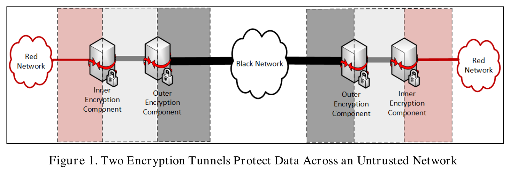
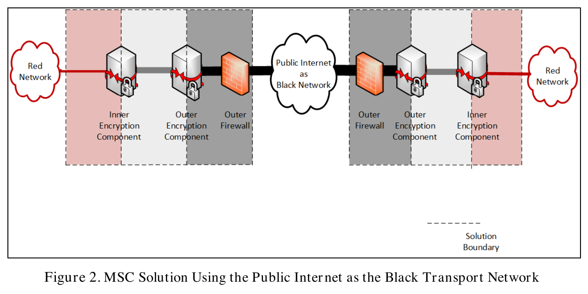
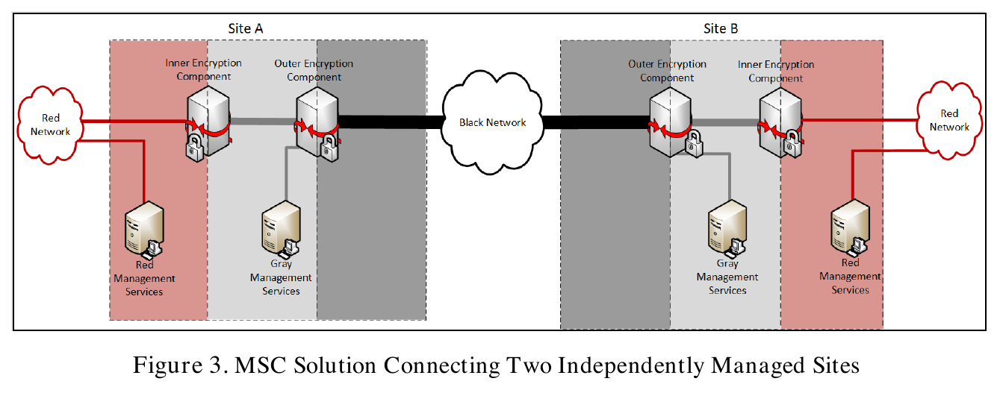
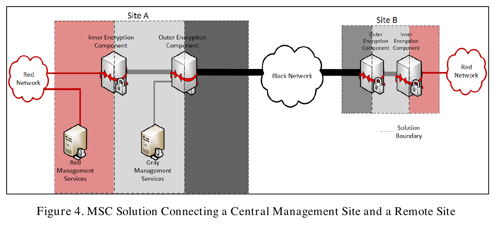
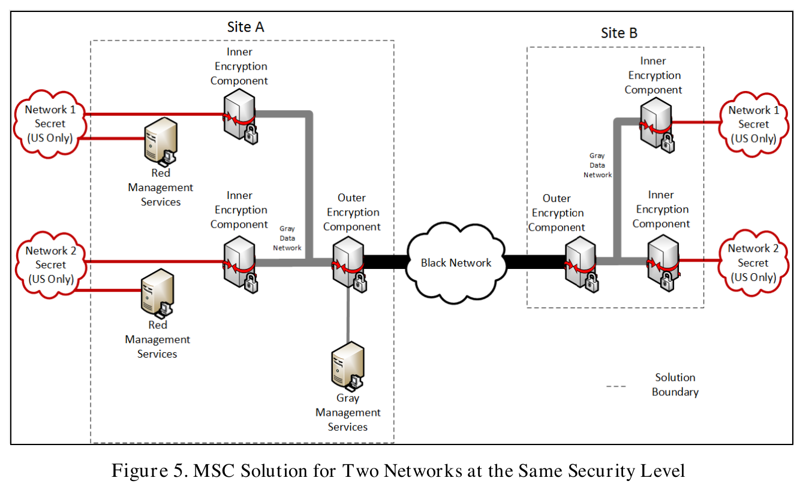
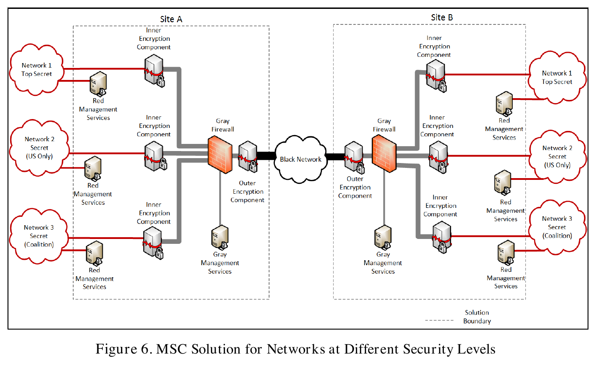
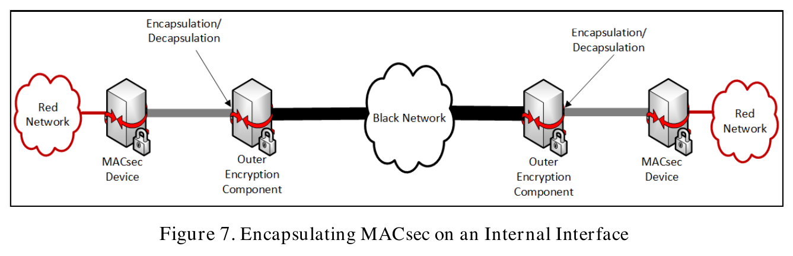
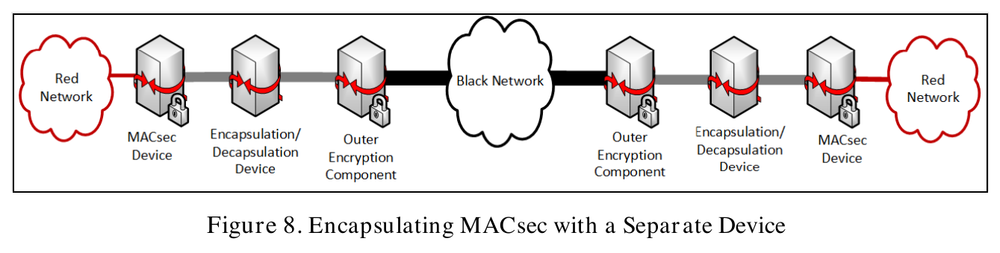
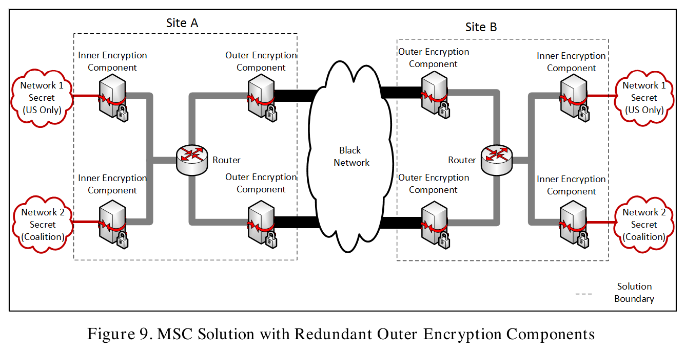

# Example networks

Concrete network topologies with identified components, network zones, and connections. Entries: 9.

[Protocol exchanges](protocol_exchanges.md) | [Partial configurations and alternatives](configurations.md)

Detailed assessments and verbatim source passages are in [network_requirement_links.md](network_requirement_links.md). Stable NET identifiers preserve references across categories.

The original assessments were authored by the extraction subagent and independently reviewed. Later user-directed corrections are recorded in [mapping decisions](mapping_decisions.json). The scripts replay those decisions, verify source references, and render the reports.

Statuses apply to the selected clauses and alternatives. Unmapped groups remain unassessed. General procurement, personnel, lifecycle, audit, and testing duties are not repeated for every schematic.

Explicit textual descriptions and applicable requirements supply details omitted from figures. Schematic connections do not establish a physical bypass of a textually required component. Genuine conflicts between textual statements remain open.

## NET-001: Two encryption tunnels across an untrusted network

Kind: topology. Requirement assessment: {presented_as_satisfying: 2, required_but_not_demonstrated: 3}.

**Figure 1. Two Encryption Tunnels Protect Data Across an Untrusted Network**

PDF page 10. [Caption text and source references](figure_captions.json).

Figure 1 presents nested encryption across untrusted transport. The explicit text supplies the required Outer Firewall omitted from the schematic. Product independence and physical implementation remain separate obligations.

| Requirement group | Selected clause | Assessment |
| --- | --- | --- |
| [RG-007: Two independent encryption layers and allowed tunnel pairings](../requirements/requirement_groups.md#rg-007) | Encrypt classified data first at the Inner component and then at the Outer component; decrypt in reverse order. | [Presented as satisfying](network_requirement_links.md#net-001-map-01) |
| [RG-008: Connectivity restricted to the same security level](../requirements/requirement_groups.md#rg-008) | Allow Red-to-Red communication only at the same security level. | [Required; implementation not demonstrated](network_requirement_links.md#net-001-map-02) |
| [RG-004: Independent product, operating-system, and cryptographic implementations](../requirements/requirement_groups.md#rg-004) | Use independent products, operating systems, and cryptographic implementations for the two layers. | [Required; implementation not demonstrated](network_requirement_links.md#net-001-map-03) |
| [RG-005: Physical separation of security components](../requirements/requirement_groups.md#rg-005) | Use physically separate Inner and Outer components. | [Required; implementation not demonstrated](network_requirement_links.md#net-001-map-04) |
| [RG-034: Outer Firewall placement for untrusted Black transport](../requirements/requirement_groups.md#rg-034) | Include an Outer Firewall when the Black transport meets the untrusted/Public Internet condition. | [Presented as satisfying](network_requirement_links.md#net-001-map-05) |

[Detailed assessments and source passages](network_requirement_links.md#net-001).

### Devices and aggregate services

| ID | Name | Location | Roles | Evidence basis |
| --- | --- | --- | --- | --- |
| NET-001-A-outer-1 | Outer Encryption Component | left side | ROLE-outer-encryption, ROLE-encryption-component | visual_interpretation |
| NET-001-A-inner-1 | Inner Encryption Component | left side | ROLE-inner-encryption, ROLE-encryption-component | visual_interpretation |
| NET-001-B-outer-1 | Outer Encryption Component | right side | ROLE-outer-encryption, ROLE-encryption-component | visual_interpretation |
| NET-001-B-inner-1 | Inner Encryption Component | right side | ROLE-inner-encryption, ROLE-encryption-component | visual_interpretation |

### Networks and zones

| ID | Name | Zone | Location | Evidence basis |
| --- | --- | --- | --- | --- |
| NET-001-black | Black Network | Black | between sides | visual_interpretation |
| NET-001-A-red-1 | Red Network | Red | left side | visual_interpretation |
| NET-001-B-red-1 | Red Network | Red | right side | visual_interpretation |

### Sites and boundaries

| Summary | Evidence basis |
| --- | --- |
| left side: no source-provided site name. | visual_interpretation |
| right side: no source-provided site name. | visual_interpretation |

### Recorded facts

| Summary | Evidence basis |
| --- | --- |
| The explicit untrusted-network requirement supplies the Outer Firewall omitted from Figure 1. It is located at the MSC edge and connects to the Black Network. | source_stated |

### Connections

| Endpoints | Description | Evidence basis |
| --- | --- | --- |
| NET-001-A-outer-1 ↔ NET-001-black | Line visibly connects the indicated endpoints. | visual_interpretation |
| NET-001-A-red-1 ↔ NET-001-A-inner-1 | Line visibly connects the indicated endpoints. | visual_interpretation |
| NET-001-A-inner-1 ↔ NET-001-A-outer-1 | Line visibly connects the indicated endpoints. | visual_interpretation |
| NET-001-B-outer-1 ↔ NET-001-black | Line visibly connects the indicated endpoints. | visual_interpretation |
| NET-001-B-red-1 ↔ NET-001-B-inner-1 | Line visibly connects the indicated endpoints. | visual_interpretation |
| NET-001-B-inner-1 ↔ NET-001-B-outer-1 | Line visibly connects the indicated endpoints. | visual_interpretation |
| NET-001-A-inner-1 ↔ NET-001-B-inner-1 | Inner encryption tunnel described in prose. | source_stated |
| NET-001-A-outer-1 ↔ NET-001-B-outer-1 | Outer encryption tunnel described in prose. | source_stated |

## NET-002: Public Internet as Black transport

Kind: topology. Requirement assessment: {presented_as_satisfying: 3, required_but_not_demonstrated: 1}.

**Figure 2. MSC Solution Using the Public Internet as the Black Transport Network**

PDF page 12. [Caption text and source references](figure_captions.json).

Figure 2 presents Outer Firewall placement and separation for Public Internet transport. Configured filtering and product eligibility require additional evidence.

| Requirement group | Selected clause | Assessment |
| --- | --- | --- |
| [RG-034: Outer Firewall placement for untrusted Black transport](../requirements/requirement_groups.md#rg-034) | Place an Outer Firewall between the Public Internet and each Outer Encryption Component. | [Presented as satisfying](network_requirement_links.md#net-002-map-01) |
| [RG-005: Physical separation of security components](../requirements/requirement_groups.md#rg-005) | Make the Outer Firewall physically separate from the Outer Encryption Component. | [Presented as satisfying](network_requirement_links.md#net-002-map-02) |
| [RG-035: Permitted protocols and peers at encryption and firewall boundaries](../requirements/requirement_groups.md#rg-035) | Describe the Outer Firewall ingress/egress protocol and Outer-component address restrictions. | [Presented as satisfying](network_requirement_links.md#net-002-map-03) |
| [RG-035: Permitted protocols and peers at encryption and firewall boundaries](../requirements/requirement_groups.md#rg-035) | Apply the complete MSC-PF-22 allowlist bidirectionally on all Outer Firewall interfaces. | [Required; implementation not demonstrated](network_requirement_links.md#net-002-map-04) |

[Detailed assessments and source passages](network_requirement_links.md#net-002).

### Devices and aggregate services

| ID | Name | Location | Roles | Evidence basis |
| --- | --- | --- | --- | --- |
| NET-002-A-outer-1 | Outer Encryption Component | left side | ROLE-outer-encryption, ROLE-encryption-component | visual_interpretation |
| NET-002-A-outer-fw | Outer Firewall | left side | ROLE-outer-firewall, ROLE-firewall | visual_interpretation |
| NET-002-A-inner-1 | Inner Encryption Component | left side | ROLE-inner-encryption, ROLE-encryption-component | visual_interpretation |
| NET-002-B-outer-1 | Outer Encryption Component | right side | ROLE-outer-encryption, ROLE-encryption-component | visual_interpretation |
| NET-002-B-outer-fw | Outer Firewall | right side | ROLE-outer-firewall, ROLE-firewall | visual_interpretation |
| NET-002-B-inner-1 | Inner Encryption Component | right side | ROLE-inner-encryption, ROLE-encryption-component | visual_interpretation |

### Networks and zones

| ID | Name | Zone | Location | Evidence basis |
| --- | --- | --- | --- | --- |
| NET-002-black | Public Internet as Black Network | Black | between sides | visual_interpretation |
| NET-002-A-red-1 | Red Network | Red | left side | visual_interpretation |
| NET-002-B-red-1 | Red Network | Red | right side | visual_interpretation |

### Interfaces

| Summary | Evidence basis |
| --- | --- |
| Outer Encryption Component external interface connects to Outer Firewall internal interface when the Black Network is the Public Internet. | source_stated |

### Sites and boundaries

| Summary | Evidence basis |
| --- | --- |
| left side: no source-provided site name. | visual_interpretation |
| right side: no source-provided site name. | visual_interpretation |

### Recorded facts

| Summary | Evidence basis |
| --- | --- |
| An Outer Firewall is required between an untrusted Black Network such as the Public Internet and the Outer Encryption Component. | source_stated |

### Connections

| Endpoints | Description | Evidence basis |
| --- | --- | --- |
| NET-002-A-outer-1 ↔ NET-002-A-outer-fw | Line visibly connects the indicated endpoints. | visual_interpretation |
| NET-002-A-outer-fw ↔ NET-002-black | Line visibly connects the indicated endpoints. | visual_interpretation |
| NET-002-A-red-1 ↔ NET-002-A-inner-1 | Line visibly connects the indicated endpoints. | visual_interpretation |
| NET-002-A-inner-1 ↔ NET-002-A-outer-1 | Line visibly connects the indicated endpoints. | visual_interpretation |
| NET-002-B-outer-1 ↔ NET-002-B-outer-fw | Line visibly connects the indicated endpoints. | visual_interpretation |
| NET-002-B-outer-fw ↔ NET-002-black | Line visibly connects the indicated endpoints. | visual_interpretation |
| NET-002-B-red-1 ↔ NET-002-B-inner-1 | Line visibly connects the indicated endpoints. | visual_interpretation |
| NET-002-B-inner-1 ↔ NET-002-B-outer-1 | Line visibly connects the indicated endpoints. | visual_interpretation |

## NET-003: Two independently managed sites

Kind: topology. Requirement assessment: {presented_as_satisfying: 2, required_but_not_demonstrated: 4}.

**Figure 3. MSC Solution Connecting Two Independently Managed Sites**

PDF page 14. [Caption text and source references](figure_captions.json).

Figure 3 presents independent site administration and nested tunnels. Peer interoperability, trust material, and authentication-server attachment depend on the selected components.

| Requirement group | Selected clause | Assessment |
| --- | --- | --- |
| [RG-010: Independently managed site administration and trust](../requirements/requirement_groups.md#rg-010) | Administer each site locally without management traffic crossing the Black Network. | [Presented as satisfying](network_requirement_links.md#net-003-map-01) |
| [RG-007: Two independent encryption layers and allowed tunnel pairings](../requirements/requirement_groups.md#rg-007) | Provide an Inner tunnel and an Outer tunnel between directly communicating sites. | [Presented as satisfying](network_requirement_links.md#net-003-map-02) |
| [RG-010: Independently managed site administration and trust](../requirements/requirement_groups.md#rg-010) | Provide peer signing certificates and revocation information, or a shared peer CAK under the selected authentication method. | [Required; implementation not demonstrated](network_requirement_links.md#net-003-map-03) |
| [RG-054: Interoperable components across communicating sites](../requirements/requirement_groups.md#rg-054) | Ensure the components selected at communicating sites interoperate. | [Required; implementation not demonstrated](network_requirement_links.md#net-003-map-04) |
| [RG-008: Connectivity restricted to the same security level](../requirements/requirement_groups.md#rg-008) | Restrict Inner VPN peers to Red Networks at the same security level. | [Required; implementation not demonstrated](network_requirement_links.md#net-003-map-05) |
| [RG-024: MACsec authentication alternatives and AS scope](../requirements/requirement_groups.md#rg-024) | Connect each MACsec Authentication Server to only one site network. | [Required; implementation not demonstrated](network_requirement_links.md#net-003-map-06) |

[Detailed assessments and source passages](network_requirement_links.md#net-003).

### Devices and aggregate services

| ID | Name | Location | Roles | Evidence basis |
| --- | --- | --- | --- | --- |
| NET-003-A-outer-1 | Outer Encryption Component | Site A | ROLE-outer-encryption, ROLE-encryption-component | visual_interpretation |
| NET-003-A-inner-1 | Inner Encryption Component | Site A | ROLE-inner-encryption, ROLE-encryption-component | visual_interpretation |
| NET-003-A-red-management-1 | Red Management Services | Site A | ROLE-red-management, ROLE-management-component | visual_interpretation |
| NET-003-A-gray-management | Gray Management Services | Site A | ROLE-gray-management, ROLE-management-component | visual_interpretation |
| NET-003-B-outer-1 | Outer Encryption Component | Site B | ROLE-outer-encryption, ROLE-encryption-component | visual_interpretation |
| NET-003-B-inner-1 | Inner Encryption Component | Site B | ROLE-inner-encryption, ROLE-encryption-component | visual_interpretation |
| NET-003-B-red-management-1 | Red Management Services | Site B | ROLE-red-management, ROLE-management-component | visual_interpretation |
| NET-003-B-gray-management | Gray Management Services | Site B | ROLE-gray-management, ROLE-management-component | visual_interpretation |

### Networks and zones

| ID | Name | Zone | Location | Evidence basis |
| --- | --- | --- | --- | --- |
| NET-003-black | Black Network | Black | between sides | visual_interpretation |
| NET-003-A-red-1 | Red Network | Red | Site A | visual_interpretation |
| NET-003-B-red-1 | Red Network | Red | Site B | visual_interpretation |

### Sites and boundaries

| Summary | Evidence basis |
| --- | --- |
| Site A: site label is present; dashed outline is shown. | visual_interpretation |
| Site B: site label is present; dashed outline is shown. | visual_interpretation |

### Recorded facts

| Summary | Evidence basis |
| --- | --- |
| Each site manages its own components. Management traffic does not cross the Black Network. Local or enterprise CAs may be used; peers must have required trust and revocation information. | source_stated |

### Connections

| Endpoints | Description | Evidence basis |
| --- | --- | --- |
| NET-003-A-outer-1 ↔ NET-003-black | Line visibly connects the indicated endpoints. | visual_interpretation |
| NET-003-A-red-1 ↔ NET-003-A-inner-1 | Line visibly connects the indicated endpoints. | visual_interpretation |
| NET-003-A-inner-1 ↔ NET-003-A-outer-1 | Line visibly connects the indicated endpoints. | visual_interpretation |
| NET-003-A-red-management-1 ↔ NET-003-A-red-1 | Line visibly connects the indicated endpoints. | visual_interpretation |
| NET-003-A-gray-management ↔ NET-003-A-outer-1 | Line visibly connects the indicated endpoints. | visual_interpretation |
| NET-003-B-outer-1 ↔ NET-003-black | Line visibly connects the indicated endpoints. | visual_interpretation |
| NET-003-B-red-1 ↔ NET-003-B-inner-1 | Line visibly connects the indicated endpoints. | visual_interpretation |
| NET-003-B-inner-1 ↔ NET-003-B-outer-1 | Line visibly connects the indicated endpoints. | visual_interpretation |
| NET-003-B-red-management-1 ↔ NET-003-B-red-1 | Line visibly connects the indicated endpoints. | visual_interpretation |
| NET-003-B-gray-management ↔ NET-003-B-outer-1 | Line visibly connects the indicated endpoints. | visual_interpretation |
| NET-003-A-inner-1 ↔ NET-003-B-inner-1 | Inner encryption tunnel described in prose. | source_stated |
| NET-003-A-outer-1 ↔ NET-003-B-outer-1 | Outer encryption tunnel described in prose. | source_stated |

## NET-004: Central Management Site and Remote Site

Kind: topology. Requirement assessment: {presented_as_satisfying: 2, required_but_not_demonstrated: 2}.

**Figure 4. MSC Solution Connecting a Central Management Site and a Remote Site**

PDF page 15. [Caption text and source references](figure_captions.json).

Figure 4 presents central administration and protected intersite management. CA/AS deployment, annex requirements, and MACsec Key Server configuration remain conditional obligations.

| Requirement group | Selected clause | Assessment |
| --- | --- | --- |
| [RG-011: Central management, CA placement, and intersite protection](../requirements/requirement_groups.md#rg-011) | Use one central management site and encrypt intersite management at least twice before Black transport. | [Presented as satisfying](network_requirement_links.md#net-004-map-01) |
| [RG-044: Layer-specific administration and management-plane separation](../requirements/requirement_groups.md#rg-044) | Place Red management with the Inner layer and Gray management with the Outer layer. | [Presented as satisfying](network_requirement_links.md#net-004-map-02) |
| [RG-011: Central management, CA placement, and intersite protection](../requirements/requirement_groups.md#rg-011) | Provide the applicable per-layer CAs, central EAP-TLS AS, and central Gray annex controls. | [Required; implementation not demonstrated](network_requirement_links.md#net-004-map-03) |
| [RG-027: MACsec key generation, key-server selection, and rollover](../requirements/requirement_groups.md#rg-027) | Configure the central-site MACsec peer as Key Server with value 0 and the other peer with value 1. | [Required; implementation not demonstrated](network_requirement_links.md#net-004-map-04) |

[Detailed assessments and source passages](network_requirement_links.md#net-004).

### Devices and aggregate services

| ID | Name | Location | Roles | Evidence basis |
| --- | --- | --- | --- | --- |
| NET-004-A-outer-1 | Outer Encryption Component | Site A | ROLE-outer-encryption, ROLE-encryption-component | visual_interpretation |
| NET-004-A-inner-1 | Inner Encryption Component | Site A | ROLE-inner-encryption, ROLE-encryption-component | visual_interpretation |
| NET-004-A-red-management-1 | Red Management Services | Site A | ROLE-red-management, ROLE-management-component | visual_interpretation |
| NET-004-A-gray-management | Gray Management Services | Site A | ROLE-gray-management, ROLE-management-component | visual_interpretation |
| NET-004-B-outer-1 | Outer Encryption Component | Site B | ROLE-outer-encryption, ROLE-encryption-component | visual_interpretation |
| NET-004-B-inner-1 | Inner Encryption Component | Site B | ROLE-inner-encryption, ROLE-encryption-component | visual_interpretation |

### Networks and zones

| ID | Name | Zone | Location | Evidence basis |
| --- | --- | --- | --- | --- |
| NET-004-black | Black Network | Black | between sides | visual_interpretation |
| NET-004-A-red-1 | Red Network | Red | Site A | visual_interpretation |
| NET-004-B-red-1 | Red Network | Red | Site B | visual_interpretation |

### Sites and boundaries

| Summary | Evidence basis |
| --- | --- |
| Site A: site label is present; dashed outline is shown. | visual_interpretation |
| Site B: site label is present; dashed outline is shown. | visual_interpretation |

### Recorded facts

| Summary | Evidence basis |
| --- | --- |
| Site A is the central management site and Site B is remote; additional sites may follow the remote-site design. | visual_interpretation |
| Remote management traversing the Black Network is encrypted at least twice. Gray central management refers to the Enterprise Gray annex. | source_stated |

### Connections

| Endpoints | Description | Evidence basis |
| --- | --- | --- |
| NET-004-A-outer-1 ↔ NET-004-black | Line visibly connects the indicated endpoints. | visual_interpretation |
| NET-004-A-red-1 ↔ NET-004-A-inner-1 | Line visibly connects the indicated endpoints. | visual_interpretation |
| NET-004-A-inner-1 ↔ NET-004-A-outer-1 | Line visibly connects the indicated endpoints. | visual_interpretation |
| NET-004-A-red-management-1 ↔ NET-004-A-red-1 | Line visibly connects the indicated endpoints. | visual_interpretation |
| NET-004-A-gray-management ↔ NET-004-A-outer-1 | Line visibly connects the indicated endpoints. | visual_interpretation |
| NET-004-B-outer-1 ↔ NET-004-black | Line visibly connects the indicated endpoints. | visual_interpretation |
| NET-004-B-red-1 ↔ NET-004-B-inner-1 | Line visibly connects the indicated endpoints. | visual_interpretation |
| NET-004-B-inner-1 ↔ NET-004-B-outer-1 | Line visibly connects the indicated endpoints. | visual_interpretation |

### Unknown details

| Unspecified information |
| --- |
| The figures do not enumerate all AW, CA, AS, SIEM, or KGS instances behind aggregate management-services symbols. |

## NET-005: Two networks at the same security level

Kind: topology. Requirement assessment: {ambiguous: 1, not_applicable: 1, presented_as_satisfying: 2, required_but_not_demonstrated: 2}.

**Figure 5. MSC Solution for Two Networks at the Same Security Level**

PDF page 17. [Caption text and source references](figure_captions.json).

Figure 5 presents two same-security-level Red Networks sharing an Outer component. Per-network management is depicted, while authentication wording and physical interface details remain unresolved.

| Requirement group | Selected clause | Assessment |
| --- | --- | --- |
| [RG-012: Separate authentication and management for security levels](../requirements/requirement_groups.md#rg-012) | Provide distinct Red Management Services and allow singly encrypted same-level traffic on the shared Gray Network. | [Presented as satisfying](network_requirement_links.md#net-005-map-01) |
| [RG-012: Separate authentication and management for security levels](../requirements/requirement_groups.md#rg-012) | Interpret the authentication separation intended for the two illustrated same-level networks. | [Ambiguous](network_requirement_links.md#net-005-map-02) |
| [RG-013: Gray Firewalls on all paths needing level separation](../requirements/requirement_groups.md#rg-013) | Require Gray Firewalls on paths between Inner components of different security levels. | [Not applicable to selected alternative](network_requirement_links.md#net-005-map-03) |
| [RG-053: Parallel Inner components and distinct Outer internal interfaces](../requirements/requirement_groups.md#rg-053) | Place multiple Inner components in parallel when sharing an Outer component. | [Presented as satisfying](network_requirement_links.md#net-005-map-04) |
| [RG-053: Parallel Inner components and distinct Outer internal interfaces](../requirements/requirement_groups.md#rg-053) | Give each Red Network a unique physical internal Outer-component interface. | [Required; implementation not demonstrated](network_requirement_links.md#net-005-map-05) |
| [RG-039: Outer Gray-interface allowlist and default denial](../requirements/requirement_groups.md#rg-039) | Permit only the appropriate same-security-level source/destination addresses on Outer Gray interfaces. | [Required; implementation not demonstrated](network_requirement_links.md#net-005-map-06) |

[Detailed assessments and source passages](network_requirement_links.md#net-005).

### Devices and aggregate services

| ID | Name | Location | Roles | Evidence basis |
| --- | --- | --- | --- | --- |
| NET-005-A-outer-1 | Outer Encryption Component | Site A | ROLE-outer-encryption, ROLE-encryption-component | visual_interpretation |
| NET-005-A-inner-1 | Inner Encryption Component | Site A Network 1 | ROLE-inner-encryption, ROLE-encryption-component | visual_interpretation |
| NET-005-A-red-management-1 | Red Management Services | Site A Network 1 | ROLE-red-management, ROLE-management-component | visual_interpretation |
| NET-005-A-inner-2 | Inner Encryption Component | Site A Network 2 | ROLE-inner-encryption, ROLE-encryption-component | visual_interpretation |
| NET-005-A-red-management-2 | Red Management Services | Site A Network 2 | ROLE-red-management, ROLE-management-component | visual_interpretation |
| NET-005-A-gray-management | Gray Management Services | Site A | ROLE-gray-management, ROLE-management-component | visual_interpretation |
| NET-005-B-outer-1 | Outer Encryption Component | Site B | ROLE-outer-encryption, ROLE-encryption-component | visual_interpretation |
| NET-005-B-inner-1 | Inner Encryption Component | Site B Network 1 | ROLE-inner-encryption, ROLE-encryption-component | visual_interpretation |
| NET-005-B-inner-2 | Inner Encryption Component | Site B Network 2 | ROLE-inner-encryption, ROLE-encryption-component | visual_interpretation |

### Networks and zones

| ID | Name | Zone | Location | Evidence basis |
| --- | --- | --- | --- | --- |
| NET-005-black | Black Network | Black | between sides | visual_interpretation |
| NET-005-A-gray-data | Gray Data Network | Gray | Site A | visual_interpretation |
| NET-005-A-red-1 | Network 1 Secret (US Only) | Red | Site A | visual_interpretation |
| NET-005-A-red-2 | Network 2 Secret (US Only) | Red | Site A | visual_interpretation |
| NET-005-B-gray-data | Gray Data Network | Gray | Site B | visual_interpretation |
| NET-005-B-red-1 | Network 1 Secret (US Only) | Red | Site B | visual_interpretation |
| NET-005-B-red-2 | Network 2 Secret (US Only) | Red | Site B | visual_interpretation |

### Sites and boundaries

| Summary | Evidence basis |
| --- | --- |
| Site A: site label is present; dashed outline is shown. | visual_interpretation |
| Site B: site label is present; dashed outline is shown. | visual_interpretation |

### Shared components

| Summary | Evidence basis |
| --- | --- |
| Site A shares one Outer Encryption Component among two inner components. | visual_interpretation |
| Site B shares one Outer Encryption Component among two inner components. | visual_interpretation |

### Recorded facts

| Summary | Evidence basis |
| --- | --- |
| Site A is the central management site and Site B is remote; additional sites may follow the remote-site design. | source_stated |
| Remote management traversing the Black Network is encrypted at least twice. Gray central management refers to the Enterprise Gray annex. | source_stated |
| Both Network 1 and Network 2 are Secret U.S.-only; the prose allows their singly encrypted traffic over the Gray Network without additional security controls in place. | source_stated |

### Connections

| Endpoints | Description | Evidence basis |
| --- | --- | --- |
| NET-005-A-outer-1 ↔ NET-005-black | Line visibly connects the indicated endpoints. | visual_interpretation |
| NET-005-A-gray-data ↔ NET-005-A-outer-1 | The figure labels the branching segment Gray Data Network. | visual_interpretation |
| NET-005-A-red-1 ↔ NET-005-A-inner-1 | Line visibly connects the indicated endpoints. | visual_interpretation |
| NET-005-A-inner-1 ↔ NET-005-A-gray-data | Drawn Gray-side connection; branching line denotes shared Gray connectivity. | visual_interpretation |
| NET-005-A-red-management-1 ↔ NET-005-A-red-1 | Line visibly connects the indicated endpoints. | visual_interpretation |
| NET-005-A-red-2 ↔ NET-005-A-inner-2 | Line visibly connects the indicated endpoints. | visual_interpretation |
| NET-005-A-inner-2 ↔ NET-005-A-gray-data | Drawn Gray-side connection; branching line denotes shared Gray connectivity. | visual_interpretation |
| NET-005-A-red-management-2 ↔ NET-005-A-red-2 | Line visibly connects the indicated endpoints. | visual_interpretation |
| NET-005-A-gray-management ↔ NET-005-A-outer-1 | Line visibly connects the indicated endpoints. | visual_interpretation |
| NET-005-B-outer-1 ↔ NET-005-black | Line visibly connects the indicated endpoints. | visual_interpretation |
| NET-005-B-gray-data ↔ NET-005-B-outer-1 | The figure labels the branching segment Gray Data Network. | visual_interpretation |
| NET-005-B-red-1 ↔ NET-005-B-inner-1 | Line visibly connects the indicated endpoints. | visual_interpretation |
| NET-005-B-inner-1 ↔ NET-005-B-gray-data | Drawn Gray-side connection; branching line denotes shared Gray connectivity. | visual_interpretation |
| NET-005-B-red-2 ↔ NET-005-B-inner-2 | Line visibly connects the indicated endpoints. | visual_interpretation |
| NET-005-B-inner-2 ↔ NET-005-B-gray-data | Drawn Gray-side connection; branching line denotes shared Gray connectivity. | visual_interpretation |

### Unknown details

| Unspecified information |
| --- |
| The figures do not enumerate all AW, CA, AS, SIEM, or KGS instances behind aggregate management-services symbols. |

### Open issues

| ID | Summary |
| --- | --- |
| NET-005-security-level-wording | The same-security-level subsection also says "Two Inner Encryption Components for networks of different security levels". Retain the wording without silently correcting its scope. |

## NET-006: Networks at different security levels

Kind: topology. Requirement assessment: {presented_as_satisfying: 3, required_but_not_demonstrated: 4}.

**Figure 6. MSC Solution for Networks at Different Security Levels**

PDF page 18. [Caption text and source references](figure_captions.json).

Figure 6 presents different-level isolation with Gray Firewalls and separate management. Address assignments, full ACLs, and unique Outer physical interfaces still need evidence.

| Requirement group | Selected clause | Assessment |
| --- | --- | --- |
| [RG-013: Gray Firewalls on all paths needing level separation](../requirements/requirement_groups.md#rg-013) | Place Gray Firewalls on physical Gray paths between Inner components of different security levels. | [Presented as satisfying](network_requirement_links.md#net-006-map-01) |
| [RG-008: Connectivity restricted to the same security level](../requirements/requirement_groups.md#rg-008) | Provide connectivity within each security level and prevent communication across levels. | [Presented as satisfying](network_requirement_links.md#net-006-map-02) |
| [RG-005: Physical separation of security components](../requirements/requirement_groups.md#rg-005) | Use standalone Gray Firewalls physically separate from Inner and Outer Encryption Components. | [Presented as satisfying](network_requirement_links.md#net-006-map-03) |
| [RG-040: Gray Firewall allowlist and cross-level denial](../requirements/requirement_groups.md#rg-040) | Configure the Gray Firewall same-level allowlist and cross-level denial rules. | [Required; implementation not demonstrated](network_requirement_links.md#net-006-map-04) |
| [RG-039: Outer Gray-interface allowlist and default denial](../requirements/requirement_groups.md#rg-039) | Apply the Outer Gray-interface same-level allowlist and default denial despite the Gray Firewalls. | [Required; implementation not demonstrated](network_requirement_links.md#net-006-map-05) |
| [RG-014: Gray addressing supports security-level filtering](../requirements/requirement_groups.md#rg-014) | Assign addresses unique to each security level to support the required peer filtering. | [Required; implementation not demonstrated](network_requirement_links.md#net-006-map-06) |
| [RG-053: Parallel Inner components and distinct Outer internal interfaces](../requirements/requirement_groups.md#rg-053) | Provide a unique physical Outer internal interface for each Red Network. | [Required; implementation not demonstrated](network_requirement_links.md#net-006-map-07) |

[Detailed assessments and source passages](network_requirement_links.md#net-006).

### Devices and aggregate services

| ID | Name | Location | Roles | Evidence basis |
| --- | --- | --- | --- | --- |
| NET-006-A-outer-1 | Outer Encryption Component | Site A | ROLE-outer-encryption, ROLE-encryption-component | visual_interpretation |
| NET-006-A-gray-fw | Gray Firewall | Site A | ROLE-gray-firewall, ROLE-firewall | visual_interpretation |
| NET-006-A-inner-1 | Inner Encryption Component | Site A Network 1 | ROLE-inner-encryption, ROLE-encryption-component | visual_interpretation |
| NET-006-A-red-management-1 | Red Management Services | Site A Network 1 | ROLE-red-management, ROLE-management-component | visual_interpretation |
| NET-006-A-inner-2 | Inner Encryption Component | Site A Network 2 | ROLE-inner-encryption, ROLE-encryption-component | visual_interpretation |
| NET-006-A-red-management-2 | Red Management Services | Site A Network 2 | ROLE-red-management, ROLE-management-component | visual_interpretation |
| NET-006-A-inner-3 | Inner Encryption Component | Site A Network 3 | ROLE-inner-encryption, ROLE-encryption-component | visual_interpretation |
| NET-006-A-red-management-3 | Red Management Services | Site A Network 3 | ROLE-red-management, ROLE-management-component | visual_interpretation |
| NET-006-A-gray-management | Gray Management Services | Site A | ROLE-gray-management, ROLE-management-component | visual_interpretation |
| NET-006-B-outer-1 | Outer Encryption Component | Site B | ROLE-outer-encryption, ROLE-encryption-component | visual_interpretation |
| NET-006-B-gray-fw | Gray Firewall | Site B | ROLE-gray-firewall, ROLE-firewall | visual_interpretation |
| NET-006-B-inner-1 | Inner Encryption Component | Site B Network 1 | ROLE-inner-encryption, ROLE-encryption-component | visual_interpretation |
| NET-006-B-red-management-1 | Red Management Services | Site B Network 1 | ROLE-red-management, ROLE-management-component | visual_interpretation |
| NET-006-B-inner-2 | Inner Encryption Component | Site B Network 2 | ROLE-inner-encryption, ROLE-encryption-component | visual_interpretation |
| NET-006-B-red-management-2 | Red Management Services | Site B Network 2 | ROLE-red-management, ROLE-management-component | visual_interpretation |
| NET-006-B-inner-3 | Inner Encryption Component | Site B Network 3 | ROLE-inner-encryption, ROLE-encryption-component | visual_interpretation |
| NET-006-B-red-management-3 | Red Management Services | Site B Network 3 | ROLE-red-management, ROLE-management-component | visual_interpretation |
| NET-006-B-gray-management | Gray Management Services | Site B | ROLE-gray-management, ROLE-management-component | visual_interpretation |

### Networks and zones

| ID | Name | Zone | Location | Evidence basis |
| --- | --- | --- | --- | --- |
| NET-006-black | Black Network | Black | between sides | visual_interpretation |
| NET-006-A-red-1 | Network 1 Top Secret | Red | Site A | visual_interpretation |
| NET-006-A-red-2 | Network 2 Secret (US Only) | Red | Site A | visual_interpretation |
| NET-006-A-red-3 | Network 3 Secret (Coalition) | Red | Site A | visual_interpretation |
| NET-006-B-red-1 | Network 1 Top Secret | Red | Site B | visual_interpretation |
| NET-006-B-red-2 | Network 2 Secret (US Only) | Red | Site B | visual_interpretation |
| NET-006-B-red-3 | Network 3 Secret (Coalition) | Red | Site B | visual_interpretation |

### Sites and boundaries

| Summary | Evidence basis |
| --- | --- |
| Site A: site label is present; dashed outline is shown. | visual_interpretation |
| Site B: site label is present; dashed outline is shown. | visual_interpretation |

### Shared components

| Summary | Evidence basis |
| --- | --- |
| Site A shares the Gray Firewall and one Outer Encryption Component among three inner components. | visual_interpretation |
| Site B shares the Gray Firewall and one Outer Encryption Component among three inner components. | visual_interpretation |

### Recorded facts

| Summary | Evidence basis |
| --- | --- |
| Gray Firewalls filter paths among inner components of different security levels; Outer Encryption Component filtering is still required. | source_stated |

### Connections

| Endpoints | Description | Evidence basis |
| --- | --- | --- |
| NET-006-A-outer-1 ↔ NET-006-black | Line visibly connects the indicated endpoints. | visual_interpretation |
| NET-006-A-gray-fw ↔ NET-006-A-outer-1 | Line visibly connects the indicated endpoints. | visual_interpretation |
| NET-006-A-red-1 ↔ NET-006-A-inner-1 | Line visibly connects the indicated endpoints. | visual_interpretation |
| NET-006-A-inner-1 ↔ NET-006-A-gray-fw | Drawn Gray-side connection; branching line denotes shared Gray connectivity. | visual_interpretation |
| NET-006-A-red-management-1 ↔ NET-006-A-red-1 | Line visibly connects the indicated endpoints. | visual_interpretation |
| NET-006-A-red-2 ↔ NET-006-A-inner-2 | Line visibly connects the indicated endpoints. | visual_interpretation |
| NET-006-A-inner-2 ↔ NET-006-A-gray-fw | Drawn Gray-side connection; branching line denotes shared Gray connectivity. | visual_interpretation |
| NET-006-A-red-management-2 ↔ NET-006-A-red-2 | Line visibly connects the indicated endpoints. | visual_interpretation |
| NET-006-A-red-3 ↔ NET-006-A-inner-3 | Line visibly connects the indicated endpoints. | visual_interpretation |
| NET-006-A-inner-3 ↔ NET-006-A-gray-fw | Drawn Gray-side connection; branching line denotes shared Gray connectivity. | visual_interpretation |
| NET-006-A-red-management-3 ↔ NET-006-A-red-3 | Line visibly connects the indicated endpoints. | visual_interpretation |
| NET-006-A-gray-management ↔ NET-006-A-gray-fw | Line visibly connects the indicated endpoints. | visual_interpretation |
| NET-006-B-outer-1 ↔ NET-006-black | Line visibly connects the indicated endpoints. | visual_interpretation |
| NET-006-B-gray-fw ↔ NET-006-B-outer-1 | Line visibly connects the indicated endpoints. | visual_interpretation |
| NET-006-B-red-1 ↔ NET-006-B-inner-1 | Line visibly connects the indicated endpoints. | visual_interpretation |
| NET-006-B-inner-1 ↔ NET-006-B-gray-fw | Drawn Gray-side connection; branching line denotes shared Gray connectivity. | visual_interpretation |
| NET-006-B-red-management-1 ↔ NET-006-B-red-1 | Line visibly connects the indicated endpoints. | visual_interpretation |
| NET-006-B-red-2 ↔ NET-006-B-inner-2 | Line visibly connects the indicated endpoints. | visual_interpretation |
| NET-006-B-inner-2 ↔ NET-006-B-gray-fw | Drawn Gray-side connection; branching line denotes shared Gray connectivity. | visual_interpretation |
| NET-006-B-red-management-2 ↔ NET-006-B-red-2 | Line visibly connects the indicated endpoints. | visual_interpretation |
| NET-006-B-red-3 ↔ NET-006-B-inner-3 | Line visibly connects the indicated endpoints. | visual_interpretation |
| NET-006-B-inner-3 ↔ NET-006-B-gray-fw | Drawn Gray-side connection; branching line denotes shared Gray connectivity. | visual_interpretation |
| NET-006-B-red-management-3 ↔ NET-006-B-red-3 | Line visibly connects the indicated endpoints. | visual_interpretation |
| NET-006-B-gray-management ↔ NET-006-B-gray-fw | Line visibly connects the indicated endpoints. | visual_interpretation |

## NET-007: MACsec encapsulation at the outer component internal interface

Kind: topology. Requirement assessment: {not_applicable: 1, presented_as_satisfying: 1, required_but_not_demonstrated: 1}.

**Figure 7. Encapsulating MACsec on an Internal Interface**

PDF page 19. [Caption text and source references](figure_captions.json).

Figure 7 presents encapsulation on the Outer component incoming interface. The separate-encapsulator condition is absent; protocol approval and deployed parameters remain unspecified.

| Requirement group | Selected clause | Assessment |
| --- | --- | --- |
| [RG-015: MACsec encapsulation and standalone encapsulator obligations](../requirements/requirement_groups.md#rg-015) | Encapsulate Inner MACsec traffic at the Outer incoming interface before applying Outer encryption. | [Presented as satisfying](network_requirement_links.md#net-007-map-01) |
| [RG-015: MACsec encapsulation and standalone encapsulator obligations](../requirements/requirement_groups.md#rg-015) | Treat a required standalone encapsulator as a Solution Component for Section 11.1. | [Not applicable to selected alternative](network_requirement_links.md#net-007-map-02) |
| [RG-015: MACsec encapsulation and standalone encapsulator obligations](../requirements/requirement_groups.md#rg-015) | Use an AO-approved encapsulation protocol. | [Required; implementation not demonstrated](network_requirement_links.md#net-007-map-03) |

[Detailed assessments and source passages](network_requirement_links.md#net-007).

### Devices and aggregate services

| ID | Name | Location | Roles | Evidence basis |
| --- | --- | --- | --- | --- |
| NET-007-A-outer-1 | Outer Encryption Component | left side | ROLE-outer-encryption, ROLE-encryption-component | visual_interpretation |
| NET-007-A-inner-1 | MACsec Device | left side | ROLE-inner-encryption, ROLE-encryption-component, ROLE-macsec-device, ROLE-inner-macsec | visual_interpretation |
| NET-007-B-outer-1 | Outer Encryption Component | right side | ROLE-outer-encryption, ROLE-encryption-component | visual_interpretation |
| NET-007-B-inner-1 | MACsec Device | right side | ROLE-inner-encryption, ROLE-encryption-component, ROLE-macsec-device, ROLE-inner-macsec | visual_interpretation |

### Networks and zones

| ID | Name | Zone | Location | Evidence basis |
| --- | --- | --- | --- | --- |
| NET-007-black | Black Network | Black | between sides | visual_interpretation |
| NET-007-A-red-1 | Red Network | Red | left side | visual_interpretation |
| NET-007-B-red-1 | Red Network | Red | right side | visual_interpretation |

### Interfaces

| Summary | Evidence basis |
| --- | --- |
| Encapsulation/Decapsulation arrows point to the Gray-facing internal interface of each Outer Encryption Component. | visual_interpretation |

### Sites and boundaries

| Summary | Evidence basis |
| --- | --- |
| left side: no source-provided site name. | visual_interpretation |
| right side: no source-provided site name. | visual_interpretation |

### Recorded facts

| Summary | Evidence basis |
| --- | --- |
| Inner MACsec traffic needs encapsulation before outer encryption. No single encapsulation protocol is mandated; L2TPv3 and Ethernet over MPLS are examples. | source_stated |

### Connections

| Endpoints | Description | Evidence basis |
| --- | --- | --- |
| NET-007-A-outer-1 ↔ NET-007-black | Line visibly connects the indicated endpoints. | visual_interpretation |
| NET-007-A-red-1 ↔ NET-007-A-inner-1 | Line visibly connects the indicated endpoints. | visual_interpretation |
| NET-007-A-inner-1 ↔ NET-007-A-outer-1 | Line visibly connects the indicated endpoints. | visual_interpretation |
| NET-007-B-outer-1 ↔ NET-007-black | Line visibly connects the indicated endpoints. | visual_interpretation |
| NET-007-B-red-1 ↔ NET-007-B-inner-1 | Line visibly connects the indicated endpoints. | visual_interpretation |
| NET-007-B-inner-1 ↔ NET-007-B-outer-1 | Line visibly connects the indicated endpoints. | visual_interpretation |

## NET-008: MACsec encapsulation by a separate device

Kind: topology. Requirement assessment: {ambiguous: 2, presented_as_satisfying: 1, required_but_not_demonstrated: 1}.

**Figure 8. Encapsulating MACsec with a Separate Device**

PDF page 20. [Caption text and source references](figure_captions.json).

Figure 8 presents a standalone encapsulator and its two interfaces. The scope and strength of the encapsulator controls conflict across prose and MSC-MD-13.

| Requirement group | Selected clause | Assessment |
| --- | --- | --- |
| [RG-015: MACsec encapsulation and standalone encapsulator obligations](../requirements/requirement_groups.md#rg-015) | Insert the standalone encapsulator between Inner MACsec and Outer encryption, with the stated internal/external attachments. | [Presented as satisfying](network_requirement_links.md#net-008-map-01) |
| [RG-015: MACsec encapsulation and standalone encapsulator obligations](../requirements/requirement_groups.md#rg-015) | Determine the standalone encapsulator boundary and applicable Solution Component controls. | [Ambiguous](network_requirement_links.md#net-008-map-02) |
| [RG-036: Minimal network-interface exposure](../requirements/requirement_groups.md#rg-036) | Apply minimal address/port/protocol exposure and disable unused interfaces on the standalone encapsulator. | [Ambiguous](network_requirement_links.md#net-008-map-03) |
| [RG-015: MACsec encapsulation and standalone encapsulator obligations](../requirements/requirement_groups.md#rg-015) | Use an AO-approved encapsulation protocol. | [Required; implementation not demonstrated](network_requirement_links.md#net-008-map-04) |

[Detailed assessments and source passages](network_requirement_links.md#net-008).

### Devices and aggregate services

| ID | Name | Location | Roles | Evidence basis |
| --- | --- | --- | --- | --- |
| NET-008-A-outer-1 | Outer Encryption Component | left side | ROLE-outer-encryption, ROLE-encryption-component | visual_interpretation |
| NET-008-A-inner-1 | MACsec Device | left side | ROLE-inner-encryption, ROLE-encryption-component, ROLE-macsec-device, ROLE-inner-macsec | visual_interpretation |
| NET-008-A-encap | Encapsulation/Decapsulation Device | left side | ROLE-encapsulation-device | visual_interpretation |
| NET-008-B-outer-1 | Outer Encryption Component | right side | ROLE-outer-encryption, ROLE-encryption-component | visual_interpretation |
| NET-008-B-inner-1 | MACsec Device | right side | ROLE-inner-encryption, ROLE-encryption-component, ROLE-macsec-device, ROLE-inner-macsec | visual_interpretation |
| NET-008-B-encap | Encapsulation/Decapsulation Device | right side | ROLE-encapsulation-device | visual_interpretation |

### Networks and zones

| ID | Name | Zone | Location | Evidence basis |
| --- | --- | --- | --- | --- |
| NET-008-black | Black Network | Black | between sides | visual_interpretation |
| NET-008-A-red-1 | Red Network | Red | left side | visual_interpretation |
| NET-008-B-red-1 | Red Network | Red | right side | visual_interpretation |

### Interfaces

| Summary | Evidence basis |
| --- | --- |
| Standalone device internal interface connects to the Inner MACsec Device; external interface connects to the Outer Encryption Component. | source_stated |

### Sites and boundaries

| Summary | Evidence basis |
| --- | --- |
| left side: no source-provided site name. | visual_interpretation |
| right side: no source-provided site name. | visual_interpretation |

### Recorded facts

| Summary | Evidence basis |
| --- | --- |
| Inner MACsec traffic needs encapsulation before outer encryption. No single encapsulation protocol is mandated; L2TPv3 and Ethernet over MPLS are examples. | source_stated |

### Connections

| Endpoints | Description | Evidence basis |
| --- | --- | --- |
| NET-008-A-outer-1 ↔ NET-008-black | Line visibly connects the indicated endpoints. | visual_interpretation |
| NET-008-A-red-1 ↔ NET-008-A-inner-1 | Line visibly connects the indicated endpoints. | visual_interpretation |
| NET-008-A-inner-1 ↔ NET-008-A-encap | Line visibly connects the indicated endpoints. | visual_interpretation |
| NET-008-A-encap ↔ NET-008-A-outer-1 | Line visibly connects the indicated endpoints. | visual_interpretation |
| NET-008-B-outer-1 ↔ NET-008-black | Line visibly connects the indicated endpoints. | visual_interpretation |
| NET-008-B-red-1 ↔ NET-008-B-inner-1 | Line visibly connects the indicated endpoints. | visual_interpretation |
| NET-008-B-inner-1 ↔ NET-008-B-encap | Line visibly connects the indicated endpoints. | visual_interpretation |
| NET-008-B-encap ↔ NET-008-B-outer-1 | Line visibly connects the indicated endpoints. | visual_interpretation |

### Open issues

| ID | Summary |
| --- | --- |
| NET-008-encapsulation-scope | PDF p19 and §5.5 require all Solution Component requirements for the standalone device. PDF p20 says the additional step falls outside the MSC Solution boundary and highly recommends DM/port filtering. MSC-MD-13 expressly applies §11.1. The source tension is unresolved. |

## NET-009: Redundant Outer Encryption Components

Kind: topology. Requirement assessment: {not_applicable: 1, presented_as_satisfying: 3, required_but_not_demonstrated: 2}.

**Figure 9. MSC Solution with Redundant Outer Encryption Components**

PDF page 22. [Caption text and source references](figure_captions.json).

Figure 9 presents redundant outer components and shared Gray routing. MSC-SR-7 supplies the required Gray Firewalls on paths between different security levels. Device counts, exact placement, filtering rules, and failover settings remain unspecified.

| Requirement group | Selected clause | Assessment |
| --- | --- | --- |
| [RG-074: Redundant component and load-balancing permission](../requirements/requirement_groups.md#rg-074) | Add parallel redundant Outer components with two Outer tunnels and a Gray router selecting an outbound component. | [Presented as satisfying](network_requirement_links.md#net-009-map-01) |
| [RG-013: Gray Firewalls on all paths needing level separation](../requirements/requirement_groups.md#rg-013) | Include a Gray Firewall on paths between Inner components of different security levels. | [Presented as satisfying](network_requirement_links.md#net-009-map-02) |
| [RG-031: Routing and switching limits on Encryption Components](../requirements/requirement_groups.md#rg-031) | Keep routing protocols off Outer Encryption Components. | [Required; implementation not demonstrated](network_requirement_links.md#net-009-map-03) |
| [RG-074: Redundant component and load-balancing permission](../requirements/requirement_groups.md#rg-074) | Apply Solution Component security requirements to the ordinary Gray router solely because it forwards redundancy traffic. | [Not applicable to selected alternative](network_requirement_links.md#net-009-map-04) |
| [RG-053: Parallel Inner components and distinct Outer internal interfaces](../requirements/requirement_groups.md#rg-053) | Place the multiple Inner components in parallel when sharing Outer components. | [Presented as satisfying](network_requirement_links.md#net-009-map-05) |
| [RG-053: Parallel Inner components and distinct Outer internal interfaces](../requirements/requirement_groups.md#rg-053) | Use a unique physical Outer internal interface for each Red Network. | [Required; implementation not demonstrated](network_requirement_links.md#net-009-map-06) |

[Detailed assessments and source passages](network_requirement_links.md#net-009).

### Devices and aggregate services

| ID | Name | Location | Roles | Evidence basis |
| --- | --- | --- | --- | --- |
| NET-009-A-outer-1 | Outer Encryption Component | Site A upper | ROLE-outer-encryption, ROLE-encryption-component | visual_interpretation |
| NET-009-A-outer-2 | Outer Encryption Component | Site A lower | ROLE-outer-encryption, ROLE-encryption-component | visual_interpretation |
| NET-009-A-router | Router | Site A | ROLE-router, ROLE-gray-router | visual_interpretation |
| NET-009-A-inner-1 | Inner Encryption Component | Site A Network 1 | ROLE-inner-encryption, ROLE-encryption-component | visual_interpretation |
| NET-009-A-inner-2 | Inner Encryption Component | Site A Network 2 | ROLE-inner-encryption, ROLE-encryption-component | visual_interpretation |
| NET-009-B-outer-1 | Outer Encryption Component | Site B upper | ROLE-outer-encryption, ROLE-encryption-component | visual_interpretation |
| NET-009-B-outer-2 | Outer Encryption Component | Site B lower | ROLE-outer-encryption, ROLE-encryption-component | visual_interpretation |
| NET-009-B-router | Router | Site B | ROLE-router, ROLE-gray-router | visual_interpretation |
| NET-009-B-inner-1 | Inner Encryption Component | Site B Network 1 | ROLE-inner-encryption, ROLE-encryption-component | visual_interpretation |
| NET-009-B-inner-2 | Inner Encryption Component | Site B Network 2 | ROLE-inner-encryption, ROLE-encryption-component | visual_interpretation |

### Networks and zones

| ID | Name | Zone | Location | Evidence basis |
| --- | --- | --- | --- | --- |
| NET-009-black | Black Network | Black | between sides | visual_interpretation |
| NET-009-A-red-1 | Network 1 Secret (US Only) | Red | Site A | visual_interpretation |
| NET-009-A-red-2 | Network 2 Secret (Coalition) | Red | Site A | visual_interpretation |
| NET-009-B-red-1 | Network 1 Secret (US Only) | Red | Site B | visual_interpretation |
| NET-009-B-red-2 | Network 2 Secret (Coalition) | Red | Site B | visual_interpretation |

### Sites and boundaries

| Summary | Evidence basis |
| --- | --- |
| Site A: site label is present; dashed outline is shown. | visual_interpretation |
| Site B: site label is present; dashed outline is shown. | visual_interpretation |

### Shared components

| Summary | Evidence basis |
| --- | --- |
| Site A shares a router and two Outer Encryption Components among two inner components. | visual_interpretation |
| Site B shares a router and two Outer Encryption Components among two inner components. | visual_interpretation |

### Recorded facts

| Summary | Evidence basis |
| --- | --- |
| Two outer tunnels connect upper and lower pairs; ordinary Gray routers select outbound outer components. Management components are omitted for clarity. | source_stated |
| MSC-SR-7 supplies the Gray Firewall requirement omitted from Figure 9: every physical Gray path between Inner components for different security levels includes a Gray Firewall. | source_stated |

### Connections

| Endpoints | Description | Evidence basis |
| --- | --- | --- |
| NET-009-A-outer-1 ↔ NET-009-black | Line visibly connects the indicated endpoints. | visual_interpretation |
| NET-009-A-outer-2 ↔ NET-009-black | Line visibly connects the indicated endpoints. | visual_interpretation |
| NET-009-A-router ↔ NET-009-A-outer-1 | Line visibly connects the indicated endpoints. | visual_interpretation |
| NET-009-A-router ↔ NET-009-A-outer-2 | Line visibly connects the indicated endpoints. | visual_interpretation |
| NET-009-A-red-1 ↔ NET-009-A-inner-1 | Line visibly connects the indicated endpoints. | visual_interpretation |
| NET-009-A-inner-1 ↔ NET-009-A-router | Drawn Gray-side connection; branching line denotes shared Gray connectivity. | visual_interpretation |
| NET-009-A-red-2 ↔ NET-009-A-inner-2 | Line visibly connects the indicated endpoints. | visual_interpretation |
| NET-009-A-inner-2 ↔ NET-009-A-router | Drawn Gray-side connection; branching line denotes shared Gray connectivity. | visual_interpretation |
| NET-009-B-outer-1 ↔ NET-009-black | Line visibly connects the indicated endpoints. | visual_interpretation |
| NET-009-B-outer-2 ↔ NET-009-black | Line visibly connects the indicated endpoints. | visual_interpretation |
| NET-009-B-router ↔ NET-009-B-outer-1 | Line visibly connects the indicated endpoints. | visual_interpretation |
| NET-009-B-router ↔ NET-009-B-outer-2 | Line visibly connects the indicated endpoints. | visual_interpretation |
| NET-009-B-red-1 ↔ NET-009-B-inner-1 | Line visibly connects the indicated endpoints. | visual_interpretation |
| NET-009-B-inner-1 ↔ NET-009-B-router | Drawn Gray-side connection; branching line denotes shared Gray connectivity. | visual_interpretation |
| NET-009-B-red-2 ↔ NET-009-B-inner-2 | Line visibly connects the indicated endpoints. | visual_interpretation |
| NET-009-B-inner-2 ↔ NET-009-B-router | Drawn Gray-side connection; branching line denotes shared Gray connectivity. | visual_interpretation |
| NET-009-A-outer-1 ↔ NET-009-B-outer-1 | Upper/lower pair outer tunnel. | source_stated |
| NET-009-A-outer-2 ↔ NET-009-B-outer-2 | Upper/lower pair outer tunnel. | source_stated |

### Unknown details

| Unspecified information |
| --- |
| The failover mechanism and the number and exact attachment points of the textually required Gray Firewalls are unspecified. |
