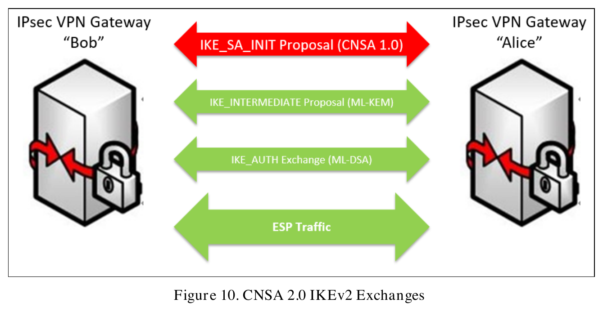

# Protocol exchanges

Message exchanges between protocol endpoints. Entries: 1.

[Example networks](networks.md) | [Partial configurations and alternatives](configurations.md)

Detailed assessments and verbatim source passages are in [network_requirement_links.md](network_requirement_links.md). Stable NET identifiers preserve references across categories.

The original assessments were authored by the extraction subagent and independently reviewed. Later user-directed corrections are recorded in [mapping decisions](mapping_decisions.json). The scripts replay those decisions, verify source references, and render the reports.

Statuses apply to the selected clauses and alternatives. Unmapped groups remain unassessed. General procurement, personnel, lifecycle, audit, and testing duties are not repeated for every schematic.

Explicit textual descriptions and applicable requirements supply details omitted from figures. Schematic connections do not establish a physical bypass of a textually required component. Genuine conflicts between textual statements remain open.

## NET-010: CNSA 2.0 IKEv2 peer exchange

Kind: protocol_exchange. Requirement assessment: {presented_as_satisfying: 1, required_but_not_demonstrated: 2}.

**Figure 10. CNSA 2.0 IKEv2 Exchanges**

PDF page 28. [Caption text and source references](figure_captions.json).

Figure 10 presents the CNSA 2.0 Objective exchange sequence. Full profile conformance and all tunnel algorithm settings are not established by the exchange arrows.

| Requirement group | Selected clause | Assessment |
| --- | --- | --- |
| [RG-019: IPsec CNSA profile and post-quantum exchange sequence](../requirements/requirement_groups.md#rg-019) | Use CNSA 1.0 in IKE_SA_INIT and ML-KEM in a subsequent IKE_INTERMEDIATE exchange. | [Presented as satisfying](network_requirement_links.md#net-010-map-01) |
| [RG-019: IPsec CNSA profile and post-quantum exchange sequence](../requirements/requirement_groups.md#rg-019) | Implement the complete Objective profile, including RFC 9370, RFC 9242, and RFC 7383. | [Required; implementation not demonstrated](network_requirement_links.md#net-010-map-02) |
| [RG-019: IPsec CNSA profile and post-quantum exchange sequence](../requirements/requirement_groups.md#rg-019) | Use the complete Table 7 algorithm suite for all IPsec tunnels except IKE_SA_INIT. | [Required; implementation not demonstrated](network_requirement_links.md#net-010-map-03) |

[Detailed assessments and source passages](network_requirement_links.md#net-010).

### Devices and aggregate services

| ID | Name | Location | Roles | Evidence basis |
| --- | --- | --- | --- | --- |
| NET-010-bob | Bob | left | ROLE-vpn-gateway | visual_interpretation |
| NET-010-alice | Alice | right | ROLE-vpn-gateway | visual_interpretation |

### Connections

| Endpoints | Description | Evidence basis |
| --- | --- | --- |
| NET-010-bob ↔ NET-010-alice | IKE_SA_INIT Proposal (CNSA 1.0) | visual_interpretation |
| NET-010-bob ↔ NET-010-alice | IKE_INTERMEDIATE Proposal (ML-KEM) | visual_interpretation |
| NET-010-bob ↔ NET-010-alice | IKE_AUTH Exchange (ML-DSA) | visual_interpretation |
| NET-010-bob ↔ NET-010-alice | ESP Traffic | visual_interpretation |

### Unknown details

| Unspecified information |
| --- |
| The exchange does not assign Bob or Alice to the inner or outer encryption layer. |
