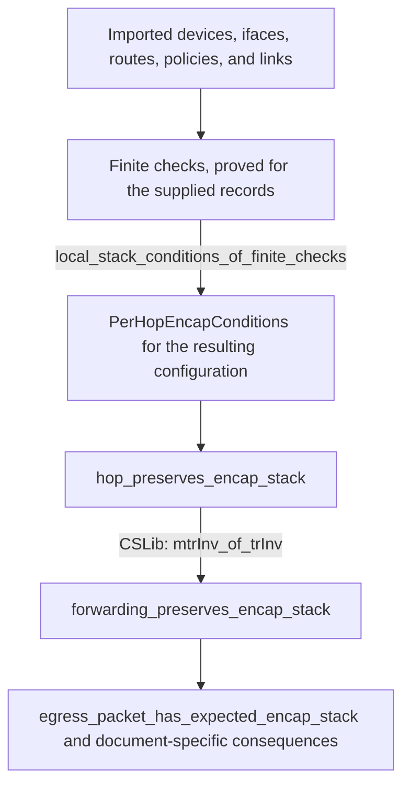

# Reusable network models and proofs in `TDN/Models`

`TDN/Models` provides network models and general proofs that can be applied to different configurations and snapshots. The modules describe packet processing, topology, filtering, encryption layers, authentication, fragmentation, generated replies, authenticated operations and cover traffic. A caller supplies the relevant configuration and proves the theorem's premises for that configuration.

The catalog covers all 115 active Lean files in `TDN/Models`. It indexes 1107 explicitly named declarations and 85 explicit instances. Each index links to its source line. Constructors, structure-field projections, and automatically derived declarations are represented by their parent types.

Each module section explains its purpose, principal results, and conditions for reuse. The expandable declaration index in each section links every named declaration to its source line. The source links are relative to the repository so they remain usable in another checkout and on GitHub.

## How to read the library

A **model** describes the states and operations considered by a proof. For example, `DataPlaneForwarding.Step` describes one packet-processing operation. An **invariant** is a condition that remains true after every permitted step when it is true initially. A **trace** is a finite sequence of permitted steps. A theorem about every trace can cover arbitrarily long finite executions without enumerating them.

A **predicate** is a condition on a value, such as whether a node is a firewall. A **contract** is an explicitly required guarantee from another model or implementation. A **soundness theorem** proves that passing a check is sufficient for the condition claimed by that check. An **induction proof** establishes an initial case and proves that one more permitted step preserves the result. The same argument then covers any finite number of steps.

An **assumption** or **premise** is a condition that must be supplied when applying a theorem. For example, a link may be required to connect interfaces with the same expected encryption stack. A **witness** is concrete supporting information, such as a path demonstrating connectivity. A **local check** verifies one of the required conditions from the supplied data. Local checks can compare several devices or inspect an entire finite rule list.

Lean declarations serve the following roles:

| Lean construct | Meaning in the library |
| --- | --- |
| `structure` | A record with named fields, such as a route or device. A structure ending in `: Prop` packages logical conditions that need proofs. |
| `inductive` | A type or relation defined by its permitted cases. The constructors of `DataPlaneForwarding.Step` specify which packet-processing steps exist. |
| `def` | A named computation or expression. A definition returning `Prop` states a condition, such as a required relationship between interfaces. |
| `abbrev` | A short name for another expression or type. |
| `lemma` | A checked supporting result, such as preservation by one step, a finite record check, or the assembly of local assumptions. |
| `theorem` | A checked principal result offered by the module, such as a reusable execution guarantee, a requirement result, or its application to a snapshot. |
| `Decidable P` | A method that determines whether proposition `P` holds and supplies a proof of the outcome. The finite-check modules provide instances for their supported conditions. |
| `by decide` | Ask Lean to use the available decision method to prove a concrete proposition. It operates on Lean values that have already been imported or defined. |
| `∀ x, ...` | The condition holds for every `x` of the stated type. |
| `∃ x, ...` | Some `x` satisfies the condition. Applying the result may reveal that witness. |
| `P → Q` | Given a proof of `P`, the result supplies a proof of `Q`. |
| `P ∧ Q` | Both conditions hold. |
| `P ∨ Q` | At least one of the conditions holds. |
| `system.Tr before action after` | One permitted step connects the two states with that action. |
| `system.MTr before actions after` | A finite trace connects the two states with the listed actions. |
| `system.TrInv property` | Every permitted step preserves `property`. |
| `Relation.ReflTransGen edge a b` | A path of zero or more edges connects `a` to `b`. |

A principal theorem retains that role when another theorem uses it. For example, `forwarding_preserves_encap_stack` is a reusable result supported by the lemma `hop_preserves_encap_stack`. Concrete evidence uses lemmas for edge checks, initial states, and local conditions, then theorems for the resulting network property. The choice of keyword depends on the result's role; a proof using `by decide` can establish either a supporting fact or a final result. Lean checks both kinds of proof in the same way.

The word **stack** means the ordered list of encryption-layer identifiers in a modeled packet. The first tag is the outermost layer. For example, `[2, 11]` describes Outer layer `2` surrounding Inner layer `11`. The tags identify protection layers in the proof. Actual addresses, protocol fields, and SPIs have separate fields.

An **interface** is a modeled connection point identified by a natural number. The configuration maps interfaces to their devices and interface names. The **expected encapsulation stack** assigns an expected protection-layer list to each interface: `expectedEncapStack : Nat → List Nat`. An interface might expect `[]` on Red, `[11]` on Gray, or `[2, 11]` on Black. The `expectedEncapStack` function supplies proof annotations whose consistency must be proved against the operational configuration. `TDN.DataPlaneForwarding.data_plane_ignores_encap_stack_annotations` establishes that changing only the stored stack annotations leaves the modeled operational configuration unchanged.

A **projection** maps a detailed state to the information retained by a simpler model. For example, a fragmented-packet state contains both a logical packet state and its pieces; a projection can retain only the logical state. A proof relating the models checks each detailed step and then transfers properties across complete traces. Some detailed steps can leave the projected state unchanged, as splitting a packet can leave its logical identity unchanged.

## Organization and dependencies

The modules separate general arguments from the finite data used to apply them. None of the 112 modules imports a snapshot, an instance module, or a document-specific target. Every direct project import stays within `TDN.Models`. Some modules describe broadly reusable mathematics; others describe a specific supported network mechanism or configuration pattern, such as authenticated fragment assembly.

| Topic | Starting modules | What a caller supplies |
| --- | --- | --- |
| [Topology and packet policy](#topology-and-packet-policy) | `Waypointing`, `DisjointAddressRanges`, `OrderedAclFilter`, `IpsecAndAclRuleModel` | Edges, labels, ranges, ordered rules, and coverage of relevant connections. |
| [IP packet execution](#ip-packet-execution) | `DataPlaneForwarding`, `EncapStackPreservation`, `TableDrivenDataPlane` | Devices, interfaces, routes, rules, policies, installed associations, links, and checked expected encapsulation stacks. |
| [MACsec and mixed-protocol execution](#macsec-and-mixed-protocol-execution) | `MacsecPortProtection`, `NestedTunnelFrame`, `MultiProtocolForwarding` | MACsec settings, associations, logical/physical interfaces, carriers, and their connection to IP processing. |
| [Generated replies](#generated-replies) | `KernelGeneratedReplies`, `IngressToOutputReplyPairChecks`, `SourceGuardedAutoReplyNetwork` | Reply-generation scope, source/output rules, route choices, and safety of allowed emissions. |
| [Fragments, copied bytes, and reassembly](#fragments-copied-bytes-and-reassembly) | `DatagramFragmentationAndSimulation`, `MultiPacketByteFlows`, `AuthenticatedCiphertextReassembly` | Byte origins, assembly rules, encodings, and any authentication contract. |
| [Trust and access](#trust-and-access) | `PkiAndPskTrustDomains`, `IkePeerSessionAgreement`, `MacsecKeyOriginModel`, `RoleBasedAccessControl` | Authority/key ownership, reciprocal peer observations, permitted key sources, and role permissions. |
| [Events and general trace arguments](#events-and-general-trace-arguments) | `PrerequisiteEventHistory`, `LocateTransitionStepInTrace`, `TraceCreditDebitBalance` | Event meanings, timestamps, prerequisites, step invariants, or per-step arithmetic equations. |
| [Packet sizes and cover traffic](#packet-sizes-and-cover-traffic) | `BlockAlignedEspLength`, `ConstantRateCoverTraffic` | Size budgets and the cover-traffic sender model. |

The packet-stack proof follows the dependency chain shown below. Each arrow means that the lower result uses the information or proof above it.



The finite checks and their soundness theorems avoid enumerating all possible packets. They inspect records such as rule atoms and address intervals, then prove that every packet matching those records has the required behavior. The graph and trace induction proofs extend those conditions to paths and executions of arbitrary finite length.

## Example: a finite edge check supports an arbitrary-path theorem

A four-node graph illustrates the complete proof structure. Nodes `0` and `1` connect to firewall `2`, which connects to node `3`. The graph has a real path from `0` to `3`. The property to prove is that every such path must visit the firewall.

```lean
import TDN.Models.Waypointing

namespace NetworkModelsGuide

def edge (a b : Fin 4) : Prop :=
  (a = 0 ∧ b = 1) ∨ (a = 1 ∧ b = 2) ∨ (a = 2 ∧ b = 3)

def firewall (node : Fin 4) : Prop := node = 2

def side (node : Fin 4) : Nat := if node = 3 then 1 else 0

lemma checked_edges : ∀ a b : Fin 4,
    edge a b → ¬ firewall a → ¬ firewall b → side a = side b := by
  unfold edge firewall
  decide

theorem no_bypass :
    ¬ Relation.ReflTransGen (TDN.Waypointing.Avoiding edge firewall) 0 3 := by
  exact TDN.Waypointing.waypointing_of_edge_invariant edge firewall side checked_edges
    (by unfold firewall; decide) (by decide)

end NetworkModelsGuide
```

`Fin 4` gives Lean exactly four possible nodes. `checked_edges` checks all endpoint pairs and proves that every edge whose endpoints are both outside the firewall preserves the side label. In the example, the remaining edge `0 → 1` preserves label `0`. The edges touching firewall `2` are excluded by the hypotheses.

`no_bypass` applies the existing general theorem. Its first supplied proof is `checked_edges`. `unfold edge firewall` exposes the definitions to the decision procedure. The two smaller proofs establish that node `0` is outside the firewall and that nodes `0` and `3` have different side labels. The library's induction argument then excludes every finite firewall-avoiding path between the endpoints. A different graph changes the data and edge checks while retaining that general argument.

## Example: checked local processing determines the transmitted stack

The packet theorem states exactly which conditions connect local processing to a two-layer result. In the following example, `checks` is a proof of all `PerHopEncapConditions` for configuration `c` and expected stacks `expectedEncapStack`. A snapshot application can obtain that proof using the finite-check modules.

```lean
import TDN.Models.EncapStackPreservation

open TDN.DataPlaneForwarding

example (env : DataPlaneModel) (expectedEncapStack : Nat → List Nat)
    (checks : PerHopEncapConditions env expectedEncapStack)
    (inner outer : Nat) (initialState finalState : State) (actions : List Action)
    (run : ForwardsAlongTrace env initialState actions finalState)
    (initial : EncapStackConsistent env expectedEncapStack initialState)
    (ready : finalState.datapathStage = .egressReady)
    (blackIface : expectedEncapStack finalState.iface = [outer, inner]) :
    finalState.frame.encapLayerIds = [outer, inner] := by
  have stack := egress_packet_has_expected_encap_stack env expectedEncapStack checks run initial ready
  exact stack.trans blackIface
```

The premises identify a permitted finite execution, a valid starting state, a final state ready for transmission, and a final interface assigned the two-layer expected stack. `egress_packet_has_expected_encap_stack` proves that the final frame's tags equal the expected stack at that interface. `stack.trans blackIface` combines the two equalities to obtain `[outer, inner]`.

`PerHopEncapConditions` is where the network-specific proof work enters the argument. Its fields require evidence about route ownership, links, switching, accepted forwarding and local output, and routing after encryption. `ExecutionEvents.nested_stack_requires_ordered_encryptions` can additionally identify the Inner and Outer encryption events in order when its placement and initial-stack premises hold.

## Applying the modules to another network

A new network application starts by choosing the behavior needed for its requirement. A topology requirement can use `Waypointing`; a packet-protection requirement needs an execution model that includes the relevant forwarding, encryption, switching, and delivery steps. Generated replies, fragment movement, and mixed protocols require the corresponding extensions when they can affect the claim.

1. Import the relevant modules and state the desired property for a configuration parameter.
2. Populate the supported device, interface, policy, route, and observation records from the new network. Preserve every choice covered by the model, including equally selected policies or routes.
3. Supply supporting information such as expected interface encapsulation stacks, domain membership, graph labels, or concrete paths. Keep the meaning of those values explicit.
4. Prove the required checks over the records. Use `by decide` for supported concrete finite propositions. If a check fails, inspect the configuration, translation, and chosen sufficient conditions before changing any general theorem.
5. Apply the appropriate soundness theorem to obtain the general local premises. Apply the path or execution theorem to derive the required consequence.
6. When the requirement includes useful communication, provide a separate accepted packet or delivery trace. A safety theorem can also hold for a configuration that drops all traffic.

The proof applies to the behavior represented by the model and its supplied premises. Deployment claims also require faithful collection, correct translation, and a justified relationship between actual processing and modeled steps. A snapshot supplies fixed-state observations; claims about changing configuration, protocol convergence, or real-time scheduling need models and evidence for those changes.

## External Lean libraries used

The implementation uses Lean 4.34.1 and the dependency revisions recorded in [lakefile.toml](../lakefile.toml) and [lean-toolchain](../lean-toolchain). The module import lists show exactly which libraries each source file uses.

| Library | Used capabilities | Pinned revision or version |
| --- | --- | --- |
| CSLib | `LTS`, one-step relations, finite traces, invariant lifting through `mtrInv_of_trInv`, and simulation between transition systems. | `990e65a685bed413f43b139db900a36ad5322a10` |
| Mathlib | Reflexive/transitive graph paths, list reasoning, bounded natural numbers, arithmetic support, and monotonicity. | `d13f23b723b8a846827a245b89c10fc7d3f11612` |
| Lean and Std | Core types, decidability, and the `omega` arithmetic tactic. | Lean `v4.34.1` |

`Models` defines network behavior and the premises connecting its records. CSLib supplies general trace reasoning, and Mathlib supplies general mathematical facts. For example, `EncapStackPreservation` first proves preservation for each network step, then calls `Cslib.LTS.mtrInv_of_trInv` to extend preservation to every finite trace.

## Complete module catalog

The catalog groups all modules by their primary purpose. Namespaces are listed separately because several files extend a shared namespace. For example, declarations from `FiniteExecution.lean` are named `TDN.DataPlaneForwarding.*` even though their import path is `TDN.Models.TableDrivenDataPlane`.

## Topology and packet policy

[Waypointing](#waypointing), [DisjointAddressRanges](#disjointaddressranges), [UnifiedIpv4Ipv6AddressKey](#unifiedipv4ipv6addresskey), [OrderedAclFilter](#orderedaclfilter), [IpsecAndAclRuleModel](#ipsecandaclrulemodel), [IpHeaderAclGuards](#ipheaderaclguards)

### Waypointing

Source: [Waypointing.lean](../TDN/Models/Waypointing.lean). Namespace: `TDN.Waypointing`.

`Waypointing` turns an edge-level check into a statement about every finite path. You supply the graph, a predicate identifying the acceptable waypoints, and a `region` label for each node. Firewalls are one application of that waypoint set. [`Avoiding`](../TDN/Models/Waypointing.lean#L5) permits an edge only when its destination is outside the waypoint set; the theorems separately require a starting node outside that set.

[`waypoint_free_path_preserves_region`](../TDN/Models/Waypointing.lean#L8) proves that a path avoiding the waypoints preserves its starting label when every edge outside the waypoint set does so. [`waypointing_of_edge_invariant`](../TDN/Models/Waypointing.lean#L17) then excludes waypoint-free paths between differently labeled endpoints. [`path_avoids_absent_waypoints`](../TDN/Models/Waypointing.lean#L25) establishes that every graph path avoids the waypoint set when that set is empty. A requirement proof can combine that result with an existing connection to show that a mandatory waypoint must exist.

A new topology supplies new edges and labels. The proofs stay unchanged. The graph must include every connection relevant to the claimed path property.

Direct imports: `Mathlib.Logic.Relation`.

<details>
<summary>All 4 named declarations in Waypointing</summary>

| Kind | Declaration |
| --- | --- |
| `def` | [`Avoiding`](../TDN/Models/Waypointing.lean#L5) |
| `theorem` | [`waypoint_free_path_preserves_region`](../TDN/Models/Waypointing.lean#L8) |
| `theorem` | [`waypointing_of_edge_invariant`](../TDN/Models/Waypointing.lean#L17) |
| `lemma` | [`path_avoids_absent_waypoints`](../TDN/Models/Waypointing.lean#L25) |

</details>

### DisjointAddressRanges

Source: [DisjointAddressRanges.lean](../TDN/Models/DisjointAddressRanges.lean). Namespace: `TDN.Addressing`.

`DisjointAddressRanges` associates inclusive numeric address ranges with arbitrary labels. [`Range`](../TDN/Models/DisjointAddressRanges.lean#L6) stores `low`, `high`, and `label`; [`Contains`](../TDN/Models/DisjointAddressRanges.lean#L12) tests membership, and [`Owns`](../TDN/Models/DisjointAddressRanges.lean#L15) connects an address to the label of a containing range.

[`Separated`](../TDN/Models/DisjointAddressRanges.lean#L18) requires ranges with different labels to be disjoint. [`separated_ranges_unique_label`](../TDN/Models/DisjointAddressRanges.lean#L21) proves that an address cannot belong to two different labels under that condition. A network can use security levels or tenant identifiers as labels. The importer must supply the ranges and their intended labels; the library proves the relationship between those supplied records.

Direct imports: `Mathlib.Data.List.Basic`, `Lean.Elab.Tactic.Omega`.

<details>
<summary>All 5 named declarations in DisjointAddressRanges</summary>

| Kind | Declaration |
| --- | --- |
| `structure` | [`Range`](../TDN/Models/DisjointAddressRanges.lean#L6) |
| `def` | [`Contains`](../TDN/Models/DisjointAddressRanges.lean#L12) |
| `def` | [`Owns`](../TDN/Models/DisjointAddressRanges.lean#L15) |
| `def` | [`Separated`](../TDN/Models/DisjointAddressRanges.lean#L18) |
| `theorem` | [`separated_ranges_unique_label`](../TDN/Models/DisjointAddressRanges.lean#L21) |

</details>

### UnifiedIpv4Ipv6AddressKey

Source: [UnifiedIpv4Ipv6AddressKey.lean](../TDN/Models/UnifiedIpv4Ipv6AddressKey.lean). Namespace: `TDN.InternetAddresses`.

`UnifiedIpv4Ipv6AddressKey` gives IPv4 and IPv6 addresses distinct numeric representations. [`encode4`](../TDN/Models/UnifiedIpv4Ipv6AddressKey.lean#L6) uses the value of a bounded 32-bit address. [`encode6`](../TDN/Models/UnifiedIpv4Ipv6AddressKey.lean#L7) adds `2^128` to a bounded 128-bit address. The three encoding theorems prove that each encoding preserves address identity and that the two families never collide.

[`headerWords`](../TDN/Models/UnifiedIpv4Ipv6AddressKey.lean#L24) returns five for an IPv4 key and zero for other keys. [`ipv6_has_no_ipv4_ihl`](../TDN/Models/UnifiedIpv4Ipv6AddressKey.lean#L26) verifies the IPv6 case. The function supplies the modeled base-header length when creating an outer header. It does not parse arbitrary IPv4 options or IPv6 extension headers.

Direct imports: `Mathlib.Data.Fin.Basic`, `Lean.Elab.Tactic.Omega`.

<details>
<summary>All 7 named declarations in UnifiedIpv4Ipv6AddressKey</summary>

| Kind | Declaration |
| --- | --- |
| `def` | [`encode4`](../TDN/Models/UnifiedIpv4Ipv6AddressKey.lean#L6) |
| `def` | [`encode6`](../TDN/Models/UnifiedIpv4Ipv6AddressKey.lean#L7) |
| `theorem` | [`families_have_disjoint_keys`](../TDN/Models/UnifiedIpv4Ipv6AddressKey.lean#L9) |
| `theorem` | [`ipv4_encoding_injective`](../TDN/Models/UnifiedIpv4Ipv6AddressKey.lean#L15) |
| `theorem` | [`ipv6_encoding_injective`](../TDN/Models/UnifiedIpv4Ipv6AddressKey.lean#L18) |
| `def` | [`headerWords`](../TDN/Models/UnifiedIpv4Ipv6AddressKey.lean#L24) |
| `theorem` | [`ipv6_has_no_ipv4_ihl`](../TDN/Models/UnifiedIpv4Ipv6AddressKey.lean#L26) |

</details>

### OrderedAclFilter

Source: [OrderedAclFilter.lean](../TDN/Models/OrderedAclFilter.lean). Namespace: `TDN.Filter`.

`OrderedAclFilter` evaluates an ordered list of rules. Each [`Rule`](../TDN/Models/OrderedAclFilter.lean#L9) contains a Boolean match function and an allow-or-deny [`Verdict`](../TDN/Models/OrderedAclFilter.lean#L5). [`evaluate`](../TDN/Models/OrderedAclFilter.lean#L13) returns the verdict of the first matching rule, or the supplied fallback when every rule misses.

[`default_deny_sound`](../TDN/Models/OrderedAclFilter.lean#L31) proves that every accepted packet has a desired property when the fallback denies traffic and every allow rule guarantees that property. [`rejects_outside_allowlist`](../TDN/Models/OrderedAclFilter.lean#L38) gives the corresponding rejection result. [`accepts_at_first_matching_rule`](../TDN/Models/OrderedAclFilter.lean#L61) proves positive acceptance after checking that earlier rules miss. [`denying_prefix_blocks`](../TDN/Models/OrderedAclFilter.lean#L69) proves rejection when an initial sequence of deny rules contains a match. [`HasUsefulTraffic`](../TDN/Models/OrderedAclFilter.lean#L46) states that at least one useful packet is accepted; a caller must supply that witness.

The packet type and match functions are parameters, so the results apply to several policy models.

Direct imports: `Mathlib.Data.List.Basic`.

<details>
<summary>All 10 named declarations in OrderedAclFilter</summary>

| Kind | Declaration |
| --- | --- |
| `inductive` | [`Verdict`](../TDN/Models/OrderedAclFilter.lean#L5) |
| `structure` | [`Rule`](../TDN/Models/OrderedAclFilter.lean#L9) |
| `def` | [`evaluate`](../TDN/Models/OrderedAclFilter.lean#L13) |
| `lemma` | [`allowed_has_matching_allow`](../TDN/Models/OrderedAclFilter.lean#L18) |
| `theorem` | [`default_deny_sound`](../TDN/Models/OrderedAclFilter.lean#L31) |
| `theorem` | [`rejects_outside_allowlist`](../TDN/Models/OrderedAclFilter.lean#L38) |
| `def` | [`HasUsefulTraffic`](../TDN/Models/OrderedAclFilter.lean#L46) |
| `lemma` | [`evaluate_skips_nonmatching_prefix`](../TDN/Models/OrderedAclFilter.lean#L50) |
| `theorem` | [`accepts_at_first_matching_rule`](../TDN/Models/OrderedAclFilter.lean#L61) |
| `theorem` | [`denying_prefix_blocks`](../TDN/Models/OrderedAclFilter.lean#L69) |

</details>

### IpsecAndAclRuleModel

Source: [IpsecAndAclRuleModel.lean](../TDN/Models/IpsecAndAclRuleModel.lean). Namespace: `TDN.PacketPolicy`.

`IpsecAndAclRuleModel` supplies the concrete packet fields and rule conditions used by the execution models. [`Packet`](../TDN/Models/IpsecAndAclRuleModel.lean#L5) includes addresses, protocol, interfaces, transport ports, header fields, connection state, and inbound/outbound IPsec-policy identifiers. [`MatchCondition`](../TDN/Models/IpsecAndAclRuleModel.lean#L98) describes one condition on those fields. A [`Rule`](../TDN/Models/IpsecAndAclRuleModel.lean#L159) matches only when every atom holds.

[`Rule.toFilter`](../TDN/Models/IpsecAndAclRuleModel.lean#L164) connects those records to the ordered evaluator in `OrderedAclFilter`. [`matching_atom`](../TDN/Models/IpsecAndAclRuleModel.lean#L167) recovers any atom's condition from a successful match. [`RequiresIpsecPolicyMatch`](../TDN/Models/IpsecAndAclRuleModel.lean#L181) requires the appropriate interface direction and an inbound or outbound policy condition. [`forwarding_policy_protects`](../TDN/Models/IpsecAndAclRuleModel.lean#L211) proves that every accepted packet has one of those guarded directions when every allow rule is guarded and the fallback denies traffic.

The result concerns policy metadata on the modeled packet. The execution modules connect outbound policy selection to an encryption operation and installed state.

The boundary proofs also inspect packet contents. `IKEHeader` checks the represented IKE version and message length. The UDP framing conditions distinguish IKE and encapsulated ESP, account for IPv4 header options, and handle reply ports explicitly. `MKAFraming` checks the supported Ethernet control-frame layout and actor identity. Size and byte-field atoms let ordered filter rules impose the same conditions. These checks establish the listed packet-format conditions; authentication depends on the separate protocol and credential models.

Direct imports: [OrderedAclFilter](#orderedaclfilter).

<details>
<summary>All 19 named declarations in IpsecAndAclRuleModel</summary>

| Kind | Declaration |
| --- | --- |
| `structure` | [`Packet`](../TDN/Models/IpsecAndAclRuleModel.lean#L5) |
| `def` | [`IKEHeader`](../TDN/Models/IpsecAndAclRuleModel.lean#L28) |
| `def` | [`Packet.IPv4FragmentOffsetDecoded`](../TDN/Models/IpsecAndAclRuleModel.lean#L38) |
| `def` | [`Packet.IPsecUDPFraming`](../TDN/Models/IpsecAndAclRuleModel.lean#L43) |
| `def` | [`Packet.IPsecUDPFramingWithOptions`](../TDN/Models/IpsecAndAclRuleModel.lean#L58) |
| `def` | [`Packet.IPsecUDPReplyFramingWithOptions`](../TDN/Models/IpsecAndAclRuleModel.lean#L74) |
| `def` | [`byteField`](../TDN/Models/IpsecAndAclRuleModel.lean#L84) |
| `def` | [`Packet.MKAFraming`](../TDN/Models/IpsecAndAclRuleModel.lean#L87) |
| `inductive` | [`MatchCondition`](../TDN/Models/IpsecAndAclRuleModel.lean#L98) |
| `def` | [`MatchCondition.matchesPacket`](../TDN/Models/IpsecAndAclRuleModel.lean#L126) |
| `structure` | [`Rule`](../TDN/Models/IpsecAndAclRuleModel.lean#L159) |
| `def` | [`Rule.toFilter`](../TDN/Models/IpsecAndAclRuleModel.lean#L164) |
| `lemma` | [`matching_atom`](../TDN/Models/IpsecAndAclRuleModel.lean#L167) |
| `def` | [`OutboundGuard`](../TDN/Models/IpsecAndAclRuleModel.lean#L173) |
| `def` | [`InboundGuard`](../TDN/Models/IpsecAndAclRuleModel.lean#L177) |
| `def` | [`RequiresIpsecPolicyMatch`](../TDN/Models/IpsecAndAclRuleModel.lean#L181) |
| `def` | [`ProtectedForward`](../TDN/Models/IpsecAndAclRuleModel.lean#L192) |
| `lemma` | [`guarded_rule_protects`](../TDN/Models/IpsecAndAclRuleModel.lean#L196) |
| `theorem` | [`forwarding_policy_protects`](../TDN/Models/IpsecAndAclRuleModel.lean#L211) |

Explicit instances:

- [Instance at line 34](../TDN/Models/IpsecAndAclRuleModel.lean#L34)
- [Instance at line 54](../TDN/Models/IpsecAndAclRuleModel.lean#L54)
- [Instance at line 69](../TDN/Models/IpsecAndAclRuleModel.lean#L69)
- [Instance at line 79](../TDN/Models/IpsecAndAclRuleModel.lean#L79)
- [Instance at line 94](../TDN/Models/IpsecAndAclRuleModel.lean#L94)
- [Instance at line 156](../TDN/Models/IpsecAndAclRuleModel.lean#L156)
- [Instance at line 184](../TDN/Models/IpsecAndAclRuleModel.lean#L184)

</details>

### IpHeaderAclGuards

Source: [IpHeaderAclGuards.lean](../TDN/Models/IpHeaderAclGuards.lean). Namespace: `TDN.PacketPolicy`.

`IpHeaderAclGuards` derives header restrictions from the atoms in every allow rule. [`ProtocolGuard`](../TDN/Models/IpHeaderAclGuards.lean#L5) selects an allowed protocol. [`ImmediateHeaderGuard`](../TDN/Models/IpHeaderAclGuards.lean#L40) restricts the immediate IPv6 next-header field. [`UnicastGuard`](../TDN/Models/IpHeaderAclGuards.lean#L12) either excludes the external interface or excludes a specified destination interval.

[`accepted_protocol`](../TDN/Models/IpHeaderAclGuards.lean#L30), [`accepted_immediate_header`](../TDN/Models/IpHeaderAclGuards.lean#L47), and [`accepted_header_words`](../TDN/Models/IpHeaderAclGuards.lean#L56) prove the corresponding restriction for any accepted packet. [`accepted_external_unicast`](../TDN/Models/IpHeaderAclGuards.lean#L64) excludes the supplied destination interval for traffic entering through the external interface. A caller supplies the interval to exclude, such as a multicast range. All four results use default-deny evaluation and checks over the complete allow-rule list.

Direct imports: [IpsecAndAclRuleModel](#ipsecandaclrulemodel).

<details>
<summary>All 8 named declarations in IpHeaderAclGuards</summary>

| Kind | Declaration |
| --- | --- |
| `def` | [`ProtocolGuard`](../TDN/Models/IpHeaderAclGuards.lean#L5) |
| `def` | [`UnicastGuard`](../TDN/Models/IpHeaderAclGuards.lean#L12) |
| `abbrev` | [`Accepts`](../TDN/Models/IpHeaderAclGuards.lean#L27) |
| `theorem` | [`accepted_protocol`](../TDN/Models/IpHeaderAclGuards.lean#L30) |
| `def` | [`ImmediateHeaderGuard`](../TDN/Models/IpHeaderAclGuards.lean#L40) |
| `theorem` | [`accepted_immediate_header`](../TDN/Models/IpHeaderAclGuards.lean#L47) |
| `theorem` | [`accepted_header_words`](../TDN/Models/IpHeaderAclGuards.lean#L56) |
| `theorem` | [`accepted_external_unicast`](../TDN/Models/IpHeaderAclGuards.lean#L64) |

Explicit instances:

- [Instance at line 8](../TDN/Models/IpHeaderAclGuards.lean#L8)
- [Instance at line 18](../TDN/Models/IpHeaderAclGuards.lean#L18)
- [Instance at line 43](../TDN/Models/IpHeaderAclGuards.lean#L43)

</details>

## IP packet execution

[DataPlaneForwarding](#dataplaneforwarding), [EncapStackPreservation](#encapstackpreservation), [PerHopForwardingChecks](#perhopforwardingchecks), [TableDrivenDataPlane](#tabledrivendataplane), [RouteAwareAclChecks](#routeawareaclchecks), [EnclaveIsolationInvariants](#enclaveisolationinvariants), [TableDrivenEnclaveChecks](#tabledrivenenclavechecks), [TunnelSaOriginAttribution](#tunnelsaoriginattribution), [InboundIpsecSelectorPreservation](#inboundipsecselectorpreservation), [BoundaryDecryptionRequired](#boundarydecryptionrequired), [EncapDecapBalance](#encapdecapbalance), [TunnelEncryptionEvents](#tunnelencryptionevents), [BlackTransitPayloadOpacity](#blacktransitpayloadopacity)

### DataPlaneForwarding

Source: [DataPlaneForwarding.lean](../TDN/Models/DataPlaneForwarding.lean). Namespace: `TDN.DataPlaneForwarding`.

`DataPlaneForwarding` defines the packet-processing steps shared by the IPsec proofs. A [`State`](../TDN/Models/DataPlaneForwarding.lean#L44) contains an interface, a processing phase, a [`Frame`](../TDN/Models/DataPlaneForwarding.lean#L18), and the policy identifiers authenticated at ingress. The frame stores the current header, payload identity, origin domain, saved encapsulation layers, and the entry interface. Each [`EncapHeaderLayer`](../TDN/Models/DataPlaneForwarding.lean#L14) preserves the preceding header so that decryption can restore it.

[`DataPlaneModel`](../TDN/Models/DataPlaneForwarding.lean#L110) supplies routes, INPUT/FORWARD/OUTPUT rules and fallback verdicts, IPsec policies, installed security associations, interface names, device ownership, links, switching, local addresses, and Red payload origins. [`IpsecPolicy`](../TDN/Models/DataPlaneForwarding.lean#L50) represents a policy and its selectors. [`InstalledSA`](../TDN/Models/DataPlaneForwarding.lean#L63) represents installed state. [`saMatchesPolicy`](../TDN/Models/DataPlaneForwarding.lean#L70) checks the local request identifier, endpoints, and any required SPI. [`lookupSpdPolicies`](../TDN/Models/DataPlaneForwarding.lean#L82) retains all equally best matching policies.

[`SelectedFibRoute`](../TDN/Models/DataPlaneForwarding.lean#L104) chooses among matching routes for the same ingress: lowest table priority first, then longest prefix, then lowest metric. Equal choices remain possible. [`Step`](../TDN/Models/DataPlaneForwarding.lean#L155) describes receipt, route selection, filtering, encryption, decryption, transmission, switching, local delivery, and dropping. Encryption requires both a selected policy and matching installed state. Plain transmission after filtering requires that no outbound policy was selected.

The preservation theorems retain payload identity, origin domain, and original addresses across every finite execution. The policy-atom results connect a matched outbound-policy condition to a configured operation and exclude the plain-transmission case. [`matched_forwarding`](../TDN/Models/DataPlaneForwarding.lean#L324) transfers an execution to another model when the caller proves that each detailed step maps to an allowed step in that model. The route and policy records remain fixed throughout each execution.

Direct imports: `Cslib.Foundations.Semantics.LTS.Simulation`, [IpsecAndAclRuleModel](#ipsecandaclrulemodel), [UnifiedIpv4Ipv6AddressKey](#unifiedipv4ipv6addresskey).

<details>
<summary>All 35 named declarations in DataPlaneForwarding</summary>

| Kind | Declaration |
| --- | --- |
| `structure` | [`TunnelSAStamp`](../TDN/Models/DataPlaneForwarding.lean#L7) |
| `structure` | [`EncapHeaderLayer`](../TDN/Models/DataPlaneForwarding.lean#L14) |
| `structure` | [`Frame`](../TDN/Models/DataPlaneForwarding.lean#L18) |
| `def` | [`payloadAddresses`](../TDN/Models/DataPlaneForwarding.lean#L25) |
| `def` | [`Frame.addresses`](../TDN/Models/DataPlaneForwarding.lean#L29) |
| `lemma` | [`payload_addresses_ignore_metadata`](../TDN/Models/DataPlaneForwarding.lean#L32) |
| `inductive` | [`DatapathStage`](../TDN/Models/DataPlaneForwarding.lean#L39) |
| `structure` | [`State`](../TDN/Models/DataPlaneForwarding.lean#L44) |
| `structure` | [`IpsecPolicy`](../TDN/Models/DataPlaneForwarding.lean#L50) |
| `structure` | [`InstalledSA`](../TDN/Models/DataPlaneForwarding.lean#L63) |
| `def` | [`saMatchesPolicy`](../TDN/Models/DataPlaneForwarding.lean#L70) |
| `def` | [`IpsecPolicy.seal`](../TDN/Models/DataPlaneForwarding.lean#L75) |
| `def` | [`IpsecPolicy.matches`](../TDN/Models/DataPlaneForwarding.lean#L78) |
| `def` | [`lookupSpdPolicies`](../TDN/Models/DataPlaneForwarding.lean#L82) |
| `inductive` | [`Action`](../TDN/Models/DataPlaneForwarding.lean#L87) |
| `structure` | [`FibRoute`](../TDN/Models/DataPlaneForwarding.lean#L91) |
| `def` | [`FibRoute.matches`](../TDN/Models/DataPlaneForwarding.lean#L101) |
| `def` | [`SelectedFibRoute`](../TDN/Models/DataPlaneForwarding.lean#L104) |
| `structure` | [`DataPlaneModel`](../TDN/Models/DataPlaneForwarding.lean#L110) |
| `def` | [`policyPacket`](../TDN/Models/DataPlaneForwarding.lean#L130) |
| `def` | [`accepts`](../TDN/Models/DataPlaneForwarding.lean#L137) |
| `def` | [`encrypt`](../TDN/Models/DataPlaneForwarding.lean#L141) |
| `inductive` | [`Step`](../TDN/Models/DataPlaneForwarding.lean#L155) |
| `def` | [`lts`](../TDN/Models/DataPlaneForwarding.lean#L226) |
| `def` | [`ForwardsAlongTrace`](../TDN/Models/DataPlaneForwarding.lean#L228) |
| `lemma` | [`step_preserves_payload`](../TDN/Models/DataPlaneForwarding.lean#L232) |
| `lemma` | [`step_preserves_original_addresses`](../TDN/Models/DataPlaneForwarding.lean#L237) |
| `theorem` | [`forwarding_preserves_original_addresses`](../TDN/Models/DataPlaneForwarding.lean#L258) |
| `theorem` | [`plaintext_delivery_retains_addresses`](../TDN/Models/DataPlaneForwarding.lean#L266) |
| `theorem` | [`forwarding_preserves_payload`](../TDN/Models/DataPlaneForwarding.lean#L275) |
| `lemma` | [`matched_policy_is_configured`](../TDN/Models/DataPlaneForwarding.lean#L286) |
| `theorem` | [`outbound_policy_atom_selects_operation`](../TDN/Models/DataPlaneForwarding.lean#L294) |
| `lemma` | [`outbound_policy_atom_excludes_plain`](../TDN/Models/DataPlaneForwarding.lean#L305) |
| `lemma` | [`simulation_of_step_map`](../TDN/Models/DataPlaneForwarding.lean#L315) |
| `theorem` | [`matched_forwarding`](../TDN/Models/DataPlaneForwarding.lean#L324) |

</details>

### EncapStackPreservation

Source: [EncapStackPreservation.lean](../TDN/Models/EncapStackPreservation.lean). Namespace: `TDN.DataPlaneForwarding`.

`EncapStackPreservation` assigns an expected list of encryption-layer identifiers to each interface through `expectedEncapStack : Nat → List Nat`. [`Frame.encapLayerIds`](../TDN/Models/EncapStackPreservation.lean#L5) reads the actual tags in the modeled encapLayers. [`encapStackAfterIngress`](../TDN/Models/EncapStackPreservation.lean#L8) accounts for a successful inbound decryption by removing the first expected tag. [`EncapStackConsistent`](../TDN/Models/EncapStackPreservation.lean#L61) states the appropriate relationship for each processing phase.

[`PerHopEncapConditions`](../TDN/Models/EncapStackPreservation.lean#L32) packages six kinds of premises: routes stay within a device; links preserve the expected stack; switching preserves the processing stack; accepted forwarding rules produce the expected output stack; locally generated output does the same; and routing after encryption preserves the resulting stack. The conditions cover every selected policy, including ties.

[`hop_preserves_encap_stack`](../TDN/Models/EncapStackPreservation.lean#L91) checks every constructor of `DataPlaneForwarding.Step`. [`forwarding_preserves_encap_stack`](../TDN/Models/EncapStackPreservation.lean#L143) applies CSLib's general induction result to any finite execution. [`egress_packet_has_expected_encap_stack`](../TDN/Models/EncapStackPreservation.lean#L152) concludes that a state ready for transmission has exactly the stack assigned to its interface. A new network supplies a configuration, expected encapsulation stacks, and proofs of the local conditions.

Direct imports: [DataPlaneForwarding](#dataplaneforwarding).

<details>
<summary>All 12 named declarations in EncapStackPreservation</summary>

| Kind | Declaration |
| --- | --- |
| `def` | [`Frame.encapLayerIds`](../TDN/Models/EncapStackPreservation.lean#L5) |
| `def` | [`encapStackAfterIngress`](../TDN/Models/EncapStackPreservation.lean#L8) |
| `def` | [`LocalAuthentication`](../TDN/Models/EncapStackPreservation.lean#L12) |
| `def` | [`ProcessingInvariant`](../TDN/Models/EncapStackPreservation.lean#L16) |
| `def` | [`AcceptedHook`](../TDN/Models/EncapStackPreservation.lean#L22) |
| `def` | [`RoutedFrame`](../TDN/Models/EncapStackPreservation.lean#L28) |
| `structure` | [`PerHopEncapConditions`](../TDN/Models/EncapStackPreservation.lean#L32) |
| `def` | [`EncapStackConsistent`](../TDN/Models/EncapStackPreservation.lean#L61) |
| `lemma` | [`accepted_hook_stack_effect`](../TDN/Models/EncapStackPreservation.lean#L79) |
| `lemma` | [`hop_preserves_encap_stack`](../TDN/Models/EncapStackPreservation.lean#L91) |
| `theorem` | [`forwarding_preserves_encap_stack`](../TDN/Models/EncapStackPreservation.lean#L143) |
| `theorem` | [`egress_packet_has_expected_encap_stack`](../TDN/Models/EncapStackPreservation.lean#L152) |

</details>

### PerHopForwardingChecks

Source: [PerHopForwardingChecks.lean](../TDN/Models/PerHopForwardingChecks.lean). Namespace: `TDN.DataPlaneForwarding`.

`PerHopForwardingChecks` reduces a packet-dependent stack obligation to checks on rule records. [`IfaceCompatible`](../TDN/Models/PerHopForwardingChecks.lean#L6) checks interface constraints. [`ImpossibleAuthentication`](../TDN/Models/PerHopForwardingChecks.lean#L12) finds an inbound-policy requirement absent from the known authentication list. [`ExcludesSelector`](../TDN/Models/PerHopForwardingChecks.lean#L22) finds address ranges that cannot match a policy. [`HasOutboundGuard`](../TDN/Models/PerHopForwardingChecks.lean#L17) identifies a required outbound policy.

[`RuleStackCheck`](../TDN/Models/PerHopForwardingChecks.lean#L82) combines those tests: either the rule cannot apply, or plain and encrypted forwarding produce the required stack. [`checked_rule_stack_effect`](../TDN/Models/PerHopForwardingChecks.lean#L90) proves that conclusion for a matching rule. [`checked_hook_stack_effect`](../TDN/Models/PerHopForwardingChecks.lean#L121) extends the argument to an accepted packet under a default-deny rule list. The checks are sufficient conditions; a failure can require a more precise argument about why a rule is unreachable.

Direct imports: [EncapStackPreservation](#encapstackpreservation), `Lean.Elab.Tactic.Omega`.

<details>
<summary>All 10 named declarations in PerHopForwardingChecks</summary>

| Kind | Declaration |
| --- | --- |
| `def` | [`IfaceCompatible`](../TDN/Models/PerHopForwardingChecks.lean#L6) |
| `def` | [`ImpossibleAuthentication`](../TDN/Models/PerHopForwardingChecks.lean#L12) |
| `def` | [`HasOutboundGuard`](../TDN/Models/PerHopForwardingChecks.lean#L17) |
| `def` | [`ExcludesSelector`](../TDN/Models/PerHopForwardingChecks.lean#L22) |
| `lemma` | [`matched_ifaces_compatible`](../TDN/Models/PerHopForwardingChecks.lean#L56) |
| `lemma` | [`matching_authentication_possible`](../TDN/Models/PerHopForwardingChecks.lean#L63) |
| `lemma` | [`excluded_selector_cannot_match`](../TDN/Models/PerHopForwardingChecks.lean#L70) |
| `def` | [`RuleStackCheck`](../TDN/Models/PerHopForwardingChecks.lean#L82) |
| `lemma` | [`checked_rule_stack_effect`](../TDN/Models/PerHopForwardingChecks.lean#L90) |
| `theorem` | [`checked_hook_stack_effect`](../TDN/Models/PerHopForwardingChecks.lean#L121) |

Explicit instances:

- [Instance at line 29](../TDN/Models/PerHopForwardingChecks.lean#L29)
- [Instance at line 35](../TDN/Models/PerHopForwardingChecks.lean#L35)
- [Instance at line 42](../TDN/Models/PerHopForwardingChecks.lean#L42)
- [Instance at line 48](../TDN/Models/PerHopForwardingChecks.lean#L48)

</details>

### TableDrivenDataPlane

Source: [TableDrivenDataPlane.lean](../TDN/Models/TableDrivenDataPlane.lean). Namespace: `TDN.DataPlaneForwarding`.

`TableDrivenDataPlane` builds `DataPlaneForwarding.DataPlaneModel` from finite lists of devices, interfaces, routes, links, and switch connections. [`DeviceData`](../TDN/Models/TableDrivenDataPlane.lean#L5) holds policies, rules, installed state, local addresses, and a recipient domain. [`IfaceData`](../TDN/Models/TableDrivenDataPlane.lean#L18) holds its owner, interface name, expected stack, and whether it originates payload traffic. [`deviceAt`](../TDN/Models/TableDrivenDataPlane.lean#L25) and [`ifaceAt`](../TDN/Models/TableDrivenDataPlane.lean#L28) return default records for indices outside their lists.

[`possibleAuthentications`](../TDN/Models/TableDrivenDataPlane.lean#L64) enumerates the empty authentication list and the singleton lists allowed by the inbound policies and interface stack. [`TableDrivenForwardChecks`](../TDN/Models/TableDrivenDataPlane.lean#L94), [`TableDrivenOutputChecks`](../TDN/Models/TableDrivenDataPlane.lean#L135), and [`TableDrivenOuterRoutes`](../TDN/Models/TableDrivenDataPlane.lean#L168) state checks over finite records. The soundness theorems prove that those checks imply the corresponding obligations for arbitrary modeled packets. [`local_stack_conditions_of_finite_checks`](../TDN/Models/TableDrivenDataPlane.lean#L202) assembles the results into [`PerHopEncapConditions`](../TDN/Models/EncapStackPreservation.lean#L32).

The checks include default records because the general configuration accepts any natural-number interface index. Snapshot applications can prove the finite propositions with `by decide`, then reuse the general soundness theorems.

Direct imports: [PerHopForwardingChecks](#perhopforwardingchecks).

<details>
<summary>All 18 named declarations in TableDrivenDataPlane</summary>

| Kind | Declaration |
| --- | --- |
| `structure` | [`DeviceData`](../TDN/Models/TableDrivenDataPlane.lean#L5) |
| `structure` | [`IfaceData`](../TDN/Models/TableDrivenDataPlane.lean#L18) |
| `def` | [`deviceAt`](../TDN/Models/TableDrivenDataPlane.lean#L25) |
| `def` | [`ifaceAt`](../TDN/Models/TableDrivenDataPlane.lean#L28) |
| `def` | [`dataPlaneModelFromRecords`](../TDN/Models/TableDrivenDataPlane.lean#L31) |
| `def` | [`expectedEncapStackFromRecords`](../TDN/Models/TableDrivenDataPlane.lean#L52) |
| `lemma` | [`iface_at_member_or_default`](../TDN/Models/TableDrivenDataPlane.lean#L55) |
| `def` | [`possibleAuthentications`](../TDN/Models/TableDrivenDataPlane.lean#L64) |
| `lemma` | [`valid_authentication_in_finite_list`](../TDN/Models/TableDrivenDataPlane.lean#L67) |
| `def` | [`RecordRuleCheck`](../TDN/Models/TableDrivenDataPlane.lean#L82) |
| `def` | [`TableDrivenForwardChecks`](../TDN/Models/TableDrivenDataPlane.lean#L94) |
| `theorem` | [`table_driven_forward_checks_sound`](../TDN/Models/TableDrivenDataPlane.lean#L104) |
| `def` | [`TableDrivenOutputChecks`](../TDN/Models/TableDrivenDataPlane.lean#L135) |
| `theorem` | [`table_driven_output_checks_sound`](../TDN/Models/TableDrivenDataPlane.lean#L143) |
| `def` | [`TableDrivenOuterRoutes`](../TDN/Models/TableDrivenDataPlane.lean#L168) |
| `theorem` | [`table_driven_outer_routes_sound`](../TDN/Models/TableDrivenDataPlane.lean#L178) |
| `lemma` | [`device_at_member_or_default`](../TDN/Models/TableDrivenDataPlane.lean#L193) |
| `theorem` | [`local_stack_conditions_of_finite_checks`](../TDN/Models/TableDrivenDataPlane.lean#L202) |

Explicit instances:

- [Instance at line 91](../TDN/Models/TableDrivenDataPlane.lean#L91)
- [Instance at line 101](../TDN/Models/TableDrivenDataPlane.lean#L101)
- [Instance at line 140](../TDN/Models/TableDrivenDataPlane.lean#L140)
- [Instance at line 175](../TDN/Models/TableDrivenDataPlane.lean#L175)

</details>

### RouteAwareAclChecks

Source: [RouteAwareAclChecks.lean](../TDN/Models/RouteAwareAclChecks.lean). Namespace: `TDN.DataPlaneForwarding`.

`RouteAwareAclChecks` uses the selected route to narrow the forwarding-rule check. [`ExcludesRoute`](../TDN/Models/RouteAwareAclChecks.lean#L5) detects a rule whose destination range cannot intersect a route. [`withRoute`](../TDN/Models/RouteAwareAclChecks.lean#L27) adds the route's destination range to the rule's conditions for the proof.

[`TableDrivenRoutedForwardChecks`](../TDN/Models/RouteAwareAclChecks.lean#L38) examines route, authentication, and allow-rule combinations. Each combination must be impossible or satisfy the stack check with the route restriction included. [`table_driven_routed_forward_checks_sound`](../TDN/Models/RouteAwareAclChecks.lean#L53) proves the packet-level conclusion. [`local_stack_conditions_of_routed_finite_checks`](../TDN/Models/RouteAwareAclChecks.lean#L86) combines those checks with link, switch, output, route-ownership, and post-encryption-route checks. The imported operational rules remain unchanged; the added range is supporting information for the proof.

Direct imports: [TableDrivenDataPlane](#tabledrivendataplane).

<details>
<summary>All 7 named declarations in RouteAwareAclChecks</summary>

| Kind | Declaration |
| --- | --- |
| `def` | [`ExcludesRoute`](../TDN/Models/RouteAwareAclChecks.lean#L5) |
| `lemma` | [`matching_route_not_excluded`](../TDN/Models/RouteAwareAclChecks.lean#L17) |
| `def` | [`withRoute`](../TDN/Models/RouteAwareAclChecks.lean#L27) |
| `lemma` | [`matches_with_route`](../TDN/Models/RouteAwareAclChecks.lean#L30) |
| `def` | [`TableDrivenRoutedForwardChecks`](../TDN/Models/RouteAwareAclChecks.lean#L38) |
| `theorem` | [`table_driven_routed_forward_checks_sound`](../TDN/Models/RouteAwareAclChecks.lean#L53) |
| `theorem` | [`local_stack_conditions_of_routed_finite_checks`](../TDN/Models/RouteAwareAclChecks.lean#L86) |

Explicit instances:

- [Instance at line 10](../TDN/Models/RouteAwareAclChecks.lean#L10)
- [Instance at line 48](../TDN/Models/RouteAwareAclChecks.lean#L48)

</details>

### EnclaveIsolationInvariants

Source: [EnclaveIsolationInvariants.lean](../TDN/Models/EnclaveIsolationInvariants.lean). Namespace: `TDN.DataPlaneForwarding`.

`EnclaveIsolationInvariants` tracks whether processing stays within a chosen set of allowed interfaces. The caller defines that set as `allowed : Nat → Prop`. [`DomainProcessing`](../TDN/Models/EnclaveIsolationInvariants.lean#L5) and [`DomainInvariant`](../TDN/Models/EnclaveIsolationInvariants.lean#L38) combine membership in the set with the encryption-stack conditions.

[`LocalDomainConditions`](../TDN/Models/EnclaveIsolationInvariants.lean#L9) requires links, switches, accepted forwarding, local output, and post-encryption routing to preserve both the expected stack and the allowed set. [`forwarding_preserves_enclave_invariant`](../TDN/Models/EnclaveIsolationInvariants.lean#L125) lifts those local premises to every finite execution. [`delivered_iface_is_allowed`](../TDN/Models/EnclaveIsolationInvariants.lean#L134) applies the invariant to a delivered state.

A caller can instantiate the allowed set for one security domain and exclude recipients in another. The library itself leaves the meaning of a domain and the membership of each interface to the caller.

Direct imports: [TunnelSaOriginAttribution](#tunnelsaoriginattribution).

<details>
<summary>All 7 named declarations in EnclaveIsolationInvariants</summary>

| Kind | Declaration |
| --- | --- |
| `def` | [`DomainProcessing`](../TDN/Models/EnclaveIsolationInvariants.lean#L5) |
| `structure` | [`LocalDomainConditions`](../TDN/Models/EnclaveIsolationInvariants.lean#L9) |
| `def` | [`DomainInvariant`](../TDN/Models/EnclaveIsolationInvariants.lean#L38) |
| `lemma` | [`accepted_hook_domain_effect`](../TDN/Models/EnclaveIsolationInvariants.lean#L52) |
| `lemma` | [`step_preserves_domain_invariant`](../TDN/Models/EnclaveIsolationInvariants.lean#L67) |
| `theorem` | [`forwarding_preserves_enclave_invariant`](../TDN/Models/EnclaveIsolationInvariants.lean#L125) |
| `theorem` | [`delivered_iface_is_allowed`](../TDN/Models/EnclaveIsolationInvariants.lean#L134) |

</details>

### TableDrivenEnclaveChecks

Source: [TableDrivenEnclaveChecks.lean](../TDN/Models/TableDrivenEnclaveChecks.lean). Namespace: `TDN.DataPlaneForwarding`.

`TableDrivenEnclaveChecks` supplies finite checks for the allowed-interface argument. [`RecordDomainCheck`](../TDN/Models/TableDrivenEnclaveChecks.lean#L5) extends the per-rule stack check with permission for the output interface. The forwarding, local-output, and outer-route predicates check the finite device and interface records. [`local_domain_conditions_of_finite_checks`](../TDN/Models/TableDrivenEnclaveChecks.lean#L112) turns the results into [`LocalDomainConditions`](../TDN/Models/EnclaveIsolationInvariants.lean#L9) for all modeled packets.

[`withEncapStackAnnotations`](../TDN/Models/TableDrivenEnclaveChecks.lean#L159) changes the proof's expected-stack annotations. [`data_plane_ignores_encap_stack_annotations`](../TDN/Models/TableDrivenEnclaveChecks.lean#L170) proves that changing only those annotations leaves `dataPlaneModelFromRecords` unchanged. A network can therefore support several domain-specific stack annotations while retaining the same operational configuration. Every chosen stack annotation still needs its own checked local premises.

Direct imports: [EnclaveIsolationInvariants](#enclaveisolationinvariants).

<details>
<summary>All 11 named declarations in TableDrivenEnclaveChecks</summary>

| Kind | Declaration |
| --- | --- |
| `def` | [`RecordDomainCheck`](../TDN/Models/TableDrivenEnclaveChecks.lean#L5) |
| `lemma` | [`domain_check_implies_stack_check`](../TDN/Models/TableDrivenEnclaveChecks.lean#L19) |
| `lemma` | [`matched_domain_check_allows_output`](../TDN/Models/TableDrivenEnclaveChecks.lean#L28) |
| `def` | [`TableDrivenDomainForwardChecks`](../TDN/Models/TableDrivenEnclaveChecks.lean#L40) |
| `theorem` | [`table_driven_domain_forward_checks_sound`](../TDN/Models/TableDrivenEnclaveChecks.lean#L53) |
| `def` | [`TableDrivenDomainOutputChecks`](../TDN/Models/TableDrivenEnclaveChecks.lean#L86) |
| `def` | [`TableDrivenDomainOuterRoutes`](../TDN/Models/TableDrivenEnclaveChecks.lean#L98) |
| `theorem` | [`local_domain_conditions_of_finite_checks`](../TDN/Models/TableDrivenEnclaveChecks.lean#L112) |
| `def` | [`withEncapStackAnnotations`](../TDN/Models/TableDrivenEnclaveChecks.lean#L159) |
| `lemma` | [`encap_stack_update_preserves_data_plane_fields`](../TDN/Models/TableDrivenEnclaveChecks.lean#L162) |
| `theorem` | [`data_plane_ignores_encap_stack_annotations`](../TDN/Models/TableDrivenEnclaveChecks.lean#L170) |

Explicit instances:

- [Instance at line 15](../TDN/Models/TableDrivenEnclaveChecks.lean#L15)
- [Instance at line 48](../TDN/Models/TableDrivenEnclaveChecks.lean#L48)
- [Instance at line 93](../TDN/Models/TableDrivenEnclaveChecks.lean#L93)
- [Instance at line 107](../TDN/Models/TableDrivenEnclaveChecks.lean#L107)

</details>

### TunnelSaOriginAttribution

Source: [TunnelSaOriginAttribution.lean](../TDN/Models/TunnelSaOriginAttribution.lean). Namespace: `TDN.DataPlaneForwarding`.

`TunnelSaOriginAttribution` connects each modeled encryption envelope to a configured outbound policy and installed state. [`ProducedSeal`](../TDN/Models/TunnelSaOriginAttribution.lean#L5) expresses that connection, and [`ProducedEnvelopes`](../TDN/Models/TunnelSaOriginAttribution.lean#L10) requires it for every envelope. [`forwarding_envelopes_have_configured_provenance`](../TDN/Models/TunnelSaOriginAttribution.lean#L42) proves the property for executions that start without encapLayers.

[`SameWireAssociation`](../TDN/Models/TunnelSaOriginAttribution.lean#L51) compares SPI and endpoints. [`PeerTagAgreement`](../TDN/Models/TunnelSaOriginAttribution.lean#L54) requires matching sender and receiver wire records to use the same proof tag. [`wire_match_determines_annotated_seal`](../TDN/Models/TunnelSaOriginAttribution.lean#L65) uses that agreement to recover the complete annotated seal from a wire match. [`TableDrivenPeerTagAgreement`](../TDN/Models/TunnelSaOriginAttribution.lean#L82) and its soundness theorem make the agreement check finite. The caller must retain every relevant peer record and justify the interpretation of its installed state.

Direct imports: [TableDrivenDataPlane](#tabledrivendataplane).

<details>
<summary>All 10 named declarations in TunnelSaOriginAttribution</summary>

| Kind | Declaration |
| --- | --- |
| `def` | [`ProducedSeal`](../TDN/Models/TunnelSaOriginAttribution.lean#L5) |
| `def` | [`ProducedEnvelopes`](../TDN/Models/TunnelSaOriginAttribution.lean#L10) |
| `lemma` | [`step_preserves_envelope_provenance`](../TDN/Models/TunnelSaOriginAttribution.lean#L13) |
| `theorem` | [`forwarding_envelopes_have_configured_provenance`](../TDN/Models/TunnelSaOriginAttribution.lean#L42) |
| `def` | [`SameWireAssociation`](../TDN/Models/TunnelSaOriginAttribution.lean#L51) |
| `def` | [`PeerTagAgreement`](../TDN/Models/TunnelSaOriginAttribution.lean#L54) |
| `def` | [`WireMatchesSeal`](../TDN/Models/TunnelSaOriginAttribution.lean#L62) |
| `theorem` | [`wire_match_determines_annotated_seal`](../TDN/Models/TunnelSaOriginAttribution.lean#L65) |
| `def` | [`TableDrivenPeerTagAgreement`](../TDN/Models/TunnelSaOriginAttribution.lean#L82) |
| `theorem` | [`table_driven_peer_tag_agreement_sound`](../TDN/Models/TunnelSaOriginAttribution.lean#L93) |

Explicit instances:

- [Instance at line 89](../TDN/Models/TunnelSaOriginAttribution.lean#L89)

</details>

### InboundIpsecSelectorPreservation

Source: [InboundIpsecSelectorPreservation.lean](../TDN/Models/InboundIpsecSelectorPreservation.lean). Namespace: `TDN.DataPlaneForwarding`.

`InboundIpsecSelectorPreservation` records why an inbound policy identifier appears in a state's authentication list. [`AuthenticationMatches`](../TDN/Models/InboundIpsecSelectorPreservation.lean#L5) requires a matching configured inbound policy whose address selectors accept the current packet. [`ProcessingAuthenticationMatches`](../TDN/Models/InboundIpsecSelectorPreservation.lean#L9) applies the condition in the phases that use that metadata.

The step lemma and [`forwarding_preserves_authentication_selectors`](../TDN/Models/InboundIpsecSelectorPreservation.lean#L31) prove that the relationship survives every finite execution from an initially valid state. The result lets later response checks use an authenticated packet's address range when reasoning about a reply to its source.

Direct imports: [EncapStackPreservation](#encapstackpreservation).

<details>
<summary>All 4 named declarations in InboundIpsecSelectorPreservation</summary>

| Kind | Declaration |
| --- | --- |
| `def` | [`AuthenticationMatches`](../TDN/Models/InboundIpsecSelectorPreservation.lean#L5) |
| `def` | [`ProcessingAuthenticationMatches`](../TDN/Models/InboundIpsecSelectorPreservation.lean#L9) |
| `lemma` | [`step_preserves_authentication_selectors`](../TDN/Models/InboundIpsecSelectorPreservation.lean#L14) |
| `theorem` | [`forwarding_preserves_authentication_selectors`](../TDN/Models/InboundIpsecSelectorPreservation.lean#L31) |

</details>

### BoundaryDecryptionRequired

Source: [BoundaryDecryptionRequired.lean](../TDN/Models/BoundaryDecryptionRequired.lean). Namespace: `TDN.DataPlaneForwarding`.

`BoundaryDecryptionRequired` proves that crossing a component's protected boundary requires a decryption step inside that component. [`UndecryptedRegion`](../TDN/Models/BoundaryDecryptionRequired.lean#L10) describes states that remain on the protected side while their authentication list is empty.

[`undecrypted_step_retains_region`](../TDN/Models/BoundaryDecryptionRequired.lean#L25) proves that every non-decryption step preserves the condition under [`PerHopEncapConditions`](../TDN/Models/EncapStackPreservation.lean#L32). [`inbound_crossing_requires_local_decryption`](../TDN/Models/BoundaryDecryptionRequired.lean#L95) then identifies an actual decryption event in a finite execution confined to one component. The execution must begin received and unauthenticated at an interface whose expected stack includes the tag, and finish ready at an interface whose expected stack excludes it. The component's inbound policies must all use the specified tag. The event also retains the original payload identity.

Direct imports: [TunnelEncryptionEvents](#tunnelencryptionevents), [SubgraphScopedTraces](#subgraphscopedtraces).

<details>
<summary>All 4 named declarations in BoundaryDecryptionRequired</summary>

| Kind | Declaration |
| --- | --- |
| `def` | [`IngressMetadata`](../TDN/Models/BoundaryDecryptionRequired.lean#L6) |
| `def` | [`UndecryptedRegion`](../TDN/Models/BoundaryDecryptionRequired.lean#L10) |
| `lemma` | [`undecrypted_step_retains_region`](../TDN/Models/BoundaryDecryptionRequired.lean#L25) |
| `theorem` | [`inbound_crossing_requires_local_decryption`](../TDN/Models/BoundaryDecryptionRequired.lean#L95) |

</details>

### EncapDecapBalance

Source: [EncapDecapBalance.lean](../TDN/Models/EncapDecapBalance.lean). Namespace: `TDN.DataPlaneForwarding`.

`EncapDecapBalance` counts encryption and decryption operations across a finite execution. [`encryptionCredit`](../TDN/Models/EncapDecapBalance.lean#L6) assigns one to encryption; [`decryptionDebit`](../TDN/Models/EncapDecapBalance.lean#L7) assigns one to decryption. The step lemma relates those counts to the change in envelope depth.

[`forwarding_envelope_balance`](../TDN/Models/EncapDecapBalance.lean#L15) proves that final depth plus decryptions equals initial depth plus encryptions. [`stack_growth_requires_encryptions`](../TDN/Models/EncapDecapBalance.lean#L22) and [`stack_removal_requires_decryptions`](../TDN/Models/EncapDecapBalance.lean#L29) derive lower bounds on the number of operations. Those counts follow directly from `DataPlaneForwarding.Step`; identifying particular Inner and Outer operations in order uses `TunnelEncryptionEvents`.

Direct imports: [DataPlaneForwarding](#dataplaneforwarding), [TraceCreditDebitBalance](#tracecreditdebitbalance).

<details>
<summary>All 6 named declarations in EncapDecapBalance</summary>

| Kind | Declaration |
| --- | --- |
| `def` | [`encryptionCredit`](../TDN/Models/EncapDecapBalance.lean#L6) |
| `def` | [`decryptionDebit`](../TDN/Models/EncapDecapBalance.lean#L7) |
| `lemma` | [`step_envelope_balance`](../TDN/Models/EncapDecapBalance.lean#L9) |
| `theorem` | [`forwarding_envelope_balance`](../TDN/Models/EncapDecapBalance.lean#L15) |
| `theorem` | [`stack_growth_requires_encryptions`](../TDN/Models/EncapDecapBalance.lean#L22) |
| `theorem` | [`stack_removal_requires_decryptions`](../TDN/Models/EncapDecapBalance.lean#L29) |

</details>

### TunnelEncryptionEvents

Source: [TunnelEncryptionEvents.lean](../TDN/Models/TunnelEncryptionEvents.lean). Namespace: `TDN.DataPlaneForwarding`.

`TunnelEncryptionEvents` finds specific encryption or decryption steps within an execution. The one-step lemmas show that adding a previously absent tag requires encryption and removing a present tag requires decryption. The boundary theorems locate those events and preserve the payload identity.

[`OrderedEncryptions`](../TDN/Models/TunnelEncryptionEvents.lean#L95) states that an Inner encryption event occurs before a particular Outer encryption event. [`nested_stack_requires_ordered_encryptions`](../TDN/Models/TunnelEncryptionEvents.lean#L107) proves that order when the execution starts with an empty stack, ends with the Outer tag present, satisfies [`PerHopEncapConditions`](../TDN/Models/EncapStackPreservation.lean#L32), and every interface headed by the Outer tag expects exactly `[outerTag, innerTag]`. The theorem supplies event witnesses within the modeled execution.

Direct imports: [EncapStackPreservation](#encapstackpreservation), [LocateTransitionStepInTrace](#locatetransitionstepintrace).

<details>
<summary>All 8 named declarations in TunnelEncryptionEvents</summary>

| Kind | Declaration |
| --- | --- |
| `lemma` | [`missing_tag_added_only_by_encryption`](../TDN/Models/TunnelEncryptionEvents.lean#L6) |
| `lemma` | [`present_tag_removed_only_by_decryption`](../TDN/Models/TunnelEncryptionEvents.lean#L22) |
| `lemma` | [`forwarding_payload_identity`](../TDN/Models/TunnelEncryptionEvents.lean#L37) |
| `theorem` | [`boundary_layer_removal_has_decryption`](../TDN/Models/TunnelEncryptionEvents.lean#L45) |
| `theorem` | [`boundary_layer_addition_has_encryption`](../TDN/Models/TunnelEncryptionEvents.lean#L59) |
| `lemma` | [`outer_encryption_has_inner_stack`](../TDN/Models/TunnelEncryptionEvents.lean#L74) |
| `def` | [`OrderedEncryptions`](../TDN/Models/TunnelEncryptionEvents.lean#L95) |
| `theorem` | [`nested_stack_requires_ordered_encryptions`](../TDN/Models/TunnelEncryptionEvents.lean#L107) |

</details>

### BlackTransitPayloadOpacity

Source: [BlackTransitPayloadOpacity.lean](../TDN/Models/BlackTransitPayloadOpacity.lean). Namespace: `TDN.DataPlaneForwarding`.

`BlackTransitPayloadOpacity` isolates execution steps that do not encrypt, decrypt, or deliver payloads. [`withHiddenContent`](../TDN/Models/BlackTransitPayloadOpacity.lean#L15) replaces the payload identifier, origin domain, and saved encapLayers while preserving the visible packet and processing state.

[`transit_step_ignores_hidden_content`](../TDN/Models/BlackTransitPayloadOpacity.lean#L22) and [`transit_path_ignores_hidden_content`](../TDN/Models/BlackTransitPayloadOpacity.lean#L45) prove that the same transit steps remain possible after the replacement. [`recovered_content_follows_checked_transit`](../TDN/Models/BlackTransitPayloadOpacity.lean#L56) combines that fact with the allowed-domain invariant. Reuse requires the selected steps to inspect only the fields retained by the replacement. The theorem describes the modeled processing behavior; a cryptographic secrecy claim needs an attacker and cryptographic security assumptions.

Direct imports: [EnclaveIsolationInvariants](#enclaveisolationinvariants).

<details>
<summary>All 6 named declarations in BlackTransitPayloadOpacity</summary>

| Kind | Declaration |
| --- | --- |
| `def` | [`TransitAction`](../TDN/Models/BlackTransitPayloadOpacity.lean#L5) |
| `def` | [`transit`](../TDN/Models/BlackTransitPayloadOpacity.lean#L12) |
| `def` | [`withHiddenContent`](../TDN/Models/BlackTransitPayloadOpacity.lean#L15) |
| `lemma` | [`transit_step_ignores_hidden_content`](../TDN/Models/BlackTransitPayloadOpacity.lean#L22) |
| `theorem` | [`transit_path_ignores_hidden_content`](../TDN/Models/BlackTransitPayloadOpacity.lean#L45) |
| `theorem` | [`recovered_content_follows_checked_transit`](../TDN/Models/BlackTransitPayloadOpacity.lean#L56) |

Explicit instances:

- [Instance at line 8](../TDN/Models/BlackTransitPayloadOpacity.lean#L8)

</details>

## MACsec and mixed-protocol execution

[MacsecPortProtection](#macsecportprotection), [NestedTunnelFrame](#nestedtunnelframe), [MultiProtocolForwarding](#multiprotocolforwarding), [MultiProtocolEncapPreservation](#multiprotocolencappreservation), [TableDrivenMultiProtocolDataPlane](#tabledrivenmultiprotocoldataplane), [MultiProtocolSaOriginAttribution](#multiprotocolsaoriginattribution), [MultiProtocolEncryptionEvents](#multiprotocolencryptionevents), [MultiProtocolBoundaryDecryption](#multiprotocolboundarydecryption), [TableDrivenMultiProtocolAuth](#tabledrivenmultiprotocolauth)

### MacsecPortProtection

Source: [MacsecPortProtection.lean](../TDN/Models/MacsecPortProtection.lean). Namespace: `TDN.LinkProtection`.

`MacsecPortProtection` models the effect of MACsec protection settings on one transmission. [`Config`](../TDN/Models/MacsecPortProtection.lean#L3) records whether the controlled port is enabled, whether frames are protected and encrypted, and the confidentiality offset. [`transmit`](../TDN/Models/MacsecPortProtection.lean#L16) returns no frame, a plain frame, an integrity-only frame, or an encrypted frame according to the settings and active association.

[`every_emitted_frame_is_encrypted`](../TDN/Models/MacsecPortProtection.lean#L30) proves full encryption when protection and encryption are enabled and the offset is zero. [`absent_sa_blocks_data`](../TDN/Models/MacsecPortProtection.lean#L40) proves that protected traffic cannot transmit without an association. [`enabled_sa_emits_encryption`](../TDN/Models/MacsecPortProtection.lean#L45) supplies the positive transmission result. The wrapper records the operation symbolically; the function does not compute ciphertext bytes.

Direct imports: .

<details>
<summary>All 7 named declarations in MacsecPortProtection</summary>

| Kind | Declaration |
| --- | --- |
| `structure` | [`Config`](../TDN/Models/MacsecPortProtection.lean#L3) |
| `inductive` | [`WireFrame`](../TDN/Models/MacsecPortProtection.lean#L10) |
| `def` | [`transmit`](../TDN/Models/MacsecPortProtection.lean#L16) |
| `def` | [`FullyEncrypted`](../TDN/Models/MacsecPortProtection.lean#L26) |
| `theorem` | [`every_emitted_frame_is_encrypted`](../TDN/Models/MacsecPortProtection.lean#L30) |
| `theorem` | [`absent_sa_blocks_data`](../TDN/Models/MacsecPortProtection.lean#L40) |
| `theorem` | [`enabled_sa_emits_encryption`](../TDN/Models/MacsecPortProtection.lean#L45) |

</details>

### NestedTunnelFrame

Source: [NestedTunnelFrame.lean](../TDN/Models/NestedTunnelFrame.lean). Namespace: `TDN.LayeredFrame`.

`NestedTunnelFrame` represents nested IPsec, MACsec, and carrier encapsulation. [`Body`](../TDN/Models/NestedTunnelFrame.lean#L38) can contain an IP datagram, an Ethernet frame, or another body wrapped in one of those three mechanisms. `visibleHeader` returns the currently routable IP header. `protectionLayers` collects only the IPsec and MACsec tags; a carrier wrapper preserves that list.

[`MACsecAssociation`](../TDN/Models/NestedTunnelFrame.lean#L6) records a tag, SCI, association number, and a local key-generation identifier. [`SameMACWireIdentity`](../TDN/Models/NestedTunnelFrame.lean#L14) compares SCI and association number. [`Carrier`](../TDN/Models/NestedTunnelFrame.lean#L21) records addresses, ports, and the peer session. [`unwrapCarrier`](../TDN/Models/NestedTunnelFrame.lean#L99) checks the receiving address, remote address, ports, and local session before removing the wrapper.

The lemmas establish the expected header visibility and layer order. [`successful_carrier_unwrap_preserves_layers`](../TDN/Models/NestedTunnelFrame.lean#L110) proves that successful removal of a carrier changes no encryption layers. Cryptographic operations remain represented by typed wrappers.

Direct imports: [DataPlaneForwarding](#dataplaneforwarding), [MacsecPortProtection](#macsecportprotection).

<details>
<summary>All 27 named declarations in NestedTunnelFrame</summary>

| Kind | Declaration |
| --- | --- |
| `structure` | [`MACsecAssociation`](../TDN/Models/NestedTunnelFrame.lean#L6) |
| `def` | [`SameMACWireIdentity`](../TDN/Models/NestedTunnelFrame.lean#L14) |
| `structure` | [`Carrier`](../TDN/Models/NestedTunnelFrame.lean#L21) |
| `structure` | [`EthernetHeader`](../TDN/Models/NestedTunnelFrame.lean#L31) |
| `inductive` | [`Body`](../TDN/Models/NestedTunnelFrame.lean#L38) |
| `structure` | [`Frame`](../TDN/Models/NestedTunnelFrame.lean#L47) |
| `def` | [`outerHeader`](../TDN/Models/NestedTunnelFrame.lean#L54) |
| `def` | [`Body.visibleHeader`](../TDN/Models/NestedTunnelFrame.lean#L61) |
| `def` | [`Body.protectionLayers`](../TDN/Models/NestedTunnelFrame.lean#L69) |
| `def` | [`Body.originalHeader`](../TDN/Models/NestedTunnelFrame.lean#L75) |
| `def` | [`Body.originalEthernet`](../TDN/Models/NestedTunnelFrame.lean#L80) |
| `def` | [`Body.isMACsecPdu`](../TDN/Models/NestedTunnelFrame.lean#L85) |
| `lemma` | [`macsec_has_no_routable_inner_header`](../TDN/Models/NestedTunnelFrame.lean#L89) |
| `lemma` | [`carrier_preserves_protection_layers`](../TDN/Models/NestedTunnelFrame.lean#L92) |
| `lemma` | [`nested_outer_inner_order`](../TDN/Models/NestedTunnelFrame.lean#L95) |
| `def` | [`unwrapCarrier`](../TDN/Models/NestedTunnelFrame.lean#L99) |
| `theorem` | [`successful_carrier_unwrap_preserves_layers`](../TDN/Models/NestedTunnelFrame.lean#L110) |
| `def` | [`Frame.visibleHeader`](../TDN/Models/NestedTunnelFrame.lean#L125) |
| `def` | [`Frame.pushHeader`](../TDN/Models/NestedTunnelFrame.lean#L130) |
| `def` | [`Frame.popHeader`](../TDN/Models/NestedTunnelFrame.lean#L135) |
| `def` | [`Frame.forwarded`](../TDN/Models/NestedTunnelFrame.lean#L140) |
| `lemma` | [`Frame.forwarded_payload`](../TDN/Models/NestedTunnelFrame.lean#L149) |
| `lemma` | [`Frame.forwarded_origin`](../TDN/Models/NestedTunnelFrame.lean#L153) |
| `def` | [`HeaderIdentity`](../TDN/Models/NestedTunnelFrame.lean#L162) |
| `def` | [`Body.HeadersCoherent`](../TDN/Models/NestedTunnelFrame.lean#L165) |
| `def` | [`Frame.HeadersCoherent`](../TDN/Models/NestedTunnelFrame.lean#L184) |
| `lemma` | [`Frame.forwarded_body`](../TDN/Models/NestedTunnelFrame.lean#L191) |

Explicit instances:

- [Instance at line 17](../TDN/Models/NestedTunnelFrame.lean#L17)

</details>

### MultiProtocolForwarding

Source: [MultiProtocolForwarding.lean](../TDN/Models/MultiProtocolForwarding.lean). Namespace: `TDN.MultiProtocolForwarding`.

`MultiProtocolForwarding` combines IP processing with MACsec interfaces, carrier endpoints, bridges, and physical links. `Config.ip` reuses `DataPlaneForwarding.DataPlaneModel`. [`MACIface`](../TDN/Models/MultiProtocolForwarding.lean#L7) links logical and physical interfaces to transmit/receive associations and protection settings. [`CarrierIface`](../TDN/Models/MultiProtocolForwarding.lean#L16) links a virtual interface to a routing interface and session information.

[`Step`](../TDN/Models/MultiProtocolForwarding.lean#L107) models IPsec encryption/decryption, MACsec encryption/decryption, carrier encapsulation/decapsulation, IP filtering and routing, bridging, delivery, and dropping. It also includes unprotected MACsec transmission and unchecked reception when their settings permit those behaviors. [`fullMACsecTransmit`](../TDN/Models/MultiProtocolForwarding.lean#L102) identifies successful full-frame encryption. [`all_traces_preserve_payload`](../TDN/Models/MultiProtocolForwarding.lean#L243) preserves payload identity and origin domain across all modeled steps.

`protectMACsec` covers integrity-only protection and encryption with a nonzero confidentiality offset. Its resulting `macsecPdu` records those settings and the association. `validateMACsec` admits that frame through a matching receive association. Full encryption uses `encryptMACsec` and the separate `macsec` frame constructor. The distinction lets a requirement proof require the full encryption operation while still accounting for configurations that provide reduced protection.

Applications supply the device records and topology. The stronger security results require the settings and local conditions checked in the next modules.

Direct imports: [NestedTunnelFrame](#nestedtunnelframe).

<details>
<summary>All 33 named declarations in MultiProtocolForwarding</summary>

| Kind | Declaration |
| --- | --- |
| `structure` | [`MACIface`](../TDN/Models/MultiProtocolForwarding.lean#L7) |
| `structure` | [`CarrierIface`](../TDN/Models/MultiProtocolForwarding.lean#L16) |
| `structure` | [`HeaderProcessing`](../TDN/Models/MultiProtocolForwarding.lean#L23) |
| `structure` | [`Config`](../TDN/Models/MultiProtocolForwarding.lean#L27) |
| `def` | [`Config.forwardedFrame`](../TDN/Models/MultiProtocolForwarding.lean#L39) |
| `def` | [`Config.ipsecFrame`](../TDN/Models/MultiProtocolForwarding.lean#L44) |
| `def` | [`Config.macsecFrame`](../TDN/Models/MultiProtocolForwarding.lean#L53) |
| `def` | [`Config.macsecPduFrame`](../TDN/Models/MultiProtocolForwarding.lean#L59) |
| `def` | [`Config.carrierFrame`](../TDN/Models/MultiProtocolForwarding.lean#L65) |
| `def` | [`Config.restoredFrame`](../TDN/Models/MultiProtocolForwarding.lean#L74) |
| `def` | [`Config.visibleHeader`](../TDN/Models/MultiProtocolForwarding.lean#L79) |
| `structure` | [`State`](../TDN/Models/MultiProtocolForwarding.lean#L84) |
| `inductive` | [`Action`](../TDN/Models/MultiProtocolForwarding.lean#L93) |
| `def` | [`policyHeader`](../TDN/Models/MultiProtocolForwarding.lean#L99) |
| `def` | [`fullMACsecTransmit`](../TDN/Models/MultiProtocolForwarding.lean#L102) |
| `inductive` | [`Step`](../TDN/Models/MultiProtocolForwarding.lean#L107) |
| `def` | [`lts`](../TDN/Models/MultiProtocolForwarding.lean#L229) |
| `def` | [`ForwardsAlongTrace`](../TDN/Models/MultiProtocolForwarding.lean#L231) |
| `lemma` | [`step_preserves_payload`](../TDN/Models/MultiProtocolForwarding.lean#L235) |
| `theorem` | [`all_traces_preserve_payload`](../TDN/Models/MultiProtocolForwarding.lean#L243) |
| `def` | [`Config.LinkPath`](../TDN/Models/MultiProtocolForwarding.lean#L261) |
| `def` | [`Config.LinkAdmitted`](../TDN/Models/MultiProtocolForwarding.lean#L266) |
| `def` | [`Config.LinkStepAdmitted`](../TDN/Models/MultiProtocolForwarding.lean#L273) |
| `def` | [`Config.ForwardableHeader`](../TDN/Models/MultiProtocolForwarding.lean#L292) |
| `def` | [`Config.HeaderStepAdmitted`](../TDN/Models/MultiProtocolForwarding.lean#L295) |
| `def` | [`Config.HeaderGenerationKnown`](../TDN/Models/MultiProtocolForwarding.lean#L299) |
| `def` | [`Config.LinkEncodingComplete`](../TDN/Models/MultiProtocolForwarding.lean#L305) |
| `lemma` | [`Config.forwardedFrame_body`](../TDN/Models/MultiProtocolForwarding.lean#L315) |
| `lemma` | [`Config.ipsecFrame_body`](../TDN/Models/MultiProtocolForwarding.lean#L319) |
| `lemma` | [`Config.macsecFrame_body`](../TDN/Models/MultiProtocolForwarding.lean#L325) |
| `lemma` | [`Config.macsec_pdu_frame_body`](../TDN/Models/MultiProtocolForwarding.lean#L331) |
| `lemma` | [`Config.carrierFrame_body`](../TDN/Models/MultiProtocolForwarding.lean#L338) |
| `lemma` | [`Config.restoredFrame_body`](../TDN/Models/MultiProtocolForwarding.lean#L344) |

</details>

### MacsecExternalOutputProtection

Source: [MacsecExternalOutputProtection.lean](../TDN/Models/MacsecExternalOutputProtection.lean). Namespace: `TDN.MultiProtocolForwarding`.

`MacsecExternalOutputProtection` proves that packets ready to leave a protected physical interface carry the configured MACsec encryption layer. `MACsecOutputChecks` requires full-frame encryption, a zero confidentiality offset, and a unique logical-to-physical interface assignment. It also checks that routes and bridge forwarding cannot send packets directly to a MACsec physical interface. Packets must reach that interface through the modeled MACsec operation.

`step_preserves_macsec_output_protection` checks every packet-processing operation against those conditions. `forwarding_preserves_macsec_output_protection` applies CSLib's invariant theorem to extend the result to every finite trace from a valid initial state. Each deployment supplies its interface settings, routes, bridge relation and initial-state proof. The general argument is independent of device names and counts.

`MACsecWireChecks` adds conditions for received physical frames. Logical and physical interfaces must remain separate, links into MACsec physical interfaces must come from MACsec senders, and the configuration must have no carrier encapsulators. Under those conditions, `step_preserves_physical_macsec_frames` preserves a full-MACsec frame on each protected physical interface. The no-carrier condition limits the configurations to which that additional result applies.

Direct imports: [MultiProtocolForwarding](#multiprotocolforwarding).

<details>
<summary>All 8 named declarations in MacsecExternalOutputProtection</summary>

| Kind | Declaration |
| --- | --- |
| `structure` | [`MACsecOutputChecks`](../TDN/Models/MacsecExternalOutputProtection.lean#L6) |
| `def` | [`MACsecOutputProtected`](../TDN/Models/MacsecExternalOutputProtection.lean#L17) |
| `lemma` | [`step_preserves_macsec_output_protection`](../TDN/Models/MacsecExternalOutputProtection.lean#L26) |
| `lemma` | [`link_transmit_uses_ready_output`](../TDN/Models/MacsecExternalOutputProtection.lean#L75) |
| `theorem` | [`forwarding_preserves_macsec_output_protection`](../TDN/Models/MacsecExternalOutputProtection.lean#L81) |
| `structure` | [`MACsecWireChecks`](../TDN/Models/MacsecExternalOutputProtection.lean#L89) |
| `def` | [`PhysicalMACsecFrames`](../TDN/Models/MacsecExternalOutputProtection.lean#L98) |
| `lemma` | [`step_preserves_physical_macsec_frames`](../TDN/Models/MacsecExternalOutputProtection.lean#L103) |

</details>

### MultiProtocolEncapPreservation

Source: [MultiProtocolEncapPreservation.lean](../TDN/Models/MultiProtocolEncapPreservation.lean). Namespace: `TDN.MultiProtocolForwarding`.

`MultiProtocolEncapPreservation` extends expected-stack reasoning to nested IPsec, MACsec, and carrier bodies. [`CarrierBodies`](../TDN/Models/MultiProtocolEncapPreservation.lean#L31) records how a body relates to configured transmitters and carrier endpoints. [`CarrierPeers`](../TDN/Models/MultiProtocolEncapPreservation.lean#L41) checks reciprocal addresses, ports, and directional session matching. [`EncapStackConsistent`](../TDN/Models/MultiProtocolEncapPreservation.lean#L79) combines those relationships with the conditions for each processing phase.

[`LocalConditions`](../TDN/Models/MultiProtocolEncapPreservation.lean#L50) includes the IP stack conditions, stack-preserving links and bridges, MACsec transmit/receive tag placement, peer-tag agreement, protection/encryption enabled with zero confidentiality offset, strict receive validation, and carrier route/peer conditions. [`all_traces_preserve_stack`](../TDN/Models/MultiProtocolEncapPreservation.lean#L348) proves preservation across any finite mixed-protocol execution once those premises and the initial invariant hold.

The constructor-by-constructor proof excludes insecure MACsec steps through the required settings. A new protocol wrapper needs its own behavior and preservation argument.

Direct imports: [MultiProtocolForwarding](#multiprotocolforwarding), [EncapStackPreservation](#encapstackpreservation).

<details>
<summary>All 16 named declarations in MultiProtocolEncapPreservation</summary>

| Kind | Declaration |
| --- | --- |
| `def` | [`Processing`](../TDN/Models/MultiProtocolEncapPreservation.lean#L7) |
| `def` | [`Routed`](../TDN/Models/MultiProtocolEncapPreservation.lean#L12) |
| `def` | [`carrierHeader`](../TDN/Models/MultiProtocolEncapPreservation.lean#L16) |
| `def` | [`LocalHeader`](../TDN/Models/MultiProtocolEncapPreservation.lean#L20) |
| `def` | [`AcceptedHook`](../TDN/Models/MultiProtocolEncapPreservation.lean#L24) |
| `def` | [`CarrierBodies`](../TDN/Models/MultiProtocolEncapPreservation.lean#L31) |
| `def` | [`CarrierPeers`](../TDN/Models/MultiProtocolEncapPreservation.lean#L41) |
| `structure` | [`LocalConditions`](../TDN/Models/MultiProtocolEncapPreservation.lean#L50) |
| `def` | [`EncapStackConsistent`](../TDN/Models/MultiProtocolEncapPreservation.lean#L79) |
| `def` | [`ipFrame`](../TDN/Models/MultiProtocolEncapPreservation.lean#L99) |
| `lemma` | [`selected_route_metadata`](../TDN/Models/MultiProtocolEncapPreservation.lean#L104) |
| `lemma` | [`hook_stack_effect_from_metadata`](../TDN/Models/MultiProtocolEncapPreservation.lean#L109) |
| `lemma` | [`hook_stack_effect`](../TDN/Models/MultiProtocolEncapPreservation.lean#L141) |
| `lemma` | [`unwrap_carrier_preserves_record`](../TDN/Models/MultiProtocolEncapPreservation.lean#L151) |
| `lemma` | [`step_preserves_stack`](../TDN/Models/MultiProtocolEncapPreservation.lean#L169) |
| `theorem` | [`all_traces_preserve_stack`](../TDN/Models/MultiProtocolEncapPreservation.lean#L348) |

</details>

### TableDrivenMultiProtocolDataPlane

Source: [TableDrivenMultiProtocolDataPlane.lean](../TDN/Models/TableDrivenMultiProtocolDataPlane.lean). Namespace: `TDN.MultiProtocolForwarding`.

`TableDrivenMultiProtocolDataPlane` constructs the mixed-protocol configuration from finite device, interface, route, link, bridge, MACsec, and carrier lists. [`MACTransmitCheck`](../TDN/Models/TableDrivenMultiProtocolDataPlane.lean#L14) checks tag placement for a configured transmit association. [`CarrierRouteChecks`](../TDN/Models/TableDrivenMultiProtocolDataPlane.lean#L21) checks the stack effect of selected IPsec policies on each carrier header's route.

[`local_conditions_from_finite_checks`](../TDN/Models/TableDrivenMultiProtocolDataPlane.lean#L49) assembles those checks, MACsec receive/tag/security checks, carrier-peer checks, and existing IP conditions into `MultiProtocolForwarding.LocalConditions`. The resulting general execution theorem can then be applied without changing its proof. Missing transmit associations can satisfy the placement check, so a separate delivery witness is needed when the requirement includes successful communication.

Direct imports: [MultiProtocolEncapPreservation](#multiprotocolencappreservation), [RouteAwareAclChecks](#routeawareaclchecks).

<details>
<summary>All 4 named declarations in TableDrivenMultiProtocolDataPlane</summary>

| Kind | Declaration |
| --- | --- |
| `def` | [`dataPlaneModelFromRecords`](../TDN/Models/TableDrivenMultiProtocolDataPlane.lean#L7) |
| `def` | [`MACTransmitCheck`](../TDN/Models/TableDrivenMultiProtocolDataPlane.lean#L14) |
| `def` | [`CarrierRouteChecks`](../TDN/Models/TableDrivenMultiProtocolDataPlane.lean#L21) |
| `theorem` | [`local_conditions_from_finite_checks`](../TDN/Models/TableDrivenMultiProtocolDataPlane.lean#L49) |

Explicit instances:

- [Instance at line 34](../TDN/Models/TableDrivenMultiProtocolDataPlane.lean#L34)
- [Instance at line 39](../TDN/Models/TableDrivenMultiProtocolDataPlane.lean#L39)
- [Instance at line 45](../TDN/Models/TableDrivenMultiProtocolDataPlane.lean#L45)

</details>

### MultiProtocolSaOriginAttribution

Source: [MultiProtocolSaOriginAttribution.lean](../TDN/Models/MultiProtocolSaOriginAttribution.lean). Namespace: `TDN.MultiProtocolForwarding`.

`MultiProtocolSaOriginAttribution` tracks configured IPsec origins inside bodies that may also contain MACsec or carrier wrappers. [`ProducedIPBodies`](../TDN/Models/MultiProtocolSaOriginAttribution.lean#L7) recursively requires every IPsec seal to come from a configured policy and installed state.

[`all_traces_preserve_ip_provenance`](../TDN/Models/MultiProtocolSaOriginAttribution.lean#L43) preserves that property. [`wire_matching_ipsec_decryption_is_admitted`](../TDN/Models/MultiProtocolSaOriginAttribution.lean#L50) proves that a receiving IPsec decryption step is available when the wire identity matches, sender/receiver tag agreement holds, the inbound policy and state are installed and bound, and the recovered header satisfies the selectors. The theorem concerns the IPsec portion of the mixed model; MACsec settings and tag relationships have their own premises.

Direct imports: [MultiProtocolForwarding](#multiprotocolforwarding), [TunnelSaOriginAttribution](#tunnelsaoriginattribution).

<details>
<summary>All 5 named declarations in MultiProtocolSaOriginAttribution</summary>

| Kind | Declaration |
| --- | --- |
| `def` | [`ProducedIPBodies`](../TDN/Models/MultiProtocolSaOriginAttribution.lean#L7) |
| `lemma` | [`unwrap_preserves_ip_provenance`](../TDN/Models/MultiProtocolSaOriginAttribution.lean#L12) |
| `lemma` | [`step_preserves_ip_provenance`](../TDN/Models/MultiProtocolSaOriginAttribution.lean#L24) |
| `theorem` | [`all_traces_preserve_ip_provenance`](../TDN/Models/MultiProtocolSaOriginAttribution.lean#L43) |
| `theorem` | [`wire_matching_ipsec_decryption_is_admitted`](../TDN/Models/MultiProtocolSaOriginAttribution.lean#L50) |

</details>

### MultiProtocolEncryptionEvents

Source: [MultiProtocolEncryptionEvents.lean](../TDN/Models/MultiProtocolEncryptionEvents.lean). Namespace: `TDN.MultiProtocolForwarding`.

`MultiProtocolEncryptionEvents` proves operation-order facts across IPsec and MACsec. [`IsEncryption`](../TDN/Models/MultiProtocolEncryptionEvents.lean#L35) and [`IsDecryption`](../TDN/Models/MultiProtocolEncryptionEvents.lean#L38) each include both protocols. The step lemmas classify layer changes, and the boundary theorems locate the operation that added or removed a tag.

[`nested_stack_requires_ordered_encryptions`](../TDN/Models/MultiProtocolEncryptionEvents.lean#L136) establishes Inner-before-Outer encryption under the mixed-protocol local conditions and the two-layer placement condition. The original-Ethernet lemmas and theorem also preserve the innermost Ethernet header through all modeled steps. Carrier encapsulation preserves the encryption-layer list, so a carrier operation cannot supply an encryption event.

Direct imports: [MultiProtocolEncapPreservation](#multiprotocolencappreservation), [LocateTransitionStepInTrace](#locatetransitionstepintrace).

<details>
<summary>All 13 named declarations in MultiProtocolEncryptionEvents</summary>

| Kind | Declaration |
| --- | --- |
| `lemma` | [`unwrap_preserves_original_ethernet`](../TDN/Models/MultiProtocolEncryptionEvents.lean#L7) |
| `lemma` | [`step_preserves_original_ethernet`](../TDN/Models/MultiProtocolEncryptionEvents.lean#L18) |
| `theorem` | [`all_traces_preserve_original_ethernet`](../TDN/Models/MultiProtocolEncryptionEvents.lean#L26) |
| `def` | [`IsEncryption`](../TDN/Models/MultiProtocolEncryptionEvents.lean#L35) |
| `def` | [`IsDecryption`](../TDN/Models/MultiProtocolEncryptionEvents.lean#L38) |
| `lemma` | [`step_layer_effect`](../TDN/Models/MultiProtocolEncryptionEvents.lean#L41) |
| `lemma` | [`missing_layer_requires_encryption`](../TDN/Models/MultiProtocolEncryptionEvents.lean#L54) |
| `lemma` | [`removed_layer_requires_decryption`](../TDN/Models/MultiProtocolEncryptionEvents.lean#L68) |
| `theorem` | [`boundary_addition_has_actual_encryption`](../TDN/Models/MultiProtocolEncryptionEvents.lean#L82) |
| `theorem` | [`boundary_removal_has_actual_decryption`](../TDN/Models/MultiProtocolEncryptionEvents.lean#L97) |
| `lemma` | [`encryption_output_layout`](../TDN/Models/MultiProtocolEncryptionEvents.lean#L112) |
| `def` | [`OrderedEncryptions`](../TDN/Models/MultiProtocolEncryptionEvents.lean#L122) |
| `theorem` | [`nested_stack_requires_ordered_encryptions`](../TDN/Models/MultiProtocolEncryptionEvents.lean#L136) |

</details>

### MultiProtocolBoundaryDecryption

Source: [MultiProtocolBoundaryDecryption.lean](../TDN/Models/MultiProtocolBoundaryDecryption.lean). Namespace: `TDN.MultiProtocolForwarding`.

`MultiProtocolBoundaryDecryption` proves required boundary decryption when a component may use IPsec, MACsec, and carriers. [`CarrierInputCheck`](../TDN/Models/MultiProtocolBoundaryDecryption.lean#L20) prevents accepted carrier input from removing a required boundary tag merely by moving to a virtual interface. [`UndecryptedRegion`](../TDN/Models/MultiProtocolBoundaryDecryption.lean#L41) tracks the corresponding condition through processing phases.

[`inbound_crossing_has_actual_boundary_decryption`](../TDN/Models/MultiProtocolBoundaryDecryption.lean#L235) locates an IPsec or MACsec decryption inside the chosen component. Its premises include the mixed local conditions, the carrier input check, policy/tag restrictions for the component, and an execution confined to that component from a protected-side received state to an unprotected-side ready state. [`BoundaryDecryption`](../TDN/Models/MultiProtocolBoundaryDecryption.lean#L225) records the relevant policy or MACsec association and the layer removal.

Direct imports: [MultiProtocolEncryptionEvents](#multiprotocolencryptionevents), [SubgraphScopedTraces](#subgraphscopedtraces).

<details>
<summary>All 8 named declarations in MultiProtocolBoundaryDecryption</summary>

| Kind | Declaration |
| --- | --- |
| `def` | [`carrierReceiveHeader`](../TDN/Models/MultiProtocolBoundaryDecryption.lean#L7) |
| `def` | [`carrierInputPacket`](../TDN/Models/MultiProtocolBoundaryDecryption.lean#L11) |
| `def` | [`CarrierInputCheck`](../TDN/Models/MultiProtocolBoundaryDecryption.lean#L20) |
| `lemma` | [`successful_unwrap_has_receiving_header`](../TDN/Models/MultiProtocolBoundaryDecryption.lean#L28) |
| `def` | [`UndecryptedRegion`](../TDN/Models/MultiProtocolBoundaryDecryption.lean#L41) |
| `lemma` | [`nondecryption_preserves_region`](../TDN/Models/MultiProtocolBoundaryDecryption.lean#L69) |
| `def` | [`BoundaryDecryption`](../TDN/Models/MultiProtocolBoundaryDecryption.lean#L225) |
| `theorem` | [`inbound_crossing_has_actual_boundary_decryption`](../TDN/Models/MultiProtocolBoundaryDecryption.lean#L235) |

</details>

### TableDrivenMultiProtocolAuth

Source: [TableDrivenMultiProtocolAuth.lean](../TDN/Models/TableDrivenMultiProtocolAuth.lean). Namespace: `TDN.MultiProtocolForwarding`.

`TableDrivenMultiProtocolAuth` makes carrier-input checking finite. [`carrierRecordPacket`](../TDN/Models/TableDrivenMultiProtocolAuth.lean#L16) builds the packet fields seen at a recorded ingress. [`TableDrivenCarrierInputChecks`](../TDN/Models/TableDrivenMultiProtocolAuth.lean#L25) requires the virtual interface to retain the tag, or default-deny INPUT rules to reject the carrier independently of connection-tracking state.

[`ignoresTracking`](../TDN/Models/TableDrivenMultiProtocolAuth.lean#L7) identifies atoms that do not inspect that state. [`table_driven_carrier_input_checks_sound`](../TDN/Models/TableDrivenMultiProtocolAuth.lean#L43) proves the general [`CarrierInputCheck`](../TDN/Models/MultiProtocolBoundaryDecryption.lean#L20) from the finite records. The condition covers arbitrary tracking strings by using a rejecting atom whose result cannot change with the string.

Direct imports: [MultiProtocolBoundaryDecryption](#multiprotocolboundarydecryption), [TableDrivenMultiProtocolDataPlane](#tabledrivenmultiprotocoldataplane).

<details>
<summary>All 5 named declarations in TableDrivenMultiProtocolAuth</summary>

| Kind | Declaration |
| --- | --- |
| `def` | [`ignoresTracking`](../TDN/Models/TableDrivenMultiProtocolAuth.lean#L7) |
| `lemma` | [`atom_holds_ignores_tracking`](../TDN/Models/TableDrivenMultiProtocolAuth.lean#L11) |
| `def` | [`carrierRecordPacket`](../TDN/Models/TableDrivenMultiProtocolAuth.lean#L16) |
| `def` | [`TableDrivenCarrierInputChecks`](../TDN/Models/TableDrivenMultiProtocolAuth.lean#L25) |
| `theorem` | [`table_driven_carrier_input_checks_sound`](../TDN/Models/TableDrivenMultiProtocolAuth.lean#L43) |

Explicit instances:

- [Instance at line 37](../TDN/Models/TableDrivenMultiProtocolAuth.lean#L37)

</details>

## Generated replies

[KernelGeneratedReplies](#kernelgeneratedreplies), [IngressToOutputReplyPairChecks](#ingresstooutputreplypairchecks), [SourceGuardedAutoReplyNetwork](#sourceguardedautoreplynetwork), [BlockRepliesToLocalCiphertext](#blockrepliestolocalciphertext), [UniformStackDeviceReplies](#uniformstackdevicereplies), [SingleEnclaveDeviceReplies](#singleenclavedevicereplies), [BlockedRepliesReduceToForwarding](#blockedrepliesreducetoforwarding), [DelayedPacketReplySafety](#delayedpacketreplysafety)

### KernelGeneratedReplies

Source: [KernelGeneratedReplies.lean](../TDN/Models/KernelGeneratedReplies.lean). Namespace: `TDN.KernelResponses`.

`KernelGeneratedReplies` adds generated ICMP or ICMPv6 traffic to an arbitrary network model. Its states track normal processing, a generated reply, a routed reply, and a consumed packet. [`Config`](../TDN/Models/KernelGeneratedReplies.lean#L54) supplies when replies can be generated, how they are routed and filtered, and the state created on emission.

[`SafeResponseRule`](../TDN/Models/KernelGeneratedReplies.lean#L17) allows a response only on loopback or excludes response protocols. The strict output-guard theorems preserve a network invariant by preventing external reply emission. [`local_reply_checks_preserve_network_safety`](../TDN/Models/KernelGeneratedReplies.lean#L137) and [`copied_response_traces_remain_safe`](../TDN/Models/KernelGeneratedReplies.lean#L156) support permitted replies when the caller proves that every allowed emission preserves the property. [`ProvenanceInvariant`](../TDN/Models/KernelGeneratedReplies.lean#L128) retains the source state's safety while the reply is generated and routed.

The reply-generation relation is deliberately broad. Applications must justify the chosen generation scope and emission function for the behavior they claim to cover.

Direct imports: [IpsecAndAclRuleModel](#ipsecandaclrulemodel), `Cslib.Foundations.Semantics.LTS.Basic`.

<details>
<summary>All 16 named declarations in KernelGeneratedReplies</summary>

| Kind | Declaration |
| --- | --- |
| `inductive` | [`Kind`](../TDN/Models/KernelGeneratedReplies.lean#L6) |
| `def` | [`ResponseProtocol`](../TDN/Models/KernelGeneratedReplies.lean#L10) |
| `def` | [`SafeResponseRule`](../TDN/Models/KernelGeneratedReplies.lean#L17) |
| `theorem` | [`accepted_response_is_loopback`](../TDN/Models/KernelGeneratedReplies.lean#L30) |
| `inductive` | [`State`](../TDN/Models/KernelGeneratedReplies.lean#L44) |
| `inductive` | [`Action`](../TDN/Models/KernelGeneratedReplies.lean#L50) |
| `structure` | [`Config`](../TDN/Models/KernelGeneratedReplies.lean#L54) |
| `def` | [`outputPacket`](../TDN/Models/KernelGeneratedReplies.lean#L62) |
| `inductive` | [`Step`](../TDN/Models/KernelGeneratedReplies.lean#L66) |
| `def` | [`lts`](../TDN/Models/KernelGeneratedReplies.lean#L85) |
| `def` | [`Invariant`](../TDN/Models/KernelGeneratedReplies.lean#L88) |
| `lemma` | [`response_output_guards_preserve_network_invariant`](../TDN/Models/KernelGeneratedReplies.lean#L94) |
| `theorem` | [`network_observations_remain_safe_with_kernel_responses`](../TDN/Models/KernelGeneratedReplies.lean#L114) |
| `def` | [`ProvenanceInvariant`](../TDN/Models/KernelGeneratedReplies.lean#L128) |
| `lemma` | [`local_reply_checks_preserve_network_safety`](../TDN/Models/KernelGeneratedReplies.lean#L137) |
| `theorem` | [`copied_response_traces_remain_safe`](../TDN/Models/KernelGeneratedReplies.lean#L156) |

Explicit instances:

- [Instance at line 13](../TDN/Models/KernelGeneratedReplies.lean#L13)
- [Instance at line 23](../TDN/Models/KernelGeneratedReplies.lean#L23)

</details>

### IngressToOutputReplyPairChecks

Source: [IngressToOutputReplyPairChecks.lean](../TDN/Models/IngressToOutputReplyPairChecks.lean). Namespace: `TDN.SourceResponseGuards`.

`IngressToOutputReplyPairChecks` compares the rules that admitted a source packet with the OUTPUT rules that could admit its reply. [`PairCheck`](../TDN/Models/IngressToOutputReplyPairChecks.lean#L72) requires equal protection stacks or identifies a reason the source/reply pair cannot match: interface mismatch, impossible authentication, non-response protocol, or disjoint source/reply address ranges.

[`AuthenticationReplyConflict`](../TDN/Models/IngressToOutputReplyPairChecks.lean#L155) adds exclusions derived from the packet's authenticated inbound policy. [`TableDrivenReplyChecks`](../TDN/Models/IngressToOutputReplyPairChecks.lean#L183) evaluates the cases over recorded interfaces, policies, and rules. Its soundness theorem proves equal source and output stacks for an accepted reply to the original source address.

[`TableDrivenGuardCoverage`](../TDN/Models/IngressToOutputReplyPairChecks.lean#L273) ensures that source-guard rules cover both encoded address families. [`table_driven_guard_coverage_excludes_fallback`](../TDN/Models/IngressToOutputReplyPairChecks.lean#L284) supplies an actual matching rule, so a permissive source fallback cannot silently justify an unchecked reply. The rule-pair conditions and coverage checks must both hold.

Direct imports: [KernelGeneratedReplies](#kernelgeneratedreplies), [TableDrivenDataPlane](#tabledrivendataplane), [InboundIpsecSelectorPreservation](#inboundipsecselectorpreservation).

<details>
<summary>All 18 named declarations in IngressToOutputReplyPairChecks</summary>

| Kind | Declaration |
| --- | --- |
| `lemma` | [`fallback_irrelevant`](../TDN/Models/IngressToOutputReplyPairChecks.lean#L7) |
| `def` | [`WrongIngress`](../TDN/Models/IngressToOutputReplyPairChecks.lean#L24) |
| `def` | [`WrongEgress`](../TDN/Models/IngressToOutputReplyPairChecks.lean#L29) |
| `def` | [`NonResponseProtocol`](../TDN/Models/IngressToOutputReplyPairChecks.lean#L34) |
| `def` | [`DisjointReplyAddress`](../TDN/Models/IngressToOutputReplyPairChecks.lean#L39) |
| `def` | [`PairCheck`](../TDN/Models/IngressToOutputReplyPairChecks.lean#L72) |
| `lemma` | [`checked_pair_preserves_layers`](../TDN/Models/IngressToOutputReplyPairChecks.lean#L84) |
| `theorem` | [`ordered_reply_checks_preserve_layers`](../TDN/Models/IngressToOutputReplyPairChecks.lean#L113) |
| `def` | [`ReplyExcludesSelector`](../TDN/Models/IngressToOutputReplyPairChecks.lean#L142) |
| `def` | [`AuthenticationReplyConflict`](../TDN/Models/IngressToOutputReplyPairChecks.lean#L155) |
| `lemma` | [`authenticated_reply_cannot_match`](../TDN/Models/IngressToOutputReplyPairChecks.lean#L165) |
| `def` | [`TableDrivenReplyChecks`](../TDN/Models/IngressToOutputReplyPairChecks.lean#L183) |
| `theorem` | [`table_driven_reply_checks_preserve_layers`](../TDN/Models/IngressToOutputReplyPairChecks.lean#L200) |
| `def` | [`CoverageRule`](../TDN/Models/IngressToOutputReplyPairChecks.lean#L242) |
| `lemma` | [`coverage_rule_matches`](../TDN/Models/IngressToOutputReplyPairChecks.lean#L257) |
| `def` | [`ValidSourceAddress`](../TDN/Models/IngressToOutputReplyPairChecks.lean#L270) |
| `def` | [`TableDrivenGuardCoverage`](../TDN/Models/IngressToOutputReplyPairChecks.lean#L273) |
| `theorem` | [`table_driven_guard_coverage_excludes_fallback`](../TDN/Models/IngressToOutputReplyPairChecks.lean#L284) |

Explicit instances:

- [Instance at line 45](../TDN/Models/IngressToOutputReplyPairChecks.lean#L45)
- [Instance at line 51](../TDN/Models/IngressToOutputReplyPairChecks.lean#L51)
- [Instance at line 57](../TDN/Models/IngressToOutputReplyPairChecks.lean#L57)
- [Instance at line 64](../TDN/Models/IngressToOutputReplyPairChecks.lean#L64)
- [Instance at line 78](../TDN/Models/IngressToOutputReplyPairChecks.lean#L78)
- [Instance at line 147](../TDN/Models/IngressToOutputReplyPairChecks.lean#L147)
- [Instance at line 160](../TDN/Models/IngressToOutputReplyPairChecks.lean#L160)
- [Instance at line 194](../TDN/Models/IngressToOutputReplyPairChecks.lean#L194)
- [Instance at line 248](../TDN/Models/IngressToOutputReplyPairChecks.lean#L248)
- [Instance at line 279](../TDN/Models/IngressToOutputReplyPairChecks.lean#L279)

</details>

### SourceGuardedAutoReplyNetwork

Source: [SourceGuardedAutoReplyNetwork.lean](../TDN/Models/SourceGuardedAutoReplyNetwork.lean). Namespace: `TDN.GuardedResponseNetwork`.

`SourceGuardedAutoReplyNetwork` combines finite IP execution data with per-device source guards. [`RequiresIpsecPolicyMatch`](../TDN/Models/SourceGuardedAutoReplyNetwork.lean#L29) requires active processing states to pass those guards. [`network`](../TDN/Models/SourceGuardedAutoReplyNetwork.lean#L38) adds that condition to each underlying execution step. [`Safe`](../TDN/Models/SourceGuardedAutoReplyNetwork.lean#L41) combines the stack invariant, authentication-selector consistency, and source guards.

[`responseConfig`](../TDN/Models/SourceGuardedAutoReplyNetwork.lean#L45) generates replies for eligible non-loopback ingress records and routes them back to the source address. [`reply_emission_preserves_safe`](../TDN/Models/SourceGuardedAutoReplyNetwork.lean#L80) proves safety from finite source/reply checks, source-rule coverage, default-deny output, and local stack conditions. [`all_guarded_response_traces_preserve_stack`](../TDN/Models/SourceGuardedAutoReplyNetwork.lean#L130) extends the result to complete finite runs.

A deployment application must account for the added source guards. Restricting the modeled steps is justified only when the real processing under consideration enforces those restrictions.

Direct imports: [IngressToOutputReplyPairChecks](#ingresstooutputreplypairchecks).

<details>
<summary>All 14 named declarations in SourceGuardedAutoReplyNetwork</summary>

| Kind | Declaration |
| --- | --- |
| `def` | [`ActivePhase`](../TDN/Models/SourceGuardedAutoReplyNetwork.lean#L6) |
| `structure` | [`Data`](../TDN/Models/SourceGuardedAutoReplyNetwork.lean#L13) |
| `def` | [`Data.config`](../TDN/Models/SourceGuardedAutoReplyNetwork.lean#L21) |
| `def` | [`Data.expectedEncapStack`](../TDN/Models/SourceGuardedAutoReplyNetwork.lean#L24) |
| `def` | [`sourcePacket`](../TDN/Models/SourceGuardedAutoReplyNetwork.lean#L26) |
| `def` | [`RequiresIpsecPolicyMatch`](../TDN/Models/SourceGuardedAutoReplyNetwork.lean#L29) |
| `def` | [`network`](../TDN/Models/SourceGuardedAutoReplyNetwork.lean#L38) |
| `def` | [`Safe`](../TDN/Models/SourceGuardedAutoReplyNetwork.lean#L41) |
| `def` | [`responseConfig`](../TDN/Models/SourceGuardedAutoReplyNetwork.lean#L45) |
| `lemma` | [`processing_of_active`](../TDN/Models/SourceGuardedAutoReplyNetwork.lean#L62) |
| `lemma` | [`selectors_of_active`](../TDN/Models/SourceGuardedAutoReplyNetwork.lean#L67) |
| `lemma` | [`network_preserves_safe`](../TDN/Models/SourceGuardedAutoReplyNetwork.lean#L73) |
| `lemma` | [`reply_emission_preserves_safe`](../TDN/Models/SourceGuardedAutoReplyNetwork.lean#L80) |
| `theorem` | [`all_guarded_response_traces_preserve_stack`](../TDN/Models/SourceGuardedAutoReplyNetwork.lean#L130) |

Explicit instances:

- [Instance at line 9](../TDN/Models/SourceGuardedAutoReplyNetwork.lean#L9)
- [Instance at line 34](../TDN/Models/SourceGuardedAutoReplyNetwork.lean#L34)

</details>

### BlockRepliesToLocalCiphertext

Source: [BlockRepliesToLocalCiphertext.lean](../TDN/Models/BlockRepliesToLocalCiphertext.lean). Namespace: `TDN.EncryptedResponseGuards`.

`BlockRepliesToLocalCiphertext` handles replies associated with locally encrypted frames. [`LocallyEncrypted`](../TDN/Models/BlockRepliesToLocalCiphertext.lean#L6) identifies frames produced by an outbound policy on the same device. [`LocalDeny`](../TDN/Models/BlockRepliesToLocalCiphertext.lean#L35) requires output rules to reject external responses to the encrypted frame's source, either through protocol/loopback restrictions or destination exclusion.

[`encrypted_error_cannot_leave_component`](../TDN/Models/BlockRepliesToLocalCiphertext.lean#L42) proves that such an external response cannot be accepted. [`TableDrivenDeny`](../TDN/Models/BlockRepliesToLocalCiphertext.lean#L67) and [`table_driven_deny_sound`](../TDN/Models/BlockRepliesToLocalCiphertext.lean#L76) connect the obligation to device records. [`combinedConfig`](../TDN/Models/BlockRepliesToLocalCiphertext.lean#L91) includes both guarded ordinary sources and locally encrypted sources; [`combined_traces_preserve_stack`](../TDN/Models/BlockRepliesToLocalCiphertext.lean#L125) proves the resulting stack property. [`network_trace_in_response_system`](../TDN/Models/BlockRepliesToLocalCiphertext.lean#L150) embeds an ordinary execution in the response model.

Direct imports: [SourceGuardedAutoReplyNetwork](#sourceguardedautoreplynetwork).

<details>
<summary>All 12 named declarations in BlockRepliesToLocalCiphertext</summary>

| Kind | Declaration |
| --- | --- |
| `def` | [`LocallyEncrypted`](../TDN/Models/BlockRepliesToLocalCiphertext.lean#L6) |
| `def` | [`ExcludesWireSource`](../TDN/Models/BlockRepliesToLocalCiphertext.lean#L11) |
| `lemma` | [`matching_destination_not_excluded`](../TDN/Models/BlockRepliesToLocalCiphertext.lean#L24) |
| `def` | [`LocalDeny`](../TDN/Models/BlockRepliesToLocalCiphertext.lean#L35) |
| `theorem` | [`encrypted_error_cannot_leave_component`](../TDN/Models/BlockRepliesToLocalCiphertext.lean#L42) |
| `def` | [`TableDrivenDeny`](../TDN/Models/BlockRepliesToLocalCiphertext.lean#L67) |
| `theorem` | [`table_driven_deny_sound`](../TDN/Models/BlockRepliesToLocalCiphertext.lean#L76) |
| `def` | [`combinedConfig`](../TDN/Models/BlockRepliesToLocalCiphertext.lean#L91) |
| `lemma` | [`combined_reply_preserves_safe`](../TDN/Models/BlockRepliesToLocalCiphertext.lean#L97) |
| `theorem` | [`combined_traces_preserve_stack`](../TDN/Models/BlockRepliesToLocalCiphertext.lean#L125) |
| `lemma` | [`encryption_step_is_local`](../TDN/Models/BlockRepliesToLocalCiphertext.lean#L144) |
| `lemma` | [`network_trace_in_response_system`](../TDN/Models/BlockRepliesToLocalCiphertext.lean#L150) |

Explicit instances:

- [Instance at line 16](../TDN/Models/BlockRepliesToLocalCiphertext.lean#L16)
- [Instance at line 72](../TDN/Models/BlockRepliesToLocalCiphertext.lean#L72)

</details>

### UniformStackDeviceReplies

Source: [UniformStackDeviceReplies.lean](../TDN/Models/UniformStackDeviceReplies.lean). Namespace: `TDN.UniformResponseRegions`.

`UniformStackDeviceReplies` handles devices whose interfaces all require the same protection stack and that have no inbound decryption policies. [`Uniform`](../TDN/Models/UniformStackDeviceReplies.lean#L6) states those two conditions. [`all_active_phases_have_uniform_stack`](../TDN/Models/UniformStackDeviceReplies.lean#L26) proves that every non-dropped state satisfying the stack invariant has the stack assigned to its current interface.

[`TableDrivenUniform`](../TDN/Models/UniformStackDeviceReplies.lean#L44) checks the condition over device and interface records. The response configuration extends the previous model to those devices, and [`all_component_response_traces_preserve_stack`](../TDN/Models/UniformStackDeviceReplies.lean#L109) combines uniform-device checks with the source-guard and encrypted-response checks. A device that crosses encryption boundaries needs the stronger checks from the other response modules.

Direct imports: [BlockRepliesToLocalCiphertext](#blockrepliestolocalciphertext).

<details>
<summary>All 8 named declarations in UniformStackDeviceReplies</summary>

| Kind | Declaration |
| --- | --- |
| `def` | [`Uniform`](../TDN/Models/UniformStackDeviceReplies.lean#L6) |
| `lemma` | [`processing_stack_at_iface`](../TDN/Models/UniformStackDeviceReplies.lean#L11) |
| `theorem` | [`all_active_phases_have_uniform_stack`](../TDN/Models/UniformStackDeviceReplies.lean#L26) |
| `def` | [`TableDrivenUniform`](../TDN/Models/UniformStackDeviceReplies.lean#L44) |
| `theorem` | [`table_driven_uniform_sound`](../TDN/Models/UniformStackDeviceReplies.lean#L54) |
| `def` | [`responseConfig`](../TDN/Models/UniformStackDeviceReplies.lean#L67) |
| `lemma` | [`reply_preserves_safe`](../TDN/Models/UniformStackDeviceReplies.lean#L74) |
| `theorem` | [`all_component_response_traces_preserve_stack`](../TDN/Models/UniformStackDeviceReplies.lean#L109) |

Explicit instances:

- [Instance at line 49](../TDN/Models/UniformStackDeviceReplies.lean#L49)

</details>

### SingleEnclaveDeviceReplies

Source: [SingleEnclaveDeviceReplies.lean](../TDN/Models/SingleEnclaveDeviceReplies.lean). Namespace: `TDN.UniformDomainResponses`.

`SingleEnclaveDeviceReplies` extends uniform-device reasoning with membership in an allowed set of interfaces. [`Uniform`](../TDN/Models/SingleEnclaveDeviceReplies.lean#L7) requires both uniform stacks and preservation of allowed membership between interfaces on the device.

[`responseConfig`](../TDN/Models/SingleEnclaveDeviceReplies.lean#L39) covers two declared device sets: devices whose output rules strictly block external responses, and devices satisfying the uniform conditions. [`reply_preserves_domain`](../TDN/Models/SingleEnclaveDeviceReplies.lean#L51) proves that permitted emissions preserve [`DomainInvariant`](../TDN/Models/EnclaveIsolationInvariants.lean#L38). [`TableDrivenUniform`](../TDN/Models/SingleEnclaveDeviceReplies.lean#L85) and its soundness theorem reduce the uniform premise to recorded interfaces and devices. The sets of response-generating devices and their premises are explicit application inputs.

Direct imports: [UniformStackDeviceReplies](#uniformstackdevicereplies), [EnclaveIsolationInvariants](#enclaveisolationinvariants).

<details>
<summary>All 7 named declarations in SingleEnclaveDeviceReplies</summary>

| Kind | Declaration |
| --- | --- |
| `def` | [`Uniform`](../TDN/Models/SingleEnclaveDeviceReplies.lean#L7) |
| `lemma` | [`processing_at_iface`](../TDN/Models/SingleEnclaveDeviceReplies.lean#L13) |
| `lemma` | [`active_domain_at_iface`](../TDN/Models/SingleEnclaveDeviceReplies.lean#L21) |
| `def` | [`responseConfig`](../TDN/Models/SingleEnclaveDeviceReplies.lean#L39) |
| `lemma` | [`reply_preserves_domain`](../TDN/Models/SingleEnclaveDeviceReplies.lean#L51) |
| `def` | [`TableDrivenUniform`](../TDN/Models/SingleEnclaveDeviceReplies.lean#L85) |
| `theorem` | [`table_driven_uniform_sound`](../TDN/Models/SingleEnclaveDeviceReplies.lean#L98) |

Explicit instances:

- [Instance at line 92](../TDN/Models/SingleEnclaveDeviceReplies.lean#L92)

</details>

### BlockedRepliesReduceToForwarding

Source: [BlockedRepliesReduceToForwarding.lean](../TDN/Models/BlockedRepliesReduceToForwarding.lean). Namespace: `TDN.KernelResponses`.

`BlockedRepliesReduceToForwarding` proves that a completed network-to-network run in the strict response model has a corresponding run in the original network model. [`strict_response_result_has_network_forwarding`](../TDN/Models/BlockedRepliesReduceToForwarding.lean#L5) requires default-deny output and [`SafeResponseRule`](../TDN/Models/KernelGeneratedReplies.lean#L17) for every allowed rule at every enabled reply source.

The proof removes response-processing branches that cannot emit externally and recovers a list of original network actions. The theorem provides a useful connection when applying existing path or execution results to a model that includes blocked generated responses.

Direct imports: [KernelGeneratedReplies](#kernelgeneratedreplies).

<details>
<summary>All 1 named declarations in BlockedRepliesReduceToForwarding</summary>

| Kind | Declaration |
| --- | --- |
| `theorem` | [`strict_response_result_has_network_forwarding`](../TDN/Models/BlockedRepliesReduceToForwarding.lean#L5) |

</details>

### DelayedPacketReplySafety

Source: [DelayedPacketReplySafety.lean](../TDN/Models/DelayedPacketReplySafety.lean). Namespace: `TDN.HistoricalResponses`.

`DelayedPacketReplySafety` retains earlier network states so that later processing can refer to them. Its [`State`](../TDN/Models/DelayedPacketReplySafety.lean#L5) holds the current state and a list of retained states. Ordinary network steps retain the previous state; a selection step makes a retained state current again.

[`Safe`](../TDN/Models/DelayedPacketReplySafety.lean#L24) requires the property for every retained state as well as the current one. [`network_preserves_retained_safety`](../TDN/Models/DelayedPacketReplySafety.lean#L27) and [`all_historical_responses_preserve_safety`](../TDN/Models/DelayedPacketReplySafety.lean#L50) preserve that condition, including generated replies when their local emission check holds. [`lift_network_trace`](../TDN/Models/DelayedPacketReplySafety.lean#L74) embeds an ordinary trace. The model supports delayed processing of saved packet states; it supplies no wall-clock scheduling guarantee.

Direct imports: [KernelGeneratedReplies](#kernelgeneratedreplies).

<details>
<summary>All 9 named declarations in DelayedPacketReplySafety</summary>

| Kind | Declaration |
| --- | --- |
| `structure` | [`State`](../TDN/Models/DelayedPacketReplySafety.lean#L5) |
| `inductive` | [`Action`](../TDN/Models/DelayedPacketReplySafety.lean#L9) |
| `inductive` | [`Step`](../TDN/Models/DelayedPacketReplySafety.lean#L13) |
| `def` | [`lts`](../TDN/Models/DelayedPacketReplySafety.lean#L21) |
| `def` | [`Safe`](../TDN/Models/DelayedPacketReplySafety.lean#L24) |
| `lemma` | [`network_preserves_retained_safety`](../TDN/Models/DelayedPacketReplySafety.lean#L27) |
| `def` | [`responseConfig`](../TDN/Models/DelayedPacketReplySafety.lean#L40) |
| `theorem` | [`all_historical_responses_preserve_safety`](../TDN/Models/DelayedPacketReplySafety.lean#L50) |
| `theorem` | [`lift_network_trace`](../TDN/Models/DelayedPacketReplySafety.lean#L74) |

</details>

## Fragments, copied bytes, and reassembly

[DatagramFragmentationAndSimulation](#datagramfragmentationandsimulation), [MultiPathFragmentForwarding](#multipathfragmentforwarding), [ForwardedFragments](#forwardedfragments), [NonInitialFragmentFilterLemmas](#noninitialfragmentfilterlemmas), [ReassemblyBufferDomainSafety](#reassemblybufferdomainsafety), [AuthenticatedCiphertextReassembly](#authenticatedciphertextreassembly), [MultiPacketByteFlows](#multipacketbyteflows), [PayloadByteOriginPath](#payloadbyteoriginpath), [PlaintextReassemblyPreservesEnclave](#plaintextreassemblypreservesenclave), [ByteFlowsWithKernelReplies](#byteflowswithkernelreplies), [BytePathEncryptionEvents](#bytepathencryptionevents), [MultiProtocolByteFlows](#multiprotocolbyteflows)

### DatagramFragmentationAndSimulation

Source: [DatagramFragmentationAndSimulation.lean](../TDN/Models/DatagramFragmentationAndSimulation.lean). Namespace: `TDN.Fragmentation`.

`DatagramFragmentationAndSimulation` represents a datagram as a header and a byte list, and a fragment as a header, offset, and byte list. [`split`](../TDN/Models/DatagramFragmentationAndSimulation.lean#L15) produces two pieces; [`join`](../TDN/Models/DatagramFragmentationAndSimulation.lean#L20) accepts matching headers and contiguous offsets. The first theorems prove header preservation and exact reassembly for those operations.

[`ValidPieces`](../TDN/Models/DatagramFragmentationAndSimulation.lean#L91) generalizes the argument to any nonempty partition with common headers, contiguous offsets, and bytes that reconstruct the original. [`SegmentedState`](../TDN/Models/DatagramFragmentationAndSimulation.lean#L127) retains a logical state plus optional fragments. Its steps split, reassemble, or move pieces through an underlying logical step that preserves their encoded header and bytes. The consistency theorems preserve that relationship.

[`StepProjection`](../TDN/Models/DatagramFragmentationAndSimulation.lean#L41) requires each detailed step to correspond to an abstract step or leave the abstract state unchanged. [`fragmented_forwarding_preserves_invariant`](../TDN/Models/DatagramFragmentationAndSimulation.lean#L63) transfers an abstract invariant through that connection. The concrete fragmented-system constructors establish the projection for the defined model. A deployment still needs a justified mapping from its fragmentation behavior to those constructors.

Direct imports: `Cslib.Foundations.Semantics.LTS.Simulation`, `Mathlib.Data.List.Basic`.

<details>
<summary>All 24 named declarations in DatagramFragmentationAndSimulation</summary>

| Kind | Declaration |
| --- | --- |
| `structure` | [`Datagram`](../TDN/Models/DatagramFragmentationAndSimulation.lean#L6) |
| `structure` | [`Fragment`](../TDN/Models/DatagramFragmentationAndSimulation.lean#L10) |
| `def` | [`split`](../TDN/Models/DatagramFragmentationAndSimulation.lean#L15) |
| `def` | [`join`](../TDN/Models/DatagramFragmentationAndSimulation.lean#L20) |
| `theorem` | [`split_preserves_header`](../TDN/Models/DatagramFragmentationAndSimulation.lean#L25) |
| `theorem` | [`reassembly_restores_bytes`](../TDN/Models/DatagramFragmentationAndSimulation.lean#L29) |
| `def` | [`stuttering`](../TDN/Models/DatagramFragmentationAndSimulation.lean#L35) |
| `def` | [`StepProjection`](../TDN/Models/DatagramFragmentationAndSimulation.lean#L41) |
| `theorem` | [`projection_is_simulation`](../TDN/Models/DatagramFragmentationAndSimulation.lean#L47) |
| `lemma` | [`stuttering_preserves_invariant`](../TDN/Models/DatagramFragmentationAndSimulation.lean#L55) |
| `theorem` | [`fragmented_forwarding_preserves_invariant`](../TDN/Models/DatagramFragmentationAndSimulation.lean#L63) |
| `def` | [`Contiguous`](../TDN/Models/DatagramFragmentationAndSimulation.lean#L77) |
| `def` | [`ValidPieces`](../TDN/Models/DatagramFragmentationAndSimulation.lean#L91) |
| `def` | [`makePieces`](../TDN/Models/DatagramFragmentationAndSimulation.lean#L96) |
| `lemma` | [`made_pieces_metadata`](../TDN/Models/DatagramFragmentationAndSimulation.lean#L101) |
| `theorem` | [`arbitrary_partition_is_valid`](../TDN/Models/DatagramFragmentationAndSimulation.lean#L118) |
| `structure` | [`SegmentedState`](../TDN/Models/DatagramFragmentationAndSimulation.lean#L127) |
| `inductive` | [`SegmentedStep`](../TDN/Models/DatagramFragmentationAndSimulation.lean#L131) |
| `def` | [`segmented`](../TDN/Models/DatagramFragmentationAndSimulation.lean#L147) |
| `theorem` | [`segmented_projection_checked`](../TDN/Models/DatagramFragmentationAndSimulation.lean#L152) |
| `def` | [`PiecesConsistent`](../TDN/Models/DatagramFragmentationAndSimulation.lean#L162) |
| `lemma` | [`segmented_preserves_piece_consistency`](../TDN/Models/DatagramFragmentationAndSimulation.lean#L166) |
| `theorem` | [`forwarding_preserves_piece_consistency`](../TDN/Models/DatagramFragmentationAndSimulation.lean#L181) |
| `theorem` | [`arbitrary_partition_reassembles`](../TDN/Models/DatagramFragmentationAndSimulation.lean#L189) |

Explicit instances:

- [Instance at line 82](../TDN/Models/DatagramFragmentationAndSimulation.lean#L82)

</details>

### MultiPathFragmentForwarding

Source: [MultiPathFragmentForwarding.lean](../TDN/Models/MultiPathFragmentForwarding.lean). Namespace: `TDN.Fragmentation`.

`MultiPathFragmentForwarding` allows fragments to occupy different logical states while they travel. [`DistributedState`](../TDN/Models/MultiPathFragmentForwarding.lean#L5) contains either a whole packet or a list of located pieces. `movePiece` advances one piece while preserving its encoded header and bytes. Reassembly requires the pieces to meet at the same logical state and satisfy [`ValidPieces`](../TDN/Models/DatagramFragmentationAndSimulation.lean#L91).

[`DistributedInvariant`](../TDN/Models/MultiPathFragmentForwarding.lean#L33) requires each located piece to satisfy the underlying invariant and carry the header of its logical state. [`distributed_step_preserves`](../TDN/Models/MultiPathFragmentForwarding.lean#L40) and [`distributed_forwarding_preserves`](../TDN/Models/MultiPathFragmentForwarding.lean#L64) lift any locally preserved invariant to that model. The argument covers the allowed movement and reassembly steps; it does not require all fragments to move together.

Direct imports: [DatagramFragmentationAndSimulation](#datagramfragmentationandsimulation).

<details>
<summary>All 6 named declarations in MultiPathFragmentForwarding</summary>

| Kind | Declaration |
| --- | --- |
| `inductive` | [`DistributedState`](../TDN/Models/MultiPathFragmentForwarding.lean#L5) |
| `inductive` | [`DistributedStep`](../TDN/Models/MultiPathFragmentForwarding.lean#L9) |
| `def` | [`distributed`](../TDN/Models/MultiPathFragmentForwarding.lean#L28) |
| `def` | [`DistributedInvariant`](../TDN/Models/MultiPathFragmentForwarding.lean#L33) |
| `lemma` | [`distributed_step_preserves`](../TDN/Models/MultiPathFragmentForwarding.lean#L40) |
| `theorem` | [`distributed_forwarding_preserves`](../TDN/Models/MultiPathFragmentForwarding.lean#L64) |

</details>

### ForwardedFragments

Source: [ForwardedFragments.lean](../TDN/Models/ForwardedFragments.lean). Namespace: `TDN.DataPlaneForwarding`.

`ForwardedFragments` connects IP packet execution to the generic fragmentation model. [`FragmentDescriptor`](../TDN/Models/ForwardedFragments.lean#L6) records payload identity, origin domain, visible source/destination addresses, and protection tags. [`encodeForFragmentation`](../TDN/Models/ForwardedFragments.lean#L18) pairs that descriptor with bytes supplied by the caller's encoding function.

[`forwarding_fragment_descriptors_match`](../TDN/Models/ForwardedFragments.lean#L22) proves that every retained fragment has the descriptor of the current logical execution state when the run starts whole. The encoding function and the admissible fragment movements determine what implementation behavior the result covers.

Direct imports: [EncapStackPreservation](#encapstackpreservation), [DatagramFragmentationAndSimulation](#datagramfragmentationandsimulation).

<details>
<summary>All 4 named declarations in ForwardedFragments</summary>

| Kind | Declaration |
| --- | --- |
| `structure` | [`FragmentDescriptor`](../TDN/Models/ForwardedFragments.lean#L6) |
| `def` | [`fragmentDescriptor`](../TDN/Models/ForwardedFragments.lean#L14) |
| `def` | [`encodeForFragmentation`](../TDN/Models/ForwardedFragments.lean#L18) |
| `theorem` | [`forwarding_fragment_descriptors_match`](../TDN/Models/ForwardedFragments.lean#L22) |

</details>

### NonInitialFragmentFilterLemmas

Source: [NonInitialFragmentFilterLemmas.lean](../TDN/Models/NonInitialFragmentFilterLemmas.lean). Namespace: `TDN.FragmentHeaders`.

`NonInitialFragmentFilterLemmas` models rule evaluation when a fragment lacks transport-header fields. [`availableWithoutTransport`](../TDN/Models/NonInitialFragmentFilterLemmas.lean#L6) excludes transport-port and ICMP type/code atoms. A fragment rule matches only when all its atoms are available and hold. [`completeTransport`](../TDN/Models/NonInitialFragmentFilterLemmas.lean#L46) supplies arbitrary values for the missing fields.

[`every_transport_completion_covers_accepted_fragment`](../TDN/Models/NonInitialFragmentFilterLemmas.lean#L65) proves that acceptance extends to every such completion for an allow-only rule list. [`fragment_forwarding_inherits_packet_policy`](../TDN/Models/NonInitialFragmentFilterLemmas.lean#L37) derives guarded forwarding under default deny. The route and policy-selection lemmas prove independence from the missing fields because the modeled selectors use addresses.

The allow-only premise is essential to the supplied argument. More general ordered mixtures of allow and deny rules need additional reasoning about how missing fields affect earlier rules.

Direct imports: [DataPlaneForwarding](#dataplaneforwarding).

<details>
<summary>All 10 named declarations in NonInitialFragmentFilterLemmas</summary>

| Kind | Declaration |
| --- | --- |
| `def` | [`availableWithoutTransport`](../TDN/Models/NonInitialFragmentFilterLemmas.lean#L6) |
| `def` | [`rule`](../TDN/Models/NonInitialFragmentFilterLemmas.lean#L10) |
| `lemma` | [`fragment_match_implies_completed_match`](../TDN/Models/NonInitialFragmentFilterLemmas.lean#L14) |
| `theorem` | [`allow_only_rules_cover_noninitial_fragments`](../TDN/Models/NonInitialFragmentFilterLemmas.lean#L20) |
| `theorem` | [`fragment_forwarding_inherits_packet_policy`](../TDN/Models/NonInitialFragmentFilterLemmas.lean#L37) |
| `def` | [`completeTransport`](../TDN/Models/NonInitialFragmentFilterLemmas.lean#L46) |
| `lemma` | [`fragment_rule_ignores_unavailable_transport`](../TDN/Models/NonInitialFragmentFilterLemmas.lean#L53) |
| `theorem` | [`every_transport_completion_covers_accepted_fragment`](../TDN/Models/NonInitialFragmentFilterLemmas.lean#L65) |
| `lemma` | [`route_selection_ignores_unavailable_transport`](../TDN/Models/NonInitialFragmentFilterLemmas.lean#L83) |
| `lemma` | [`policy_selection_ignores_unavailable_transport`](../TDN/Models/NonInitialFragmentFilterLemmas.lean#L89) |

</details>

### ReassemblyBufferDomainSafety

Source: [ReassemblyBufferDomainSafety.lean](../TDN/Models/ReassemblyBufferDomainSafety.lean). Namespace: `TDN.ReassemblyOrigins`.

`ReassemblyBufferDomainSafety` proves properties of the bytes admitted into a reassembly buffer. [`ByteOrigin`](../TDN/Models/ReassemblyBufferDomainSafety.lean#L5) can annotate each byte with its domain and source packet. [`assemble`](../TDN/Models/ReassemblyBufferDomainSafety.lean#L10) checks nonempty pieces, matching headers, and contiguous offsets before concatenating their bytes.

[`PieceSafe`](../TDN/Models/ReassemblyBufferDomainSafety.lean#L18) and [`BufferSafe`](../TDN/Models/ReassemblyBufferDomainSafety.lean#L22) require a chosen property for every byte. The buffer steps admit pieces, discard pieces, or clear the buffer. [`every_reassembly_history_preserves_byte_safety`](../TDN/Models/ReassemblyBufferDomainSafety.lean#L83) proves the property for every assembled byte when each admitted piece satisfies it. [`reassembled_bytes_stay_in_admitted_domain`](../TDN/Models/ReassemblyBufferDomainSafety.lean#L98) specializes the property to one domain. The caller must prove the piece-admission rule, including how source annotations correspond to actual received data.

Direct imports: [DatagramFragmentationAndSimulation](#datagramfragmentationandsimulation).

<details>
<summary>All 12 named declarations in ReassemblyBufferDomainSafety</summary>

| Kind | Declaration |
| --- | --- |
| `structure` | [`ByteOrigin`](../TDN/Models/ReassemblyBufferDomainSafety.lean#L5) |
| `def` | [`assemble`](../TDN/Models/ReassemblyBufferDomainSafety.lean#L10) |
| `def` | [`PieceSafe`](../TDN/Models/ReassemblyBufferDomainSafety.lean#L18) |
| `def` | [`BufferSafe`](../TDN/Models/ReassemblyBufferDomainSafety.lean#L22) |
| `lemma` | [`flattened_bytes_safe`](../TDN/Models/ReassemblyBufferDomainSafety.lean#L26) |
| `theorem` | [`assembled_bytes_inherit_piece_safety`](../TDN/Models/ReassemblyBufferDomainSafety.lean#L36) |
| `inductive` | [`Action`](../TDN/Models/ReassemblyBufferDomainSafety.lean#L48) |
| `inductive` | [`Step`](../TDN/Models/ReassemblyBufferDomainSafety.lean#L52) |
| `def` | [`system`](../TDN/Models/ReassemblyBufferDomainSafety.lean#L62) |
| `lemma` | [`admission_preserves_byte_safety`](../TDN/Models/ReassemblyBufferDomainSafety.lean#L67) |
| `theorem` | [`every_reassembly_history_preserves_byte_safety`](../TDN/Models/ReassemblyBufferDomainSafety.lean#L83) |
| `theorem` | [`reassembled_bytes_stay_in_admitted_domain`](../TDN/Models/ReassemblyBufferDomainSafety.lean#L98) |

</details>

### AuthenticatedCiphertextReassembly

Source: [AuthenticatedCiphertextReassembly.lean](../TDN/Models/AuthenticatedCiphertextReassembly.lean). Namespace: `TDN.AuthenticatedAssembly`.

`AuthenticatedCiphertextReassembly` connects accepted reassembled ciphertext to messages previously produced under compatible authentication contexts. [`Context`](../TDN/Models/AuthenticatedCiphertextReassembly.lean#L5) includes secret identity, receiver, protocol domain, direction, and key-use epoch. [`Compatible`](../TDN/Models/AuthenticatedCiphertextReassembly.lean#L13) checks those fields and a caller-supplied epoch-acceptance relation. A [`Message`](../TDN/Models/AuthenticatedCiphertextReassembly.lean#L20) retains producer annotations; a [`Decoded`](../TDN/Models/AuthenticatedCiphertextReassembly.lean#L27) value contains the context, wire bytes, and recovered plaintext.

[`AuthenticationSound`](../TDN/Models/AuthenticatedCiphertextReassembly.lean#L47) requires every accepted decoding to match a prior publication. It is an explicit cryptographic premise. [`all_accepted_messages_inherit_publication_property`](../TDN/Models/AuthenticatedCiphertextReassembly.lean#L128) proves that accepted messages inherit a property imposed on every published message. [`accepted_messages_from_seeded_history`](../TDN/Models/AuthenticatedCiphertextReassembly.lean#L151) handles a nonempty initial history, and [`published_messages_were_produced`](../TDN/Models/AuthenticatedCiphertextReassembly.lean#L172) establishes production for histories starting empty.

The application must include every producer capable of authenticating under the receiving context and justify key, direction, epoch, and no-forgery assumptions. The property applies to all matching publications, which matters when identical plaintext could have several producers.

Direct imports: [ReassemblyBufferDomainSafety](#reassemblybufferdomainsafety).

<details>
<summary>All 15 named declarations in AuthenticatedCiphertextReassembly</summary>

| Kind | Declaration |
| --- | --- |
| `structure` | [`Context`](../TDN/Models/AuthenticatedCiphertextReassembly.lean#L5) |
| `def` | [`Compatible`](../TDN/Models/AuthenticatedCiphertextReassembly.lean#L13) |
| `structure` | [`Message`](../TDN/Models/AuthenticatedCiphertextReassembly.lean#L20) |
| `structure` | [`Decoded`](../TDN/Models/AuthenticatedCiphertextReassembly.lean#L27) |
| `def` | [`Matches`](../TDN/Models/AuthenticatedCiphertextReassembly.lean#L33) |
| `structure` | [`State`](../TDN/Models/AuthenticatedCiphertextReassembly.lean#L39) |
| `inductive` | [`Action`](../TDN/Models/AuthenticatedCiphertextReassembly.lean#L44) |
| `def` | [`AuthenticationSound`](../TDN/Models/AuthenticatedCiphertextReassembly.lean#L47) |
| `inductive` | [`Step`](../TDN/Models/AuthenticatedCiphertextReassembly.lean#L54) |
| `def` | [`system`](../TDN/Models/AuthenticatedCiphertextReassembly.lean#L77) |
| `def` | [`Safe`](../TDN/Models/AuthenticatedCiphertextReassembly.lean#L84) |
| `lemma` | [`local_publication_preserves`](../TDN/Models/AuthenticatedCiphertextReassembly.lean#L92) |
| `theorem` | [`all_accepted_messages_inherit_publication_property`](../TDN/Models/AuthenticatedCiphertextReassembly.lean#L128) |
| `theorem` | [`accepted_messages_from_seeded_history`](../TDN/Models/AuthenticatedCiphertextReassembly.lean#L151) |
| `theorem` | [`published_messages_were_produced`](../TDN/Models/AuthenticatedCiphertextReassembly.lean#L172) |

</details>

### MultiPacketByteFlows

Source: [MultiPacketByteFlows.lean](../TDN/Models/MultiPacketByteFlows.lean). Namespace: `TDN.ByteFlows`.

`MultiPacketByteFlows` lifts a packet-state model to a collection of packets carrying explicit byte lists. [`Carrier`](../TDN/Models/MultiPacketByteFlows.lean#L6) pairs a network state with its bytes. The steps inject packets, advance one packet, split, assemble, copy selected bytes, discard packets, or reorder the collection.

[`all_traces_preserve_byte_properties`](../TDN/Models/MultiPacketByteFlows.lean#L108) proves a property for every byte in every resulting carrier. The caller supplies three premises: valid origins satisfy the property; network steps preserve it; and permitted assembly preserves it. [`network_trace_on_one_carrier`](../TDN/Models/MultiPacketByteFlows.lean#L122) embeds an ordinary network trace into the collection model. Copying is based on membership in a source byte list, so applications should use origin-bearing byte identities when equal byte values could otherwise hide distinct sources.

Direct imports: `Cslib.Foundations.Semantics.LTS.Basic`, `Mathlib.Data.List.Basic`.

<details>
<summary>All 8 named declarations in MultiPacketByteFlows</summary>

| Kind | Declaration |
| --- | --- |
| `structure` | [`Carrier`](../TDN/Models/MultiPacketByteFlows.lean#L6) |
| `inductive` | [`Action`](../TDN/Models/MultiPacketByteFlows.lean#L10) |
| `inductive` | [`Step`](../TDN/Models/MultiPacketByteFlows.lean#L14) |
| `def` | [`lts`](../TDN/Models/MultiPacketByteFlows.lean#L38) |
| `def` | [`Safe`](../TDN/Models/MultiPacketByteFlows.lean#L42) |
| `lemma` | [`step_preserves_bytes`](../TDN/Models/MultiPacketByteFlows.lean#L45) |
| `theorem` | [`all_traces_preserve_byte_properties`](../TDN/Models/MultiPacketByteFlows.lean#L108) |
| `theorem` | [`network_trace_on_one_carrier`](../TDN/Models/MultiPacketByteFlows.lean#L122) |

</details>

### PayloadByteOriginPath

Source: [PayloadByteOriginPath.lean](../TDN/Models/PayloadByteOriginPath.lean). Namespace: `TDN.ByteLineage`.

`PayloadByteOriginPath` records a path from an admitted byte's source state to its current state. Its steps include network processing and permitted assembly changes. [`HasOrigin`](../TDN/Models/PayloadByteOriginPath.lean#L15) states that such a source and path exist.

[`every_byte_has_source_path`](../TDN/Models/PayloadByteOriginPath.lean#L19) proves that every byte present after a `MultiPacketByteFlows` execution from an empty collection has an admitted source path. [`local_checks_preserve_lineage`](../TDN/Models/PayloadByteOriginPath.lean#L38) carries a property along that path when network steps and assembly each preserve it. The result lets a proof identify encryption events along a copied or reassembled byte's own path.

Direct imports: [MultiPacketByteFlows](#multipacketbyteflows).

<details>
<summary>All 5 named declarations in PayloadByteOriginPath</summary>

| Kind | Declaration |
| --- | --- |
| `inductive` | [`Step`](../TDN/Models/PayloadByteOriginPath.lean#L5) |
| `def` | [`lts`](../TDN/Models/PayloadByteOriginPath.lean#L12) |
| `def` | [`HasOrigin`](../TDN/Models/PayloadByteOriginPath.lean#L15) |
| `theorem` | [`every_byte_has_source_path`](../TDN/Models/PayloadByteOriginPath.lean#L19) |
| `lemma` | [`local_checks_preserve_lineage`](../TDN/Models/PayloadByteOriginPath.lean#L38) |

</details>

### PlaintextReassemblyPreservesEnclave

Source: [PlaintextReassemblyPreservesEnclave.lean](../TDN/Models/PlaintextReassemblyPreservesEnclave.lean). Namespace: `TDN.DataPlaneForwarding`.

[`PlaintextReassemblyPreservesEnclave`](../TDN/Models/PlaintextReassemblyPreservesEnclave.lean#L6) permits assembly between received states at the same interface when both states have empty encryption-tag lists. [`plaintext_assembly_preserves_domain`](../TDN/Models/PlaintextReassemblyPreservesEnclave.lean#L10) proves that such a change preserves [`DomainInvariant`](../TDN/Models/EnclaveIsolationInvariants.lean#L38).

The proof works because the received-state domain invariant depends on the interface and expected stack. It gives a specific assembly relation for byte-flow applications. Authenticated ciphertext assembly uses the separate authentication model.

Direct imports: [MultiPacketByteFlows](#multipacketbyteflows), [EnclaveIsolationInvariants](#enclaveisolationinvariants).

<details>
<summary>All 2 named declarations in PlaintextReassemblyPreservesEnclave</summary>

| Kind | Declaration |
| --- | --- |
| `def` | [`PlaintextAssembly`](../TDN/Models/PlaintextReassemblyPreservesEnclave.lean#L6) |
| `lemma` | [`plaintext_assembly_preserves_domain`](../TDN/Models/PlaintextReassemblyPreservesEnclave.lean#L10) |

</details>

### ByteFlowsWithKernelReplies

Source: [ByteFlowsWithKernelReplies.lean](../TDN/Models/ByteFlowsWithKernelReplies.lean). Namespace: `TDN.ResponseByteFlows`.

`ByteFlowsWithKernelReplies` combines byte collections with the generated-response model. New byte origins and assembly are permitted only in ordinary network states. Reply generation and emission then occur through `KernelGeneratedReplies`.

[`all_fragment_and_response_histories_preserve_bytes`](../TDN/Models/ByteFlowsWithKernelReplies.lean#L31) uses strict response output guards. [`all_fragment_and_permitted_response_histories_preserve_bytes`](../TDN/Models/ByteFlowsWithKernelReplies.lean#L61) allows external replies when their emission preserves the byte property. Both require safe injection, invariant-preserving network steps, and safe assembly. The latter theorem retains the source state's property through reply generation and routing, which supports reasoning about copied bytes in replies.

Direct imports: [MultiPacketByteFlows](#multipacketbyteflows), [KernelGeneratedReplies](#kernelgeneratedreplies).

<details>
<summary>All 6 named declarations in ByteFlowsWithKernelReplies</summary>

| Kind | Declaration |
| --- | --- |
| `def` | [`source`](../TDN/Models/ByteFlowsWithKernelReplies.lean#L6) |
| `def` | [`assembly`](../TDN/Models/ByteFlowsWithKernelReplies.lean#L11) |
| `def` | [`system`](../TDN/Models/ByteFlowsWithKernelReplies.lean#L16) |
| `lemma` | [`assembled_response_state_preserves`](../TDN/Models/ByteFlowsWithKernelReplies.lean#L20) |
| `theorem` | [`all_fragment_and_response_histories_preserve_bytes`](../TDN/Models/ByteFlowsWithKernelReplies.lean#L31) |
| `theorem` | [`all_fragment_and_permitted_response_histories_preserve_bytes`](../TDN/Models/ByteFlowsWithKernelReplies.lean#L61) |

</details>

### BytePathEncryptionEvents

Source: [BytePathEncryptionEvents.lean](../TDN/Models/BytePathEncryptionEvents.lean). Namespace: `TDN.ByteProtectionEvents`.

`BytePathEncryptionEvents` follows protection tags along byte-origin paths that include IP execution, generated responses, and plaintext assembly. [`tags`](../TDN/Models/BytePathEncryptionEvents.lean#L10) reads the source frame's tags during response generation and routing. [`EncryptionEvent`](../TDN/Models/BytePathEncryptionEvents.lean#L19) identifies an actual underlying IP encryption step.

[`trace_tag_addition_has_encryption`](../TDN/Models/BytePathEncryptionEvents.lean#L49) proves that a tag appearing along such a path has a corresponding encryption event. [`domain_lineage_preservation`](../TDN/Models/BytePathEncryptionEvents.lean#L63) preserves the allowed-domain invariant through the combined model under local domain conditions and strict/uniform response checks. The module prevents copying or assembly steps from being mistaken for encryption operations in the proof.

Direct imports: [PayloadByteOriginPath](#payloadbyteoriginpath), [ByteFlowsWithKernelReplies](#byteflowswithkernelreplies), [PlaintextReassemblyPreservesEnclave](#plaintextreassemblypreservesenclave), [SingleEnclaveDeviceReplies](#singleenclavedevicereplies), [TunnelEncryptionEvents](#tunnelencryptionevents).

<details>
<summary>All 6 named declarations in BytePathEncryptionEvents</summary>

| Kind | Declaration |
| --- | --- |
| `def` | [`encapLayerIds`](../TDN/Models/BytePathEncryptionEvents.lean#L10) |
| `def` | [`system`](../TDN/Models/BytePathEncryptionEvents.lean#L14) |
| `def` | [`EncryptionEvent`](../TDN/Models/BytePathEncryptionEvents.lean#L19) |
| `lemma` | [`added_tag_is_actual_encryption`](../TDN/Models/BytePathEncryptionEvents.lean#L27) |
| `theorem` | [`trace_tag_addition_has_encryption`](../TDN/Models/BytePathEncryptionEvents.lean#L49) |
| `lemma` | [`domain_lineage_preservation`](../TDN/Models/BytePathEncryptionEvents.lean#L63) |

</details>

### MultiProtocolByteFlows

Source: [MultiProtocolByteFlows.lean](../TDN/Models/MultiProtocolByteFlows.lean). Namespace: `TDN.MultiProtocolForwarding`.

`MultiProtocolByteFlows` applies byte-origin reasoning to the IPsec/MACsec/carrier model. [`PlainByteAssembly`](../TDN/Models/MultiProtocolByteFlows.lean#L7) permits same-interface assembly of received plaintext into a datagram or Ethernet body. [`mixed_byte_forwarding_preserves_stack`](../TDN/Models/MultiProtocolByteFlows.lean#L26) lifts the mixed stack invariant to all resulting byte carriers when injection and local conditions are checked.

[`byteLineage`](../TDN/Models/MultiProtocolByteFlows.lean#L40) tracks the individual source paths. [`byte_path_layer_addition_has_encryption`](../TDN/Models/MultiProtocolByteFlows.lean#L68) locates an IPsec or MACsec encryption event on such a path. [`mixed_byte_path_requires_ordered_encryptions`](../TDN/Models/MultiProtocolByteFlows.lean#L88) proves Inner-before-Outer order under the two-layer placement premise. The scope is the mixed network and stated plaintext assembly relation; generated-response composition is provided separately for the IP model.

Direct imports: [PayloadByteOriginPath](#payloadbyteoriginpath), [MultiProtocolEncryptionEvents](#multiprotocolencryptionevents).

<details>
<summary>All 11 named declarations in MultiProtocolByteFlows</summary>

| Kind | Declaration |
| --- | --- |
| `def` | [`PlainByteAssembly`](../TDN/Models/MultiProtocolByteFlows.lean#L7) |
| `lemma` | [`plain_byte_assembly_preserves_stack`](../TDN/Models/MultiProtocolByteFlows.lean#L13) |
| `def` | [`byteSystem`](../TDN/Models/MultiProtocolByteFlows.lean#L23) |
| `theorem` | [`mixed_byte_forwarding_preserves_stack`](../TDN/Models/MultiProtocolByteFlows.lean#L26) |
| `def` | [`byteLineage`](../TDN/Models/MultiProtocolByteFlows.lean#L40) |
| `lemma` | [`byte_lineage_preserves_stack`](../TDN/Models/MultiProtocolByteFlows.lean#L42) |
| `def` | [`ByteEncryptionEvent`](../TDN/Models/MultiProtocolByteFlows.lean#L49) |
| `lemma` | [`byte_layer_added_only_by_encryption`](../TDN/Models/MultiProtocolByteFlows.lean#L54) |
| `theorem` | [`byte_path_layer_addition_has_encryption`](../TDN/Models/MultiProtocolByteFlows.lean#L68) |
| `def` | [`ByteOrderedEncryptions`](../TDN/Models/MultiProtocolByteFlows.lean#L80) |
| `theorem` | [`mixed_byte_path_requires_ordered_encryptions`](../TDN/Models/MultiProtocolByteFlows.lean#L88) |

</details>

## Trust and access

[PkiAndPskTrustDomains](#pkiandpsktrustdomains), [IkePeerSessionAgreement](#ikepeersessionagreement), [MacsecKeyOriginModel](#macseckeyoriginmodel), [AntiReplayPacketNumberBounds](#antireplaypacketnumberbounds), [RoleBasedAccessControl](#rolebasedaccesscontrol)

### PkiAndPskTrustDomains

Source: [PkiAndPskTrustDomains.lean](../TDN/Models/PkiAndPskTrustDomains.lean). Namespace: `TDN.Trust`.

`PkiAndPskTrustDomains` models certificate-authority and pre-shared-key trust domains. [`Identity`](../TDN/Models/PkiAndPskTrustDomains.lean#L5) stores a domain, issuer, and trusted issuer list. [`Admits`](../TDN/Models/PkiAndPskTrustDomains.lean#L10) checks issuer membership. [`Scoped`](../TDN/Models/PkiAndPskTrustDomains.lean#L15) requires both the local issuer and every trusted issuer to belong to the identity's domain under a supplied authority-ownership function.

[`scoped_authorities_exclude_cross_domain`](../TDN/Models/PkiAndPskTrustDomains.lean#L24) rules out mutual admission between different domains under those conditions. [`SharedKeyIdentity`](../TDN/Models/PkiAndPskTrustDomains.lean#L30), [`KeyAdmits`](../TDN/Models/PkiAndPskTrustDomains.lean#L34), and [`scoped_keys_exclude_cross_domain`](../TDN/Models/PkiAndPskTrustDomains.lean#L36) give the corresponding equality-based key argument. The library treats issuer and key identities as supplied data. Certificate validation, possession of secrets, and correct ownership assignments require evidence or explicit implementation assumptions.

Direct imports: `Mathlib.Data.List.Basic`.

<details>
<summary>All 9 named declarations in PkiAndPskTrustDomains</summary>

| Kind | Declaration |
| --- | --- |
| `structure` | [`Identity`](../TDN/Models/PkiAndPskTrustDomains.lean#L5) |
| `def` | [`Admits`](../TDN/Models/PkiAndPskTrustDomains.lean#L10) |
| `def` | [`MutuallyAdmits`](../TDN/Models/PkiAndPskTrustDomains.lean#L13) |
| `def` | [`Scoped`](../TDN/Models/PkiAndPskTrustDomains.lean#L15) |
| `lemma` | [`admitted_domain_eq`](../TDN/Models/PkiAndPskTrustDomains.lean#L19) |
| `theorem` | [`scoped_authorities_exclude_cross_domain`](../TDN/Models/PkiAndPskTrustDomains.lean#L24) |
| `structure` | [`SharedKeyIdentity`](../TDN/Models/PkiAndPskTrustDomains.lean#L30) |
| `def` | [`KeyAdmits`](../TDN/Models/PkiAndPskTrustDomains.lean#L34) |
| `theorem` | [`scoped_keys_exclude_cross_domain`](../TDN/Models/PkiAndPskTrustDomains.lean#L36) |

</details>

### IkePeerSessionAgreement

Source: [IkePeerSessionAgreement.lean](../TDN/Models/IkePeerSessionAgreement.lean). Namespace: `TDN.IKEContexts`.

`IkePeerSessionAgreement` checks reciprocal observations of an IKE/CHILD-SA pair. [`Endpoint`](../TDN/Models/IkePeerSessionAgreement.lean#L5) stores identities, addresses, IKE SPIs, inbound/outbound SPIs, traffic-selector ranges, initiator role, and the PFS flag. [`Peer`](../TDN/Models/IkePeerSessionAgreement.lean#L23) checks that each observation matches the opposite direction of the other.

[`reciprocal_peers_agree_on_directional_record`](../TDN/Models/IkePeerSessionAgreement.lean#L48) proves agreement between the sender's [`sendName`](../TDN/Models/IkePeerSessionAgreement.lean#L40) and receiver's [`receiveName`](../TDN/Models/IkePeerSessionAgreement.lean#L44). [`reciprocal_peers_share_key_under_derivation_contract`](../TDN/Models/IkePeerSessionAgreement.lean#L53) applies a supplied premise that reciprocal peers derive matching keys. The second theorem explicitly depends on that key-derivation contract; the observed identifiers alone establish the directional record agreement.

Direct imports: `Mathlib.Data.List.Basic`.

<details>
<summary>All 6 named declarations in IkePeerSessionAgreement</summary>

| Kind | Declaration |
| --- | --- |
| `structure` | [`Endpoint`](../TDN/Models/IkePeerSessionAgreement.lean#L5) |
| `def` | [`Peer`](../TDN/Models/IkePeerSessionAgreement.lean#L23) |
| `def` | [`sendName`](../TDN/Models/IkePeerSessionAgreement.lean#L40) |
| `def` | [`receiveName`](../TDN/Models/IkePeerSessionAgreement.lean#L44) |
| `theorem` | [`reciprocal_peers_agree_on_directional_record`](../TDN/Models/IkePeerSessionAgreement.lean#L48) |
| `theorem` | [`reciprocal_peers_share_key_under_derivation_contract`](../TDN/Models/IkePeerSessionAgreement.lean#L53) |

Explicit instances:

- [Instance at line 36](../TDN/Models/IkePeerSessionAgreement.lean#L36)

</details>

### MacsecKeyOriginModel

Source: [MacsecKeyOriginModel.lean](../TDN/Models/MacsecKeyOriginModel.lean). Namespace: `TDN.KeySources`.

`MacsecKeyOriginModel` tracks how key-agreement participants were created. A participant originates either from an authenticated exchange or from pre-shared configuration. The configuration enables the pre-shared path only when both CAK and CKN are present.

[`executions_have_only_authenticated_sources`](../TDN/Models/MacsecKeyOriginModel.lean#L67) proves that every retained participant comes from an authenticated exchange when the pre-shared path is disabled and the execution starts empty. The model includes participant creation, removal, and unchanged progress steps. A concrete application must connect those permitted creation paths to the actual key-management implementation.

Direct imports: `Cslib.Foundations.Semantics.LTS.Basic`, `Mathlib.Data.List.Basic`.

<details>
<summary>All 11 named declarations in MacsecKeyOriginModel</summary>

| Kind | Declaration |
| --- | --- |
| `structure` | [`Config`](../TDN/Models/MacsecKeyOriginModel.lean#L6) |
| `def` | [`Config.preSharedEnabled`](../TDN/Models/MacsecKeyOriginModel.lean#L11) |
| `inductive` | [`Origin`](../TDN/Models/MacsecKeyOriginModel.lean#L14) |
| `structure` | [`Participant`](../TDN/Models/MacsecKeyOriginModel.lean#L19) |
| `abbrev` | [`State`](../TDN/Models/MacsecKeyOriginModel.lean#L24) |
| `inductive` | [`Action`](../TDN/Models/MacsecKeyOriginModel.lean#L26) |
| `inductive` | [`Step`](../TDN/Models/MacsecKeyOriginModel.lean#L32) |
| `def` | [`system`](../TDN/Models/MacsecKeyOriginModel.lean#L45) |
| `def` | [`OnlyAuthenticatedSources`](../TDN/Models/MacsecKeyOriginModel.lean#L47) |
| `lemma` | [`creation_preserves_authenticated_sources`](../TDN/Models/MacsecKeyOriginModel.lean#L50) |
| `theorem` | [`executions_have_only_authenticated_sources`](../TDN/Models/MacsecKeyOriginModel.lean#L67) |

</details>

### AntiReplayPacketNumberBounds

Source: [AntiReplayPacketNumberBounds.lean](../TDN/Models/AntiReplayPacketNumberBounds.lean). Namespace: `TDN.SequenceFreshness`.

`AntiReplayPacketNumberBounds` relates a packet number to a recent counter sample. [`Transmission`](../TDN/Models/AntiReplayPacketNumberBounds.lean#L6) records association, generation, packet number, and send time. [`Sample`](../TDN/Models/AntiReplayPacketNumberBounds.lean#L13) records the next packet number at a sampling time. [`CounterSampleValid`](../TDN/Models/AntiReplayPacketNumberBounds.lean#L23) requires every earlier recorded transmission for the same counter to have a smaller number.

[`accepted_transmission_is_recent`](../TDN/Models/AntiReplayPacketNumberBounds.lean#L30) derives an age bound when the counter sample is recent, its next number has been installed or exceeded, and the packet passes a zero-window replay test. The history-membership and counter-validity premises are explicit. [`installed_samples_have_matching_updates`](../TDN/Models/AntiReplayPacketNumberBounds.lean#L51) uses `PrerequisiteEventHistory` to require a matching earlier update for every admitted installation. The receive rule is a lower-bound check; the module does not implement a complete replay bitmap or counter-wrap protocol.

Direct imports: [PrerequisiteEventHistory](#prerequisiteeventhistory), `Lean.Elab.Tactic.Omega`.

<details>
<summary>All 8 named declarations in AntiReplayPacketNumberBounds</summary>

| Kind | Declaration |
| --- | --- |
| `structure` | [`Transmission`](../TDN/Models/AntiReplayPacketNumberBounds.lean#L6) |
| `structure` | [`Sample`](../TDN/Models/AntiReplayPacketNumberBounds.lean#L13) |
| `def` | [`SameCounter`](../TDN/Models/AntiReplayPacketNumberBounds.lean#L20) |
| `def` | [`CounterSampleValid`](../TDN/Models/AntiReplayPacketNumberBounds.lean#L23) |
| `def` | [`accepts`](../TDN/Models/AntiReplayPacketNumberBounds.lean#L27) |
| `theorem` | [`accepted_transmission_is_recent`](../TDN/Models/AntiReplayPacketNumberBounds.lean#L30) |
| `def` | [`InstallMatches`](../TDN/Models/AntiReplayPacketNumberBounds.lean#L45) |
| `theorem` | [`installed_samples_have_matching_updates`](../TDN/Models/AntiReplayPacketNumberBounds.lean#L51) |

</details>

### RoleBasedAccessControl

Source: [RoleBasedAccessControl.lean](../TDN/Models/RoleBasedAccessControl.lean). Namespace: `TDN.AccessControl`.

`RoleBasedAccessControl` authorizes a request using an authenticated certificate fingerprint, a role mapping, and exact method/path permissions. `Request.normalizedPath` is the path presented to the authorization function. [`authorize`](../TDN/Models/RoleBasedAccessControl.lean#L17) denies unknown fingerprints and otherwise checks for a matching permission.

[`authorized_request_has_permission`](../TDN/Models/RoleBasedAccessControl.lean#L24) recovers the matching role and permission from a successful decision. The denial theorems reject unmapped peers and absent paths. [`role_permission_restricts_operations`](../TDN/Models/RoleBasedAccessControl.lean#L54) lifts a check over a role's permission list to every authorized request. Authentication of the fingerprint and correct path normalization are inputs to the model.

Direct imports: `Mathlib.Data.List.Basic`.

<details>
<summary>All 7 named declarations in RoleBasedAccessControl</summary>

| Kind | Declaration |
| --- | --- |
| `structure` | [`Permission`](../TDN/Models/RoleBasedAccessControl.lean#L5) |
| `structure` | [`Request`](../TDN/Models/RoleBasedAccessControl.lean#L11) |
| `def` | [`authorize`](../TDN/Models/RoleBasedAccessControl.lean#L17) |
| `lemma` | [`authorized_request_has_permission`](../TDN/Models/RoleBasedAccessControl.lean#L24) |
| `theorem` | [`unmapped_peer_is_denied`](../TDN/Models/RoleBasedAccessControl.lean#L37) |
| `theorem` | [`absent_path_is_denied`](../TDN/Models/RoleBasedAccessControl.lean#L43) |
| `theorem` | [`role_permission_restricts_operations`](../TDN/Models/RoleBasedAccessControl.lean#L54) |

</details>

## Events and general trace arguments

[PrerequisiteEventHistory](#prerequisiteeventhistory), [LocateTransitionStepInTrace](#locatetransitionstepintrace), [TraceCreditDebitBalance](#tracecreditdebitbalance), [SubgraphScopedTraces](#subgraphscopedtraces)

### PrerequisiteEventHistory

Source: [PrerequisiteEventHistory.lean](../TDN/Models/PrerequisiteEventHistory.lean). Namespace: `TDN.Admission`.

`PrerequisiteEventHistory` defines a generic history in which selected events require a prior supporting event. `Step.record` adds a new event only if each triggered obligation has a matching event in the existing history. The trigger and matching relation are caller-supplied predicates.

[`all_admitted_events_have_prerequisites`](../TDN/Models/PrerequisiteEventHistory.lean#L33) proves that every triggered event in a history reached from empty has a supporting event in the retained history. The transition rule enforces the prior-history condition. Timestamp ordering can be included in the supplied prerequisite relation when required.

Direct imports: `Cslib.Foundations.Semantics.LTS.Basic`.

<details>
<summary>All 5 named declarations in PrerequisiteEventHistory</summary>

| Kind | Declaration |
| --- | --- |
| `inductive` | [`Step`](../TDN/Models/PrerequisiteEventHistory.lean#L5) |
| `def` | [`lts`](../TDN/Models/PrerequisiteEventHistory.lean#L11) |
| `def` | [`HasPrerequisites`](../TDN/Models/PrerequisiteEventHistory.lean#L14) |
| `lemma` | [`step_preserves_prerequisites`](../TDN/Models/PrerequisiteEventHistory.lean#L18) |
| `theorem` | [`all_admitted_events_have_prerequisites`](../TDN/Models/PrerequisiteEventHistory.lean#L33) |

</details>

### LocateTransitionStepInTrace

Source: [LocateTransitionStepInTrace.lean](../TDN/Models/LocateTransitionStepInTrace.lean). Namespace: `TDN.TraceEvents`.

`LocateTransitionStepInTrace` finds a particular kind of step within a finite execution. [`Contains`](../TDN/Models/LocateTransitionStepInTrace.lean#L5) decomposes the action list into an earlier trace, one witnessed step, and a later trace. The event predicate can inspect the states on both sides and the action itself.

[`changing_predicate_has_event`](../TDN/Models/LocateTransitionStepInTrace.lean#L13) proves that a property holding initially and failing finally must be lost at some actual step. [`map_event`](../TDN/Models/LocateTransitionStepInTrace.lean#L31) strengthens the description of an already located event using a one-step argument. The execution-event modules reuse those results to locate encryption and decryption operations.

Direct imports: `Cslib.Foundations.Semantics.LTS.Basic`.

<details>
<summary>All 3 named declarations in LocateTransitionStepInTrace</summary>

| Kind | Declaration |
| --- | --- |
| `def` | [`Contains`](../TDN/Models/LocateTransitionStepInTrace.lean#L5) |
| `theorem` | [`changing_predicate_has_event`](../TDN/Models/LocateTransitionStepInTrace.lean#L13) |
| `theorem` | [`map_event`](../TDN/Models/LocateTransitionStepInTrace.lean#L31) |

</details>

### TraceCreditDebitBalance

Source: [TraceCreditDebitBalance.lean](../TDN/Models/TraceCreditDebitBalance.lean). Namespace: `TDN.TraceAccounting`.

`TraceCreditDebitBalance` adds a one-step arithmetic balance across a finite trace. The caller provides a natural-number state measure, a credit for each action, a debit for each action, and a balance equation for every permitted step.

[`trace_balance`](../TDN/Models/TraceCreditDebitBalance.lean#L7) proves the complete-run balance. [`increase_requires_credit`](../TDN/Models/TraceCreditDebitBalance.lean#L21) bounds the total increase by the sum of credits. `EncapDecapBalance` instantiates the measure with envelope count and the credits/debits with encryption/decryption events. Other applications can reuse the same proofs with a different measure.

Direct imports: `Cslib.Foundations.Semantics.LTS.Basic`, `Mathlib.Data.List.Basic`, `Lean.Elab.Tactic.Omega`.

<details>
<summary>All 2 named declarations in TraceCreditDebitBalance</summary>

| Kind | Declaration |
| --- | --- |
| `theorem` | [`trace_balance`](../TDN/Models/TraceCreditDebitBalance.lean#L7) |
| `theorem` | [`increase_requires_credit`](../TDN/Models/TraceCreditDebitBalance.lean#L21) |

</details>

### SubgraphScopedTraces

Source: [SubgraphScopedTraces.lean](../TDN/Models/SubgraphScopedTraces.lean). Namespace: `TDN.RestrictedExecution`.

`RestrictedExecution.within` retains only steps whose starting and ending states satisfy a supplied scope predicate. [`project_trace`](../TDN/Models/SubgraphScopedTraces.lean#L8) proves that every restricted trace is also an original trace.

[`actual_event_in_scope`](../TDN/Models/SubgraphScopedTraces.lean#L16) transfers an event witness to the original system and retains the scope conditions at the event's endpoints. Boundary-decryption proofs instantiate the predicate with membership in one component. A caller must separately establish that the execution being analyzed stays within that scope.

Direct imports: [LocateTransitionStepInTrace](#locatetransitionstepintrace).

<details>
<summary>All 3 named declarations in SubgraphScopedTraces</summary>

| Kind | Declaration |
| --- | --- |
| `def` | [`within`](../TDN/Models/SubgraphScopedTraces.lean#L5) |
| `theorem` | [`project_trace`](../TDN/Models/SubgraphScopedTraces.lean#L8) |
| `theorem` | [`actual_event_in_scope`](../TDN/Models/SubgraphScopedTraces.lean#L16) |

</details>

## Packet sizes and cover traffic

[BlockAlignedEspLength](#blockalignedesplength), [ConstantRateCoverTraffic](#constantratecovertraffic)

### BlockAlignedEspLength

Source: [BlockAlignedEspLength.lean](../TDN/Models/BlockAlignedEspLength.lean). Namespace: `TDN.PacketLength`.

`BlockAlignedEspLength` computes a wire length from payload bytes, trailer bytes, padding alignment, and fixed overhead. [`alignedWireLength`](../TDN/Models/BlockAlignedEspLength.lean#L7) rounds the payload plus trailer upward to an alignment boundary, then adds the fixed overhead.

[`aligned_wire_length_monotone`](../TDN/Models/BlockAlignedEspLength.lean#L10) proves that larger payloads cannot produce a smaller modeled wire length. [`all_sizes_fit_from_maximum`](../TDN/Models/BlockAlignedEspLength.lean#L19) therefore reduces a bound for every payload size to one check at the maximum. The caller supplies the actual overheads, MTU, and payload limit. A meaningful protocol application also uses a positive alignment and accounts for each encapsulation layer.

Direct imports: `Mathlib.Data.Nat.Basic`, `Mathlib.Order.Monotone.Defs`, `Lean.Elab.Tactic.Omega`.

<details>
<summary>All 3 named declarations in BlockAlignedEspLength</summary>

| Kind | Declaration |
| --- | --- |
| `def` | [`alignedWireLength`](../TDN/Models/BlockAlignedEspLength.lean#L7) |
| `theorem` | [`aligned_wire_length_monotone`](../TDN/Models/BlockAlignedEspLength.lean#L10) |
| `theorem` | [`all_sizes_fit_from_maximum`](../TDN/Models/BlockAlignedEspLength.lean#L19) |

</details>

### ConstantRateCoverTraffic

Source: [ConstantRateCoverTraffic.lean](../TDN/Models/ConstantRateCoverTraffic.lean). Namespace: `TDN.CoverTraffic`.

`ConstantRateCoverTraffic` models a bounded packet queue serviced by scheduled transmission attempts. [`Config`](../TDN/Models/ConstantRateCoverTraffic.lean#L7) specifies record size, header size, queue limit, and interval. [`enqueue`](../TDN/Models/ConstantRateCoverTraffic.lean#L27) retains only nonempty packets that fit and arrive while the queue has room. A tick consumes the head or an empty payload, records an attempted padded length, advances the deadline, and increments the sequence.

[`all_traces_have_bounded_queues_and_fixed_records`](../TDN/Models/ConstantRateCoverTraffic.lean#L143) proves the queue bound and fixed attempted record size under a valid configuration. [`equal_schedule_gives_equal_size_observations`](../TDN/Models/ConstantRateCoverTraffic.lean#L149) proves equal time/size/success observations for two safe states when their attempt times and success flags already match. The schedule equality is a premise. The results do not guarantee periodic delivery by a real scheduler or hide losses, timing differences, or other traffic features.

Direct imports: `Cslib.Foundations.Semantics.LTS.Basic`, `Mathlib.Data.List.Basic`, `Lean.Elab.Tactic.Omega`.

<details>
<summary>All 23 named declarations in ConstantRateCoverTraffic</summary>

| Kind | Declaration |
| --- | --- |
| `structure` | [`Config`](../TDN/Models/ConstantRateCoverTraffic.lean#L7) |
| `def` | [`Config.Valid`](../TDN/Models/ConstantRateCoverTraffic.lean#L14) |
| `abbrev` | [`Packet`](../TDN/Models/ConstantRateCoverTraffic.lean#L21) |
| `def` | [`QueueValid`](../TDN/Models/ConstantRateCoverTraffic.lean#L23) |
| `def` | [`enqueue`](../TDN/Models/ConstantRateCoverTraffic.lean#L27) |
| `def` | [`payload`](../TDN/Models/ConstantRateCoverTraffic.lean#L31) |
| `def` | [`paddedBytes`](../TDN/Models/ConstantRateCoverTraffic.lean#L36) |
| `lemma` | [`padding_gives_fixed_length`](../TDN/Models/ConstantRateCoverTraffic.lean#L39) |
| `lemma` | [`enqueue_preserves_queue`](../TDN/Models/ConstantRateCoverTraffic.lean#L46) |
| `lemma` | [`tail_preserves_queue`](../TDN/Models/ConstantRateCoverTraffic.lean#L63) |
| `lemma` | [`payload_fits`](../TDN/Models/ConstantRateCoverTraffic.lean#L76) |
| `structure` | [`Attempt`](../TDN/Models/ConstantRateCoverTraffic.lean#L83) |
| `structure` | [`State`](../TDN/Models/ConstantRateCoverTraffic.lean#L89) |
| `def` | [`initial`](../TDN/Models/ConstantRateCoverTraffic.lean#L96) |
| `def` | [`nextDeadline`](../TDN/Models/ConstantRateCoverTraffic.lean#L98) |
| `lemma` | [`deadline_advances`](../TDN/Models/ConstantRateCoverTraffic.lean#L102) |
| `inductive` | [`Action`](../TDN/Models/ConstantRateCoverTraffic.lean#L107) |
| `inductive` | [`Step`](../TDN/Models/ConstantRateCoverTraffic.lean#L112) |
| `def` | [`system`](../TDN/Models/ConstantRateCoverTraffic.lean#L124) |
| `def` | [`Safe`](../TDN/Models/ConstantRateCoverTraffic.lean#L126) |
| `lemma` | [`step_preserves_size_and_capacity`](../TDN/Models/ConstantRateCoverTraffic.lean#L129) |
| `theorem` | [`all_traces_have_bounded_queues_and_fixed_records`](../TDN/Models/ConstantRateCoverTraffic.lean#L143) |
| `theorem` | [`equal_schedule_gives_equal_size_observations`](../TDN/Models/ConstantRateCoverTraffic.lean#L149) |

Explicit instances:

- [Instance at line 17](../TDN/Models/ConstantRateCoverTraffic.lean#L17)

</details>

## Device processing, source bytes, and boundary checks

### BigEndianByteCodec

Source: [BigEndianByteCodec.lean](../TDN/Models/BigEndianByteCodec.lean).

Converts integers to fixed-width bytes and reads integer fields back. The proofs require each value to fit its chosen width. These results support source headers, fragment fields and ESP headers without depending on a network configuration.

<details>
<summary>All 13 named declarations in BigEndianByteCodec</summary>

| Kind | Declaration |
| --- | --- |
| `lemma` | [`unsigned_accumulator`](../TDN/Models/BigEndianByteCodec.lean#L6) |
| `lemma` | [`unsigned_append`](../TDN/Models/BigEndianByteCodec.lean#L17) |
| `lemma` | [`unsigned_bound`](../TDN/Models/BigEndianByteCodec.lean#L23) |
| `lemma` | [`field_bound`](../TDN/Models/BigEndianByteCodec.lean#L33) |
| `def` | [`encodeUnsigned`](../TDN/Models/BigEndianByteCodec.lean#L42) |
| `lemma` | [`encodeUnsigned_length`](../TDN/Models/BigEndianByteCodec.lean#L46) |
| `theorem` | [`encodeUnsigned_decodes`](../TDN/Models/BigEndianByteCodec.lean#L52) |
| `theorem` | [`field_encoded_segment`](../TDN/Models/BigEndianByteCodec.lean#L71) |
| `lemma` | [`field_append_before`](../TDN/Models/BigEndianByteCodec.lean#L80) |
| `lemma` | [`field_append_after`](../TDN/Models/BigEndianByteCodec.lean#L88) |
| `lemma` | [`field_encodeUnsigned`](../TDN/Models/BigEndianByteCodec.lean#L93) |
| `lemma` | [`field_two_bytes`](../TDN/Models/BigEndianByteCodec.lean#L99) |
| `lemma` | [`decoded_fragment_offset_from_field`](../TDN/Models/BigEndianByteCodec.lean#L115) |

</details>

### PerimeterWireToModelCorrespondence

Source: [PerimeterWireToModelCorrespondence.lean](../TDN/Models/PerimeterWireToModelCorrespondence.lean).

Connects a packet observed at a physical boundary to the modeled operations that produced it. The outbound argument follows filtering, any selected IPsec operation, and routing until transmission is ready. The inbound argument requires a real modeled decryption step for the corresponding policy annotation. The caller supplies the configuration and a permitted native execution.

<details>
<summary>All 19 named declarations in PerimeterWireToModelCorrespondence</summary>

| Kind | Declaration |
| --- | --- |
| `def` | [`BoundaryPacket`](../TDN/Models/PerimeterWireToModelCorrespondence.lean#L6) |
| `lemma` | [`boundary_packet_keeps_endpoints`](../TDN/Models/PerimeterWireToModelCorrespondence.lean#L13) |
| `lemma` | [`IPsec_output_has_configured_outer_header`](../TDN/Models/PerimeterWireToModelCorrespondence.lean#L20) |
| `lemma` | [`IPsec_input_has_configured_outer_header`](../TDN/Models/PerimeterWireToModelCorrespondence.lean#L41) |
| `lemma` | [`outer_route_keeps_boundary_header`](../TDN/Models/PerimeterWireToModelCorrespondence.lean#L72) |
| `lemma` | [`wire_keeps_boundary_header`](../TDN/Models/PerimeterWireToModelCorrespondence.lean#L82) |
| `inductive` | [`OutboundSuffix`](../TDN/Models/PerimeterWireToModelCorrespondence.lean#L89) |
| `lemma` | [`outbound_suffix_has_ready_state`](../TDN/Models/PerimeterWireToModelCorrespondence.lean#L98) |
| `lemma` | [`outbound_suffix_is_native_forwarding`](../TDN/Models/PerimeterWireToModelCorrespondence.lean#L108) |
| `lemma` | [`IPsec_suffix_boundary_packet_uses_installed_policy`](../TDN/Models/PerimeterWireToModelCorrespondence.lean#L117) |
| `inductive` | [`FirstReadyRun`](../TDN/Models/PerimeterWireToModelCorrespondence.lean#L135) |
| `lemma` | [`first_ready_run_is_native_forwarding`](../TDN/Models/PerimeterWireToModelCorrespondence.lean#L144) |
| `lemma` | [`first_ready_run_finishes_ready`](../TDN/Models/PerimeterWireToModelCorrespondence.lean#L153) |
| `lemma` | [`first_ready_run_from_ready_is_identity`](../TDN/Models/PerimeterWireToModelCorrespondence.lean#L160) |
| `lemma` | [`dropped_state_has_no_first_ready_run`](../TDN/Models/PerimeterWireToModelCorrespondence.lean#L167) |
| `lemma` | [`first_ready_run_from_encapsulated_is_one_route`](../TDN/Models/PerimeterWireToModelCorrespondence.lean#L177) |
| `theorem` | [`first_ready_run_from_filtered_is_native_suffix`](../TDN/Models/PerimeterWireToModelCorrespondence.lean#L192) |
| `theorem` | [`outbound_policy_annotation_forces_actual_IPsec`](../TDN/Models/PerimeterWireToModelCorrespondence.lean#L210) |
| `theorem` | [`inbound_policy_annotation_requires_actual_decryption`](../TDN/Models/PerimeterWireToModelCorrespondence.lean#L225) |

</details>

### BoundedByteChunking

Source: [BoundedByteChunking.lean](../TDN/Models/BoundedByteChunking.lean).

Splits a byte list into bounded, nonempty pieces. The proofs show that concatenating the pieces restores the original bytes and that each piece respects the capacity. The supplied recursion bound must allow the complete input to be processed.

<details>
<summary>All 6 named declarations in BoundedByteChunking</summary>

| Kind | Declaration |
| --- | --- |
| `def` | [`bytePartition`](../TDN/Models/BoundedByteChunking.lean#L5) |
| `lemma` | [`byte_partition_nonempty`](../TDN/Models/BoundedByteChunking.lean#L11) |
| `lemma` | [`byte_partition_restores_bytes`](../TDN/Models/BoundedByteChunking.lean#L19) |
| `lemma` | [`byte_partition_piece_bound`](../TDN/Models/BoundedByteChunking.lean#L29) |
| `inductive` | [`BoundedPartition`](../TDN/Models/BoundedByteChunking.lean#L56) |
| `theorem` | [`byte_partition_is_bounded`](../TDN/Models/BoundedByteChunking.lean#L65) |

</details>

### InnermostPacketReconstruction

Source: [InnermostPacketReconstruction.lean](../TDN/Models/InnermostPacketReconstruction.lean).

`canonicalRoot` reconstructs a representative source packet from a modeled frame. For IP traffic, the packet fields determine the network and transport headers, while the stored payload determines the application bytes. For Ethernet traffic, it rebuilds the Ethernet header and decodes the stored payload. The proof shows that the rebuilt packet satisfies the modeled decoding conditions and preserves the application bytes and original header identities. Reconstructed IPv4 identification and fragment flags are set to zero. The construction gives later byte-length proofs a source packet they can compute from the current frame.

<details>
<summary>All 6 named declarations in InnermostPacketReconstruction</summary>

| Kind | Declaration |
| --- | --- |
| `lemma` | [`matched_transport_template`](../TDN/Models/InnermostPacketReconstruction.lean#L7) |
| `def` | [`canonicalIPRoot`](../TDN/Models/InnermostPacketReconstruction.lean#L36) |
| `theorem` | [`standard_IP_root_decodes`](../TDN/Models/InnermostPacketReconstruction.lean#L45) |
| `lemma` | [`matched_Ethernet_header_bounds`](../TDN/Models/InnermostPacketReconstruction.lean#L113) |
| `def` | [`canonicalRoot`](../TDN/Models/InnermostPacketReconstruction.lean#L134) |
| `theorem` | [`standard_root_properties`](../TDN/Models/InnermostPacketReconstruction.lean#L143) |

</details>

### DecodedIpHeaderBounds

Source: [DecodedIpHeaderBounds.lean](../TDN/Models/DecodedIpHeaderBounds.lean).

Extracts address, protocol, header-size and representability conditions from a decoded source datagram. The results let later proofs use the decoder conditions without inspecting the original byte list repeatedly.

<details>
<summary>All 3 named declarations in DecodedIpHeaderBounds</summary>

| Kind | Declaration |
| --- | --- |
| `lemma` | [`matched_network_header_properties`](../TDN/Models/DecodedIpHeaderBounds.lean#L5) |
| `lemma` | [`matched_transport_ICMP_representable`](../TDN/Models/DecodedIpHeaderBounds.lean#L45) |
| `theorem` | [`decoded_IP_header_properties`](../TDN/Models/DecodedIpHeaderBounds.lean#L62) |

</details>

### EspAeadWireCodec

Source: [EspAeadWireCodec.lean](../TDN/Models/EspAeadWireCodec.lean).

Builds the modeled ESP header, IV, padding, trailer and protected bytes. The general proofs establish the exact encoded length and successful decoding after encoding. The caller supplies an encryption function together with proofs of its output length and successful decoding after encryption. Cryptographic secrecy and nonce freshness need separate arguments.

<details>
<summary>All 18 named declarations in EspAeadWireCodec</summary>

| Kind | Declaration |
| --- | --- |
| `structure` | [`GCMPrimitive`](../TDN/Models/EspAeadWireCodec.lean#L9) |
| `def` | [`paddingLength`](../TDN/Models/EspAeadWireCodec.lean#L19) |
| `lemma` | [`padding_length_bound`](../TDN/Models/EspAeadWireCodec.lean#L22) |
| `lemma` | [`padded_length`](../TDN/Models/EspAeadWireCodec.lean#L26) |
| `def` | [`padding`](../TDN/Models/EspAeadWireCodec.lean#L32) |
| `lemma` | [`padding_length`](../TDN/Models/EspAeadWireCodec.lean#L35) |
| `def` | [`protectedPlaintext`](../TDN/Models/EspAeadWireCodec.lean#L39) |
| `lemma` | [`protected_plaintext_length`](../TDN/Models/EspAeadWireCodec.lean#L43) |
| `def` | [`espAAD`](../TDN/Models/EspAeadWireCodec.lean#L51) |
| `lemma` | [`aad_length`](../TDN/Models/EspAeadWireCodec.lean#L54) |
| `def` | [`encodeESP`](../TDN/Models/EspAeadWireCodec.lean#L58) |
| `def` | [`openESP`](../TDN/Models/EspAeadWireCodec.lean#L65) |
| `lemma` | [`encoded_ESP_length`](../TDN/Models/EspAeadWireCodec.lean#L69) |
| `lemma` | [`open_encoded_ESP`](../TDN/Models/EspAeadWireCodec.lean#L78) |
| `def` | [`unpadESP`](../TDN/Models/EspAeadWireCodec.lean#L104) |
| `lemma` | [`unpad_protected_plaintext`](../TDN/Models/EspAeadWireCodec.lean#L111) |
| `def` | [`decodeESP`](../TDN/Models/EspAeadWireCodec.lean#L150) |
| `theorem` | [`decode_encoded_ESP`](../TDN/Models/EspAeadWireCodec.lean#L154) |

</details>

### EthernetAndVlanWireCodec

Source: [EthernetAndVlanWireCodec.lean](../TDN/Models/EthernetAndVlanWireCodec.lean).

Constructs Ethernet headers with supported VLAN tags. The matching theorem proves that the generated bytes contain the supplied addresses, EtherType and tag fields when those fields fit their encoded widths.

<details>
<summary>All 6 named declarations in EthernetAndVlanWireCodec</summary>

| Kind | Declaration |
| --- | --- |
| `def` | [`encodeVLANs`](../TDN/Models/EthernetAndVlanWireCodec.lean#L5) |
| `lemma` | [`encoded_VLAN_length`](../TDN/Models/EthernetAndVlanWireCodec.lean#L9) |
| `lemma` | [`encoded_VLAN_fields`](../TDN/Models/EthernetAndVlanWireCodec.lean#L15) |
| `def` | [`encodeEthernetHeader`](../TDN/Models/EthernetAndVlanWireCodec.lean#L42) |
| `lemma` | [`encoded_Ethernet_header_length`](../TDN/Models/EthernetAndVlanWireCodec.lean#L46) |
| `theorem` | [`encoded_Ethernet_header_matches`](../TDN/Models/EthernetAndVlanWireCodec.lean#L51) |

</details>

### L2BridgeMtuPreservation

Source: [L2BridgeMtuPreservation.lean](../TDN/Models/L2BridgeMtuPreservation.lean).

Preserves a plain Ethernet payload size bound across the supported native steps. Link and bridge conditions require a receiving interface to support the sending interface’s MTU. The supporting reassembly lemma recovers the payload bound from a valid single Ethernet frame.

<details>
<summary>All 5 named declarations in L2BridgeMtuPreservation</summary>

| Kind | Declaration |
| --- | --- |
| `def` | [`EthernetSizeBound`](../TDN/Models/L2BridgeMtuPreservation.lean#L8) |
| `structure` | [`EthernetMTUChecks`](../TDN/Models/L2BridgeMtuPreservation.lean#L12) |
| `lemma` | [`Ethernet_no_visible`](../TDN/Models/L2BridgeMtuPreservation.lean#L16) |
| `theorem` | [`device_step_preserves_Ethernet_size`](../TDN/Models/L2BridgeMtuPreservation.lean#L22) |
| `lemma` | [`Ethernet_reassembly_size`](../TDN/Models/L2BridgeMtuPreservation.lean#L69) |

</details>

### HopLimitUpdatedDatagramCodec

Source: [HopLimitUpdatedDatagramCodec.lean](../TDN/Models/HopLimitUpdatedDatagramCodec.lean).

Updates a source datagram header to reflect the hop limit after forwarding. The proofs retain the other modeled header fields and the source transport header. The serializer initializes fields outside the modeled comparison, including checksums; its matching claim follows the fields listed in the formal decoder.

<details>
<summary>All 5 named declarations in HopLimitUpdatedDatagramCodec</summary>

| Kind | Declaration |
| --- | --- |
| `lemma` | [`HeaderIdentity.actual_is_nominal_with_hop`](../TDN/Models/HopLimitUpdatedDatagramCodec.lean#L5) |
| `def` | [`forwardedNetworkHeader`](../TDN/Models/HopLimitUpdatedDatagramCodec.lean#L17) |
| `lemma` | [`forwarded_network_header_matches`](../TDN/Models/HopLimitUpdatedDatagramCodec.lean#L23) |
| `lemma` | [`forwarded_transport_header_matches`](../TDN/Models/HopLimitUpdatedDatagramCodec.lean#L62) |
| `lemma` | [`initial_forwarded_network_bytes`](../TDN/Models/HopLimitUpdatedDatagramCodec.lean#L71) |

</details>

### FragmentOffsetAndLengthPlan

Source: [FragmentOffsetAndLengthPlan.lean](../TDN/Models/FragmentOffsetAndLengthPlan.lean).

Constructs fragment records from a bounded byte partition. The proofs account for offsets, nonempty pieces, alignment, total length and restoration of the original data. The caller supplies the fragment-header encoder and its field conditions.

<details>
<summary>All 8 named declarations in FragmentOffsetAndLengthPlan</summary>

| Kind | Declaration |
| --- | --- |
| `abbrev` | [`FragmentHeaderEncoder`](../TDN/Models/FragmentOffsetAndLengthPlan.lean#L6) |
| `def` | [`makeFragments`](../TDN/Models/FragmentOffsetAndLengthPlan.lean#L8) |
| `lemma` | [`made_fragments_as_pieces`](../TDN/Models/FragmentOffsetAndLengthPlan.lean#L16) |
| `structure` | [`FragmentPlanFacts`](../TDN/Models/FragmentOffsetAndLengthPlan.lean#L24) |
| `theorem` | [`made_fragments_follow_plan`](../TDN/Models/FragmentOffsetAndLengthPlan.lean#L33) |
| `lemma` | [`BoundedPartition.chunks_nonempty`](../TDN/Models/FragmentOffsetAndLengthPlan.lean#L69) |
| `lemma` | [`BoundedPartition.restores_bytes`](../TDN/Models/FragmentOffsetAndLengthPlan.lean#L74) |
| `theorem` | [`made_fragments_are_valid_pieces`](../TDN/Models/FragmentOffsetAndLengthPlan.lean#L85) |

</details>

### HeaderAwareEncryptionOrder

Source: [HeaderAwareEncryptionOrder.lean](../TDN/Models/HeaderAwareEncryptionOrder.lean).

Proves the order of Inner and Outer encryption while retaining the headers used by the actual modeled filters. A final two-layer stack identifies an earlier Inner encryption followed by an Outer encryption. The caller supplies the initial stack, placement conditions, and local header-processing conditions.

<details>
<summary>All 2 named declarations in HeaderAwareEncryptionOrder</summary>

| Kind | Declaration |
| --- | --- |
| `lemma` | [`headered_encryption_output_layout`](../TDN/Models/HeaderAwareEncryptionOrder.lean#L7) |
| `theorem` | [`headered_nested_stack_requires_ordered_encryptions`](../TDN/Models/HeaderAwareEncryptionOrder.lean#L17) |

</details>

### HeaderAwareEncapPreservation

Source: [HeaderAwareEncapPreservation.lean](../TDN/Models/HeaderAwareEncapPreservation.lean).

Maintains the expected encryption layers as packets move through routing, filtering, encapsulation and decryption. The argument uses the header currently visible to each operation. Checked local conditions and the initial invariant imply that every finite execution preserves the expected stack.

<details>
<summary>All 14 named declarations in HeaderAwareEncapPreservation</summary>

| Kind | Declaration |
| --- | --- |
| `lemma` | [`HeaderIdentity.source`](../TDN/Models/HeaderAwareEncapPreservation.lean#L6) |
| `lemma` | [`HeaderIdentity.destination`](../TDN/Models/HeaderAwareEncapPreservation.lean#L11) |
| `lemma` | [`Frame.forwarded_visible`](../TDN/Models/HeaderAwareEncapPreservation.lean#L16) |
| `lemma` | [`Frame.pop_visible`](../TDN/Models/HeaderAwareEncapPreservation.lean#L26) |
| `abbrev` | [`withoutHeaderProcessing`](../TDN/Models/HeaderAwareEncapPreservation.lean#L37) |
| `abbrev` | [`HeaderedLocalConditions`](../TDN/Models/HeaderAwareEncapPreservation.lean#L39) |
| `lemma` | [`carrier_bodies_without_headers`](../TDN/Models/HeaderAwareEncapPreservation.lean#L42) |
| `def` | [`HeaderedLocalHeader`](../TDN/Models/HeaderAwareEncapPreservation.lean#L46) |
| `def` | [`HeaderedAcceptedHook`](../TDN/Models/HeaderAwareEncapPreservation.lean#L50) |
| `def` | [`HeaderedStackInvariant`](../TDN/Models/HeaderAwareEncapPreservation.lean#L57) |
| `lemma` | [`selected_associations_same_header`](../TDN/Models/HeaderAwareEncapPreservation.lean#L78) |
| `lemma` | [`headered_hook_stack_effect`](../TDN/Models/HeaderAwareEncapPreservation.lean#L85) |
| `lemma` | [`headered_step_preserves_stack`](../TDN/Models/HeaderAwareEncapPreservation.lean#L106) |
| `theorem` | [`headered_traces_preserve_stack`](../TDN/Models/HeaderAwareEncapPreservation.lean#L294) |

</details>

### NetfilterHookChains

Source: [NetfilterHookChains.lean](../TDN/Models/NetfilterHookChains.lean).

Adds the actual receiving or sending interface to a rule program. The proofs show how the added interface conditions affect evaluation and preserve the corresponding native admission decision. A caller provides the original rules, interface names and interface context.

<details>
<summary>All 15 named declarations in NetfilterHookChains</summary>

| Kind | Declaration |
| --- | --- |
| `def` | [`Rule.withContext`](../TDN/Models/NetfilterHookChains.lean#L5) |
| `def` | [`contextProgram`](../TDN/Models/NetfilterHookChains.lean#L8) |
| `lemma` | [`context_rule_matches`](../TDN/Models/NetfilterHookChains.lean#L11) |
| `theorem` | [`context_program_evaluation`](../TDN/Models/NetfilterHookChains.lean#L20) |
| `lemma` | [`context_rule_requires_context`](../TDN/Models/NetfilterHookChains.lean#L34) |
| `theorem` | [`context_program_rejects_wrong_context`](../TDN/Models/NetfilterHookChains.lean#L40) |
| `def` | [`Program.withContext`](../TDN/Models/NetfilterHookChains.lean#L59) |
| `lemma` | [`Program.context_evaluation`](../TDN/Models/NetfilterHookChains.lean#L62) |
| `def` | [`IfacePolicy.withContext`](../TDN/Models/NetfilterHookChains.lean#L68) |
| `def` | [`contextPolicies`](../TDN/Models/NetfilterHookChains.lean#L72) |
| `lemma` | [`lookup_context_policies`](../TDN/Models/NetfilterHookChains.lean#L76) |
| `theorem` | [`contextual_link_admission_preserves_actual_hook`](../TDN/Models/NetfilterHookChains.lean#L90) |
| `def` | [`Config.withLinkContext`](../TDN/Models/NetfilterHookChains.lean#L114) |
| `theorem` | [`link_context_preserves_native_admission`](../TDN/Models/NetfilterHookChains.lean#L118) |
| `theorem` | [`link_context_preserves_native_step_admission`](../TDN/Models/NetfilterHookChains.lean#L132) |

</details>

### Ipv4AndIpv6FragmentBuilder

Source: [Ipv4AndIpv6FragmentBuilder.lean](../TDN/Models/Ipv4AndIpv6FragmentBuilder.lean).

Chooses fragment capacities from the IP header size and MTU, then constructs IPv4 or IPv6 fragments. The reassembly theorem proves that the resulting fragments reconstruct the datagram within the supplied size and header conditions.

<details>
<summary>All 8 named declarations in Ipv4AndIpv6FragmentBuilder</summary>

| Kind | Declaration |
| --- | --- |
| `def` | [`fragmentHeaderSize`](../TDN/Models/Ipv4AndIpv6FragmentBuilder.lean#L9) |
| `def` | [`fragmentCapacity`](../TDN/Models/Ipv4AndIpv6FragmentBuilder.lean#L12) |
| `def` | [`encodeIPFragmentHeader`](../TDN/Models/Ipv4AndIpv6FragmentBuilder.lean#L15) |
| `lemma` | [`fragment_capacity_bounds`](../TDN/Models/Ipv4AndIpv6FragmentBuilder.lean#L21) |
| `theorem` | [`encoded_IP_fragment_is_valid`](../TDN/Models/Ipv4AndIpv6FragmentBuilder.lean#L36) |
| `def` | [`Datagram.fragmentIP`](../TDN/Models/Ipv4AndIpv6FragmentBuilder.lean#L104) |
| `theorem` | [`Datagram.fragment_IP_reassembles`](../TDN/Models/Ipv4AndIpv6FragmentBuilder.lean#L109) |
| `theorem` | [`Datagram.fragment_IP_reassembles_from_header`](../TDN/Models/Ipv4AndIpv6FragmentBuilder.lean#L137) |

</details>

### IpsecOnlyEncapInvariant

Source: [IpsecOnlyEncapInvariant.lean](../TDN/Models/IpsecOnlyEncapInvariant.lean).

Tracks whether a packet contains only the supported IPsec layers and a plain inner body. The preservation lemma rules out introducing unsupported MACsec or carrier wrappers when those mechanisms are absent from the supplied configuration.

<details>
<summary>All 3 named declarations in IpsecOnlyEncapInvariant</summary>

| Kind | Declaration |
| --- | --- |
| `def` | [`Body.IPsecOnly`](../TDN/Models/IpsecOnlyEncapInvariant.lean#L5) |
| `lemma` | [`Config.visible_implies_body_header`](../TDN/Models/IpsecOnlyEncapInvariant.lean#L16) |
| `lemma` | [`step_preserves_IPsec_body_shape`](../TDN/Models/IpsecOnlyEncapInvariant.lean#L27) |

</details>

### RecursiveEspWireCodec

Source: [RecursiveEspWireCodec.lean](../TDN/Models/RecursiveEspWireCodec.lean).

Serializes and decodes nested IPsec bodies while preserving their original payload and modeled headers. The reusable results connect the encoded byte length to the recursive IPsec size calculation. The caller supplies the encryption function and its required length and decoding properties, supported IPv4 tunnel parameters and coherent visible and hidden headers.

<details>
<summary>All 17 named declarations in RecursiveEspWireCodec</summary>

| Kind | Declaration |
| --- | --- |
| `structure` | [`Parameters`](../TDN/Models/RecursiveEspWireCodec.lean#L8) |
| `structure` | [`Codec`](../TDN/Models/RecursiveEspWireCodec.lean#L15) |
| `def` | [`KnownIPv4Seal`](../TDN/Models/RecursiveEspWireCodec.lean#L22) |
| `def` | [`nextHeader`](../TDN/Models/RecursiveEspWireCodec.lean#L26) |
| `lemma` | [`next_header_bound`](../TDN/Models/RecursiveEspWireCodec.lean#L31) |
| `def` | [`networkLength`](../TDN/Models/RecursiveEspWireCodec.lean#L38) |
| `def` | [`leafNetwork`](../TDN/Models/RecursiveEspWireCodec.lean#L44) |
| `def` | [`encodeBody`](../TDN/Models/RecursiveEspWireCodec.lean#L48) |
| `def` | [`decodeBody`](../TDN/Models/RecursiveEspWireCodec.lean#L63) |
| `def` | [`encodeFrame`](../TDN/Models/RecursiveEspWireCodec.lean#L78) |
| `def` | [`decodeFrame`](../TDN/Models/RecursiveEspWireCodec.lean#L82) |
| `lemma` | [`known_outer_header_size`](../TDN/Models/RecursiveEspWireCodec.lean#L87) |
| `theorem` | [`initial_body_serialization`](../TDN/Models/RecursiveEspWireCodec.lean#L100) |
| `lemma` | [`source_IP_body_from_original`](../TDN/Models/RecursiveEspWireCodec.lean#L115) |
| `lemma` | [`ESP_network_length_at_least_inner`](../TDN/Models/RecursiveEspWireCodec.lean#L128) |
| `theorem` | [`decode_encoded_body`](../TDN/Models/RecursiveEspWireCodec.lean#L135) |
| `theorem` | [`encoded_body_network_length`](../TDN/Models/RecursiveEspWireCodec.lean#L194) |

</details>

### IpsecIngressDecapLemmas

Source: [IpsecIngressDecapLemmas.lean](../TDN/Models/IpsecIngressDecapLemmas.lean).

Connects admitted decryption and subsequent routing to the installed IPsec policy and visible header. The lemmas retain endpoint addresses and authentication facts through the receiving path. They require coherent headers and the recorded policy, association and processing relations.

<details>
<summary>All 6 named declarations in IpsecIngressDecapLemmas</summary>

| Kind | Declaration |
| --- | --- |
| `lemma` | [`coherent_IPsec_visible_fields`](../TDN/Models/IpsecIngressDecapLemmas.lean#L5) |
| `def` | [`IPsecInputAtom`](../TDN/Models/IpsecIngressDecapLemmas.lean#L20) |
| `def` | [`IPsecInputPossible`](../TDN/Models/IpsecIngressDecapLemmas.lean#L33) |
| `lemma` | [`admitted_decryption_has_possible_rule`](../TDN/Models/IpsecIngressDecapLemmas.lean#L43) |
| `lemma` | [`coherent_same_body_has_same_visible_source`](../TDN/Models/IpsecIngressDecapLemmas.lean#L75) |
| `lemma` | [`ingress_route_detailed_authentication`](../TDN/Models/IpsecIngressDecapLemmas.lean#L96) |

Explicit instances:

- [Instance at line 29](../TDN/Models/IpsecIngressDecapLemmas.lean#L29)
- [Instance at line 38](../TDN/Models/IpsecIngressDecapLemmas.lean#L38)

</details>

### IpsecOverEthernetWireCodec

Source: [IpsecOverEthernetWireCodec.lean](../TDN/Models/IpsecOverEthernetWireCodec.lean).

`linkEncoding` gives a modeled frame an Ethernet representation. IP traffic receives an Ethernet header with the appropriate IPv4 or IPv6 EtherType and the bytes produced by the IPsec emission model. The Ethernet source and destination fields are zero placeholders. An existing Ethernet body retains its modeled header and payload. `encoded_link_describes_reachable_IPsec_frame` proves that the resulting header and byte layout describe a reachable frame, assuming source decoding, consistent headers and the established packet-size limits. That connection lets bridge-rule checks operate on the represented transmitted frame.

<details>
<summary>All 4 named declarations in IpsecOverEthernetWireCodec</summary>

| Kind | Declaration |
| --- | --- |
| `def` | [`IPLinkHeader`](../TDN/Models/IpsecOverEthernetWireCodec.lean#L7) |
| `def` | [`linkEncoding`](../TDN/Models/IpsecOverEthernetWireCodec.lean#L11) |
| `lemma` | [`IP_link_header_decoded`](../TDN/Models/IpsecOverEthernetWireCodec.lean#L21) |
| `theorem` | [`encoded_link_describes_reachable_IPsec_frame`](../TDN/Models/IpsecOverEthernetWireCodec.lean#L31) |

</details>

### Ipv4OptionsIpsecMasks

Source: [Ipv4OptionsIpsecMasks.lean](../TDN/Models/Ipv4OptionsIpsecMasks.lean).

Extends the finite IPsec packet descriptions with IPv4-header options. Its matching lemma connects the resulting rule conditions to the packet fields. The supplied source, destination, interface and header-word values determine the supported packet class.

<details>
<summary>All 2 named declarations in Ipv4OptionsIpsecMasks</summary>

| Kind | Declaration |
| --- | --- |
| `def` | [`IPsecForm.maskWithOptions`](../TDN/Models/Ipv4OptionsIpsecMasks.lean#L5) |
| `lemma` | [`IPsecForm.maskWithOptions_matches`](../TDN/Models/Ipv4OptionsIpsecMasks.lean#L10) |

</details>

### IkeAndEspPacketFormats

Source: [IkeAndEspPacketFormats.lean](../TDN/Models/IkeAndEspPacketFormats.lean).

Describes the supported ESP and UDP request/reply forms used in the boundary-rule proofs. Each form fixes its protocol, relevant ports and framing conditions. The proofs relate decoded packet bytes to those forms and their finite rule descriptions.

<details>
<summary>All 13 named declarations in IkeAndEspPacketFormats</summary>

| Kind | Declaration |
| --- | --- |
| `inductive` | [`IPsecForm`](../TDN/Models/IkeAndEspPacketFormats.lean#L6) |
| `def` | [`IPsecForm.all`](../TDN/Models/IkeAndEspPacketFormats.lean#L10) |
| `def` | [`IPsecForm.protocol`](../TDN/Models/IkeAndEspPacketFormats.lean#L12) |
| `def` | [`IPsecForm.sourcePort`](../TDN/Models/IkeAndEspPacketFormats.lean#L16) |
| `def` | [`IPsecForm.destinationPort`](../TDN/Models/IkeAndEspPacketFormats.lean#L21) |
| `def` | [`IPsecForm.requestFraming`](../TDN/Models/IkeAndEspPacketFormats.lean#L26) |
| `def` | [`IPsecForm.replyFraming`](../TDN/Models/IkeAndEspPacketFormats.lean#L30) |
| `def` | [`IPsecForm.Matches`](../TDN/Models/IkeAndEspPacketFormats.lean#L34) |
| `lemma` | [`request_framing_has_form`](../TDN/Models/IkeAndEspPacketFormats.lean#L41) |
| `lemma` | [`reply_framing_has_form`](../TDN/Models/IkeAndEspPacketFormats.lean#L58) |
| `lemma` | [`decoded_IPsec_has_form`](../TDN/Models/IkeAndEspPacketFormats.lean#L75) |
| `def` | [`IPsecForm.mask`](../TDN/Models/IkeAndEspPacketFormats.lean#L96) |
| `lemma` | [`IPsecForm.mask_matches`](../TDN/Models/IkeAndEspPacketFormats.lean#L105) |

</details>

### IpsecEgressFragmentAndEmit

Source: [IpsecEgressFragmentAndEmit.lean](../TDN/Models/IpsecEgressFragmentAndEmit.lean).

Constructs the emitted datagram from the current plain or nested IPsec packet body. The proofs bind its raw length and visible header to the serializer, then establish reconstruction from the MTU-selected fragments. The result uses the same encryption primitive and field-comparison assumptions as the source and ESP encoders.

<details>
<summary>All 13 named declarations in IpsecEgressFragmentAndEmit</summary>

| Kind | Declaration |
| --- | --- |
| `def` | [`protectedData`](../TDN/Models/IpsecEgressFragmentAndEmit.lean#L8) |
| `def` | [`bareEmission`](../TDN/Models/IpsecEgressFragmentAndEmit.lean#L16) |
| `def` | [`wireEmission`](../TDN/Models/IpsecEgressFragmentAndEmit.lean#L36) |
| `lemma` | [`bare_emission_raw`](../TDN/Models/IpsecEgressFragmentAndEmit.lean#L42) |
| `lemma` | [`wire_emission_raw`](../TDN/Models/IpsecEgressFragmentAndEmit.lean#L49) |
| `lemma` | [`wire_emission_body`](../TDN/Models/IpsecEgressFragmentAndEmit.lean#L58) |
| `lemma` | [`wire_emission_network`](../TDN/Models/IpsecEgressFragmentAndEmit.lean#L67) |
| `lemma` | [`wire_Ethernet_size`](../TDN/Models/IpsecEgressFragmentAndEmit.lean#L77) |
| `lemma` | [`wire_fitting_fragment_count`](../TDN/Models/IpsecEgressFragmentAndEmit.lean#L83) |
| `lemma` | [`forwarded_header_unfragmented`](../TDN/Models/IpsecEgressFragmentAndEmit.lean#L103) |
| `lemma` | [`bare_emission_IP_properties`](../TDN/Models/IpsecEgressFragmentAndEmit.lean#L119) |
| `lemma` | [`reachable_visible_representable`](../TDN/Models/IpsecEgressFragmentAndEmit.lean#L210) |
| `theorem` | [`wire_IP_reassembles`](../TDN/Models/IpsecEgressFragmentAndEmit.lean#L244) |

</details>

### Ipv4FragmentHeaderCodec

Source: [Ipv4FragmentHeaderCodec.lean](../TDN/Models/Ipv4FragmentHeaderCodec.lean).

Constructs IPv4 fragment headers and proves their identification, offset, length and more-fragments fields. The theorem requires representable addresses and header values, valid fragment alignment and a bounded total length.

<details>
<summary>All 5 named declarations in Ipv4FragmentHeaderCodec</summary>

| Kind | Declaration |
| --- | --- |
| `def` | [`ipv4FragmentFlags`](../TDN/Models/Ipv4FragmentHeaderCodec.lean#L5) |
| `def` | [`encodeIPv4Fragment`](../TDN/Models/Ipv4FragmentHeaderCodec.lean#L8) |
| `lemma` | [`ipv4_fragment_flags_bound`](../TDN/Models/Ipv4FragmentHeaderCodec.lean#L13) |
| `theorem` | [`encoded_IPv4_fragment_fields`](../TDN/Models/Ipv4FragmentHeaderCodec.lean#L17) |
| `lemma` | [`encoded_IPv4_fragment_size`](../TDN/Models/Ipv4FragmentHeaderCodec.lean#L39) |

</details>

### Ipv6FragmentExtHeaderCodec

Source: [Ipv6FragmentExtHeaderCodec.lean](../TDN/Models/Ipv6FragmentExtHeaderCodec.lean).

Constructs the supported IPv6 base and fragment headers. The field theorem connects the encoded bytes to the next-header value, payload length, fragment offset and more-fragments bit under the supplied bounds.

<details>
<summary>All 4 named declarations in Ipv6FragmentExtHeaderCodec</summary>

| Kind | Declaration |
| --- | --- |
| `def` | [`fragmentMoreBit`](../TDN/Models/Ipv6FragmentExtHeaderCodec.lean#L5) |
| `def` | [`encodeIPv6FragmentHeader`](../TDN/Models/Ipv6FragmentExtHeaderCodec.lean#L7) |
| `lemma` | [`encoded_IPv6_fragment_header_length`](../TDN/Models/Ipv6FragmentExtHeaderCodec.lean#L15) |
| `theorem` | [`encoded_IPv6_fragment_fields`](../TDN/Models/Ipv6FragmentExtHeaderCodec.lean#L20) |

</details>

### KeyStoreConfinementModel

Source: [KeyStoreConfinementModel.lean](../TDN/Models/KeyStoreConfinementModel.lean).

Models a protected key store and its operations. The reusable proofs exclude forbidden key exports and require authorization for reads across every modeled execution. The caller supplies key confidentiality, principal permissions and an initial safe store. Applying the results to a token requires correspondence with its actual interfaces.

<details>
<summary>All 13 named declarations in KeyStoreConfinementModel</summary>

| Kind | Declaration |
| --- | --- |
| `structure` | [`Object`](../TDN/Models/KeyStoreConfinementModel.lean#L5) |
| `def` | [`Object.Restricted`](../TDN/Models/KeyStoreConfinementModel.lean#L12) |
| `def` | [`StoreSafe`](../TDN/Models/KeyStoreConfinementModel.lean#L15) |
| `inductive` | [`Event`](../TDN/Models/KeyStoreConfinementModel.lean#L18) |
| `inductive` | [`Action`](../TDN/Models/KeyStoreConfinementModel.lean#L23) |
| `def` | [`Action.events`](../TDN/Models/KeyStoreConfinementModel.lean#L34) |
| `inductive` | [`Step`](../TDN/Models/KeyStoreConfinementModel.lean#L41) |
| `def` | [`system`](../TDN/Models/KeyStoreConfinementModel.lean#L69) |
| `lemma` | [`step_preserves_store`](../TDN/Models/KeyStoreConfinementModel.lean#L74) |
| `lemma` | [`step_export_impossible`](../TDN/Models/KeyStoreConfinementModel.lean#L101) |
| `lemma` | [`step_read_authorized`](../TDN/Models/KeyStoreConfinementModel.lean#L127) |
| `theorem` | [`protected_exports_impossible`](../TDN/Models/KeyStoreConfinementModel.lean#L144) |
| `theorem` | [`all_reads_authorized`](../TDN/Models/KeyStoreConfinementModel.lean#L160) |

</details>

### L2FrameFilter

Source: [L2FrameFilter.lean](../TDN/Models/L2FrameFilter.lean).

Represents ordered link-layer filtering at a named input or output interface. A frame record connects Ethernet bytes, IP fields and MACsec framing to a modeled body. Admission requires a present interface policy and acceptance by the selected directional program.

<details>
<summary>All 12 named declarations in L2FrameFilter</summary>

| Kind | Declaration |
| --- | --- |
| `structure` | [`Program`](../TDN/Models/L2FrameFilter.lean#L5) |
| `structure` | [`IfacePolicy`](../TDN/Models/L2FrameFilter.lean#L10) |
| `def` | [`Program.Accepts`](../TDN/Models/L2FrameFilter.lean#L15) |
| `structure` | [`Frame`](../TDN/Models/L2FrameFilter.lean#L18) |
| `def` | [`Frame.Packet`](../TDN/Models/L2FrameFilter.lean#L24) |
| `def` | [`Frame.Decoded`](../TDN/Models/L2FrameFilter.lean#L32) |
| `def` | [`MACsecFraming`](../TDN/Models/L2FrameFilter.lean#L35) |
| `def` | [`Frame.DescribesBody`](../TDN/Models/L2FrameFilter.lean#L45) |
| `def` | [`lookup`](../TDN/Models/L2FrameFilter.lean#L70) |
| `def` | [`Admitted`](../TDN/Models/L2FrameFilter.lean#L73) |
| `def` | [`payloadCode`](../TDN/Models/L2FrameFilter.lean#L88) |
| `def` | [`Frame.Describes`](../TDN/Models/L2FrameFilter.lean#L91) |

Explicit instances:

- [Instance at line 41](../TDN/Models/L2FrameFilter.lean#L41)
- [Instance at line 61](../TDN/Models/L2FrameFilter.lean#L61)
- [Instance at line 66](../TDN/Models/L2FrameFilter.lean#L66)
- [Instance at line 78](../TDN/Models/L2FrameFilter.lean#L78)
- [Instance at line 83](../TDN/Models/L2FrameFilter.lean#L83)

</details>

### SwapLocalAddressBindings

Source: [SwapLocalAddressBindings.lean](../TDN/Models/SwapLocalAddressBindings.lean).

Replaces the local-address predicate in an execution configuration and proves which policy decisions remain unchanged. The proofs make their equality conditions explicit for the packet and input, forwarding or output decision in question.

<details>
<summary>All 6 named declarations in SwapLocalAddressBindings</summary>

| Kind | Declaration |
| --- | --- |
| `def` | [`Config.withLocalAddresses`](../TDN/Models/SwapLocalAddressBindings.lean#L5) |
| `lemma` | [`local_address_projection_preserves_policy_packet`](../TDN/Models/SwapLocalAddressBindings.lean#L8) |
| `lemma` | [`local_address_projection_preserves_input_admission`](../TDN/Models/SwapLocalAddressBindings.lean#L13) |
| `lemma` | [`local_address_projection_preserves_forward_decision`](../TDN/Models/SwapLocalAddressBindings.lean#L19) |
| `lemma` | [`local_address_projection_preserves_input_decision`](../TDN/Models/SwapLocalAddressBindings.lean#L30) |
| `lemma` | [`local_address_projection_preserves_output_decision`](../TDN/Models/SwapLocalAddressBindings.lean#L41) |

</details>

### MultiProtocolHeaderCoherence

Source: [MultiProtocolHeaderCoherence.lean](../TDN/Models/MultiProtocolHeaderCoherence.lean).

Tracks the visible and hidden headers through forwarding, IPsec, MACsec and carrier operations. The step lemma proves header consistency for one operation, and the execution theorem extends that result to any finite run. Generated header bounds and initial header consistency remain required inputs.

<details>
<summary>All 20 named declarations in MultiProtocolHeaderCoherence</summary>

| Kind | Declaration |
| --- | --- |
| `lemma` | [`HeaderIdentity.decrement`](../TDN/Models/MultiProtocolHeaderCoherence.lean#L5) |
| `lemma` | [`Body.coherent_visible`](../TDN/Models/MultiProtocolHeaderCoherence.lean#L12) |
| `lemma` | [`Body.coherent_set_active`](../TDN/Models/MultiProtocolHeaderCoherence.lean#L19) |
| `lemma` | [`Frame.coherent_visible`](../TDN/Models/MultiProtocolHeaderCoherence.lean#L27) |
| `lemma` | [`Frame.forwarded_headers`](../TDN/Models/MultiProtocolHeaderCoherence.lean#L39) |
| `lemma` | [`Frame.push_ipsec_headers`](../TDN/Models/MultiProtocolHeaderCoherence.lean#L49) |
| `lemma` | [`Frame.push_carrier_headers`](../TDN/Models/MultiProtocolHeaderCoherence.lean#L56) |
| `lemma` | [`Frame.push_macsec_headers`](../TDN/Models/MultiProtocolHeaderCoherence.lean#L63) |
| `lemma` | [`Frame.push_macsec_pdu_headers`](../TDN/Models/MultiProtocolHeaderCoherence.lean#L68) |
| `lemma` | [`Frame.pop_macsec_pdu_headers`](../TDN/Models/MultiProtocolHeaderCoherence.lean#L73) |
| `lemma` | [`Frame.pop_ipsec_headers`](../TDN/Models/MultiProtocolHeaderCoherence.lean#L82) |
| `lemma` | [`Frame.pop_macsec_headers`](../TDN/Models/MultiProtocolHeaderCoherence.lean#L90) |
| `lemma` | [`Frame.pop_carrier_headers`](../TDN/Models/MultiProtocolHeaderCoherence.lean#L98) |
| `lemma` | [`unwrap_carrier_has_body`](../TDN/Models/MultiProtocolHeaderCoherence.lean#L106) |
| `def` | [`HeaderBounds`](../TDN/Models/MultiProtocolHeaderCoherence.lean#L124) |
| `lemma` | [`step_preserves_headers`](../TDN/Models/MultiProtocolHeaderCoherence.lean#L127) |
| `theorem` | [`all_traces_preserve_headers`](../TDN/Models/MultiProtocolHeaderCoherence.lean#L176) |
| `lemma` | [`field_byte_bound`](../TDN/Models/MultiProtocolHeaderCoherence.lean#L190) |
| `lemma` | [`matched_network_hop_bound`](../TDN/Models/MultiProtocolHeaderCoherence.lean#L201) |
| `lemma` | [`decoded_source_headers`](../TDN/Models/MultiProtocolHeaderCoherence.lean#L212) |

</details>

### InnerHeaderPreservation

Source: [InnerHeaderPreservation.lean](../TDN/Models/InnerHeaderPreservation.lean).

Shows that the original packet header survives modeled wrapping, unwrapping and forwarding. The single-step result is lifted to every finite execution. The result concerns the original header retained by the model.

<details>
<summary>All 3 named declarations in InnerHeaderPreservation</summary>

| Kind | Declaration |
| --- | --- |
| `lemma` | [`unwrap_preserves_original_header`](../TDN/Models/InnerHeaderPreservation.lean#L6) |
| `lemma` | [`step_preserves_original_header`](../TDN/Models/InnerHeaderPreservation.lean#L19) |
| `theorem` | [`all_traces_preserve_original_header`](../TDN/Models/InnerHeaderPreservation.lean#L27) |

</details>

### InterfaceInventoryClosure

Source: [InterfaceInventoryClosure.lean](../TDN/Models/InterfaceInventoryClosure.lean).

Keeps every reachable packet state within an explicit interface inventory. Local conditions cover each possible interface change. The general execution theorem reuses those conditions across any finite run.

<details>
<summary>All 3 named declarations in InterfaceInventoryClosure</summary>

| Kind | Declaration |
| --- | --- |
| `structure` | [`IfaceConditions`](../TDN/Models/InterfaceInventoryClosure.lean#L5) |
| `lemma` | [`step_preserves_iface_inventory`](../TDN/Models/InterfaceInventoryClosure.lean#L16) |
| `theorem` | [`all_traces_stay_in_iface_inventory`](../TDN/Models/InterfaceInventoryClosure.lean#L48) |

</details>

### DecidableAclInstances

Source: [DecidableAclInstances.lean](../TDN/Models/DecidableAclInstances.lean).

Provides decidability instances for concrete rule acceptance and association-to-policy binding. The instances let Lean compute these finite conditions when a network application supplies concrete records.

<details>
<summary>All 0 named declarations in DecidableAclInstances</summary>

| Kind | Declaration |
| --- | --- |

Explicit instances:

- [Instance at line 5](../TDN/Models/DecidableAclInstances.lean#L5)
- [Instance at line 10](../TDN/Models/DecidableAclInstances.lean#L10)

</details>

### NetfilterToRoutingLemmas

Source: [NetfilterToRoutingLemmas.lean](../TDN/Models/NetfilterToRoutingLemmas.lean).

Preserves interface, source-address and authentication facts between arrival, route selection and filtering. Several lemmas show that route and association choices depend on the specified address fields. These facts connect finite rule checks to arbitrary eligible packets.

<details>
<summary>All 8 named declarations in NetfilterToRoutingLemmas</summary>

| Kind | Declaration |
| --- | --- |
| `lemma` | [`ingress_has_native_ifaces`](../TDN/Models/NetfilterToRoutingLemmas.lean#L6) |
| `lemma` | [`route_from_ingress_preserves_local_state`](../TDN/Models/NetfilterToRoutingLemmas.lean#L15) |
| `lemma` | [`association_matches_depends_on_addresses`](../TDN/Models/NetfilterToRoutingLemmas.lean#L29) |
| `lemma` | [`selected_associations_depend_on_addresses`](../TDN/Models/NetfilterToRoutingLemmas.lean#L35) |
| `lemma` | [`selected_route_depends_on_destination`](../TDN/Models/NetfilterToRoutingLemmas.lean#L42) |
| `def` | [`addressPoint`](../TDN/Models/NetfilterToRoutingLemmas.lean#L48) |
| `lemma` | [`decrypted_route_has_authentication`](../TDN/Models/NetfilterToRoutingLemmas.lean#L53) |
| `lemma` | [`ingress_route_authentication`](../TDN/Models/NetfilterToRoutingLemmas.lean#L61) |

</details>

### PerStageMtuInvariants

Source: [PerStageMtuInvariants.lean](../TDN/Models/PerStageMtuInvariants.lean).

States the size conditions needed at each packet-processing phase. Its main theorem proves that one permitted native step preserves those conditions. The proof accounts for source datagrams, ordered filtering, route selection, successful decryption and the length added by nested ESP.

<details>
<summary>All 13 named declarations in PerStageMtuInvariants</summary>

| Kind | Declaration |
| --- | --- |
| `def` | [`BodySizeBudget`](../TDN/Models/PerStageMtuInvariants.lean#L9) |
| `lemma` | [`body_budget_has_length`](../TDN/Models/PerStageMtuInvariants.lean#L19) |
| `lemma` | [`decoded_source_body_budget`](../TDN/Models/PerStageMtuInvariants.lean#L49) |
| `def` | [`AuthenticationSizeBound`](../TDN/Models/PerStageMtuInvariants.lean#L64) |
| `def` | [`FilteredSizeBound`](../TDN/Models/PerStageMtuInvariants.lean#L69) |
| `def` | [`SizeRouted`](../TDN/Models/PerStageMtuInvariants.lean#L77) |
| `def` | [`ReadySizeBound`](../TDN/Models/PerStageMtuInvariants.lean#L82) |
| `def` | [`SizeInvariant`](../TDN/Models/PerStageMtuInvariants.lean#L88) |
| `structure` | [`SizeChecks`](../TDN/Models/PerStageMtuInvariants.lean#L107) |
| `lemma` | [`filtered_size_from_checks`](../TDN/Models/PerStageMtuInvariants.lean#L140) |
| `lemma` | [`authentication_bound_empty`](../TDN/Models/PerStageMtuInvariants.lean#L193) |
| `lemma` | [`size_ready_if_not_required`](../TDN/Models/PerStageMtuInvariants.lean#L198) |
| `theorem` | [`device_step_preserves_size_budget`](../TDN/Models/PerStageMtuInvariants.lean#L206) |

</details>

### FirewallRuleLengthGuards

Source: [FirewallRuleLengthGuards.lean](../TDN/Models/FirewallRuleLengthGuards.lean).

Derives size bounds from ordered firewall rules. A bound can come from the accepting rule, an earlier oversized-packet denial, or the size established by authenticated decryption. The program theorem proves the bound for every accepted packet under its explicit route and policy conditions.

<details>
<summary>All 9 named declarations in FirewallRuleLengthGuards</summary>

| Kind | Declaration |
| --- | --- |
| `def` | [`EarlierSizeGuard`](../TDN/Models/FirewallRuleLengthGuards.lean#L5) |
| `def` | [`SizeBoundAtom`](../TDN/Models/FirewallRuleLengthGuards.lean#L16) |
| `def` | [`RuleSizeBound`](../TDN/Models/FirewallRuleLengthGuards.lean#L26) |
| `def` | [`RouteExcludesPolicy`](../TDN/Models/FirewallRuleLengthGuards.lean#L38) |
| `lemma` | [`route_and_policy_overlap`](../TDN/Models/FirewallRuleLengthGuards.lean#L45) |
| `lemma` | [`checked_rule_size_bound`](../TDN/Models/FirewallRuleLengthGuards.lean#L51) |
| `def` | [`SizedRuleCheck`](../TDN/Models/FirewallRuleLengthGuards.lean#L89) |
| `def` | [`SizedProgramChecks`](../TDN/Models/FirewallRuleLengthGuards.lean#L99) |
| `theorem` | [`checked_program_size_bounds`](../TDN/Models/FirewallRuleLengthGuards.lean#L127) |

Explicit instances:

- [Instance at line 10](../TDN/Models/FirewallRuleLengthGuards.lean#L10)
- [Instance at line 21](../TDN/Models/FirewallRuleLengthGuards.lean#L21)
- [Instance at line 31](../TDN/Models/FirewallRuleLengthGuards.lean#L31)
- [Instance at line 41](../TDN/Models/FirewallRuleLengthGuards.lean#L41)
- [Instance at line 108](../TDN/Models/FirewallRuleLengthGuards.lean#L108)
- [Instance at line 115](../TDN/Models/FirewallRuleLengthGuards.lean#L115)

</details>

### IpAndTransportHeaderCodec

Source: [IpAndTransportHeaderCodec.lean](../TDN/Models/IpAndTransportHeaderCodec.lean).

Constructs the modeled IPv4, IPv6, UDP, TCP and ICMP header fields and proves that the decoder reads them back. Width and length bounds prevent truncation. Checksums and unused fields are initialized to zero, and the matching condition covers the listed field comparisons and sizes. Protocol checksum validation remains separate.

<details>
<summary>All 17 named declarations in IpAndTransportHeaderCodec</summary>

| Kind | Declaration |
| --- | --- |
| `def` | [`encodeIPv4Header`](../TDN/Models/IpAndTransportHeaderCodec.lean#L5) |
| `lemma` | [`encoded_IPv4_header_length`](../TDN/Models/IpAndTransportHeaderCodec.lean#L15) |
| `theorem` | [`encoded_IPv4_header_matches`](../TDN/Models/IpAndTransportHeaderCodec.lean#L22) |
| `def` | [`encodeIPv6Header`](../TDN/Models/IpAndTransportHeaderCodec.lean#L42) |
| `lemma` | [`encoded_IPv6_header_length`](../TDN/Models/IpAndTransportHeaderCodec.lean#L47) |
| `theorem` | [`encoded_IPv6_header_matches`](../TDN/Models/IpAndTransportHeaderCodec.lean#L51) |
| `def` | [`encodeUDPHeader`](../TDN/Models/IpAndTransportHeaderCodec.lean#L68) |
| `lemma` | [`encoded_UDP_header_length`](../TDN/Models/IpAndTransportHeaderCodec.lean#L72) |
| `theorem` | [`encoded_UDP_header_matches`](../TDN/Models/IpAndTransportHeaderCodec.lean#L76) |
| `def` | [`encodeICMPHeader`](../TDN/Models/IpAndTransportHeaderCodec.lean#L87) |
| `lemma` | [`encoded_ICMP_header_length`](../TDN/Models/IpAndTransportHeaderCodec.lean#L90) |
| `theorem` | [`encoded_ICMP_header_matches`](../TDN/Models/IpAndTransportHeaderCodec.lean#L94) |
| `def` | [`encodeTCPHeader`](../TDN/Models/IpAndTransportHeaderCodec.lean#L107) |
| `lemma` | [`encoded_TCP_header_length`](../TDN/Models/IpAndTransportHeaderCodec.lean#L113) |
| `theorem` | [`encoded_TCP_header_matches`](../TDN/Models/IpAndTransportHeaderCodec.lean#L118) |
| `lemma` | [`encoded_IPv4_flags`](../TDN/Models/IpAndTransportHeaderCodec.lean#L142) |
| `lemma` | [`encoded_IPv4_identity`](../TDN/Models/IpAndTransportHeaderCodec.lean#L148) |

</details>

### RawPacketDecodeAndHooks

Source: [RawPacketDecodeAndHooks.lean](../TDN/Models/RawPacketDecodeAndHooks.lean).

Defines raw packet decoding, IP and link-layer filter contexts, and the observed processing inventory. The inventory records interface names, header generation and supported encryption-size or encapsulation settings. These definitions state the conditions needed to connect byte observations with packet-processing proofs.

<details>
<summary>All 38 named declarations in RawPacketDecodeAndHooks</summary>

| Kind | Declaration |
| --- | --- |
| `inductive` | [`Hook`](../TDN/Models/RawPacketDecodeAndHooks.lean#L6) |
| `inductive` | [`RawPacket`](../TDN/Models/RawPacketDecodeAndHooks.lean#L10) |
| `def` | [`RawPacket.Bytes`](../TDN/Models/RawPacketDecodeAndHooks.lean#L15) |
| `def` | [`RawPacket.Decoded`](../TDN/Models/RawPacketDecodeAndHooks.lean#L19) |
| `def` | [`RawPacket.Complete`](../TDN/Models/RawPacketDecodeAndHooks.lean#L36) |
| `def` | [`RawPacket.Fragment`](../TDN/Models/RawPacketDecodeAndHooks.lean#L45) |
| `inductive` | [`DecodeOutcome`](../TDN/Models/RawPacketDecodeAndHooks.lean#L56) |
| `def` | [`DecodeOutcome.Valid`](../TDN/Models/RawPacketDecodeAndHooks.lean#L60) |
| `def` | [`Ingress`](../TDN/Models/RawPacketDecodeAndHooks.lean#L67) |
| `def` | [`inputPacket`](../TDN/Models/RawPacketDecodeAndHooks.lean#L72) |
| `def` | [`InputAdmitted`](../TDN/Models/RawPacketDecodeAndHooks.lean#L77) |
| `structure` | [`Context`](../TDN/Models/RawPacketDecodeAndHooks.lean#L83) |
| `def` | [`Context.Packet`](../TDN/Models/RawPacketDecodeAndHooks.lean#L90) |
| `def` | [`Context.AtHook`](../TDN/Models/RawPacketDecodeAndHooks.lean#L98) |
| `structure` | [`LinkContext`](../TDN/Models/RawPacketDecodeAndHooks.lean#L118) |
| `structure` | [`CarrierEncoding`](../TDN/Models/RawPacketDecodeAndHooks.lean#L124) |
| `def` | [`CarrierEncoding.header`](../TDN/Models/RawPacketDecodeAndHooks.lean#L130) |
| `def` | [`CarrierEncoding.session`](../TDN/Models/RawPacketDecodeAndHooks.lean#L133) |
| `def` | [`carrierNetworkOrder`](../TDN/Models/RawPacketDecodeAndHooks.lean#L136) |
| `def` | [`CarrierEncoding.Valid`](../TDN/Models/RawPacketDecodeAndHooks.lean#L139) |
| `structure` | [`CarrierBinding`](../TDN/Models/RawPacketDecodeAndHooks.lean#L151) |
| `structure` | [`MKAEndpoint`](../TDN/Models/RawPacketDecodeAndHooks.lean#L159) |
| `structure` | [`IPsecSizeBinding`](../TDN/Models/RawPacketDecodeAndHooks.lean#L166) |
| `def` | [`IPsecSizeBinding.EncodedSize`](../TDN/Models/RawPacketDecodeAndHooks.lean#L172) |
| `def` | [`IPsecSizeBinding.Valid`](../TDN/Models/RawPacketDecodeAndHooks.lean#L175) |
| `structure` | [`Inventory`](../TDN/Models/RawPacketDecodeAndHooks.lean#L185) |
| `inductive` | [`UDPMode`](../TDN/Models/RawPacketDecodeAndHooks.lean#L194) |
| `structure` | [`UDPBinding`](../TDN/Models/RawPacketDecodeAndHooks.lean#L198) |
| `def` | [`UDPBinding.Tuple`](../TDN/Models/RawPacketDecodeAndHooks.lean#L215) |
| `def` | [`UDPBinding.Framing`](../TDN/Models/RawPacketDecodeAndHooks.lean#L220) |
| `def` | [`UDPBinding.WellFormed`](../TDN/Models/RawPacketDecodeAndHooks.lean#L229) |
| `def` | [`words16`](../TDN/Models/RawPacketDecodeAndHooks.lean#L258) |
| `def` | [`ChecksumValid`](../TDN/Models/RawPacketDecodeAndHooks.lean#L263) |
| `def` | [`networkOrder`](../TDN/Models/RawPacketDecodeAndHooks.lean#L266) |
| `def` | [`pseudoHeader`](../TDN/Models/RawPacketDecodeAndHooks.lean#L269) |
| `def` | [`optionsValid`](../TDN/Models/RawPacketDecodeAndHooks.lean#L277) |
| `def` | [`IPv4OptionsValid`](../TDN/Models/RawPacketDecodeAndHooks.lean#L287) |
| `def` | [`RawPacket.PreHookValid`](../TDN/Models/RawPacketDecodeAndHooks.lean#L290) |

Explicit instances:

- [Instance at line 147](../TDN/Models/RawPacketDecodeAndHooks.lean#L147)
- [Instance at line 181](../TDN/Models/RawPacketDecodeAndHooks.lean#L181)
- [Instance at line 243](../TDN/Models/RawPacketDecodeAndHooks.lean#L243)
- [Instance at line 248](../TDN/Models/RawPacketDecodeAndHooks.lean#L248)
- [Instance at line 253](../TDN/Models/RawPacketDecodeAndHooks.lean#L253)
- [Instance at line 310](../TDN/Models/RawPacketDecodeAndHooks.lean#L310)
- [Instance at line 315](../TDN/Models/RawPacketDecodeAndHooks.lean#L315)
- [Instance at line 318](../TDN/Models/RawPacketDecodeAndHooks.lean#L318)
- [Instance at line 322](../TDN/Models/RawPacketDecodeAndHooks.lean#L322)
- [Instance at line 326](../TDN/Models/RawPacketDecodeAndHooks.lean#L326)

</details>

### EndpointTransmitSpec

Source: [EndpointTransmitSpec.lean](../TDN/Models/EndpointTransmitSpec.lean).

Defines an application request, its network and transport headers, emitted datagrams, fragments and possible source errors. The validity conditions require correct header fields, payload preservation and reconstruction from fragments. A concrete source processor must prove those conditions for all its outcomes. Header validity also requires that hop limits and protocol fields fit their encoded widths, that IPv6 next-header metadata agrees with the selected protocol, and that ICMP has no synthetic transport ports.

<details>
<summary>All 35 named declarations in EndpointTransmitSpec</summary>

| Kind | Declaration |
| --- | --- |
| `def` | [`unsigned`](../TDN/Models/EndpointTransmitSpec.lean#L6) |
| `def` | [`field`](../TDN/Models/EndpointTransmitSpec.lean#L9) |
| `def` | [`protocolNumber`](../TDN/Models/EndpointTransmitSpec.lean#L12) |
| `inductive` | [`Mode`](../TDN/Models/EndpointTransmitSpec.lean#L19) |
| `structure` | [`Request`](../TDN/Models/EndpointTransmitSpec.lean#L24) |
| `def` | [`Request.Overhead`](../TDN/Models/EndpointTransmitSpec.lean#L34) |
| `def` | [`HeaderRepresentable`](../TDN/Models/EndpointTransmitSpec.lean#L37) |
| `def` | [`Request.HeadersRepresentable`](../TDN/Models/EndpointTransmitSpec.lean#L44) |
| `def` | [`Request.TemplateValid`](../TDN/Models/EndpointTransmitSpec.lean#L49) |
| `def` | [`Request.PayloadMatches`](../TDN/Models/EndpointTransmitSpec.lean#L72) |
| `def` | [`Request.ProtocolLimit`](../TDN/Models/EndpointTransmitSpec.lean#L78) |
| `def` | [`Request.PacketSize`](../TDN/Models/EndpointTransmitSpec.lean#L84) |
| `def` | [`Request.MtuOverhead`](../TDN/Models/EndpointTransmitSpec.lean#L87) |
| `def` | [`Request.MtuBytes`](../TDN/Models/EndpointTransmitSpec.lean#L92) |
| `def` | [`NetworkHeaderMatches`](../TDN/Models/EndpointTransmitSpec.lean#L95) |
| `def` | [`TransportHeaderMatches`](../TDN/Models/EndpointTransmitSpec.lean#L114) |
| `def` | [`EthernetHeaderMatches`](../TDN/Models/EndpointTransmitSpec.lean#L126) |
| `structure` | [`Fragment`](../TDN/Models/EndpointTransmitSpec.lean#L135) |
| `def` | [`Fragment.Raw`](../TDN/Models/EndpointTransmitSpec.lean#L141) |
| `def` | [`Fragment.MtuBytes`](../TDN/Models/EndpointTransmitSpec.lean#L144) |
| `def` | [`Fragment.AsPiece`](../TDN/Models/EndpointTransmitSpec.lean#L149) |
| `def` | [`Fragment.IPv4Fields`](../TDN/Models/EndpointTransmitSpec.lean#L152) |
| `def` | [`Fragment.IPv6Fields`](../TDN/Models/EndpointTransmitSpec.lean#L160) |
| `structure` | [`Datagram`](../TDN/Models/EndpointTransmitSpec.lean#L174) |
| `def` | [`Datagram.Data`](../TDN/Models/EndpointTransmitSpec.lean#L181) |
| `def` | [`Datagram.Raw`](../TDN/Models/EndpointTransmitSpec.lean#L184) |
| `def` | [`Datagram.MtuBytes`](../TDN/Models/EndpointTransmitSpec.lean#L187) |
| `def` | [`Datagram.Decoded`](../TDN/Models/EndpointTransmitSpec.lean#L192) |
| `def` | [`Datagram.HeaderFrom`](../TDN/Models/EndpointTransmitSpec.lean#L206) |
| `def` | [`Datagram.Reassembles`](../TDN/Models/EndpointTransmitSpec.lean#L219) |
| `def` | [`Datagram.ValidFor`](../TDN/Models/EndpointTransmitSpec.lean#L241) |
| `inductive` | [`Error`](../TDN/Models/EndpointTransmitSpec.lean#L252) |
| `inductive` | [`Outcome`](../TDN/Models/EndpointTransmitSpec.lean#L256) |
| `def` | [`Outcome.Valid`](../TDN/Models/EndpointTransmitSpec.lean#L260) |
| `structure` | [`Processing`](../TDN/Models/EndpointTransmitSpec.lean#L277) |

</details>

### PayloadToNatEncoding

Source: [PayloadToNatEncoding.lean](../TDN/Models/PayloadToNatEncoding.lean).

Encodes payload bytes as a natural number and proves that distinct byte lists remain distinguishable. The decoding theorem recovers the original bytes. These results connect symbolic packet identity to the bytes stored in a frame observation.

<details>
<summary>All 8 named declarations in PayloadToNatEncoding</summary>

| Kind | Declaration |
| --- | --- |
| `lemma` | [`payloadCode_concat`](../TDN/Models/PayloadToNatEncoding.lean#L6) |
| `lemma` | [`payloadCode_as_digits`](../TDN/Models/PayloadToNatEncoding.lean#L10) |
| `lemma` | [`digits_payloadCode`](../TDN/Models/PayloadToNatEncoding.lean#L17) |
| `theorem` | [`payloadCode_injective`](../TDN/Models/PayloadToNatEncoding.lean#L29) |
| `lemma` | [`Frame.Describes.plain_Ethernet_payload`](../TDN/Models/PayloadToNatEncoding.lean#L43) |
| `lemma` | [`Frame.Describes.plain_IP_payload`](../TDN/Models/PayloadToNatEncoding.lean#L51) |
| `def` | [`decodePayload`](../TDN/Models/PayloadToNatEncoding.lean#L65) |
| `lemma` | [`decodePayload_payloadCode`](../TDN/Models/PayloadToNatEncoding.lean#L68) |

</details>

### PlannedDatagramFragmentation

Source: [PlannedDatagramFragmentation.lean](../TDN/Models/PlannedDatagramFragmentation.lean).

Applies a fragment plan to a datagram and proves reassembly. A separate result shows that a packet larger than the MTU needs multiple pieces. The proof relies on the bounded partition and fragment-header conditions.

<details>
<summary>All 7 named declarations in PlannedDatagramFragmentation</summary>

| Kind | Declaration |
| --- | --- |
| `lemma` | [`made_fragments_length`](../TDN/Models/PlannedDatagramFragmentation.lean#L5) |
| `lemma` | [`partition_of_oversized_packet_has_multiple_chunks`](../TDN/Models/PlannedDatagramFragmentation.lean#L12) |
| `def` | [`Datagram.withPlannedFragments`](../TDN/Models/PlannedDatagramFragmentation.lean#L24) |
| `lemma` | [`Datagram.planned_body`](../TDN/Models/PlannedDatagramFragmentation.lean#L30) |
| `lemma` | [`Datagram.planned_data`](../TDN/Models/PlannedDatagramFragmentation.lean#L33) |
| `lemma` | [`Datagram.planned_raw`](../TDN/Models/PlannedDatagramFragmentation.lean#L36) |
| `theorem` | [`Datagram.planned_fragments_reassemble`](../TDN/Models/PlannedDatagramFragmentation.lean#L39) |

</details>

### AclFlowCoverageMasks

Source: [AclFlowCoverageMasks.lean](../TDN/Models/AclFlowCoverageMasks.lean).

Describes a set of packets using finite conditions on addresses, protocols, ports and interfaces. The coverage proof checks ordered rules and establishes that every packet satisfying the description is allowed. Rejected earlier conditions remain part of the proof, so an accepting rule cannot hide a preceding denial.

<details>
<summary>All 10 named declarations in AclFlowCoverageMasks</summary>

| Kind | Declaration |
| --- | --- |
| `structure` | [`AclFlowSelector`](../TDN/Models/AclFlowCoverageMasks.lean#L5) |
| `def` | [`AclFlowSelector.Matches`](../TDN/Models/AclFlowCoverageMasks.lean#L22) |
| `def` | [`AclFlowSelector.Allows`](../TDN/Models/AclFlowCoverageMasks.lean#L34) |
| `lemma` | [`AclFlowSelector.allowed_atom_holds`](../TDN/Models/AclFlowCoverageMasks.lean#L53) |
| `def` | [`AclFlowSelector.Rejects`](../TDN/Models/AclFlowCoverageMasks.lean#L82) |
| `lemma` | [`AclFlowSelector.rejected_atom_fails`](../TDN/Models/AclFlowCoverageMasks.lean#L97) |
| `def` | [`AclFlowSelector.IsPermittedByAclChain`](../TDN/Models/AclFlowCoverageMasks.lean#L128) |
| `def` | [`AclFlowSelector.checkPermittedByAclChain`](../TDN/Models/AclFlowCoverageMasks.lean#L134) |
| `lemma` | [`AclFlowSelector.finiteCovers_correct`](../TDN/Models/AclFlowCoverageMasks.lean#L141) |
| `theorem` | [`AclFlowSelector.covered_packets_are_allowed`](../TDN/Models/AclFlowCoverageMasks.lean#L152) |

Explicit instances:

- [Instance at line 50](../TDN/Models/AclFlowCoverageMasks.lean#L50)
- [Instance at line 94](../TDN/Models/AclFlowCoverageMasks.lean#L94)
- [Instance at line 149](../TDN/Models/AclFlowCoverageMasks.lean#L149)

</details>

### RawIkeAndUdpEspByteOffsets

Source: [RawIkeAndUdpEspByteOffsets.lean](../TDN/Models/RawIkeAndUdpEspByteOffsets.lean).

Derives supported IKE and UDP-encapsulated ESP framing from the original packet bytes. The lemmas connect byte offsets and lengths with the packet fields used by filter proofs. They require the relevant decoding and eligibility premises.

<details>
<summary>All 4 named declarations in RawIkeAndUdpEspByteOffsets</summary>

| Kind | Declaration |
| --- | --- |
| `lemma` | [`two_byte_field`](../TDN/Models/RawIkeAndUdpEspByteOffsets.lean#L6) |
| `lemma` | [`decoded_IPv4_UDP_framing`](../TDN/Models/RawIkeAndUdpEspByteOffsets.lean#L27) |
| `lemma` | [`eligible_IKE_has_framing`](../TDN/Models/RawIkeAndUdpEspByteOffsets.lean#L59) |
| `lemma` | [`eligible_UDPESP_has_framing`](../TDN/Models/RawIkeAndUdpEspByteOffsets.lean#L98) |

</details>

### EndpointTransmitContract

Source: [EndpointTransmitContract.lean](../TDN/Models/EndpointTransmitContract.lean).

Separates the conditions for successful packet generation from the conditions for source errors. The main theorem combines both sets of conditions and establishes validity for every result returned by a supplied source processor.

<details>
<summary>All 4 named declarations in EndpointTransmitContract</summary>

| Kind | Declaration |
| --- | --- |
| `structure` | [`EmissionConditions`](../TDN/Models/EndpointTransmitContract.lean#L5) |
| `structure` | [`ErrorConditions`](../TDN/Models/EndpointTransmitContract.lean#L36) |
| `lemma` | [`emitted_datagram_valid`](../TDN/Models/EndpointTransmitContract.lean#L50) |
| `theorem` | [`processing_outcomes_valid`](../TDN/Models/EndpointTransmitContract.lean#L66) |

</details>

### OriginIpDatagramCodec

Source: [OriginIpDatagramCodec.lean](../TDN/Models/OriginIpDatagramCodec.lean).

Builds an IP source datagram from an application request. The proofs preserve its payload, selected addresses and transport fields, source fragment flags and declared lengths. Valid request templates and size bounds provide the required encoding premises.

<details>
<summary>All 10 named declarations in OriginIpDatagramCodec</summary>

| Kind | Declaration |
| --- | --- |
| `def` | [`sourceFlags`](../TDN/Models/OriginIpDatagramCodec.lean#L6) |
| `lemma` | [`source_flags_fit`](../TDN/Models/OriginIpDatagramCodec.lean#L9) |
| `lemma` | [`source_flags_are_not_fragments`](../TDN/Models/OriginIpDatagramCodec.lean#L13) |
| `lemma` | [`source_flags_match_df`](../TDN/Models/OriginIpDatagramCodec.lean#L18) |
| `def` | [`sourceHeader`](../TDN/Models/OriginIpDatagramCodec.lean#L23) |
| `def` | [`encodeSourceDatagram`](../TDN/Models/OriginIpDatagramCodec.lean#L30) |
| `lemma` | [`Request.ip_template_parts`](../TDN/Models/OriginIpDatagramCodec.lean#L39) |
| `theorem` | [`source_IP_datagram_decodes`](../TDN/Models/OriginIpDatagramCodec.lean#L55) |
| `lemma` | [`source_IP_datagram_flags`](../TDN/Models/OriginIpDatagramCodec.lean#L145) |
| `theorem` | [`source_IP_whole_datagram_valid`](../TDN/Models/OriginIpDatagramCodec.lean#L153) |

</details>

### OriginEthernetFrameCodec

Source: [OriginEthernetFrameCodec.lean](../TDN/Models/OriginEthernetFrameCodec.lean).

Builds an Ethernet source datagram from a header and payload. The proofs establish the supported header interpretation, payload identity and valid whole-frame emission within the supplied MTU.

<details>
<summary>All 4 named declarations in OriginEthernetFrameCodec</summary>

| Kind | Declaration |
| --- | --- |
| `def` | [`encodeSourceEthernet`](../TDN/Models/OriginEthernetFrameCodec.lean#L6) |
| `lemma` | [`source_Ethernet_mtu_bytes`](../TDN/Models/OriginEthernetFrameCodec.lean#L10) |
| `theorem` | [`source_Ethernet_datagram_decodes`](../TDN/Models/OriginEthernetFrameCodec.lean#L13) |
| `theorem` | [`source_Ethernet_whole_datagram_valid`](../TDN/Models/OriginEthernetFrameCodec.lean#L27) |

</details>

### OriginL3L4HeaderCodec

Source: [OriginL3L4HeaderCodec.lean](../TDN/Models/OriginL3L4HeaderCodec.lean).

Selects the network and transport encoders for a supported source request. The template conditions spell out the supported protocols and field bounds. The matching theorems connect those conditions to the generated bytes.

<details>
<summary>All 9 named declarations in OriginL3L4HeaderCodec</summary>

| Kind | Declaration |
| --- | --- |
| `def` | [`TransportTemplate`](../TDN/Models/OriginL3L4HeaderCodec.lean#L6) |
| `def` | [`encodeTransportHeader`](../TDN/Models/OriginL3L4HeaderCodec.lean#L11) |
| `theorem` | [`source_transport_header_matches`](../TDN/Models/OriginL3L4HeaderCodec.lean#L16) |
| `lemma` | [`transport_template_protocol_bound`](../TDN/Models/OriginL3L4HeaderCodec.lean#L44) |
| `def` | [`NetworkTemplate`](../TDN/Models/OriginL3L4HeaderCodec.lean#L55) |
| `def` | [`networkHeaderSize`](../TDN/Models/OriginL3L4HeaderCodec.lean#L61) |
| `def` | [`networkProtocolLimit`](../TDN/Models/OriginL3L4HeaderCodec.lean#L64) |
| `def` | [`encodeNetworkHeader`](../TDN/Models/OriginL3L4HeaderCodec.lean#L67) |
| `theorem` | [`source_network_header_matches`](../TDN/Models/OriginL3L4HeaderCodec.lean#L71) |

</details>

### ValidHeaderFieldWidths

Source: [ValidHeaderFieldWidths.lean](../TDN/Models/ValidHeaderFieldWidths.lean).

Proves that a valid emitted datagram requires fields that fit their packet encodings. The results identify necessary hop-limit, protocol and header conditions for source requests.

<details>
<summary>All 2 named declarations in ValidHeaderFieldWidths</summary>

| Kind | Declaration |
| --- | --- |
| `lemma` | [`Datagram.valid_source_hop_bound`](../TDN/Models/ValidHeaderFieldWidths.lean#L5) |
| `lemma` | [`Datagram.valid_source_header_representable`](../TDN/Models/ValidHeaderFieldWidths.lean#L24) |

</details>

### OriginHostIpFragmentation

Source: [OriginHostIpFragmentation.lean](../TDN/Models/OriginHostIpFragmentation.lean).

Connects source-request encoding to IP fragmentation. The resulting datagram preserves the application payload and source fields, and its fragments satisfy the source-validity condition for the configured MTU.

<details>
<summary>All 3 named declarations in OriginHostIpFragmentation</summary>

| Kind | Declaration |
| --- | --- |
| `def` | [`encodeFragmentedSourceDatagram`](../TDN/Models/OriginHostIpFragmentation.lean#L6) |
| `lemma` | [`source_IP_fragmentation_preserves`](../TDN/Models/OriginHostIpFragmentation.lean#L11) |
| `theorem` | [`source_IP_fragmented_datagram_valid`](../TDN/Models/OriginHostIpFragmentation.lean#L23) |

</details>

### OriginStreamSegmentation

Source: [OriginStreamSegmentation.lean](../TDN/Models/OriginStreamSegmentation.lean).

Splits stream data into source datagrams that fit the MTU and protocol-length limits. The validity theorem accounts for every segment and preserves the complete application byte sequence. Datagram requests retain the corresponding fragmentation behavior.

<details>
<summary>All 6 named declarations in OriginStreamSegmentation</summary>

| Kind | Declaration |
| --- | --- |
| `def` | [`Request.segmentCapacity`](../TDN/Models/OriginStreamSegmentation.lean#L5) |
| `lemma` | [`Request.ip_overhead_bounds`](../TDN/Models/OriginStreamSegmentation.lean#L8) |
| `lemma` | [`Request.segment_capacity_positive`](../TDN/Models/OriginStreamSegmentation.lean#L22) |
| `def` | [`sourceIPDatagrams`](../TDN/Models/OriginStreamSegmentation.lean#L29) |
| `lemma` | [`source_whole_application`](../TDN/Models/OriginStreamSegmentation.lean#L36) |
| `theorem` | [`source_IP_datagrams_valid`](../TDN/Models/OriginStreamSegmentation.lean#L40) |

</details>

### OriginEndpointTransmitter

Source: [OriginEndpointTransmitter.lean](../TDN/Models/OriginEndpointTransmitter.lean).

Implements the modeled source processor for supported IP and Ethernet requests. It emits datagrams or reports an invalid template, invalid MTU, excessive protocol length or a forbidden oversized datagram. Its general correctness theorem requires an MTU of at least 1280 and establishes the specified result for every request.

<details>
<summary>All 8 named declarations in OriginEndpointTransmitter</summary>

| Kind | Declaration |
| --- | --- |
| `def` | [`processSource`](../TDN/Models/OriginEndpointTransmitter.lean#L10) |
| `theorem` | [`source_processing_valid_for_representable_headers`](../TDN/Models/OriginEndpointTransmitter.lean#L26) |
| `def` | [`sourceProcessing`](../TDN/Models/OriginEndpointTransmitter.lean#L96) |
| `lemma` | [`Request.template_headers_representable`](../TDN/Models/OriginEndpointTransmitter.lean#L99) |
| `theorem` | [`source_processing_valid`](../TDN/Models/OriginEndpointTransmitter.lean#L107) |
| `lemma` | [`source_IP_emission_shape`](../TDN/Models/OriginEndpointTransmitter.lean#L114) |
| `lemma` | [`source_Ethernet_emission_shape`](../TDN/Models/OriginEndpointTransmitter.lean#L133) |
| `lemma` | [`source_IP_datagrams_have_source_headers`](../TDN/Models/OriginEndpointTransmitter.lean#L149) |

Explicit instances:

- [Instance at line 6](../TDN/Models/OriginEndpointTransmitter.lean#L6)

</details>

### OriginTransmitterSatisfiesContract

Source: [OriginTransmitterSatisfiesContract.lean](../TDN/Models/OriginTransmitterSatisfiesContract.lean).

Packages the source processor correctness results into its successful-emission and error conditions. Other proofs can reuse those conditions without repeating the source processor case analysis.

<details>
<summary>All 2 named declarations in OriginTransmitterSatisfiesContract</summary>

| Kind | Declaration |
| --- | --- |
| `theorem` | [`source_processing_emission_conditions`](../TDN/Models/OriginTransmitterSatisfiesContract.lean#L6) |
| `theorem` | [`source_processing_error_conditions`](../TDN/Models/OriginTransmitterSatisfiesContract.lean#L44) |

</details>

### InvalidHeaderTemplateCounterexamples

Source: [InvalidHeaderTemplateCounterexamples.lean](../TDN/Models/InvalidHeaderTemplateCounterexamples.lean).

Preserves concrete failures of the earlier request-template conditions. The examples cover a hop limit of 256, an inconsistent IPv6 next-header value and nonzero ICMP transport ports. The corrected template rejects those unrepresentable requests with the specified error result.

<details>
<summary>All 16 named declarations in InvalidHeaderTemplateCounterexamples</summary>

| Kind | Declaration |
| --- | --- |
| `def` | [`Request.TemplateValidBeforeRepresentability`](../TDN/Models/InvalidHeaderTemplateCounterexamples.lean#L6) |
| `def` | [`Outcome.ValidBeforeRepresentability`](../TDN/Models/InvalidHeaderTemplateCounterexamples.lean#L30) |
| `theorem` | [`request_with_unrepresentable_hop_has_no_valid_outcome`](../TDN/Models/InvalidHeaderTemplateCounterexamples.lean#L48) |
| `theorem` | [`request_with_unrepresentable_header_has_no_valid_outcome`](../TDN/Models/InvalidHeaderTemplateCounterexamples.lean#L78) |
| `def` | [`oversizedHopRequest`](../TDN/Models/InvalidHeaderTemplateCounterexamples.lean#L108) |
| `lemma` | [`oversized_hop_old_template_is_allowed`](../TDN/Models/InvalidHeaderTemplateCounterexamples.lean#L118) |
| `theorem` | [`oversized_hop_request_cannot_be_processed`](../TDN/Models/InvalidHeaderTemplateCounterexamples.lean#L122) |
| `def` | [`ipv6NextHeaderMismatchRequest`](../TDN/Models/InvalidHeaderTemplateCounterexamples.lean#L129) |
| `def` | [`nonzeroICMPPortRequest`](../TDN/Models/InvalidHeaderTemplateCounterexamples.lean#L139) |
| `lemma` | [`ipv6_next_header_mismatch_old_template_is_allowed`](../TDN/Models/InvalidHeaderTemplateCounterexamples.lean#L147) |
| `lemma` | [`nonzero_icmp_port_old_template_is_allowed`](../TDN/Models/InvalidHeaderTemplateCounterexamples.lean#L152) |
| `theorem` | [`ipv6_next_header_mismatch_cannot_be_processed`](../TDN/Models/InvalidHeaderTemplateCounterexamples.lean#L156) |
| `theorem` | [`nonzero_icmp_port_cannot_be_processed`](../TDN/Models/InvalidHeaderTemplateCounterexamples.lean#L164) |
| `theorem` | [`oversized_hop_receives_valid_unsupported_result`](../TDN/Models/InvalidHeaderTemplateCounterexamples.lean#L172) |
| `theorem` | [`ipv6_next_header_mismatch_receives_valid_unsupported_result`](../TDN/Models/InvalidHeaderTemplateCounterexamples.lean#L177) |
| `theorem` | [`nonzero_icmp_port_receives_valid_unsupported_result`](../TDN/Models/InvalidHeaderTemplateCounterexamples.lean#L182) |

</details>

### StutteringTraceSimulation

Source: [StutteringTraceSimulation.lean](../TDN/Models/StutteringTraceSimulation.lean).

Maps detailed executions to a simpler transition system. Actions omitted by the mapping must preserve the represented state. The general theorem constructs the corresponding simpler execution from the per-step mapping condition.

<details>
<summary>All 3 named declarations in StutteringTraceSimulation</summary>

| Kind | Declaration |
| --- | --- |
| `theorem` | [`optional_actions`](../TDN/Models/StutteringTraceSimulation.lean#L5) |
| `theorem` | [`action_member_has_actual_step`](../TDN/Models/StutteringTraceSimulation.lean#L30) |
| `theorem` | [`project_forwarding`](../TDN/Models/StutteringTraceSimulation.lean#L44) |

</details>

### UnfragmentedOrSegmentedEmit

Source: [UnfragmentedOrSegmentedEmit.lean](../TDN/Models/UnfragmentedOrSegmentedEmit.lean).

Emits a datagram as one fragment when it fits and constructs fragments when necessary. The proofs show that both choices reassemble to the original bytes. The one-fragment lemma connects a proved MTU bound to the packet-sizing requirement.

<details>
<summary>All 19 named declarations in UnfragmentedOrSegmentedEmit</summary>

| Kind | Declaration |
| --- | --- |
| `def` | [`Datagram.wholeFragment`](../TDN/Models/UnfragmentedOrSegmentedEmit.lean#L5) |
| `def` | [`Datagram.asWhole`](../TDN/Models/UnfragmentedOrSegmentedEmit.lean#L8) |
| `lemma` | [`Datagram.asWhole_body`](../TDN/Models/UnfragmentedOrSegmentedEmit.lean#L11) |
| `lemma` | [`Datagram.asWhole_application`](../TDN/Models/UnfragmentedOrSegmentedEmit.lean#L14) |
| `lemma` | [`Datagram.asWhole_raw`](../TDN/Models/UnfragmentedOrSegmentedEmit.lean#L17) |
| `lemma` | [`Datagram.asWhole_mtuBytes`](../TDN/Models/UnfragmentedOrSegmentedEmit.lean#L20) |
| `lemma` | [`Datagram.asWhole_decoded`](../TDN/Models/UnfragmentedOrSegmentedEmit.lean#L23) |
| `lemma` | [`Datagram.asWhole_headerFrom`](../TDN/Models/UnfragmentedOrSegmentedEmit.lean#L27) |
| `lemma` | [`Datagram.asWhole_fragment_count`](../TDN/Models/UnfragmentedOrSegmentedEmit.lean#L31) |
| `lemma` | [`Datagram.whole_fragment_mtuBytes`](../TDN/Models/UnfragmentedOrSegmentedEmit.lean#L34) |
| `lemma` | [`Datagram.whole_fragment_pieces_valid`](../TDN/Models/UnfragmentedOrSegmentedEmit.lean#L40) |
| `def` | [`Datagram.UnfragmentedHeader`](../TDN/Models/UnfragmentedOrSegmentedEmit.lean#L47) |
| `lemma` | [`Datagram.decoded_header_is_unfragmented`](../TDN/Models/UnfragmentedOrSegmentedEmit.lean#L55) |
| `theorem` | [`Datagram.whole_packet_reassembles_from_header`](../TDN/Models/UnfragmentedOrSegmentedEmit.lean#L68) |
| `theorem` | [`Datagram.whole_packet_reassembles`](../TDN/Models/UnfragmentedOrSegmentedEmit.lean#L92) |
| `def` | [`Datagram.fragmentOnlyWhenNeeded`](../TDN/Models/UnfragmentedOrSegmentedEmit.lean#L117) |
| `lemma` | [`Datagram.needed_fragmentation_preserves_raw`](../TDN/Models/UnfragmentedOrSegmentedEmit.lean#L120) |
| `lemma` | [`Datagram.fitting_packet_uses_one_fragment`](../TDN/Models/UnfragmentedOrSegmentedEmit.lean#L125) |
| `theorem` | [`Datagram.fragment_only_when_needed_reassembles`](../TDN/Models/UnfragmentedOrSegmentedEmit.lean#L130) |

</details>

## Indexed evidence certificates

The certificate modules move repeated route and ACL searches into the generator. Lean checks the proposed record indices and proves that the resulting conclusions follow from the original captured tables. The [construction tools](../scripts/construction/README.md#generate-indexed-checking-certificates) generate and check those witnesses.

### IndexedWitnessTree

Source: [TDN/Models/IndexedWitnessTree.lean](../TDN/Models/IndexedWitnessTree.lean)

`WitnessTree` stores records in a binary tree. `lookup_mem` proves that a successful indexed lookup returns an actual leaf. `checkWith_sound` checks a witness for every leaf and rejects missing branches. A balanced tree supports a lookup in a number of steps proportional to the logarithm of its leaf count.

`NatIndex` follows the bits of a numeric key. `OrderedIndex` compares a key with the value stored at each branch. These structures select proposed witnesses. The calling checker verifies the retrieved record, so an incorrectly constructed index cannot justify an incorrect result.

<details>
<summary>All 10 named declarations in IndexedWitnessTree</summary>

| Kind | Declaration |
| --- | --- |
| `inductive` | [`WitnessTree`](../TDN/Models/IndexedWitnessTree.lean#L8) |
| `def` | [`values`](../TDN/Models/IndexedWitnessTree.lean#L16) |
| `def` | [`lookup`](../TDN/Models/IndexedWitnessTree.lean#L21) |
| `lemma` | [`lookup_mem`](../TDN/Models/IndexedWitnessTree.lean#L27) |
| `def` | [`checkWith`](../TDN/Models/IndexedWitnessTree.lean#L42) |
| `theorem` | [`checkWith_sound`](../TDN/Models/IndexedWitnessTree.lean#L49) |
| `inductive` | [`NatIndex`](../TDN/Models/IndexedWitnessTree.lean#L73) |
| `def` | [`NatIndex.lookup`](../TDN/Models/IndexedWitnessTree.lean#L78) |
| `inductive` | [`OrderedIndex`](../TDN/Models/IndexedWitnessTree.lean#L86) |
| `def` | [`OrderedIndex.lookup`](../TDN/Models/IndexedWitnessTree.lean#L91) |

</details>

### FibRouteCertificates

Source: [TDN/Models/FibRouteCertificates.lean](../TDN/Models/FibRouteCertificates.lean)

`RouteCertificate` supplies the selected routes for one destination address. Every matching captured route is compared with a proposed best route for its incoming interface. Every equal-priority alternative must be retained. Retained records also have checked indices into the original table.

`table_driven_route_certificate_sound` proves that the retained routes are exactly those permitted by `SelectedFibRoute`. The theorem preserves routing-table priority, longest-prefix matching, metric comparisons, and equal-cost alternatives. A new snapshot supplies new records and indices while reusing the same proof.

<details>
<summary>All 9 named declarations in FibRouteCertificates</summary>

| Kind | Declaration |
| --- | --- |
| `def` | [`routePriorityAllows`](../TDN/Models/FibRouteCertificates.lean#L8) |
| `lemma` | [`route_priority_transitive`](../TDN/Models/FibRouteCertificates.lean#L17) |
| `structure` | [`RouteCertificate`](../TDN/Models/FibRouteCertificates.lean#L36) |
| `def` | [`RouteCertificate.best`](../TDN/Models/FibRouteCertificates.lean#L44) |
| `def` | [`RouteCertificate.Covers`](../TDN/Models/FibRouteCertificates.lean#L48) |
| `def` | [`RouteCertificate.Retains`](../TDN/Models/FibRouteCertificates.lean#L62) |
| `def` | [`RouteCertificate.check`](../TDN/Models/FibRouteCertificates.lean#L73) |
| `lemma` | [`route_certificate_covers`](../TDN/Models/FibRouteCertificates.lean#L77) |
| `theorem` | [`table_driven_route_certificate_sound`](../TDN/Models/FibRouteCertificates.lean#L98) |

Explicit instances:

- [Instance at line 13](../TDN/Models/FibRouteCertificates.lean#L13)
- [Instance at line 57](../TDN/Models/FibRouteCertificates.lean#L57)
- [Instance at line 68](../TDN/Models/FibRouteCertificates.lean#L68)

</details>

### AclPermitCertificates

Source: [TDN/Models/AclPermitCertificates.lean](../TDN/Models/AclPermitCertificates.lean)

`AclRuleIndex` divides an ordered ACL into earlier rules and a remaining tree containing only allow rules. An `AclPermitWitness` names an allow rule and one rejecting condition for each earlier deny rule. The caller establishes that the indexed rules reconstruct the captured ACL.

`table_driven_acl_certificate_sound` derives `IsPermittedByAclChain` after checking the selected allow rule and every earlier deny rule. The proof preserves first-match behavior. The selected-rule lookup uses a balanced tree; checking earlier deny rules remains necessary.

<details>
<summary>All 10 named declarations in AclPermitCertificates</summary>

| Kind | Declaration |
| --- | --- |
| `structure` | [`AclRuleIndex`](../TDN/Models/AclPermitCertificates.lean#L8) |
| `structure` | [`AclPermitWitness`](../TDN/Models/AclPermitCertificates.lean#L13) |
| `def` | [`AclRuleIndex.rules`](../TDN/Models/AclPermitCertificates.lean#L18) |
| `def` | [`AclRuleIndex.Valid`](../TDN/Models/AclPermitCertificates.lean#L20) |
| `def` | [`checkAclPrefix`](../TDN/Models/AclPermitCertificates.lean#L25) |
| `lemma` | [`checked_acl_prefix_is_safe`](../TDN/Models/AclPermitCertificates.lean#L33) |
| `lemma` | [`allow_only_rules_permit`](../TDN/Models/AclPermitCertificates.lean#L52) |
| `lemma` | [`safe_prefix_preserves_permit`](../TDN/Models/AclPermitCertificates.lean#L66) |
| `def` | [`checkAclPermit`](../TDN/Models/AclPermitCertificates.lean#L75) |
| `theorem` | [`table_driven_acl_certificate_sound`](../TDN/Models/AclPermitCertificates.lean#L81) |

Explicit instances:

- [Instance at line 23](../TDN/Models/AclPermitCertificates.lean#L23)

</details>

## Validation and maintenance

The active library is checked by `lake build`. The [scope guide](theory_scope.md) records which modules and regression cases were retired. The remaining tests exercise the packet, path, authentication, and encryption arguments. The all-theorem axiom audit runs through `scripts/construction/audit_axioms.lean`.

The catalog lists every explicit named declaration and every explicit decidability instance in the inspected source files. The source links identify the current declaration lines. When adding or renaming a module, update its explanation, declaration index, imports, and the counts at the beginning of the document. When changing a theorem's premises, update the corresponding explanation of what a caller must supply.

Build a module and its dependencies from the repository root with:

```sh
lake build TDN.Models.EncapStackPreservation
```

Inspect a declaration in Lean by importing its module and using its namespace-qualified name:

```lean
import TDN.Models.EncapStackPreservation

#check TDN.DataPlaneForwarding.forwarding_preserves_encap_stack
#print TDN.DataPlaneForwarding.PerHopEncapConditions
```

`#check` shows the declaration's type, including its parameters, premises, and conclusion. `#print` shows the definition or theorem body, which helps trace how the result depends on the smaller declarations listed in the catalog.
