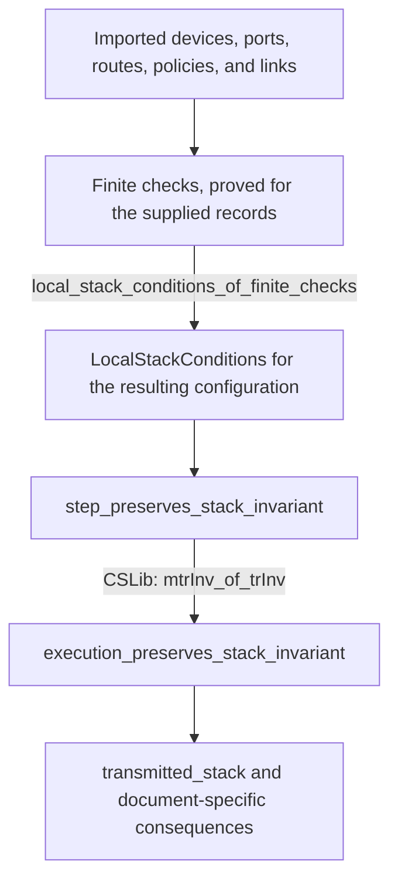

# Reusable network models and proofs in `TDN/Semantics`

`TDN/Semantics` provides network models and general proofs that can be applied to different configurations and snapshots. The modules describe packet processing, topology, filtering, encryption layers, authentication, fragmentation, generated replies, and several operational services. A caller supplies the relevant configuration and proves the theorem's premises for that configuration.

The catalog covers all 70 Lean files present on 2026-10-27. It lists all 604 explicitly named declarations: 59 structures, 36 inductive types or relations, 248 definitions, 3 abbreviations, 111 lemmas, and 147 theorems. It also links the 51 explicit instances that make particular propositions decidable. Constructors, structure-field projections, and automatically derived declarations are included through their parent types rather than counted separately.

Each module section explains its purpose, principal results, and conditions for reuse. The expandable declaration index in each section links every named declaration to its source line. The source links are relative to the repository so they remain usable in another checkout and on GitHub.

## How to read the library

A **model** describes the states and operations considered by a proof. For example, `Execution.Step` describes one packet-processing operation. An **invariant** is a condition that remains true after every permitted step when it is true initially. A **trace** is a finite sequence of permitted steps. A theorem about every trace can cover arbitrarily long finite executions without enumerating them.

A **predicate** is a condition on a value, such as whether a node is a firewall. A **contract** is an explicitly required guarantee from another model or implementation. A **soundness theorem** proves that passing a check is sufficient for the condition claimed by that check. An **induction proof** establishes an initial case and proves that one more permitted step preserves the result. The same argument then covers any finite number of steps.

An **assumption** or **premise** is a condition that must be supplied when applying a theorem. For example, a link may be required to connect ports with the same expected encryption stack. A **witness** is concrete supporting information, such as a path demonstrating connectivity. A **local check** verifies one of the required conditions from the supplied data. Local checks can compare several devices or inspect an entire finite rule list.

Lean declarations serve the following roles:

| Lean construct | Meaning in the library |
| --- | --- |
| `structure` | A record with named fields, such as a route or device. A structure ending in `: Prop` packages logical conditions that need proofs. |
| `inductive` | A type or relation defined by its permitted cases. The constructors of `Execution.Step` specify which packet-processing steps exist. |
| `def` | A named computation or expression. A definition returning `Prop` states a condition, such as a required relationship between ports. |
| `abbrev` | A short name for another expression or type. |
| `lemma` | A checked supporting result, such as preservation by one step, a finite record check, or the assembly of local assumptions. |
| `theorem` | A checked principal result offered by the module, such as a reusable execution guarantee, a requirement result, or its application to a snapshot. |
| `Decidable P` | A method that determines whether proposition `P` holds and supplies a proof of the outcome. The finite-check modules provide instances for their supported conditions. |
| `by decide` | Ask Lean to use the available decision method to prove a concrete proposition. It operates on Lean values that have already been imported or defined. |
| `∀ x, ...` | The condition holds for every `x` of the stated type. |
| `∃ x, ...` | Some `x` satisfies the condition. Applying the result may reveal that witness. |
| `P → Q` | Given a proof of `P`, the result supplies a proof of `Q`. |
| `P ∧ Q` | Both conditions hold. |
| `P ∨ Q` | At least one of the conditions holds. |
| `system.Tr before action after` | One permitted step connects the two states with that action. |
| `system.MTr before actions after` | A finite trace connects the two states with the listed actions. |
| `system.TrInv property` | Every permitted step preserves `property`. |
| `Relation.ReflTransGen edge a b` | A path of zero or more edges connects `a` to `b`. |

A principal theorem retains that role when another theorem uses it. For example, `execution_preserves_stack_invariant` is a reusable result supported by the lemma `step_preserves_stack_invariant`. Concrete evidence uses lemmas for edge checks, initial states, and local conditions, then theorems for the resulting network property. The choice of keyword depends on the result's role; a proof using `by decide` can establish either a supporting fact or a final result. Lean checks both kinds of proof in the same way.

The word **stack** means the ordered list of encryption-layer tags in a modeled packet. The first tag is the outermost layer. For example, `[2, 11]` describes Outer layer `2` surrounding Inner layer `11`. The tags identify protection layers in the proof. Actual addresses, protocol fields, and SPIs have separate fields.

A **port** is a modeled connection point identified by a natural number. The configuration maps ports to their devices and interface names. A **layout** assigns an expected stack to each port: `layout : Nat → List Nat`. A port might expect `[]` on Red, `[11]` on Gray, or `[2, 11]` on Black. The layout is supporting information whose consistency must be proved against the operational configuration. `FiniteDomains.finite_config_ignores_port_stack_annotations` establishes that changing only the stored stack annotations leaves the modeled operational configuration unchanged.

A **projection** maps a detailed state to the information retained by a simpler model. For example, a fragmented-packet state contains both a logical packet state and its pieces; a projection can retain only the logical state. A proof relating the models checks each detailed step and then transfers properties across complete traces. Some detailed steps can leave the projected state unchanged, as splitting a packet can leave its logical identity unchanged.

## Organization and dependencies

The modules separate general arguments from the finite data used to apply them. None of the 70 modules imports a snapshot, an instance module, or a document-specific target. Every direct project import stays within `TDN.Semantics`. Some modules describe broadly reusable mathematics; others describe a specific supported network mechanism or configuration pattern, such as the fixed HTTP/ESP bridge allowlist.

| Topic | Starting modules | What a caller supplies |
| --- | --- | --- |
| [Topology and packet policy](#topology-and-packet-policy) | `Paths`, `Addressing`, `Filter`, `PacketPolicy` | Edges, labels, ranges, ordered rules, and coverage of relevant connections. |
| [IP packet execution](#ip-packet-execution) | `Execution`, `ExecutionInvariant`, `FiniteExecution` | Devices, ports, routes, rules, policies, installed associations, links, and a checked layout. |
| [MACsec and mixed-protocol execution](#macsec-and-mixed-protocol-execution) | `LinkProtection`, `LayeredFrame`, `MultiProtocolExecution` | MACsec settings, associations, logical/physical ports, carriers, and their connection to IP processing. |
| [Generated replies](#generated-replies) | `KernelResponses`, `SourceResponseGuards`, `GuardedResponseNetwork` | Reply-generation scope, source/output rules, route choices, and safety of allowed emissions. |
| [Fragments, copied bytes, and reassembly](#fragments-copied-bytes-and-reassembly) | `Fragmentation`, `ByteFlows`, `AuthenticatedAssembly` | Byte origins, assembly rules, encodings, and any authentication contract. |
| [Trust and access](#trust-and-access) | `Trust`, `IKEContexts`, `KeySources`, `AccessControl` | Authority/key ownership, reciprocal peer observations, permitted key sources, and role permissions. |
| [Events and general trace arguments](#events-and-general-trace-arguments) | `Temporal`, `Admission`, `TraceEvents`, `TraceAccounting` | Event meanings, timestamps, prerequisites, step invariants, or per-step arithmetic equations. |
| [Sizes, clocks, logs, and cover traffic](#sizes-clocks-logs-and-cover-traffic) | `PacketLength`, `ClockSamples`, `AuditRotation`, `CoverTraffic` | Size budgets, clock observations, record histories, journal acknowledgments, or a scheduler model. |

The packet-stack proof follows the dependency chain shown below. Each arrow means that the lower result uses the information or proof above it.



The finite checks and their soundness theorems avoid enumerating all possible packets. They inspect records such as rule atoms and address intervals, then prove that every packet matching those records has the required behavior. The graph and trace induction proofs extend those conditions to paths and executions of arbitrary finite length.

## Example: a finite edge check supports an arbitrary-path theorem

A four-node graph illustrates the complete proof structure. Nodes `0` and `1` connect to firewall `2`, which connects to node `3`. The graph has a real path from `0` to `3`. The property to prove is that every such path must visit the firewall.

```lean
import TDN.Semantics.Paths

namespace SemanticsGuide

def edge (a b : Fin 4) : Prop :=
  (a = 0 ∧ b = 1) ∨ (a = 1 ∧ b = 2) ∨ (a = 2 ∧ b = 3)

def firewall (node : Fin 4) : Prop := node = 2

def side (node : Fin 4) : Nat := if node = 3 then 1 else 0

lemma checked_edges : ∀ a b : Fin 4,
    edge a b → ¬ firewall a → ¬ firewall b → side a = side b := by
  unfold edge firewall
  decide

theorem no_bypass :
    ¬ Relation.ReflTransGen (TDN.Paths.Avoiding edge firewall) 0 3 := by
  exact TDN.Paths.no_firewall_free_crossing edge firewall side checked_edges
    (by unfold firewall; decide) (by decide)

end SemanticsGuide
```

`Fin 4` gives Lean exactly four possible nodes. `checked_edges` checks all endpoint pairs and proves that every edge whose endpoints are both outside the firewall preserves the side label. In the example, the remaining edge `0 → 1` preserves label `0`. The edges touching firewall `2` are excluded by the hypotheses.

`no_bypass` applies the existing general theorem. Its first supplied proof is `checked_edges`. `unfold edge firewall` exposes the definitions to the decision procedure. The two smaller proofs establish that node `0` is outside the firewall and that nodes `0` and `3` have different side labels. The library's induction argument then excludes every finite firewall-avoiding path between the endpoints. A different graph changes the data and edge checks while retaining that general argument.

## Example: checked local processing determines the transmitted stack

The packet theorem states exactly which conditions connect local processing to a two-layer result. In the following example, `checks` is a proof of all `LocalStackConditions` for configuration `c` and layout `layout`. A snapshot application can obtain that proof using the finite-check modules.

```lean
import TDN.Semantics.ExecutionInvariant

open TDN.Execution

example (c : Config) (layout : Nat → List Nat)
    (checks : LocalStackConditions c layout)
    (inner outer : Nat) (start finish : State) (actions : List Action)
    (run : (lts c).MTr start actions finish)
    (initial : StackInvariant c layout start)
    (ready : finish.phase = .ready)
    (blackPort : layout finish.port = [outer, inner]) :
    finish.frame.tags = [outer, inner] := by
  have stack := transmitted_stack c layout checks run initial ready
  exact stack.trans blackPort
```

The premises identify a permitted finite execution, a valid starting state, a final state ready for transmission, and a final port assigned the two-layer layout. `transmitted_stack` proves that the final frame's tags equal the layout at that port. `stack.trans blackPort` combines the two equalities to obtain `[outer, inner]`.

`LocalStackConditions` is where the network-specific proof work enters the argument. Its fields require evidence about route ownership, links, switching, accepted forwarding and local output, and routing after encryption. `ExecutionEvents.nested_stack_requires_ordered_encryptions` can additionally identify the Inner and Outer encryption events in order when its placement and initial-stack premises hold.

## Applying the modules to another network

A new network application starts by choosing the behavior needed for its requirement. A topology requirement can use `Paths`; a packet-protection requirement needs an execution model that includes the relevant forwarding, encryption, switching, and delivery steps. Generated replies, fragment movement, and mixed protocols require the corresponding extensions when they can affect the claim.

1. Import the relevant modules and state the desired property for a configuration parameter.
2. Populate the supported device, port, policy, route, and observation records from the new network. Preserve every choice covered by the model, including equally selected policies or routes.
3. Supply supporting information such as port layouts, domain membership, graph labels, or concrete paths. Keep the meaning of those values explicit.
4. Prove the required checks over the records. Use `by decide` for supported concrete finite propositions. If a check fails, inspect the configuration, translation, and chosen sufficient conditions before changing any general theorem.
5. Apply the appropriate soundness theorem to obtain the general local premises. Apply the path or execution theorem to derive the required consequence.
6. When the requirement includes useful communication, provide a separate accepted packet or delivery trace. A safety theorem can also hold for a configuration that drops all traffic.

The proof applies to the behavior represented by the model and its supplied premises. Deployment claims also require faithful collection, correct translation, and a justified relationship between actual processing and modeled steps. A snapshot supplies fixed-state observations; claims about changing configuration, protocol convergence, or real-time scheduling need models and evidence for those changes.

## External Lean libraries used

The implementation uses Lean 4.34.1 and the dependency revisions recorded in [lakefile.toml](../lakefile.toml) and [lean-toolchain](../lean-toolchain). The module import lists show exactly which libraries each source file uses.

| Library | Used capabilities | Pinned revision or version |
| --- | --- | --- |
| CSLib | `LTS`, one-step relations, finite traces, invariant lifting through `mtrInv_of_trInv`, and simulation between transition systems. | `990e65a685bed413f43b139db900a36ad5322a10` |
| Mathlib | Reflexive/transitive graph paths, list reasoning, bounded natural numbers, arithmetic support, and monotonicity. | `d13f23b723b8a846827a245b89c10fc7d3f11612` |
| Lean and Std | Core types, decidability, the `omega` arithmetic tactic, and calendar calculations through `Std.Time.PlainDateTime`. | Lean `v4.34.1` |

`Semantics` defines network behavior and the premises connecting its records. CSLib supplies general trace reasoning, and Mathlib supplies general mathematical facts. For example, `ExecutionInvariant` first proves preservation for each network step, then calls `Cslib.LTS.mtrInv_of_trInv` to extend preservation to every finite trace.

## Complete module catalog

The catalog groups all modules by their primary purpose. Namespaces are listed separately because several files extend a shared namespace. For example, declarations from `FiniteExecution.lean` are named `TDN.Execution.*` even though their import path is `TDN.Semantics.FiniteExecution`.

## Topology and packet policy

[Paths](#paths), [Addressing](#addressing), [InternetAddresses](#internetaddresses), [Filter](#filter), [PacketPolicy](#packetpolicy), [HeaderPolicy](#headerpolicy), [BridgePolicy](#bridgepolicy), [StatefulFilter](#statefulfilter)

### Paths

Source: [Paths.lean](../TDN/Semantics/Paths.lean). Namespace: `TDN.Paths`.

`Paths` turns an edge-level check into a statement about every finite path. You supply the graph, a predicate identifying firewalls, and a `side` label for each node. [`Avoiding`](../TDN/Semantics/Paths.lean#L6) permits an edge only when its destination is not a firewall; the theorems separately require a non-firewall starting node.

[`avoidance_preserves_side`](../TDN/Semantics/Paths.lean#L10) proves that a path avoiding firewalls preserves its starting label when every non-firewall edge does so. [`no_firewall_free_crossing`](../TDN/Semantics/Paths.lean#L20) then excludes paths between differently labeled endpoints. [`path_avoids_absent_firewalls`](../TDN/Semantics/Paths.lean#L29) establishes that every graph path avoids firewalls if no node is a firewall. A requirement proof can combine that result with an existing connection to show that a mandatory firewall must exist.

A new topology supplies new edges and labels. The proofs stay unchanged. The graph must include every connection relevant to the claimed path property.

Direct imports: `Mathlib.Logic.Relation`.

<details>
<summary>All 4 named declarations in Paths</summary>

| Kind | Declaration |
| --- | --- |
| `def` | [`Avoiding`](../TDN/Semantics/Paths.lean#L6) |
| `theorem` | [`avoidance_preserves_side`](../TDN/Semantics/Paths.lean#L10) |
| `theorem` | [`no_firewall_free_crossing`](../TDN/Semantics/Paths.lean#L20) |
| `lemma` | [`path_avoids_absent_firewalls`](../TDN/Semantics/Paths.lean#L29) |


</details>

### Addressing

Source: [Addressing.lean](../TDN/Semantics/Addressing.lean). Namespace: `TDN.Addressing`.

`Addressing` associates inclusive numeric address ranges with arbitrary labels. [`Range`](../TDN/Semantics/Addressing.lean#L6) stores `low`, `high`, and `label`; [`Contains`](../TDN/Semantics/Addressing.lean#L12) tests membership, and [`Owns`](../TDN/Semantics/Addressing.lean#L15) connects an address to the label of a containing range.

[`Separated`](../TDN/Semantics/Addressing.lean#L18) requires ranges with different labels to be disjoint. [`separated_ranges_unique_label`](../TDN/Semantics/Addressing.lean#L22) proves that an address cannot belong to two different labels under that condition. A network can use security levels or tenant identifiers as labels. The importer must supply the ranges and their intended labels; the library proves the relationship between those supplied records.

Direct imports: `Mathlib.Data.List.Basic`, `Lean.Elab.Tactic.Omega`.

<details>
<summary>All 5 named declarations in Addressing</summary>

| Kind | Declaration |
| --- | --- |
| `structure` | [`Range`](../TDN/Semantics/Addressing.lean#L6) |
| `def` | [`Contains`](../TDN/Semantics/Addressing.lean#L12) |
| `def` | [`Owns`](../TDN/Semantics/Addressing.lean#L15) |
| `def` | [`Separated`](../TDN/Semantics/Addressing.lean#L18) |
| `theorem` | [`separated_ranges_unique_label`](../TDN/Semantics/Addressing.lean#L22) |


</details>

### InternetAddresses

Source: [InternetAddresses.lean](../TDN/Semantics/InternetAddresses.lean). Namespace: `TDN.InternetAddresses`.

`InternetAddresses` gives IPv4 and IPv6 addresses distinct numeric representations. [`encode4`](../TDN/Semantics/InternetAddresses.lean#L8) uses the value of a bounded 32-bit address. [`encode6`](../TDN/Semantics/InternetAddresses.lean#L9) adds `2^128` to a bounded 128-bit address. The three encoding theorems prove that each encoding preserves address identity and that the two families never collide.

[`headerWords`](../TDN/Semantics/InternetAddresses.lean#L27) returns five for an IPv4 key and zero for other keys. [`ipv6_has_no_ipv4_ihl`](../TDN/Semantics/InternetAddresses.lean#L29) verifies the IPv6 case. The function supplies the modeled base-header length when creating an outer header. It does not parse arbitrary IPv4 options or IPv6 extension headers.

Direct imports: `Mathlib.Data.Fin.Basic`, `Lean.Elab.Tactic.Omega`.

<details>
<summary>All 7 named declarations in InternetAddresses</summary>

| Kind | Declaration |
| --- | --- |
| `def` | [`encode4`](../TDN/Semantics/InternetAddresses.lean#L8) |
| `def` | [`encode6`](../TDN/Semantics/InternetAddresses.lean#L9) |
| `theorem` | [`families_have_disjoint_keys`](../TDN/Semantics/InternetAddresses.lean#L11) |
| `theorem` | [`ipv4_encoding_injective`](../TDN/Semantics/InternetAddresses.lean#L17) |
| `theorem` | [`ipv6_encoding_injective`](../TDN/Semantics/InternetAddresses.lean#L20) |
| `def` | [`headerWords`](../TDN/Semantics/InternetAddresses.lean#L27) |
| `theorem` | [`ipv6_has_no_ipv4_ihl`](../TDN/Semantics/InternetAddresses.lean#L29) |


</details>

### Filter

Source: [Filter.lean](../TDN/Semantics/Filter.lean). Namespace: `TDN.Filter`.

`Filter` evaluates an ordered list of rules. Each [`Rule`](../TDN/Semantics/Filter.lean#L9) contains a Boolean match function and an allow-or-deny [`Verdict`](../TDN/Semantics/Filter.lean#L5). [`evaluate`](../TDN/Semantics/Filter.lean#L14) returns the verdict of the first matching rule, or the supplied fallback when every rule misses.

[`default_deny_sound`](../TDN/Semantics/Filter.lean#L33) proves that every accepted packet has a desired property when the fallback denies traffic and every allow rule guarantees that property. [`rejects_outside_allowlist`](../TDN/Semantics/Filter.lean#L41) gives the corresponding rejection result. [`accepts_at_first_matching_rule`](../TDN/Semantics/Filter.lean#L68) proves positive acceptance after checking that earlier rules miss. [`denying_prefix_blocks`](../TDN/Semantics/Filter.lean#L78) proves rejection when an initial sequence of deny rules contains a match. [`HasUsefulTraffic`](../TDN/Semantics/Filter.lean#L50) states that at least one useful packet is accepted; a caller must supply that witness.

The packet type and match functions are parameters, so the results apply to several policy models.

Direct imports: `Mathlib.Data.List.Basic`.

<details>
<summary>All 10 named declarations in Filter</summary>

| Kind | Declaration |
| --- | --- |
| `inductive` | [`Verdict`](../TDN/Semantics/Filter.lean#L5) |
| `structure` | [`Rule`](../TDN/Semantics/Filter.lean#L9) |
| `def` | [`evaluate`](../TDN/Semantics/Filter.lean#L14) |
| `lemma` | [`allowed_has_matching_allow`](../TDN/Semantics/Filter.lean#L20) |
| `theorem` | [`default_deny_sound`](../TDN/Semantics/Filter.lean#L33) |
| `theorem` | [`rejects_outside_allowlist`](../TDN/Semantics/Filter.lean#L41) |
| `def` | [`HasUsefulTraffic`](../TDN/Semantics/Filter.lean#L50) |
| `lemma` | [`evaluate_skips_nonmatching_prefix`](../TDN/Semantics/Filter.lean#L55) |
| `theorem` | [`accepts_at_first_matching_rule`](../TDN/Semantics/Filter.lean#L68) |
| `theorem` | [`denying_prefix_blocks`](../TDN/Semantics/Filter.lean#L78) |


</details>

### PacketPolicy

Source: [PacketPolicy.lean](../TDN/Semantics/PacketPolicy.lean). Namespace: `TDN.PacketPolicy`.

`PacketPolicy` supplies the concrete packet fields and rule conditions used by the execution models. [`Packet`](../TDN/Semantics/PacketPolicy.lean#L5) includes addresses, protocol, interfaces, transport ports, header fields, connection state, and inbound/outbound IPsec-policy identifiers. [`Atom`](../TDN/Semantics/PacketPolicy.lean#L22) describes one condition on those fields. A [`Rule`](../TDN/Semantics/PacketPolicy.lean#L60) matches only when every atom holds.

[`Rule.toFilter`](../TDN/Semantics/PacketPolicy.lean#L65) connects those records to the ordered evaluator in `Filter`. [`matching_atom`](../TDN/Semantics/PacketPolicy.lean#L68) recovers any atom's condition from a successful match. [`Guarded`](../TDN/Semantics/PacketPolicy.lean#L82) requires the appropriate interface direction and an inbound or outbound policy condition. [`forwarding_policy_protects`](../TDN/Semantics/PacketPolicy.lean#L113) proves that every accepted packet has one of those guarded directions when every allow rule is guarded and the fallback denies traffic.

The result concerns policy metadata on the modeled packet. The execution modules connect outbound policy selection to an encryption operation and installed state.

Direct imports: [Filter](#filter).

<details>
<summary>All 12 named declarations in PacketPolicy</summary>

| Kind | Declaration |
| --- | --- |
| `structure` | [`Packet`](../TDN/Semantics/PacketPolicy.lean#L5) |
| `inductive` | [`Atom`](../TDN/Semantics/PacketPolicy.lean#L22) |
| `def` | [`Atom.holds`](../TDN/Semantics/PacketPolicy.lean#L40) |
| `structure` | [`Rule`](../TDN/Semantics/PacketPolicy.lean#L60) |
| `def` | [`Rule.toFilter`](../TDN/Semantics/PacketPolicy.lean#L65) |
| `lemma` | [`matching_atom`](../TDN/Semantics/PacketPolicy.lean#L68) |
| `def` | [`OutboundGuard`](../TDN/Semantics/PacketPolicy.lean#L74) |
| `def` | [`InboundGuard`](../TDN/Semantics/PacketPolicy.lean#L78) |
| `def` | [`Guarded`](../TDN/Semantics/PacketPolicy.lean#L82) |
| `def` | [`ProtectedForward`](../TDN/Semantics/PacketPolicy.lean#L93) |
| `lemma` | [`guarded_rule_protects`](../TDN/Semantics/PacketPolicy.lean#L97) |
| `theorem` | [`forwarding_policy_protects`](../TDN/Semantics/PacketPolicy.lean#L113) |


Explicit decidability instances:

- [`Decidable (a.holds p)`](../TDN/Semantics/PacketPolicy.lean#L57)
- [`Decidable (Guarded r inside outside)`](../TDN/Semantics/PacketPolicy.lean#L85)


</details>

### HeaderPolicy

Source: [HeaderPolicy.lean](../TDN/Semantics/HeaderPolicy.lean). Namespace: `TDN.PacketPolicy`.

`HeaderPolicy` derives header restrictions from the atoms in every allow rule. [`ProtocolGuard`](../TDN/Semantics/HeaderPolicy.lean#L5) selects an allowed protocol. [`ImmediateHeaderGuard`](../TDN/Semantics/HeaderPolicy.lean#L41) restricts the immediate IPv6 next-header field. [`UnicastGuard`](../TDN/Semantics/HeaderPolicy.lean#L12) either excludes the external interface or excludes a specified destination interval.

[`accepted_protocol`](../TDN/Semantics/HeaderPolicy.lean#L30), [`accepted_immediate_header`](../TDN/Semantics/HeaderPolicy.lean#L48), and [`accepted_header_words`](../TDN/Semantics/HeaderPolicy.lean#L57) prove the corresponding restriction for any accepted packet. [`accepted_external_unicast`](../TDN/Semantics/HeaderPolicy.lean#L65) excludes the supplied destination interval for traffic entering through the external interface. A caller supplies the interval to exclude, such as a multicast range. All four results use default-deny evaluation and checks over the complete allow-rule list.

Direct imports: [PacketPolicy](#packetpolicy).

<details>
<summary>All 8 named declarations in HeaderPolicy</summary>

| Kind | Declaration |
| --- | --- |
| `def` | [`ProtocolGuard`](../TDN/Semantics/HeaderPolicy.lean#L5) |
| `def` | [`UnicastGuard`](../TDN/Semantics/HeaderPolicy.lean#L12) |
| `abbrev` | [`Accepts`](../TDN/Semantics/HeaderPolicy.lean#L27) |
| `theorem` | [`accepted_protocol`](../TDN/Semantics/HeaderPolicy.lean#L30) |
| `def` | [`ImmediateHeaderGuard`](../TDN/Semantics/HeaderPolicy.lean#L41) |
| `theorem` | [`accepted_immediate_header`](../TDN/Semantics/HeaderPolicy.lean#L48) |
| `theorem` | [`accepted_header_words`](../TDN/Semantics/HeaderPolicy.lean#L57) |
| `theorem` | [`accepted_external_unicast`](../TDN/Semantics/HeaderPolicy.lean#L65) |


Explicit decidability instances:

- [`Decidable (ProtocolGuard allowed r)`](../TDN/Semantics/HeaderPolicy.lean#L8)
- [`Decidable (UnicastGuard external low high r)`](../TDN/Semantics/HeaderPolicy.lean#L18)
- [`Decidable (ImmediateHeaderGuard allowed rule)`](../TDN/Semantics/HeaderPolicy.lean#L44)


</details>

### BridgePolicy

Source: [BridgePolicy.lean](../TDN/Semantics/BridgePolicy.lean). Namespace: `TDN.BridgePolicy`.

`BridgePolicy` defines a small, reusable bridge allowlist parameterized by a client and server address. The chain permits ARP, IPv4 ESP, and IPv4 TCP requests and responses for HTTP port 80 between those endpoints.

[`accepted_tcp_is_bounded`](../TDN/Semantics/BridgePolicy.lean#L31) proves that accepted IPv4 TCP traffic has the specified request or response shape. [`has_useful_request`](../TDN/Semantics/BridgePolicy.lean#L41) constructs an accepted request, showing that the chain permits useful traffic. Reuse requires the modeled bridge to use that exact chain or a separately justified translation to it. The module's [`Frame`](../TDN/Semantics/BridgePolicy.lean#L4) contains only the fields needed for those checks.

Direct imports: [Filter](#filter).

<details>
<summary>All 6 named declarations in BridgePolicy</summary>

| Kind | Declaration |
| --- | --- |
| `structure` | [`Frame`](../TDN/Semantics/BridgePolicy.lean#L4) |
| `def` | [`HTTPRequest`](../TDN/Semantics/BridgePolicy.lean#L12) |
| `def` | [`HTTPResponse`](../TDN/Semantics/BridgePolicy.lean#L15) |
| `def` | [`chain`](../TDN/Semantics/BridgePolicy.lean#L23) |
| `theorem` | [`accepted_tcp_is_bounded`](../TDN/Semantics/BridgePolicy.lean#L31) |
| `theorem` | [`has_useful_request`](../TDN/Semantics/BridgePolicy.lean#L41) |


Explicit decidability instances:

- [`Decidable (HTTPRequest client server p)`](../TDN/Semantics/BridgePolicy.lean#L18)
- [`Decidable (HTTPResponse client server p)`](../TDN/Semantics/BridgePolicy.lean#L20)


</details>

### StatefulFilter

Source: [StatefulFilter.lean](../TDN/Semantics/StatefulFilter.lean). Namespace: `TDN.StatefulFilter`.

`StatefulFilter` adds a cache to an ordered packet filter. A packet is accepted when a cached key matches or the ordinary rules allow it. An accepted packet can create a cache entry when `createsState` permits creation. An expiration step removes entries.

[`empty_cache_preserved`](../TDN/Semantics/StatefulFilter.lean#L50) proves that a cache starting empty stays empty when state creation is disabled for every packet. [`fixed_stateless_policy_is_effective`](../TDN/Semantics/StatefulFilter.lean#L58) then proves that the cache-aware verdict equals the ordinary rule evaluation after any finite execution. The caller must establish the no-creation condition and the empty initial cache. The module gives a way to justify using a stateless policy model under those specific conditions.

Direct imports: [Filter](#filter), `Cslib.Foundations.Semantics.LTS.Basic`.

<details>
<summary>All 8 named declarations in StatefulFilter</summary>

| Kind | Declaration |
| --- | --- |
| `structure` | [`Config`](../TDN/Semantics/StatefulFilter.lean#L9) |
| `def` | [`verdict`](../TDN/Semantics/StatefulFilter.lean#L16) |
| `def` | [`afterPacket`](../TDN/Semantics/StatefulFilter.lean#L21) |
| `inductive` | [`Step`](../TDN/Semantics/StatefulFilter.lean#L29) |
| `def` | [`lts`](../TDN/Semantics/StatefulFilter.lean#L36) |
| `lemma` | [`empty_step`](../TDN/Semantics/StatefulFilter.lean#L39) |
| `theorem` | [`empty_cache_preserved`](../TDN/Semantics/StatefulFilter.lean#L50) |
| `theorem` | [`fixed_stateless_policy_is_effective`](../TDN/Semantics/StatefulFilter.lean#L58) |


</details>

## IP packet execution

[Execution](#execution), [ExecutionInvariant](#executioninvariant), [ExecutionChecks](#executionchecks), [FiniteExecution](#finiteexecution), [FiniteRoutedExecution](#finiteroutedexecution), [ExecutionDomains](#executiondomains), [FiniteDomains](#finitedomains), [ExecutionProvenance](#executionprovenance), [AuthenticationSelectors](#authenticationselectors), [ExecutionAuthentication](#executionauthentication), [ExecutionHistory](#executionhistory), [ExecutionEvents](#executionevents), [CiphertextTransit](#ciphertexttransit)

### Execution

Source: [Execution.lean](../TDN/Semantics/Execution.lean). Namespace: `TDN.Execution`.

`Execution` defines the packet-processing steps shared by the IPsec proofs. A [`State`](../TDN/Semantics/Execution.lean#L48) contains a port, a processing phase, a [`Frame`](../TDN/Semantics/Execution.lean#L21), and the policy identifiers authenticated at ingress. The frame stores the current header, payload identity, origin domain, saved encryption envelopes, and the entry port. Each [`Envelope`](../TDN/Semantics/Execution.lean#L16) preserves the preceding header so that decryption can restore it.

[`Config`](../TDN/Semantics/Execution.lean#L120) supplies routes, INPUT/FORWARD/OUTPUT rules and fallback verdicts, IPsec policies, installed security associations, interface names, device ownership, links, switching, local addresses, and Red payload origins. [`Association`](../TDN/Semantics/Execution.lean#L55) represents a policy and its selectors. [`SecurityAssociation`](../TDN/Semantics/Execution.lean#L70) represents installed state. [`StateBindsPolicy`](../TDN/Semantics/Execution.lean#L77) checks the local request identifier, endpoints, and any required SPI. [`selectedAssociations`](../TDN/Semantics/Execution.lean#L90) retains all equally best matching policies.

[`SelectedRoute`](../TDN/Semantics/Execution.lean#L114) chooses among matching routes for the same ingress: lowest table priority first, then longest prefix, then lowest metric. Equal choices remain possible. [`Step`](../TDN/Semantics/Execution.lean#L171) describes receipt, route selection, filtering, encryption, decryption, transmission, switching, local delivery, and dropping. Encryption requires both a selected policy and matching installed state. Plain transmission after filtering requires that no outbound policy was selected.

The preservation theorems retain payload identity, origin domain, and original addresses across every finite execution. The policy-atom results connect a matched outbound-policy condition to a configured operation and exclude the plain-transmission case. [`matched_execution`](../TDN/Semantics/Execution.lean#L345) transfers an execution to another model when the caller proves that each detailed step maps to an allowed step in that model. The route and policy records remain fixed throughout each execution.

Direct imports: `Cslib.Foundations.Semantics.LTS.Simulation`, [PacketPolicy](#packetpolicy), [InternetAddresses](#internetaddresses).

<details>
<summary>All 34 named declarations in Execution</summary>

| Kind | Declaration |
| --- | --- |
| `structure` | [`Seal`](../TDN/Semantics/Execution.lean#L8) |
| `structure` | [`Envelope`](../TDN/Semantics/Execution.lean#L16) |
| `structure` | [`Frame`](../TDN/Semantics/Execution.lean#L21) |
| `def` | [`payloadAddresses`](../TDN/Semantics/Execution.lean#L29) |
| `def` | [`Frame.addresses`](../TDN/Semantics/Execution.lean#L33) |
| `lemma` | [`payload_addresses_ignore_metadata`](../TDN/Semantics/Execution.lean#L36) |
| `inductive` | [`Phase`](../TDN/Semantics/Execution.lean#L43) |
| `structure` | [`State`](../TDN/Semantics/Execution.lean#L48) |
| `structure` | [`Association`](../TDN/Semantics/Execution.lean#L55) |
| `structure` | [`SecurityAssociation`](../TDN/Semantics/Execution.lean#L70) |
| `def` | [`StateBindsPolicy`](../TDN/Semantics/Execution.lean#L77) |
| `def` | [`Association.seal`](../TDN/Semantics/Execution.lean#L82) |
| `def` | [`Association.matches`](../TDN/Semantics/Execution.lean#L85) |
| `def` | [`selectedAssociations`](../TDN/Semantics/Execution.lean#L90) |
| `inductive` | [`Action`](../TDN/Semantics/Execution.lean#L95) |
| `structure` | [`Route`](../TDN/Semantics/Execution.lean#L99) |
| `def` | [`Route.matches`](../TDN/Semantics/Execution.lean#L109) |
| `def` | [`SelectedRoute`](../TDN/Semantics/Execution.lean#L114) |
| `structure` | [`Config`](../TDN/Semantics/Execution.lean#L120) |
| `def` | [`policyPacket`](../TDN/Semantics/Execution.lean#L142) |
| `def` | [`accepts`](../TDN/Semantics/Execution.lean#L149) |
| `def` | [`encrypt`](../TDN/Semantics/Execution.lean#L154) |
| `inductive` | [`Step`](../TDN/Semantics/Execution.lean#L171) |
| `def` | [`lts`](../TDN/Semantics/Execution.lean#L242) |
| `lemma` | [`step_preserves_payload`](../TDN/Semantics/Execution.lean#L244) |
| `lemma` | [`step_preserves_original_addresses`](../TDN/Semantics/Execution.lean#L249) |
| `theorem` | [`execution_preserves_original_addresses`](../TDN/Semantics/Execution.lean#L272) |
| `theorem` | [`plaintext_delivery_retains_addresses`](../TDN/Semantics/Execution.lean#L282) |
| `theorem` | [`execution_preserves_payload`](../TDN/Semantics/Execution.lean#L292) |
| `lemma` | [`matched_policy_is_configured`](../TDN/Semantics/Execution.lean#L303) |
| `theorem` | [`outbound_policy_atom_selects_operation`](../TDN/Semantics/Execution.lean#L313) |
| `lemma` | [`outbound_policy_atom_excludes_plain`](../TDN/Semantics/Execution.lean#L325) |
| `lemma` | [`simulation_of_step_map`](../TDN/Semantics/Execution.lean#L335) |
| `theorem` | [`matched_execution`](../TDN/Semantics/Execution.lean#L345) |


</details>

### ExecutionInvariant

Source: [ExecutionInvariant.lean](../TDN/Semantics/ExecutionInvariant.lean). Namespace: `TDN.Execution`.

`ExecutionInvariant` assigns an expected list of encryption-layer tags to each port through `layout : Nat → List Nat`. [`Frame.tags`](../TDN/Semantics/ExecutionInvariant.lean#L6) reads the actual tags in the modeled envelopes. [`processingStack`](../TDN/Semantics/ExecutionInvariant.lean#L10) accounts for a successful inbound decryption by removing the first expected tag. [`StackInvariant`](../TDN/Semantics/ExecutionInvariant.lean#L70) states the appropriate relationship for each processing phase.

[`LocalStackConditions`](../TDN/Semantics/ExecutionInvariant.lean#L39) packages six kinds of premises: routes stay within a device; links preserve the expected stack; switching preserves the processing stack; accepted forwarding rules produce the expected output stack; locally generated output does the same; and routing after encryption preserves the resulting stack. The conditions cover every selected policy, including ties.

[`step_preserves_stack_invariant`](../TDN/Semantics/ExecutionInvariant.lean#L100) checks every constructor of `Execution.Step`. [`execution_preserves_stack_invariant`](../TDN/Semantics/ExecutionInvariant.lean#L154) applies CSLib's general induction result to any finite execution. [`transmitted_stack`](../TDN/Semantics/ExecutionInvariant.lean#L164) concludes that a state ready for transmission has exactly the stack assigned to its port. A new network supplies a configuration, a layout, and proofs of the local conditions.

Direct imports: [Execution](#execution).

<details>
<summary>All 12 named declarations in ExecutionInvariant</summary>

| Kind | Declaration |
| --- | --- |
| `def` | [`Frame.tags`](../TDN/Semantics/ExecutionInvariant.lean#L6) |
| `def` | [`processingStack`](../TDN/Semantics/ExecutionInvariant.lean#L10) |
| `def` | [`LocalAuthentication`](../TDN/Semantics/ExecutionInvariant.lean#L14) |
| `def` | [`ProcessingInvariant`](../TDN/Semantics/ExecutionInvariant.lean#L19) |
| `def` | [`AcceptedHook`](../TDN/Semantics/ExecutionInvariant.lean#L25) |
| `def` | [`RoutedFrame`](../TDN/Semantics/ExecutionInvariant.lean#L32) |
| `structure` | [`LocalStackConditions`](../TDN/Semantics/ExecutionInvariant.lean#L39) |
| `def` | [`StackInvariant`](../TDN/Semantics/ExecutionInvariant.lean#L70) |
| `lemma` | [`accepted_hook_stack_effect`](../TDN/Semantics/ExecutionInvariant.lean#L88) |
| `lemma` | [`step_preserves_stack_invariant`](../TDN/Semantics/ExecutionInvariant.lean#L100) |
| `theorem` | [`execution_preserves_stack_invariant`](../TDN/Semantics/ExecutionInvariant.lean#L154) |
| `theorem` | [`transmitted_stack`](../TDN/Semantics/ExecutionInvariant.lean#L164) |


</details>

### ExecutionChecks

Source: [ExecutionChecks.lean](../TDN/Semantics/ExecutionChecks.lean). Namespace: `TDN.Execution`.

`ExecutionChecks` reduces a packet-dependent stack obligation to checks on rule records. [`PortCompatible`](../TDN/Semantics/ExecutionChecks.lean#L6) checks interface constraints. [`ImpossibleAuthentication`](../TDN/Semantics/ExecutionChecks.lean#L12) finds an inbound-policy requirement absent from the known authentication list. [`ExcludesSelector`](../TDN/Semantics/ExecutionChecks.lean#L23) finds address ranges that cannot match a policy. [`HasOutboundGuard`](../TDN/Semantics/ExecutionChecks.lean#L17) identifies a required outbound policy.

[`RuleStackCheck`](../TDN/Semantics/ExecutionChecks.lean#L85) combines those tests: either the rule cannot apply, or plain and encrypted forwarding produce the required stack. [`checked_rule_stack_effect`](../TDN/Semantics/ExecutionChecks.lean#L93) proves that conclusion for a matching rule. [`checked_hook_stack_effect`](../TDN/Semantics/ExecutionChecks.lean#L125) extends the argument to an accepted packet under a default-deny rule list. The checks are sufficient conditions; a failure can require a more precise argument about why a rule is unreachable.

Direct imports: [ExecutionInvariant](#executioninvariant), `Lean.Elab.Tactic.Omega`.

<details>
<summary>All 10 named declarations in ExecutionChecks</summary>

| Kind | Declaration |
| --- | --- |
| `def` | [`PortCompatible`](../TDN/Semantics/ExecutionChecks.lean#L6) |
| `def` | [`ImpossibleAuthentication`](../TDN/Semantics/ExecutionChecks.lean#L12) |
| `def` | [`HasOutboundGuard`](../TDN/Semantics/ExecutionChecks.lean#L17) |
| `def` | [`ExcludesSelector`](../TDN/Semantics/ExecutionChecks.lean#L23) |
| `lemma` | [`matched_ports_compatible`](../TDN/Semantics/ExecutionChecks.lean#L57) |
| `lemma` | [`matching_authentication_possible`](../TDN/Semantics/ExecutionChecks.lean#L64) |
| `lemma` | [`excluded_selector_cannot_match`](../TDN/Semantics/ExecutionChecks.lean#L71) |
| `def` | [`RuleStackCheck`](../TDN/Semantics/ExecutionChecks.lean#L85) |
| `lemma` | [`checked_rule_stack_effect`](../TDN/Semantics/ExecutionChecks.lean#L93) |
| `theorem` | [`checked_hook_stack_effect`](../TDN/Semantics/ExecutionChecks.lean#L125) |


Explicit decidability instances:

- [`Decidable (PortCompatible r i o)`](../TDN/Semantics/ExecutionChecks.lean#L30)
- [`Decidable (ImpossibleAuthentication r auth)`](../TDN/Semantics/ExecutionChecks.lean#L36)
- [`Decidable (HasOutboundGuard r)`](../TDN/Semantics/ExecutionChecks.lean#L43)
- [`Decidable (ExcludesSelector r p)`](../TDN/Semantics/ExecutionChecks.lean#L49)


</details>

### FiniteExecution

Source: [FiniteExecution.lean](../TDN/Semantics/FiniteExecution.lean). Namespace: `TDN.Execution`.

`FiniteExecution` builds `Execution.Config` from finite lists of devices, ports, routes, links, and switch connections. [`DeviceData`](../TDN/Semantics/FiniteExecution.lean#L6) holds policies, rules, installed state, local addresses, and a recipient domain. [`PortData`](../TDN/Semantics/FiniteExecution.lean#L19) holds its owner, interface name, expected stack, and whether it originates payload traffic. [`deviceAt`](../TDN/Semantics/FiniteExecution.lean#L26) and [`portAt`](../TDN/Semantics/FiniteExecution.lean#L29) return default records for indices outside their lists.

[`possibleAuthentications`](../TDN/Semantics/FiniteExecution.lean#L65) enumerates the empty authentication list and the singleton lists allowed by the inbound policies and port stack. [`FiniteForwardChecks`](../TDN/Semantics/FiniteExecution.lean#L98), [`FiniteOutputChecks`](../TDN/Semantics/FiniteExecution.lean#L140), and [`FiniteOuterRoutes`](../TDN/Semantics/FiniteExecution.lean#L173) state checks over finite records. The soundness theorems prove that those checks imply the corresponding obligations for arbitrary modeled packets. [`local_stack_conditions_of_finite_checks`](../TDN/Semantics/FiniteExecution.lean#L210) assembles the results into [`LocalStackConditions`](../TDN/Semantics/ExecutionInvariant.lean#L39).

The checks include default records because the general configuration accepts any natural-number port index. Snapshot applications can prove the finite propositions with `by decide`, then reuse the general soundness theorems.

Direct imports: [ExecutionChecks](#executionchecks).

<details>
<summary>All 18 named declarations in FiniteExecution</summary>

| Kind | Declaration |
| --- | --- |
| `structure` | [`DeviceData`](../TDN/Semantics/FiniteExecution.lean#L6) |
| `structure` | [`PortData`](../TDN/Semantics/FiniteExecution.lean#L19) |
| `def` | [`deviceAt`](../TDN/Semantics/FiniteExecution.lean#L26) |
| `def` | [`portAt`](../TDN/Semantics/FiniteExecution.lean#L29) |
| `def` | [`finiteConfig`](../TDN/Semantics/FiniteExecution.lean#L32) |
| `def` | [`finiteLayout`](../TDN/Semantics/FiniteExecution.lean#L53) |
| `lemma` | [`port_at_member_or_default`](../TDN/Semantics/FiniteExecution.lean#L56) |
| `def` | [`possibleAuthentications`](../TDN/Semantics/FiniteExecution.lean#L65) |
| `lemma` | [`valid_authentication_in_finite_list`](../TDN/Semantics/FiniteExecution.lean#L68) |
| `def` | [`RecordRuleCheck`](../TDN/Semantics/FiniteExecution.lean#L84) |
| `def` | [`FiniteForwardChecks`](../TDN/Semantics/FiniteExecution.lean#L98) |
| `theorem` | [`finite_forward_checks_sound`](../TDN/Semantics/FiniteExecution.lean#L108) |
| `def` | [`FiniteOutputChecks`](../TDN/Semantics/FiniteExecution.lean#L140) |
| `theorem` | [`finite_output_checks_sound`](../TDN/Semantics/FiniteExecution.lean#L148) |
| `def` | [`FiniteOuterRoutes`](../TDN/Semantics/FiniteExecution.lean#L173) |
| `theorem` | [`finite_outer_routes_sound`](../TDN/Semantics/FiniteExecution.lean#L183) |
| `lemma` | [`device_at_member_or_default`](../TDN/Semantics/FiniteExecution.lean#L199) |
| `theorem` | [`local_stack_conditions_of_finite_checks`](../TDN/Semantics/FiniteExecution.lean#L210) |


Explicit decidability instances:

- [`Decidable (RecordRuleCheck i o d a r)`](../TDN/Semantics/FiniteExecution.lean#L93)
- [`Decidable (FiniteForwardChecks devices ports)`](../TDN/Semantics/FiniteExecution.lean#L105)
- [`Decidable (FiniteOutputChecks devices ports)`](../TDN/Semantics/FiniteExecution.lean#L145)
- [`Decidable (FiniteOuterRoutes devices ports routes)`](../TDN/Semantics/FiniteExecution.lean#L180)


</details>

### FiniteRoutedExecution

Source: [FiniteRoutedExecution.lean](../TDN/Semantics/FiniteRoutedExecution.lean). Namespace: `TDN.Execution`.

`FiniteRoutedExecution` uses the selected route to narrow the forwarding-rule check. [`ExcludesRoute`](../TDN/Semantics/FiniteRoutedExecution.lean#L6) detects a rule whose destination range cannot intersect a route. [`withRoute`](../TDN/Semantics/FiniteRoutedExecution.lean#L29) adds the route's destination range to the rule's conditions for the proof.

[`FiniteRoutedForwardChecks`](../TDN/Semantics/FiniteRoutedExecution.lean#L42) examines route, authentication, and allow-rule combinations. Each combination must be impossible or satisfy the stack check with the route restriction included. [`finite_routed_forward_checks_sound`](../TDN/Semantics/FiniteRoutedExecution.lean#L57) proves the packet-level conclusion. [`local_stack_conditions_of_routed_finite_checks`](../TDN/Semantics/FiniteRoutedExecution.lean#L92) combines those checks with link, switch, output, route-ownership, and post-encryption-route checks. The imported operational rules remain unchanged; the added range is supporting information for the proof.

Direct imports: [FiniteExecution](#finiteexecution).

<details>
<summary>All 7 named declarations in FiniteRoutedExecution</summary>

| Kind | Declaration |
| --- | --- |
| `def` | [`ExcludesRoute`](../TDN/Semantics/FiniteRoutedExecution.lean#L6) |
| `lemma` | [`matching_route_not_excluded`](../TDN/Semantics/FiniteRoutedExecution.lean#L18) |
| `def` | [`withRoute`](../TDN/Semantics/FiniteRoutedExecution.lean#L29) |
| `lemma` | [`matches_with_route`](../TDN/Semantics/FiniteRoutedExecution.lean#L32) |
| `def` | [`FiniteRoutedForwardChecks`](../TDN/Semantics/FiniteRoutedExecution.lean#L42) |
| `theorem` | [`finite_routed_forward_checks_sound`](../TDN/Semantics/FiniteRoutedExecution.lean#L57) |
| `theorem` | [`local_stack_conditions_of_routed_finite_checks`](../TDN/Semantics/FiniteRoutedExecution.lean#L92) |


Explicit decidability instances:

- [`Decidable (ExcludesRoute rule route)`](../TDN/Semantics/FiniteRoutedExecution.lean#L11)
- [`Decidable (FiniteRoutedForwardChecks devices ports routes)`](../TDN/Semantics/FiniteRoutedExecution.lean#L52)


</details>

### ExecutionDomains

Source: [ExecutionDomains.lean](../TDN/Semantics/ExecutionDomains.lean). Namespace: `TDN.Execution`.

`ExecutionDomains` tracks whether processing stays within a chosen set of allowed ports. The caller defines that set as `allowed : Nat → Prop`. [`DomainProcessing`](../TDN/Semantics/ExecutionDomains.lean#L6) and [`DomainInvariant`](../TDN/Semantics/ExecutionDomains.lean#L39) combine membership in the set with the encryption-stack conditions.

[`LocalDomainConditions`](../TDN/Semantics/ExecutionDomains.lean#L10) requires links, switches, accepted forwarding, local output, and post-encryption routing to preserve both the expected stack and the allowed set. [`execution_preserves_domain_invariant`](../TDN/Semantics/ExecutionDomains.lean#L126) lifts those local premises to every finite execution. [`delivered_port_is_allowed`](../TDN/Semantics/ExecutionDomains.lean#L136) applies the invariant to a delivered state.

A caller can instantiate the allowed set for one security domain and exclude recipients in another. The library itself leaves the meaning of a domain and the membership of each port to the caller.

Direct imports: [ExecutionProvenance](#executionprovenance).

<details>
<summary>All 7 named declarations in ExecutionDomains</summary>

| Kind | Declaration |
| --- | --- |
| `def` | [`DomainProcessing`](../TDN/Semantics/ExecutionDomains.lean#L6) |
| `structure` | [`LocalDomainConditions`](../TDN/Semantics/ExecutionDomains.lean#L10) |
| `def` | [`DomainInvariant`](../TDN/Semantics/ExecutionDomains.lean#L39) |
| `lemma` | [`accepted_hook_domain_effect`](../TDN/Semantics/ExecutionDomains.lean#L53) |
| `lemma` | [`step_preserves_domain_invariant`](../TDN/Semantics/ExecutionDomains.lean#L68) |
| `theorem` | [`execution_preserves_domain_invariant`](../TDN/Semantics/ExecutionDomains.lean#L126) |
| `theorem` | [`delivered_port_is_allowed`](../TDN/Semantics/ExecutionDomains.lean#L136) |


</details>

### FiniteDomains

Source: [FiniteDomains.lean](../TDN/Semantics/FiniteDomains.lean). Namespace: `TDN.Execution`.

`FiniteDomains` supplies finite checks for the allowed-port argument. [`RecordDomainCheck`](../TDN/Semantics/FiniteDomains.lean#L5) extends the per-rule stack check with permission for the output port. The forwarding, local-output, and outer-route predicates check the finite device and port records. [`local_domain_conditions_of_finite_checks`](../TDN/Semantics/FiniteDomains.lean#L112) turns the results into [`LocalDomainConditions`](../TDN/Semantics/ExecutionDomains.lean#L10) for all modeled packets.

[`withPortStacks`](../TDN/Semantics/FiniteDomains.lean#L161) changes the proof's expected-stack annotations. [`finite_config_ignores_port_stack_annotations`](../TDN/Semantics/FiniteDomains.lean#L172) proves that changing only those annotations leaves `finiteConfig` unchanged. A network can therefore support several domain-specific layouts while retaining the same operational configuration. Every chosen layout still needs its own checked local premises.

Direct imports: [ExecutionDomains](#executiondomains).

<details>
<summary>All 11 named declarations in FiniteDomains</summary>

| Kind | Declaration |
| --- | --- |
| `def` | [`RecordDomainCheck`](../TDN/Semantics/FiniteDomains.lean#L5) |
| `lemma` | [`domain_check_implies_stack_check`](../TDN/Semantics/FiniteDomains.lean#L19) |
| `lemma` | [`matched_domain_check_allows_output`](../TDN/Semantics/FiniteDomains.lean#L28) |
| `def` | [`FiniteDomainForwardChecks`](../TDN/Semantics/FiniteDomains.lean#L40) |
| `theorem` | [`finite_domain_forward_checks_sound`](../TDN/Semantics/FiniteDomains.lean#L53) |
| `def` | [`FiniteDomainOutputChecks`](../TDN/Semantics/FiniteDomains.lean#L86) |
| `def` | [`FiniteDomainOuterRoutes`](../TDN/Semantics/FiniteDomains.lean#L98) |
| `theorem` | [`local_domain_conditions_of_finite_checks`](../TDN/Semantics/FiniteDomains.lean#L112) |
| `def` | [`withPortStacks`](../TDN/Semantics/FiniteDomains.lean#L161) |
| `lemma` | [`port_stack_update_keeps_operational_fields`](../TDN/Semantics/FiniteDomains.lean#L164) |
| `theorem` | [`finite_config_ignores_port_stack_annotations`](../TDN/Semantics/FiniteDomains.lean#L172) |


Explicit decidability instances:

- [`Decidable (RecordDomainCheck allowed i o d a r)`](../TDN/Semantics/FiniteDomains.lean#L15)
- [`Decidable (FiniteDomainForwardChecks devices ports allowed)`](../TDN/Semantics/FiniteDomains.lean#L48)
- [`Decidable (FiniteDomainOutputChecks devices ports allowed)`](../TDN/Semantics/FiniteDomains.lean#L93)
- [`Decidable (FiniteDomainOuterRoutes devices ports routes allowed)`](../TDN/Semantics/FiniteDomains.lean#L107)


</details>

### ExecutionProvenance

Source: [ExecutionProvenance.lean](../TDN/Semantics/ExecutionProvenance.lean). Namespace: `TDN.Execution`.

`ExecutionProvenance` connects each modeled encryption envelope to a configured outbound policy and installed state. [`ProducedSeal`](../TDN/Semantics/ExecutionProvenance.lean#L6) expresses that connection, and [`ProducedEnvelopes`](../TDN/Semantics/ExecutionProvenance.lean#L11) requires it for every envelope. [`execution_envelopes_have_configured_provenance`](../TDN/Semantics/ExecutionProvenance.lean#L43) proves the property for executions that start without envelopes.

[`SameWireAssociation`](../TDN/Semantics/ExecutionProvenance.lean#L52) compares SPI and endpoints. [`PeerTagAgreement`](../TDN/Semantics/ExecutionProvenance.lean#L55) requires matching sender and receiver wire records to use the same proof tag. [`wire_match_determines_annotated_seal`](../TDN/Semantics/ExecutionProvenance.lean#L68) uses that agreement to recover the complete annotated seal from a wire match. [`FinitePeerTagAgreement`](../TDN/Semantics/ExecutionProvenance.lean#L85) and its soundness theorem make the agreement check finite. The caller must retain every relevant peer record and justify the interpretation of its installed state.

Direct imports: [FiniteExecution](#finiteexecution).

<details>
<summary>All 10 named declarations in ExecutionProvenance</summary>

| Kind | Declaration |
| --- | --- |
| `def` | [`ProducedSeal`](../TDN/Semantics/ExecutionProvenance.lean#L6) |
| `def` | [`ProducedEnvelopes`](../TDN/Semantics/ExecutionProvenance.lean#L11) |
| `lemma` | [`step_preserves_envelope_provenance`](../TDN/Semantics/ExecutionProvenance.lean#L14) |
| `theorem` | [`execution_envelopes_have_configured_provenance`](../TDN/Semantics/ExecutionProvenance.lean#L43) |
| `def` | [`SameWireAssociation`](../TDN/Semantics/ExecutionProvenance.lean#L52) |
| `def` | [`PeerTagAgreement`](../TDN/Semantics/ExecutionProvenance.lean#L55) |
| `def` | [`WireMatchesSeal`](../TDN/Semantics/ExecutionProvenance.lean#L63) |
| `theorem` | [`wire_match_determines_annotated_seal`](../TDN/Semantics/ExecutionProvenance.lean#L68) |
| `def` | [`FinitePeerTagAgreement`](../TDN/Semantics/ExecutionProvenance.lean#L85) |
| `theorem` | [`finite_peer_tag_agreement_sound`](../TDN/Semantics/ExecutionProvenance.lean#L96) |


Explicit decidability instances:

- [`Decidable (FinitePeerTagAgreement devices)`](../TDN/Semantics/ExecutionProvenance.lean#L92)


</details>

### AuthenticationSelectors

Source: [AuthenticationSelectors.lean](../TDN/Semantics/AuthenticationSelectors.lean). Namespace: `TDN.Execution`.

`AuthenticationSelectors` records why an inbound policy identifier appears in a state's authentication list. [`AuthenticationMatches`](../TDN/Semantics/AuthenticationSelectors.lean#L8) requires a matching configured inbound policy whose address selectors accept the current packet. [`ProcessingAuthenticationMatches`](../TDN/Semantics/AuthenticationSelectors.lean#L12) applies the condition in the phases that use that metadata.

The step lemma and [`execution_preserves_authentication_selectors`](../TDN/Semantics/AuthenticationSelectors.lean#L34) prove that the relationship survives every finite execution from an initially valid state. The result lets later response checks use an authenticated packet's address range when reasoning about a reply to its source.

Direct imports: [ExecutionInvariant](#executioninvariant).

<details>
<summary>All 4 named declarations in AuthenticationSelectors</summary>

| Kind | Declaration |
| --- | --- |
| `def` | [`AuthenticationMatches`](../TDN/Semantics/AuthenticationSelectors.lean#L8) |
| `def` | [`ProcessingAuthenticationMatches`](../TDN/Semantics/AuthenticationSelectors.lean#L12) |
| `lemma` | [`step_preserves_authentication_selectors`](../TDN/Semantics/AuthenticationSelectors.lean#L17) |
| `theorem` | [`execution_preserves_authentication_selectors`](../TDN/Semantics/AuthenticationSelectors.lean#L34) |


</details>

### ExecutionAuthentication

Source: [ExecutionAuthentication.lean](../TDN/Semantics/ExecutionAuthentication.lean). Namespace: `TDN.Execution`.

`ExecutionAuthentication` proves that crossing a component's protected boundary requires a decryption step inside that component. [`UndecryptedRegion`](../TDN/Semantics/ExecutionAuthentication.lean#L13) describes states that remain on the protected side while their authentication list is empty.

[`undecrypted_step_retains_region`](../TDN/Semantics/ExecutionAuthentication.lean#L28) proves that every non-decryption step preserves the condition under [`LocalStackConditions`](../TDN/Semantics/ExecutionInvariant.lean#L39). [`inbound_crossing_requires_local_decryption`](../TDN/Semantics/ExecutionAuthentication.lean#L101) then identifies an actual decryption event in a finite execution confined to one component. The execution must begin received and unauthenticated at a port whose layout includes the tag, and finish ready at a port whose layout excludes it. The component's inbound policies must all use the specified tag. The event also retains the original payload identity.

Direct imports: [ExecutionEvents](#executionevents), [RestrictedExecution](#restrictedexecution).

<details>
<summary>All 4 named declarations in ExecutionAuthentication</summary>

| Kind | Declaration |
| --- | --- |
| `def` | [`IngressMetadata`](../TDN/Semantics/ExecutionAuthentication.lean#L7) |
| `def` | [`UndecryptedRegion`](../TDN/Semantics/ExecutionAuthentication.lean#L13) |
| `lemma` | [`undecrypted_step_retains_region`](../TDN/Semantics/ExecutionAuthentication.lean#L28) |
| `theorem` | [`inbound_crossing_requires_local_decryption`](../TDN/Semantics/ExecutionAuthentication.lean#L101) |


</details>

### ExecutionHistory

Source: [ExecutionHistory.lean](../TDN/Semantics/ExecutionHistory.lean). Namespace: `TDN.Execution`.

`ExecutionHistory` counts encryption and decryption operations across a finite execution. [`encryptionCredit`](../TDN/Semantics/ExecutionHistory.lean#L6) assigns one to encryption; [`decryptionDebit`](../TDN/Semantics/ExecutionHistory.lean#L7) assigns one to decryption. The step lemma relates those counts to the change in envelope depth.

[`execution_envelope_balance`](../TDN/Semantics/ExecutionHistory.lean#L15) proves that final depth plus decryptions equals initial depth plus encryptions. [`stack_growth_requires_encryptions`](../TDN/Semantics/ExecutionHistory.lean#L22) and [`stack_removal_requires_decryptions`](../TDN/Semantics/ExecutionHistory.lean#L29) derive lower bounds on the number of operations. Those counts follow directly from `Execution.Step`; identifying particular Inner and Outer operations in order uses `ExecutionEvents`.

Direct imports: [Execution](#execution), [TraceAccounting](#traceaccounting).

<details>
<summary>All 6 named declarations in ExecutionHistory</summary>

| Kind | Declaration |
| --- | --- |
| `def` | [`encryptionCredit`](../TDN/Semantics/ExecutionHistory.lean#L6) |
| `def` | [`decryptionDebit`](../TDN/Semantics/ExecutionHistory.lean#L7) |
| `lemma` | [`step_envelope_balance`](../TDN/Semantics/ExecutionHistory.lean#L9) |
| `theorem` | [`execution_envelope_balance`](../TDN/Semantics/ExecutionHistory.lean#L15) |
| `theorem` | [`stack_growth_requires_encryptions`](../TDN/Semantics/ExecutionHistory.lean#L22) |
| `theorem` | [`stack_removal_requires_decryptions`](../TDN/Semantics/ExecutionHistory.lean#L29) |


</details>

### ExecutionEvents

Source: [ExecutionEvents.lean](../TDN/Semantics/ExecutionEvents.lean). Namespace: `TDN.Execution`.

`ExecutionEvents` finds specific encryption or decryption steps within an execution. The one-step lemmas show that adding a previously absent tag requires encryption and removing a present tag requires decryption. The boundary theorems locate those events and preserve the payload identity.

[`OrderedEncryptions`](../TDN/Semantics/ExecutionEvents.lean#L101) states that an Inner encryption event occurs before a particular Outer encryption event. [`nested_stack_requires_ordered_encryptions`](../TDN/Semantics/ExecutionEvents.lean#L115) proves that order when the execution starts with an empty stack, ends with the Outer tag present, satisfies [`LocalStackConditions`](../TDN/Semantics/ExecutionInvariant.lean#L39), and every port headed by the Outer tag expects exactly `[outerTag, innerTag]`. The theorem supplies event witnesses within the modeled execution.

Direct imports: [ExecutionInvariant](#executioninvariant), [TraceEvents](#traceevents).

<details>
<summary>All 8 named declarations in ExecutionEvents</summary>

| Kind | Declaration |
| --- | --- |
| `lemma` | [`missing_tag_added_only_by_encryption`](../TDN/Semantics/ExecutionEvents.lean#L6) |
| `lemma` | [`present_tag_removed_only_by_decryption`](../TDN/Semantics/ExecutionEvents.lean#L22) |
| `lemma` | [`execution_payload_identity`](../TDN/Semantics/ExecutionEvents.lean#L37) |
| `theorem` | [`boundary_layer_removal_has_decryption`](../TDN/Semantics/ExecutionEvents.lean#L47) |
| `theorem` | [`boundary_layer_addition_has_encryption`](../TDN/Semantics/ExecutionEvents.lean#L62) |
| `lemma` | [`outer_encryption_has_inner_stack`](../TDN/Semantics/ExecutionEvents.lean#L78) |
| `def` | [`OrderedEncryptions`](../TDN/Semantics/ExecutionEvents.lean#L101) |
| `theorem` | [`nested_stack_requires_ordered_encryptions`](../TDN/Semantics/ExecutionEvents.lean#L115) |


</details>

### CiphertextTransit

Source: [CiphertextTransit.lean](../TDN/Semantics/CiphertextTransit.lean). Namespace: `TDN.Execution`.

`CiphertextTransit` isolates execution steps that do not encrypt, decrypt, or deliver payloads. [`withHiddenContent`](../TDN/Semantics/CiphertextTransit.lean#L20) replaces the payload identifier, origin domain, and saved envelopes while preserving the visible packet and processing state.

[`transit_step_ignores_hidden_content`](../TDN/Semantics/CiphertextTransit.lean#L27) and [`transit_path_ignores_hidden_content`](../TDN/Semantics/CiphertextTransit.lean#L52) prove that the same transit steps remain possible after the replacement. [`recovered_content_follows_checked_transit`](../TDN/Semantics/CiphertextTransit.lean#L68) combines that fact with the allowed-domain invariant. Reuse requires the selected steps to inspect only the fields retained by the replacement. The theorem describes the modeled processing behavior; a cryptographic secrecy claim needs an attacker and cryptographic security assumptions.

Direct imports: [ExecutionDomains](#executiondomains).

<details>
<summary>All 6 named declarations in CiphertextTransit</summary>

| Kind | Declaration |
| --- | --- |
| `def` | [`TransitAction`](../TDN/Semantics/CiphertextTransit.lean#L7) |
| `def` | [`transit`](../TDN/Semantics/CiphertextTransit.lean#L14) |
| `def` | [`withHiddenContent`](../TDN/Semantics/CiphertextTransit.lean#L20) |
| `lemma` | [`transit_step_ignores_hidden_content`](../TDN/Semantics/CiphertextTransit.lean#L27) |
| `theorem` | [`transit_path_ignores_hidden_content`](../TDN/Semantics/CiphertextTransit.lean#L52) |
| `theorem` | [`recovered_content_follows_checked_transit`](../TDN/Semantics/CiphertextTransit.lean#L68) |


Explicit decidability instances:

- [`Decidable (TransitAction action)`](../TDN/Semantics/CiphertextTransit.lean#L10)


</details>

## MACsec and mixed-protocol execution

[Encapsulation](#encapsulation), [LinkProtection](#linkprotection), [LayeredFrame](#layeredframe), [MultiProtocolExecution](#multiprotocolexecution), [MultiProtocolInvariant](#multiprotocolinvariant), [FiniteMultiProtocol](#finitemultiprotocol), [MultiProtocolProvenance](#multiprotocolprovenance), [MultiProtocolEvents](#multiprotocolevents), [MultiProtocolAuthentication](#multiprotocolauthentication), [FiniteMultiProtocolAuthentication](#finitemultiprotocolauthentication)

### Encapsulation

Source: [Encapsulation.lean](../TDN/Semantics/Encapsulation.lean). Namespace: `TDN.Encapsulation`.

`Encapsulation` models a body carried through a graph inside a wrapper addressed to a destination. A state contains the current node and either a wrapped or exposed body. Forwarding preserves the wrapper and body; unwrapping is permitted only at the destination node.

[`carried_body_preserved_to_endpoint`](../TDN/Semantics/Encapsulation.lean#L56) proves that every reachable state still carries the original wrapped body or exposes that body at the destination. The graph and payload type are parameters. Reuse requires the implementation's forwarding and unwrapping behavior to match the two permitted step forms.

Direct imports: `Cslib.Foundations.Semantics.LTS.Basic`.

<details>
<summary>All 9 named declarations in Encapsulation</summary>

| Kind | Declaration |
| --- | --- |
| `inductive` | [`Frame`](../TDN/Semantics/Encapsulation.lean#L5) |
| `def` | [`Frame.body`](../TDN/Semantics/Encapsulation.lean#L9) |
| `structure` | [`State`](../TDN/Semantics/Encapsulation.lean#L13) |
| `inductive` | [`Action`](../TDN/Semantics/Encapsulation.lean#L17) |
| `inductive` | [`Step`](../TDN/Semantics/Encapsulation.lean#L23) |
| `def` | [`lts`](../TDN/Semantics/Encapsulation.lean#L30) |
| `def` | [`PreservedUntilEndpoint`](../TDN/Semantics/Encapsulation.lean#L33) |
| `lemma` | [`step_preserves_carried_body`](../TDN/Semantics/Encapsulation.lean#L38) |
| `theorem` | [`carried_body_preserved_to_endpoint`](../TDN/Semantics/Encapsulation.lean#L56) |


</details>

### LinkProtection

Source: [LinkProtection.lean](../TDN/Semantics/LinkProtection.lean). Namespace: `TDN.LinkProtection`.

`LinkProtection` models the effect of MACsec protection settings on one transmission. [`Config`](../TDN/Semantics/LinkProtection.lean#L5) records whether the controlled port is enabled, whether frames are protected and encrypted, and the confidentiality offset. [`transmit`](../TDN/Semantics/LinkProtection.lean#L20) returns no frame, a plain frame, an integrity-only frame, or an encrypted frame according to the settings and active association.

[`every_emitted_frame_is_encrypted`](../TDN/Semantics/LinkProtection.lean#L36) proves full encryption when protection and encryption are enabled and the offset is zero. [`absent_sa_blocks_data`](../TDN/Semantics/LinkProtection.lean#L46) proves that protected traffic cannot transmit without an association. [`enabled_sa_emits_encryption`](../TDN/Semantics/LinkProtection.lean#L51) supplies the positive transmission result. The wrapper records the operation symbolically; the function does not compute ciphertext bytes.

Direct imports: .

<details>
<summary>All 7 named declarations in LinkProtection</summary>

| Kind | Declaration |
| --- | --- |
| `structure` | [`Config`](../TDN/Semantics/LinkProtection.lean#L5) |
| `inductive` | [`WireFrame`](../TDN/Semantics/LinkProtection.lean#L12) |
| `def` | [`transmit`](../TDN/Semantics/LinkProtection.lean#L20) |
| `def` | [`FullyEncrypted`](../TDN/Semantics/LinkProtection.lean#L30) |
| `theorem` | [`every_emitted_frame_is_encrypted`](../TDN/Semantics/LinkProtection.lean#L36) |
| `theorem` | [`absent_sa_blocks_data`](../TDN/Semantics/LinkProtection.lean#L46) |
| `theorem` | [`enabled_sa_emits_encryption`](../TDN/Semantics/LinkProtection.lean#L51) |


</details>

### LayeredFrame

Source: [LayeredFrame.lean](../TDN/Semantics/LayeredFrame.lean). Namespace: `TDN.LayeredFrame`.

`LayeredFrame` represents nested IPsec, MACsec, and carrier encapsulation. [`Body`](../TDN/Semantics/LayeredFrame.lean#L46) can contain an IP datagram, an Ethernet frame, or another body wrapped in one of those three mechanisms. `visibleHeader` returns the currently routable IP header. `protectionLayers` collects only the IPsec and MACsec tags; a carrier wrapper preserves that list.

[`MACsecAssociation`](../TDN/Semantics/LayeredFrame.lean#L8) records a tag, SCI, association number, and a local key-generation identifier. [`SameMACWireIdentity`](../TDN/Semantics/LayeredFrame.lean#L16) compares SCI and association number. [`Carrier`](../TDN/Semantics/LayeredFrame.lean#L25) records addresses, ports, and the peer session. [`unwrapCarrier`](../TDN/Semantics/LayeredFrame.lean#L108) checks the receiving address, remote address, ports, and local session before removing the wrapper.

The lemmas establish the expected header visibility and layer order. [`successful_carrier_unwrap_preserves_layers`](../TDN/Semantics/LayeredFrame.lean#L116) proves that successful removal of a carrier changes no encryption layers. Cryptographic operations remain represented by typed wrappers.

Direct imports: [Execution](#execution), [LinkProtection](#linkprotection).

<details>
<summary>All 17 named declarations in LayeredFrame</summary>

| Kind | Declaration |
| --- | --- |
| `structure` | [`MACsecAssociation`](../TDN/Semantics/LayeredFrame.lean#L8) |
| `def` | [`SameMACWireIdentity`](../TDN/Semantics/LayeredFrame.lean#L16) |
| `structure` | [`Carrier`](../TDN/Semantics/LayeredFrame.lean#L25) |
| `structure` | [`EthernetHeader`](../TDN/Semantics/LayeredFrame.lean#L36) |
| `inductive` | [`Body`](../TDN/Semantics/LayeredFrame.lean#L46) |
| `structure` | [`Frame`](../TDN/Semantics/LayeredFrame.lean#L53) |
| `def` | [`outerHeader`](../TDN/Semantics/LayeredFrame.lean#L58) |
| `def` | [`Body.visibleHeader`](../TDN/Semantics/LayeredFrame.lean#L67) |
| `def` | [`Body.protectionLayers`](../TDN/Semantics/LayeredFrame.lean#L75) |
| `def` | [`Body.originalHeader`](../TDN/Semantics/LayeredFrame.lean#L81) |
| `def` | [`Body.originalEthernet`](../TDN/Semantics/LayeredFrame.lean#L86) |
| `def` | [`Body.isEthernetCiphertext`](../TDN/Semantics/LayeredFrame.lean#L92) |
| `lemma` | [`macsec_has_no_routable_inner_header`](../TDN/Semantics/LayeredFrame.lean#L96) |
| `lemma` | [`carrier_preserves_protection_layers`](../TDN/Semantics/LayeredFrame.lean#L99) |
| `lemma` | [`nested_outer_inner_order`](../TDN/Semantics/LayeredFrame.lean#L102) |
| `def` | [`unwrapCarrier`](../TDN/Semantics/LayeredFrame.lean#L108) |
| `theorem` | [`successful_carrier_unwrap_preserves_layers`](../TDN/Semantics/LayeredFrame.lean#L116) |


Explicit decidability instances:

- [`Decidable (SameMACWireIdentity first second)`](../TDN/Semantics/LayeredFrame.lean#L19)


</details>

### MultiProtocolExecution

Source: [MultiProtocolExecution.lean](../TDN/Semantics/MultiProtocolExecution.lean). Namespace: `TDN.MultiProtocolExecution`.

`MultiProtocolExecution` combines IP processing with MACsec ports, carrier endpoints, bridges, and physical links. `Config.ip` reuses `Execution.Config`. [`MACPort`](../TDN/Semantics/MultiProtocolExecution.lean#L6) links logical and physical ports to transmit/receive associations and protection settings. [`CarrierPort`](../TDN/Semantics/MultiProtocolExecution.lean#L15) links a virtual port to a routing port and session information.

[`Step`](../TDN/Semantics/MultiProtocolExecution.lean#L57) models IPsec encryption/decryption, MACsec encryption/decryption, carrier encapsulation/decapsulation, IP filtering and routing, bridging, delivery, and dropping. It also includes unprotected MACsec transmission and unchecked reception when their settings permit those behaviors. [`fullMACsecTransmit`](../TDN/Semantics/MultiProtocolExecution.lean#L52) identifies successful full-frame encryption. [`all_executions_preserve_payload`](../TDN/Semantics/MultiProtocolExecution.lean#L173) preserves payload identity and origin domain across all modeled steps.

Applications supply the device records and topology. The stronger security results require the settings and local conditions checked in the next modules.

Direct imports: [LayeredFrame](#layeredframe).

<details>
<summary>All 11 named declarations in MultiProtocolExecution</summary>

| Kind | Declaration |
| --- | --- |
| `structure` | [`MACPort`](../TDN/Semantics/MultiProtocolExecution.lean#L6) |
| `structure` | [`CarrierPort`](../TDN/Semantics/MultiProtocolExecution.lean#L15) |
| `structure` | [`Config`](../TDN/Semantics/MultiProtocolExecution.lean#L22) |
| `structure` | [`State`](../TDN/Semantics/MultiProtocolExecution.lean#L29) |
| `inductive` | [`Action`](../TDN/Semantics/MultiProtocolExecution.lean#L37) |
| `def` | [`policyHeader`](../TDN/Semantics/MultiProtocolExecution.lean#L45) |
| `def` | [`fullMACsecTransmit`](../TDN/Semantics/MultiProtocolExecution.lean#L52) |
| `inductive` | [`Step`](../TDN/Semantics/MultiProtocolExecution.lean#L57) |
| `def` | [`lts`](../TDN/Semantics/MultiProtocolExecution.lean#L163) |
| `lemma` | [`step_preserves_payload`](../TDN/Semantics/MultiProtocolExecution.lean#L165) |
| `theorem` | [`all_executions_preserve_payload`](../TDN/Semantics/MultiProtocolExecution.lean#L173) |


</details>

### MultiProtocolInvariant

Source: [MultiProtocolInvariant.lean](../TDN/Semantics/MultiProtocolInvariant.lean). Namespace: `TDN.MultiProtocolExecution`.

`MultiProtocolInvariant` extends expected-stack reasoning to nested IPsec, MACsec, and carrier bodies. [`CarrierBodies`](../TDN/Semantics/MultiProtocolInvariant.lean#L36) records how a body relates to configured transmitters and carrier endpoints. [`CarrierPeers`](../TDN/Semantics/MultiProtocolInvariant.lean#L45) checks reciprocal addresses, ports, and directional session matching. [`StackInvariant`](../TDN/Semantics/MultiProtocolInvariant.lean#L82) combines those relationships with the conditions for each processing phase.

[`LocalConditions`](../TDN/Semantics/MultiProtocolInvariant.lean#L54) includes the IP stack conditions, stack-preserving links and bridges, MACsec transmit/receive tag placement, peer-tag agreement, protection/encryption enabled with zero confidentiality offset, strict receive validation, and carrier route/peer conditions. [`all_executions_preserve_stack`](../TDN/Semantics/MultiProtocolInvariant.lean#L324) proves preservation across any finite mixed-protocol execution once those premises and the initial invariant hold.

The constructor-by-constructor proof excludes insecure MACsec steps through the required settings. A new protocol wrapper needs its own behavior and preservation argument.

Direct imports: [MultiProtocolExecution](#multiprotocolexecution), [ExecutionInvariant](#executioninvariant).

<details>
<summary>All 16 named declarations in MultiProtocolInvariant</summary>

| Kind | Declaration |
| --- | --- |
| `def` | [`Processing`](../TDN/Semantics/MultiProtocolInvariant.lean#L7) |
| `def` | [`Routed`](../TDN/Semantics/MultiProtocolInvariant.lean#L12) |
| `def` | [`carrierHeader`](../TDN/Semantics/MultiProtocolInvariant.lean#L16) |
| `def` | [`LocalHeader`](../TDN/Semantics/MultiProtocolInvariant.lean#L23) |
| `def` | [`AcceptedHook`](../TDN/Semantics/MultiProtocolInvariant.lean#L27) |
| `def` | [`CarrierBodies`](../TDN/Semantics/MultiProtocolInvariant.lean#L36) |
| `def` | [`CarrierPeers`](../TDN/Semantics/MultiProtocolInvariant.lean#L45) |
| `structure` | [`LocalConditions`](../TDN/Semantics/MultiProtocolInvariant.lean#L54) |
| `def` | [`StackInvariant`](../TDN/Semantics/MultiProtocolInvariant.lean#L82) |
| `def` | [`ipFrame`](../TDN/Semantics/MultiProtocolInvariant.lean#L104) |
| `lemma` | [`selected_route_metadata`](../TDN/Semantics/MultiProtocolInvariant.lean#L109) |
| `lemma` | [`hook_stack_effect_from_metadata`](../TDN/Semantics/MultiProtocolInvariant.lean#L114) |
| `lemma` | [`hook_stack_effect`](../TDN/Semantics/MultiProtocolInvariant.lean#L149) |
| `lemma` | [`unwrap_carrier_preserves_record`](../TDN/Semantics/MultiProtocolInvariant.lean#L159) |
| `lemma` | [`step_preserves_stack`](../TDN/Semantics/MultiProtocolInvariant.lean#L178) |
| `theorem` | [`all_executions_preserve_stack`](../TDN/Semantics/MultiProtocolInvariant.lean#L324) |


</details>

### FiniteMultiProtocol

Source: [FiniteMultiProtocol.lean](../TDN/Semantics/FiniteMultiProtocol.lean). Namespace: `TDN.MultiProtocolExecution`.

`FiniteMultiProtocol` constructs the mixed-protocol configuration from finite device, port, route, link, bridge, MACsec, and carrier lists. [`MACTransmitCheck`](../TDN/Semantics/FiniteMultiProtocol.lean#L14) checks tag placement for a configured transmit association. [`CarrierRouteChecks`](../TDN/Semantics/FiniteMultiProtocol.lean#L21) checks the stack effect of selected IPsec policies on each carrier header's route.

[`local_conditions_from_finite_checks`](../TDN/Semantics/FiniteMultiProtocol.lean#L52) assembles those checks, MACsec receive/tag/security checks, carrier-peer checks, and existing IP conditions into `MultiProtocolExecution.LocalConditions`. The resulting general execution theorem can then be applied without changing its proof. Missing transmit associations can satisfy the placement check, so a separate delivery witness is needed when the requirement includes successful communication.

Direct imports: [MultiProtocolInvariant](#multiprotocolinvariant), [FiniteRoutedExecution](#finiteroutedexecution).

<details>
<summary>All 4 named declarations in FiniteMultiProtocol</summary>

| Kind | Declaration |
| --- | --- |
| `def` | [`finiteConfig`](../TDN/Semantics/FiniteMultiProtocol.lean#L7) |
| `def` | [`MACTransmitCheck`](../TDN/Semantics/FiniteMultiProtocol.lean#L14) |
| `def` | [`CarrierRouteChecks`](../TDN/Semantics/FiniteMultiProtocol.lean#L21) |
| `theorem` | [`local_conditions_from_finite_checks`](../TDN/Semantics/FiniteMultiProtocol.lean#L52) |


Explicit decidability instances:

- [`Decidable (MACTransmitCheck ports port)`](../TDN/Semantics/FiniteMultiProtocol.lean#L34)
- [`Decidable (CarrierRouteChecks devices ports routes carriers)`](../TDN/Semantics/FiniteMultiProtocol.lean#L39)
- [`Decidable (CarrierPeers sender receiver)`](../TDN/Semantics/FiniteMultiProtocol.lean#L45)


</details>

### MultiProtocolProvenance

Source: [MultiProtocolProvenance.lean](../TDN/Semantics/MultiProtocolProvenance.lean). Namespace: `TDN.MultiProtocolExecution`.

`MultiProtocolProvenance` tracks configured IPsec origins inside bodies that may also contain MACsec or carrier wrappers. [`ProducedIPBodies`](../TDN/Semantics/MultiProtocolProvenance.lean#L9) recursively requires every IPsec seal to come from a configured policy and installed state.

[`all_executions_preserve_ip_provenance`](../TDN/Semantics/MultiProtocolProvenance.lean#L41) preserves that property. [`wire_matching_ipsec_decryption_is_admitted`](../TDN/Semantics/MultiProtocolProvenance.lean#L51) proves that a receiving IPsec decryption step is available when the wire identity matches, sender/receiver tag agreement holds, the inbound policy and state are installed and bound, and the recovered header satisfies the selectors. The theorem concerns the IPsec portion of the mixed model; MACsec settings and tag relationships have their own premises.

Direct imports: [MultiProtocolExecution](#multiprotocolexecution), [ExecutionProvenance](#executionprovenance).

<details>
<summary>All 5 named declarations in MultiProtocolProvenance</summary>

| Kind | Declaration |
| --- | --- |
| `def` | [`ProducedIPBodies`](../TDN/Semantics/MultiProtocolProvenance.lean#L9) |
| `lemma` | [`unwrap_preserves_ip_provenance`](../TDN/Semantics/MultiProtocolProvenance.lean#L14) |
| `lemma` | [`step_preserves_ip_provenance`](../TDN/Semantics/MultiProtocolProvenance.lean#L26) |
| `theorem` | [`all_executions_preserve_ip_provenance`](../TDN/Semantics/MultiProtocolProvenance.lean#L41) |
| `theorem` | [`wire_matching_ipsec_decryption_is_admitted`](../TDN/Semantics/MultiProtocolProvenance.lean#L51) |


</details>

### MultiProtocolEvents

Source: [MultiProtocolEvents.lean](../TDN/Semantics/MultiProtocolEvents.lean). Namespace: `TDN.MultiProtocolExecution`.

`MultiProtocolEvents` proves operation-order facts across IPsec and MACsec. [`IsEncryption`](../TDN/Semantics/MultiProtocolEvents.lean#L38) and [`IsDecryption`](../TDN/Semantics/MultiProtocolEvents.lean#L41) each include both protocols. The step lemmas classify layer changes, and the boundary theorems locate the operation that added or removed a tag.

[`nested_stack_requires_ordered_encryptions`](../TDN/Semantics/MultiProtocolEvents.lean#L150) establishes Inner-before-Outer encryption under the mixed-protocol local conditions and the two-layer placement condition. The original-Ethernet lemmas and theorem also preserve the innermost Ethernet header through all modeled steps. Carrier encapsulation preserves the encryption-layer list, so a carrier operation cannot supply an encryption event.

Direct imports: [MultiProtocolInvariant](#multiprotocolinvariant), [TraceEvents](#traceevents).

<details>
<summary>All 13 named declarations in MultiProtocolEvents</summary>

| Kind | Declaration |
| --- | --- |
| `lemma` | [`unwrap_preserves_original_ethernet`](../TDN/Semantics/MultiProtocolEvents.lean#L8) |
| `lemma` | [`step_preserves_original_ethernet`](../TDN/Semantics/MultiProtocolEvents.lean#L19) |
| `theorem` | [`all_executions_preserve_original_ethernet`](../TDN/Semantics/MultiProtocolEvents.lean#L29) |
| `def` | [`IsEncryption`](../TDN/Semantics/MultiProtocolEvents.lean#L38) |
| `def` | [`IsDecryption`](../TDN/Semantics/MultiProtocolEvents.lean#L41) |
| `lemma` | [`step_layer_effect`](../TDN/Semantics/MultiProtocolEvents.lean#L47) |
| `lemma` | [`missing_layer_requires_encryption`](../TDN/Semantics/MultiProtocolEvents.lean#L59) |
| `lemma` | [`removed_layer_requires_decryption`](../TDN/Semantics/MultiProtocolEvents.lean#L73) |
| `theorem` | [`boundary_addition_has_actual_encryption`](../TDN/Semantics/MultiProtocolEvents.lean#L89) |
| `theorem` | [`boundary_removal_has_actual_decryption`](../TDN/Semantics/MultiProtocolEvents.lean#L106) |
| `lemma` | [`encryption_output_layout`](../TDN/Semantics/MultiProtocolEvents.lean#L123) |
| `def` | [`OrderedEncryptions`](../TDN/Semantics/MultiProtocolEvents.lean#L133) |
| `theorem` | [`nested_stack_requires_ordered_encryptions`](../TDN/Semantics/MultiProtocolEvents.lean#L150) |


</details>

### MultiProtocolAuthentication

Source: [MultiProtocolAuthentication.lean](../TDN/Semantics/MultiProtocolAuthentication.lean). Namespace: `TDN.MultiProtocolExecution`.

`MultiProtocolAuthentication` proves required boundary decryption when a component may use IPsec, MACsec, and carriers. [`CarrierInputCheck`](../TDN/Semantics/MultiProtocolAuthentication.lean#L22) prevents accepted carrier input from removing a required boundary tag merely by moving to a virtual port. [`UndecryptedRegion`](../TDN/Semantics/MultiProtocolAuthentication.lean#L45) tracks the corresponding condition through processing phases.

[`inbound_crossing_has_actual_boundary_decryption`](../TDN/Semantics/MultiProtocolAuthentication.lean#L210) locates an IPsec or MACsec decryption inside the chosen component. Its premises include the mixed local conditions, the carrier input check, policy/tag restrictions for the component, and an execution confined to that component from a protected-side received state to an unprotected-side ready state. [`BoundaryDecryption`](../TDN/Semantics/MultiProtocolAuthentication.lean#L197) records the relevant policy or MACsec association and the layer removal.

Direct imports: [MultiProtocolEvents](#multiprotocolevents), [RestrictedExecution](#restrictedexecution).

<details>
<summary>All 8 named declarations in MultiProtocolAuthentication</summary>

| Kind | Declaration |
| --- | --- |
| `def` | [`carrierReceiveHeader`](../TDN/Semantics/MultiProtocolAuthentication.lean#L7) |
| `def` | [`carrierInputPacket`](../TDN/Semantics/MultiProtocolAuthentication.lean#L11) |
| `def` | [`CarrierInputCheck`](../TDN/Semantics/MultiProtocolAuthentication.lean#L22) |
| `lemma` | [`successful_unwrap_has_receiving_header`](../TDN/Semantics/MultiProtocolAuthentication.lean#L30) |
| `def` | [`UndecryptedRegion`](../TDN/Semantics/MultiProtocolAuthentication.lean#L45) |
| `lemma` | [`nondecryption_preserves_region`](../TDN/Semantics/MultiProtocolAuthentication.lean#L73) |
| `def` | [`BoundaryDecryption`](../TDN/Semantics/MultiProtocolAuthentication.lean#L197) |
| `theorem` | [`inbound_crossing_has_actual_boundary_decryption`](../TDN/Semantics/MultiProtocolAuthentication.lean#L210) |


</details>

### FiniteMultiProtocolAuthentication

Source: [FiniteMultiProtocolAuthentication.lean](../TDN/Semantics/FiniteMultiProtocolAuthentication.lean). Namespace: `TDN.MultiProtocolExecution`.

`FiniteMultiProtocolAuthentication` makes carrier-input checking finite. [`carrierRecordPacket`](../TDN/Semantics/FiniteMultiProtocolAuthentication.lean#L16) builds the packet fields seen at a recorded ingress. [`FiniteCarrierInputChecks`](../TDN/Semantics/FiniteMultiProtocolAuthentication.lean#L25) requires the virtual port to retain the tag, or default-deny INPUT rules to reject the carrier independently of connection-tracking state.

[`ignoresTracking`](../TDN/Semantics/FiniteMultiProtocolAuthentication.lean#L7) identifies atoms that do not inspect that state. [`finite_carrier_input_checks_sound`](../TDN/Semantics/FiniteMultiProtocolAuthentication.lean#L45) proves the general [`CarrierInputCheck`](../TDN/Semantics/MultiProtocolAuthentication.lean#L22) from the finite records. The condition covers arbitrary tracking strings by using a rejecting atom whose result cannot change with the string.

Direct imports: [MultiProtocolAuthentication](#multiprotocolauthentication), [FiniteMultiProtocol](#finitemultiprotocol).

<details>
<summary>All 5 named declarations in FiniteMultiProtocolAuthentication</summary>

| Kind | Declaration |
| --- | --- |
| `def` | [`ignoresTracking`](../TDN/Semantics/FiniteMultiProtocolAuthentication.lean#L7) |
| `lemma` | [`atom_holds_ignores_tracking`](../TDN/Semantics/FiniteMultiProtocolAuthentication.lean#L11) |
| `def` | [`carrierRecordPacket`](../TDN/Semantics/FiniteMultiProtocolAuthentication.lean#L16) |
| `def` | [`FiniteCarrierInputChecks`](../TDN/Semantics/FiniteMultiProtocolAuthentication.lean#L25) |
| `theorem` | [`finite_carrier_input_checks_sound`](../TDN/Semantics/FiniteMultiProtocolAuthentication.lean#L45) |


Explicit decidability instances:

- [`Decidable (FiniteCarrierInputChecks devices ports carriers tag)`](../TDN/Semantics/FiniteMultiProtocolAuthentication.lean#L37)


</details>

## Generated replies

[KernelResponses](#kernelresponses), [SourceResponseGuards](#sourceresponseguards), [GuardedResponseNetwork](#guardedresponsenetwork), [EncryptedResponseGuards](#encryptedresponseguards), [UniformResponseRegions](#uniformresponseregions), [UniformDomainResponses](#uniformdomainresponses), [StrictResponseProjection](#strictresponseprojection), [HistoricalResponses](#historicalresponses)

### KernelResponses

Source: [KernelResponses.lean](../TDN/Semantics/KernelResponses.lean). Namespace: `TDN.KernelResponses`.

`KernelResponses` adds generated ICMP or ICMPv6 traffic to an arbitrary network model. Its states track normal processing, a generated reply, a routed reply, and a consumed packet. [`Config`](../TDN/Semantics/KernelResponses.lean#L67) supplies when replies can be generated, how they are routed and filtered, and the state created on emission.

[`SafeResponseRule`](../TDN/Semantics/KernelResponses.lean#L23) allows a response only on loopback or excludes response protocols. The strict output-guard theorems preserve a network invariant by preventing external reply emission. [`local_reply_checks_preserve_network_safety`](../TDN/Semantics/KernelResponses.lean#L160) and [`copied_response_executions_remain_safe`](../TDN/Semantics/KernelResponses.lean#L179) support permitted replies when the caller proves that every allowed emission preserves the property. [`ProvenanceInvariant`](../TDN/Semantics/KernelResponses.lean#L148) retains the source state's safety while the reply is generated and routed.

The reply-generation relation is deliberately broad. Applications must justify the chosen generation scope and emission function for the behavior they claim to cover.

Direct imports: [PacketPolicy](#packetpolicy), `Cslib.Foundations.Semantics.LTS.Basic`.

<details>
<summary>All 16 named declarations in KernelResponses</summary>

| Kind | Declaration |
| --- | --- |
| `inductive` | [`Kind`](../TDN/Semantics/KernelResponses.lean#L9) |
| `def` | [`ResponseProtocol`](../TDN/Semantics/KernelResponses.lean#L13) |
| `def` | [`SafeResponseRule`](../TDN/Semantics/KernelResponses.lean#L23) |
| `theorem` | [`accepted_response_is_loopback`](../TDN/Semantics/KernelResponses.lean#L38) |
| `inductive` | [`State`](../TDN/Semantics/KernelResponses.lean#L54) |
| `inductive` | [`Action`](../TDN/Semantics/KernelResponses.lean#L60) |
| `structure` | [`Config`](../TDN/Semantics/KernelResponses.lean#L67) |
| `def` | [`outputPacket`](../TDN/Semantics/KernelResponses.lean#L75) |
| `inductive` | [`Step`](../TDN/Semantics/KernelResponses.lean#L79) |
| `def` | [`lts`](../TDN/Semantics/KernelResponses.lean#L98) |
| `def` | [`Invariant`](../TDN/Semantics/KernelResponses.lean#L101) |
| `lemma` | [`response_output_guards_preserve_network_invariant`](../TDN/Semantics/KernelResponses.lean#L111) |
| `theorem` | [`network_observations_remain_safe_with_kernel_responses`](../TDN/Semantics/KernelResponses.lean#L131) |
| `def` | [`ProvenanceInvariant`](../TDN/Semantics/KernelResponses.lean#L148) |
| `lemma` | [`local_reply_checks_preserve_network_safety`](../TDN/Semantics/KernelResponses.lean#L160) |
| `theorem` | [`copied_response_executions_remain_safe`](../TDN/Semantics/KernelResponses.lean#L179) |


Explicit decidability instances:

- [`Decidable (ResponseProtocol protocol)`](../TDN/Semantics/KernelResponses.lean#L16)
- [`Decidable (SafeResponseRule rule)`](../TDN/Semantics/KernelResponses.lean#L29)


</details>

### SourceResponseGuards

Source: [SourceResponseGuards.lean](../TDN/Semantics/SourceResponseGuards.lean). Namespace: `TDN.SourceResponseGuards`.

`SourceResponseGuards` compares the rules that admitted a source packet with the OUTPUT rules that could admit its reply. [`PairCheck`](../TDN/Semantics/SourceResponseGuards.lean#L73) requires equal protection stacks or identifies a reason the source/reply pair cannot match: interface mismatch, impossible authentication, non-response protocol, or disjoint source/reply address ranges.

[`AuthenticationReplyConflict`](../TDN/Semantics/SourceResponseGuards.lean#L165) adds exclusions derived from the packet's authenticated inbound policy. [`FiniteReplyChecks`](../TDN/Semantics/SourceResponseGuards.lean#L193) evaluates the cases over recorded ports, policies, and rules. Its soundness theorem proves equal source and output stacks for an accepted reply to the original source address.

[`FiniteGuardCoverage`](../TDN/Semantics/SourceResponseGuards.lean#L286) ensures that source-guard rules cover both encoded address families. [`finite_guard_coverage_excludes_fallback`](../TDN/Semantics/SourceResponseGuards.lean#L297) supplies an actual matching rule, so a permissive source fallback cannot silently justify an unchecked reply. The rule-pair conditions and coverage checks must both hold.

Direct imports: [KernelResponses](#kernelresponses), [FiniteExecution](#finiteexecution), [AuthenticationSelectors](#authenticationselectors).

<details>
<summary>All 18 named declarations in SourceResponseGuards</summary>

| Kind | Declaration |
| --- | --- |
| `lemma` | [`fallback_irrelevant`](../TDN/Semantics/SourceResponseGuards.lean#L8) |
| `def` | [`WrongIngress`](../TDN/Semantics/SourceResponseGuards.lean#L25) |
| `def` | [`WrongEgress`](../TDN/Semantics/SourceResponseGuards.lean#L30) |
| `def` | [`NonResponseProtocol`](../TDN/Semantics/SourceResponseGuards.lean#L35) |
| `def` | [`DisjointReplyAddress`](../TDN/Semantics/SourceResponseGuards.lean#L40) |
| `def` | [`PairCheck`](../TDN/Semantics/SourceResponseGuards.lean#L73) |
| `lemma` | [`checked_pair_preserves_layers`](../TDN/Semantics/SourceResponseGuards.lean#L89) |
| `theorem` | [`ordered_reply_checks_preserve_layers`](../TDN/Semantics/SourceResponseGuards.lean#L121) |
| `def` | [`ReplyExcludesSelector`](../TDN/Semantics/SourceResponseGuards.lean#L152) |
| `def` | [`AuthenticationReplyConflict`](../TDN/Semantics/SourceResponseGuards.lean#L165) |
| `lemma` | [`authenticated_reply_cannot_match`](../TDN/Semantics/SourceResponseGuards.lean#L175) |
| `def` | [`FiniteReplyChecks`](../TDN/Semantics/SourceResponseGuards.lean#L193) |
| `theorem` | [`finite_reply_checks_preserve_layers`](../TDN/Semantics/SourceResponseGuards.lean#L210) |
| `def` | [`CoverageRule`](../TDN/Semantics/SourceResponseGuards.lean#L255) |
| `lemma` | [`coverage_rule_matches`](../TDN/Semantics/SourceResponseGuards.lean#L270) |
| `def` | [`ValidSourceAddress`](../TDN/Semantics/SourceResponseGuards.lean#L283) |
| `def` | [`FiniteGuardCoverage`](../TDN/Semantics/SourceResponseGuards.lean#L286) |
| `theorem` | [`finite_guard_coverage_excludes_fallback`](../TDN/Semantics/SourceResponseGuards.lean#L297) |


Explicit decidability instances:

- [`Decidable (WrongIngress rule name)`](../TDN/Semantics/SourceResponseGuards.lean#L46)
- [`Decidable (WrongEgress rule name)`](../TDN/Semantics/SourceResponseGuards.lean#L52)
- [`Decidable (NonResponseProtocol rule)`](../TDN/Semantics/SourceResponseGuards.lean#L58)
- [`Decidable (DisjointReplyAddress source output)`](../TDN/Semantics/SourceResponseGuards.lean#L65)
- [`Decidable (PairCheck ingress egress authenticated sourceLayers outputLayers source output)`](../TDN/Semantics/SourceResponseGuards.lean#L79)
- [`Decidable (ReplyExcludesSelector output association)`](../TDN/Semantics/SourceResponseGuards.lean#L157)
- [`Decidable (AuthenticationReplyConflict device auth output)`](../TDN/Semantics/SourceResponseGuards.lean#L170)
- [`Decidable (FiniteReplyChecks devices ports guards)`](../TDN/Semantics/SourceResponseGuards.lean#L204)
- [`Decidable (CoverageRule rule ingress low high)`](../TDN/Semantics/SourceResponseGuards.lean#L261)
- [`Decidable (FiniteGuardCoverage ports guards)`](../TDN/Semantics/SourceResponseGuards.lean#L292)


</details>

### GuardedResponseNetwork

Source: [GuardedResponseNetwork.lean](../TDN/Semantics/GuardedResponseNetwork.lean). Namespace: `TDN.GuardedResponseNetwork`.

`GuardedResponseNetwork` combines finite IP execution data with per-device source guards. [`Guarded`](../TDN/Semantics/GuardedResponseNetwork.lean#L34) requires active processing states to pass those guards. [`network`](../TDN/Semantics/GuardedResponseNetwork.lean#L43) adds that condition to each underlying execution step. [`Safe`](../TDN/Semantics/GuardedResponseNetwork.lean#L46) combines the stack invariant, authentication-selector consistency, and source guards.

[`responseConfig`](../TDN/Semantics/GuardedResponseNetwork.lean#L50) generates replies for eligible non-loopback ingress records and routes them back to the source address. [`reply_emission_preserves_safe`](../TDN/Semantics/GuardedResponseNetwork.lean#L88) proves safety from finite source/reply checks, source-rule coverage, default-deny output, and local stack conditions. [`all_guarded_response_executions_preserve_stack`](../TDN/Semantics/GuardedResponseNetwork.lean#L142) extends the result to complete finite runs.

A deployment application must account for the added source guards. Restricting the modeled steps is justified only when the real processing under consideration enforces those restrictions.

Direct imports: [SourceResponseGuards](#sourceresponseguards).

<details>
<summary>All 14 named declarations in GuardedResponseNetwork</summary>

| Kind | Declaration |
| --- | --- |
| `def` | [`ActivePhase`](../TDN/Semantics/GuardedResponseNetwork.lean#L8) |
| `structure` | [`Data`](../TDN/Semantics/GuardedResponseNetwork.lean#L15) |
| `def` | [`Data.config`](../TDN/Semantics/GuardedResponseNetwork.lean#L23) |
| `def` | [`Data.layout`](../TDN/Semantics/GuardedResponseNetwork.lean#L26) |
| `def` | [`sourcePacket`](../TDN/Semantics/GuardedResponseNetwork.lean#L28) |
| `def` | [`Guarded`](../TDN/Semantics/GuardedResponseNetwork.lean#L34) |
| `def` | [`network`](../TDN/Semantics/GuardedResponseNetwork.lean#L43) |
| `def` | [`Safe`](../TDN/Semantics/GuardedResponseNetwork.lean#L46) |
| `def` | [`responseConfig`](../TDN/Semantics/GuardedResponseNetwork.lean#L50) |
| `lemma` | [`processing_of_active`](../TDN/Semantics/GuardedResponseNetwork.lean#L67) |
| `lemma` | [`selectors_of_active`](../TDN/Semantics/GuardedResponseNetwork.lean#L72) |
| `lemma` | [`network_preserves_safe`](../TDN/Semantics/GuardedResponseNetwork.lean#L78) |
| `lemma` | [`reply_emission_preserves_safe`](../TDN/Semantics/GuardedResponseNetwork.lean#L88) |
| `theorem` | [`all_guarded_response_executions_preserve_stack`](../TDN/Semantics/GuardedResponseNetwork.lean#L142) |


Explicit decidability instances:

- [`Decidable (ActivePhase phase)`](../TDN/Semantics/GuardedResponseNetwork.lean#L11)
- [`Decidable (Guarded data state)`](../TDN/Semantics/GuardedResponseNetwork.lean#L39)


</details>

### EncryptedResponseGuards

Source: [EncryptedResponseGuards.lean](../TDN/Semantics/EncryptedResponseGuards.lean). Namespace: `TDN.EncryptedResponseGuards`.

`EncryptedResponseGuards` handles replies associated with locally encrypted frames. [`LocallyEncrypted`](../TDN/Semantics/EncryptedResponseGuards.lean#L8) identifies frames produced by an outbound policy on the same device. [`LocalDeny`](../TDN/Semantics/EncryptedResponseGuards.lean#L41) requires output rules to reject external responses to the encrypted frame's source, either through protocol/loopback restrictions or destination exclusion.

[`encrypted_error_cannot_leave_component`](../TDN/Semantics/EncryptedResponseGuards.lean#L48) proves that such an external response cannot be accepted. [`FiniteDeny`](../TDN/Semantics/EncryptedResponseGuards.lean#L73) and [`finite_deny_sound`](../TDN/Semantics/EncryptedResponseGuards.lean#L82) connect the obligation to device records. [`combinedConfig`](../TDN/Semantics/EncryptedResponseGuards.lean#L99) includes both guarded ordinary sources and locally encrypted sources; [`combined_executions_preserve_stack`](../TDN/Semantics/EncryptedResponseGuards.lean#L135) proves the resulting stack property. [`network_trace_in_response_system`](../TDN/Semantics/EncryptedResponseGuards.lean#L160) embeds an ordinary execution in the response model.

Direct imports: [GuardedResponseNetwork](#guardedresponsenetwork).

<details>
<summary>All 12 named declarations in EncryptedResponseGuards</summary>

| Kind | Declaration |
| --- | --- |
| `def` | [`LocallyEncrypted`](../TDN/Semantics/EncryptedResponseGuards.lean#L8) |
| `def` | [`ExcludesWireSource`](../TDN/Semantics/EncryptedResponseGuards.lean#L15) |
| `lemma` | [`matching_destination_not_excluded`](../TDN/Semantics/EncryptedResponseGuards.lean#L28) |
| `def` | [`LocalDeny`](../TDN/Semantics/EncryptedResponseGuards.lean#L41) |
| `theorem` | [`encrypted_error_cannot_leave_component`](../TDN/Semantics/EncryptedResponseGuards.lean#L48) |
| `def` | [`FiniteDeny`](../TDN/Semantics/EncryptedResponseGuards.lean#L73) |
| `theorem` | [`finite_deny_sound`](../TDN/Semantics/EncryptedResponseGuards.lean#L82) |
| `def` | [`combinedConfig`](../TDN/Semantics/EncryptedResponseGuards.lean#L99) |
| `lemma` | [`combined_reply_preserves_safe`](../TDN/Semantics/EncryptedResponseGuards.lean#L105) |
| `theorem` | [`combined_executions_preserve_stack`](../TDN/Semantics/EncryptedResponseGuards.lean#L135) |
| `lemma` | [`encryption_step_is_local`](../TDN/Semantics/EncryptedResponseGuards.lean#L154) |
| `lemma` | [`network_trace_in_response_system`](../TDN/Semantics/EncryptedResponseGuards.lean#L160) |


Explicit decidability instances:

- [`Decidable (ExcludesWireSource rule source)`](../TDN/Semantics/EncryptedResponseGuards.lean#L20)
- [`Decidable (FiniteDeny devices)`](../TDN/Semantics/EncryptedResponseGuards.lean#L78)


</details>

### UniformResponseRegions

Source: [UniformResponseRegions.lean](../TDN/Semantics/UniformResponseRegions.lean). Namespace: `TDN.UniformResponseRegions`.

`UniformResponseRegions` handles devices whose ports all require the same protection stack and that have no inbound decryption policies. [`Uniform`](../TDN/Semantics/UniformResponseRegions.lean#L9) states those two conditions. [`all_active_phases_have_uniform_stack`](../TDN/Semantics/UniformResponseRegions.lean#L29) proves that every non-dropped state satisfying the stack invariant has the stack assigned to its current port.

[`FiniteUniform`](../TDN/Semantics/UniformResponseRegions.lean#L47) checks the condition over device and port records. The response configuration extends the previous model to those devices, and [`all_component_response_executions_preserve_stack`](../TDN/Semantics/UniformResponseRegions.lean#L112) combines uniform-device checks with the source-guard and encrypted-response checks. A device that crosses encryption boundaries needs the stronger checks from the other response modules.

Direct imports: [EncryptedResponseGuards](#encryptedresponseguards).

<details>
<summary>All 8 named declarations in UniformResponseRegions</summary>

| Kind | Declaration |
| --- | --- |
| `def` | [`Uniform`](../TDN/Semantics/UniformResponseRegions.lean#L9) |
| `lemma` | [`processing_stack_at_port`](../TDN/Semantics/UniformResponseRegions.lean#L14) |
| `theorem` | [`all_active_phases_have_uniform_stack`](../TDN/Semantics/UniformResponseRegions.lean#L29) |
| `def` | [`FiniteUniform`](../TDN/Semantics/UniformResponseRegions.lean#L47) |
| `theorem` | [`finite_uniform_sound`](../TDN/Semantics/UniformResponseRegions.lean#L57) |
| `def` | [`responseConfig`](../TDN/Semantics/UniformResponseRegions.lean#L70) |
| `lemma` | [`reply_preserves_safe`](../TDN/Semantics/UniformResponseRegions.lean#L77) |
| `theorem` | [`all_component_response_executions_preserve_stack`](../TDN/Semantics/UniformResponseRegions.lean#L112) |


Explicit decidability instances:

- [`Decidable (FiniteUniform devices ports owners)`](../TDN/Semantics/UniformResponseRegions.lean#L52)


</details>

### UniformDomainResponses

Source: [UniformDomainResponses.lean](../TDN/Semantics/UniformDomainResponses.lean). Namespace: `TDN.UniformDomainResponses`.

`UniformDomainResponses` extends uniform-device reasoning with membership in an allowed set of ports. [`Uniform`](../TDN/Semantics/UniformDomainResponses.lean#L10) requires both uniform stacks and preservation of allowed membership between ports on the device.

[`responseConfig`](../TDN/Semantics/UniformDomainResponses.lean#L45) covers two declared device sets: devices whose output rules strictly block external responses, and devices satisfying the uniform conditions. [`reply_preserves_domain`](../TDN/Semantics/UniformDomainResponses.lean#L57) proves that permitted emissions preserve [`DomainInvariant`](../TDN/Semantics/ExecutionDomains.lean#L39). [`FiniteUniform`](../TDN/Semantics/UniformDomainResponses.lean#L91) and its soundness theorem reduce the uniform premise to recorded ports and devices. The sets of response-generating devices and their premises are explicit application inputs.

Direct imports: [UniformResponseRegions](#uniformresponseregions), [ExecutionDomains](#executiondomains).

<details>
<summary>All 7 named declarations in UniformDomainResponses</summary>

| Kind | Declaration |
| --- | --- |
| `def` | [`Uniform`](../TDN/Semantics/UniformDomainResponses.lean#L10) |
| `lemma` | [`processing_at_port`](../TDN/Semantics/UniformDomainResponses.lean#L16) |
| `lemma` | [`active_domain_at_port`](../TDN/Semantics/UniformDomainResponses.lean#L24) |
| `def` | [`responseConfig`](../TDN/Semantics/UniformDomainResponses.lean#L45) |
| `lemma` | [`reply_preserves_domain`](../TDN/Semantics/UniformDomainResponses.lean#L57) |
| `def` | [`FiniteUniform`](../TDN/Semantics/UniformDomainResponses.lean#L91) |
| `theorem` | [`finite_uniform_sound`](../TDN/Semantics/UniformDomainResponses.lean#L104) |


Explicit decidability instances:

- [`Decidable (FiniteUniform devices ports allowed owners)`](../TDN/Semantics/UniformDomainResponses.lean#L98)


</details>

### StrictResponseProjection

Source: [StrictResponseProjection.lean](../TDN/Semantics/StrictResponseProjection.lean). Namespace: `TDN.KernelResponses`.

`StrictResponseProjection` proves that a completed network-to-network run in the strict response model has a corresponding run in the original network model. [`strict_response_result_has_network_execution`](../TDN/Semantics/StrictResponseProjection.lean#L8) requires default-deny output and [`SafeResponseRule`](../TDN/Semantics/KernelResponses.lean#L23) for every allowed rule at every enabled reply source.

The proof removes response-processing branches that cannot emit externally and recovers a list of original network actions. The theorem provides a useful connection when applying existing path or execution results to a model that includes blocked generated responses.

Direct imports: [KernelResponses](#kernelresponses).

<details>
<summary>All 1 named declarations in StrictResponseProjection</summary>

| Kind | Declaration |
| --- | --- |
| `theorem` | [`strict_response_result_has_network_execution`](../TDN/Semantics/StrictResponseProjection.lean#L8) |


</details>

### HistoricalResponses

Source: [HistoricalResponses.lean](../TDN/Semantics/HistoricalResponses.lean). Namespace: `TDN.HistoricalResponses`.

`HistoricalResponses` retains earlier network states so that later processing can refer to them. Its [`State`](../TDN/Semantics/HistoricalResponses.lean#L7) holds the current state and a list of retained states. Ordinary network steps retain the previous state; a selection step makes a retained state current again.

[`Safe`](../TDN/Semantics/HistoricalResponses.lean#L28) requires the property for every retained state as well as the current one. [`network_preserves_retained_safety`](../TDN/Semantics/HistoricalResponses.lean#L31) and [`all_historical_responses_preserve_safety`](../TDN/Semantics/HistoricalResponses.lean#L57) preserve that condition, including generated replies when their local emission check holds. [`lift_network_trace`](../TDN/Semantics/HistoricalResponses.lean#L81) embeds an ordinary trace. The model supports delayed processing of saved packet states; it supplies no wall-clock scheduling guarantee.

Direct imports: [KernelResponses](#kernelresponses).

<details>
<summary>All 9 named declarations in HistoricalResponses</summary>

| Kind | Declaration |
| --- | --- |
| `structure` | [`State`](../TDN/Semantics/HistoricalResponses.lean#L7) |
| `inductive` | [`Action`](../TDN/Semantics/HistoricalResponses.lean#L11) |
| `inductive` | [`Step`](../TDN/Semantics/HistoricalResponses.lean#L17) |
| `def` | [`lts`](../TDN/Semantics/HistoricalResponses.lean#L25) |
| `def` | [`Safe`](../TDN/Semantics/HistoricalResponses.lean#L28) |
| `lemma` | [`network_preserves_retained_safety`](../TDN/Semantics/HistoricalResponses.lean#L31) |
| `def` | [`responseConfig`](../TDN/Semantics/HistoricalResponses.lean#L44) |
| `theorem` | [`all_historical_responses_preserve_safety`](../TDN/Semantics/HistoricalResponses.lean#L57) |
| `theorem` | [`lift_network_trace`](../TDN/Semantics/HistoricalResponses.lean#L81) |


</details>

## Fragments, copied bytes, and reassembly

[Fragmentation](#fragmentation), [DistributedFragments](#distributedfragments), [ExecutionFragments](#executionfragments), [FragmentHeaders](#fragmentheaders), [ReassemblyOrigins](#reassemblyorigins), [AuthenticatedAssembly](#authenticatedassembly), [ByteFlows](#byteflows), [ByteLineage](#bytelineage), [PlaintextAssembly](#plaintextassembly), [ResponseByteFlows](#responsebyteflows), [ByteProtectionEvents](#byteprotectionevents), [MixedByteFlows](#mixedbyteflows)

### Fragmentation

Source: [Fragmentation.lean](../TDN/Semantics/Fragmentation.lean). Namespace: `TDN.Fragmentation`.

`Fragmentation` represents a datagram as a header and a byte list, and a fragment as a header, offset, and byte list. [`split`](../TDN/Semantics/Fragmentation.lean#L18) produces two pieces; [`join`](../TDN/Semantics/Fragmentation.lean#L23) accepts matching headers and contiguous offsets. The first theorems prove header preservation and exact reassembly for those operations.

[`ValidPieces`](../TDN/Semantics/Fragmentation.lean#L101) generalizes the argument to any nonempty partition with common headers, contiguous offsets, and bytes that reconstruct the original. [`SegmentedState`](../TDN/Semantics/Fragmentation.lean#L139) retains a logical state plus optional fragments. Its steps split, reassemble, or move pieces through an underlying logical step that preserves their encoded header and bytes. The consistency theorems preserve that relationship.

[`StepProjection`](../TDN/Semantics/Fragmentation.lean#L47) requires each detailed step to correspond to an abstract step or leave the abstract state unchanged. [`fragmented_execution_preserves_invariant`](../TDN/Semantics/Fragmentation.lean#L71) transfers an abstract invariant through that connection. The concrete fragmented-system constructors establish the projection for the defined model. A deployment still needs a justified mapping from its fragmentation behavior to those constructors.

Direct imports: `Cslib.Foundations.Semantics.LTS.Simulation`, `Mathlib.Data.List.Basic`.

<details>
<summary>All 24 named declarations in Fragmentation</summary>

| Kind | Declaration |
| --- | --- |
| `structure` | [`Datagram`](../TDN/Semantics/Fragmentation.lean#L9) |
| `structure` | [`Fragment`](../TDN/Semantics/Fragmentation.lean#L13) |
| `def` | [`split`](../TDN/Semantics/Fragmentation.lean#L18) |
| `def` | [`join`](../TDN/Semantics/Fragmentation.lean#L23) |
| `theorem` | [`split_preserves_header`](../TDN/Semantics/Fragmentation.lean#L28) |
| `theorem` | [`reassembly_restores_bytes`](../TDN/Semantics/Fragmentation.lean#L32) |
| `def` | [`stuttering`](../TDN/Semantics/Fragmentation.lean#L39) |
| `def` | [`StepProjection`](../TDN/Semantics/Fragmentation.lean#L47) |
| `theorem` | [`projection_is_simulation`](../TDN/Semantics/Fragmentation.lean#L53) |
| `lemma` | [`stuttering_preserves_invariant`](../TDN/Semantics/Fragmentation.lean#L61) |
| `theorem` | [`fragmented_execution_preserves_invariant`](../TDN/Semantics/Fragmentation.lean#L71) |
| `def` | [`Contiguous`](../TDN/Semantics/Fragmentation.lean#L87) |
| `def` | [`ValidPieces`](../TDN/Semantics/Fragmentation.lean#L101) |
| `def` | [`makePieces`](../TDN/Semantics/Fragmentation.lean#L106) |
| `lemma` | [`made_pieces_metadata`](../TDN/Semantics/Fragmentation.lean#L111) |
| `theorem` | [`arbitrary_partition_is_valid`](../TDN/Semantics/Fragmentation.lean#L128) |
| `structure` | [`SegmentedState`](../TDN/Semantics/Fragmentation.lean#L139) |
| `inductive` | [`SegmentedStep`](../TDN/Semantics/Fragmentation.lean#L143) |
| `def` | [`segmented`](../TDN/Semantics/Fragmentation.lean#L159) |
| `theorem` | [`segmented_projection_checked`](../TDN/Semantics/Fragmentation.lean#L164) |
| `def` | [`PiecesConsistent`](../TDN/Semantics/Fragmentation.lean#L175) |
| `lemma` | [`segmented_preserves_piece_consistency`](../TDN/Semantics/Fragmentation.lean#L179) |
| `theorem` | [`execution_preserves_piece_consistency`](../TDN/Semantics/Fragmentation.lean#L194) |
| `theorem` | [`arbitrary_partition_reassembles`](../TDN/Semantics/Fragmentation.lean#L202) |


Explicit decidability instances:

- [`Decidable (Contiguous offset pieces)`](../TDN/Semantics/Fragmentation.lean#L92)


</details>

### DistributedFragments

Source: [DistributedFragments.lean](../TDN/Semantics/DistributedFragments.lean). Namespace: `TDN.Fragmentation`.

`DistributedFragments` allows fragments to occupy different logical states while they travel. [`DistributedState`](../TDN/Semantics/DistributedFragments.lean#L7) contains either a whole packet or a list of located pieces. `movePiece` advances one piece while preserving its encoded header and bytes. Reassembly requires the pieces to meet at the same logical state and satisfy [`ValidPieces`](../TDN/Semantics/Fragmentation.lean#L101).

[`DistributedInvariant`](../TDN/Semantics/DistributedFragments.lean#L37) requires each located piece to satisfy the underlying invariant and carry the header of its logical state. [`distributed_step_preserves`](../TDN/Semantics/DistributedFragments.lean#L44) and [`distributed_execution_preserves`](../TDN/Semantics/DistributedFragments.lean#L69) lift any locally preserved invariant to that model. The argument covers the allowed movement and reassembly steps; it does not require all fragments to move together.

Direct imports: [Fragmentation](#fragmentation).

<details>
<summary>All 6 named declarations in DistributedFragments</summary>

| Kind | Declaration |
| --- | --- |
| `inductive` | [`DistributedState`](../TDN/Semantics/DistributedFragments.lean#L7) |
| `inductive` | [`DistributedStep`](../TDN/Semantics/DistributedFragments.lean#L11) |
| `def` | [`distributed`](../TDN/Semantics/DistributedFragments.lean#L30) |
| `def` | [`DistributedInvariant`](../TDN/Semantics/DistributedFragments.lean#L37) |
| `lemma` | [`distributed_step_preserves`](../TDN/Semantics/DistributedFragments.lean#L44) |
| `theorem` | [`distributed_execution_preserves`](../TDN/Semantics/DistributedFragments.lean#L69) |


</details>

### ExecutionFragments

Source: [ExecutionFragments.lean](../TDN/Semantics/ExecutionFragments.lean). Namespace: `TDN.Execution`.

`ExecutionFragments` connects IP packet execution to the generic fragmentation model. [`FragmentDescriptor`](../TDN/Semantics/ExecutionFragments.lean#L8) records payload identity, origin domain, visible source/destination addresses, and protection tags. [`encodeForFragmentation`](../TDN/Semantics/ExecutionFragments.lean#L20) pairs that descriptor with bytes supplied by the caller's encoding function.

[`execution_fragment_descriptors_match`](../TDN/Semantics/ExecutionFragments.lean#L26) proves that every retained fragment has the descriptor of the current logical execution state when the run starts whole. The encoding function and the admissible fragment movements determine what implementation behavior the result covers.

Direct imports: [ExecutionInvariant](#executioninvariant), [Fragmentation](#fragmentation).

<details>
<summary>All 4 named declarations in ExecutionFragments</summary>

| Kind | Declaration |
| --- | --- |
| `structure` | [`FragmentDescriptor`](../TDN/Semantics/ExecutionFragments.lean#L8) |
| `def` | [`fragmentDescriptor`](../TDN/Semantics/ExecutionFragments.lean#L16) |
| `def` | [`encodeForFragmentation`](../TDN/Semantics/ExecutionFragments.lean#L20) |
| `theorem` | [`execution_fragment_descriptors_match`](../TDN/Semantics/ExecutionFragments.lean#L26) |


</details>

### FragmentHeaders

Source: [FragmentHeaders.lean](../TDN/Semantics/FragmentHeaders.lean). Namespace: `TDN.FragmentHeaders`.

`FragmentHeaders` models rule evaluation when a fragment lacks transport-header fields. [`availableWithoutTransport`](../TDN/Semantics/FragmentHeaders.lean#L9) excludes transport-port and ICMP type/code atoms. A fragment rule matches only when all its atoms are available and hold. [`completeTransport`](../TDN/Semantics/FragmentHeaders.lean#L58) supplies arbitrary values for the missing fields.

[`every_transport_completion_covers_accepted_fragment`](../TDN/Semantics/FragmentHeaders.lean#L77) proves that acceptance extends to every such completion for an allow-only rule list. [`fragment_forwarding_inherits_packet_policy`](../TDN/Semantics/FragmentHeaders.lean#L47) derives guarded forwarding under default deny. The route and policy-selection lemmas prove independence from the missing fields because the modeled selectors use addresses.

The allow-only premise is essential to the supplied argument. More general ordered mixtures of allow and deny rules need additional reasoning about how missing fields affect earlier rules.

Direct imports: [Execution](#execution).

<details>
<summary>All 10 named declarations in FragmentHeaders</summary>

| Kind | Declaration |
| --- | --- |
| `def` | [`availableWithoutTransport`](../TDN/Semantics/FragmentHeaders.lean#L9) |
| `def` | [`rule`](../TDN/Semantics/FragmentHeaders.lean#L13) |
| `lemma` | [`fragment_match_implies_completed_match`](../TDN/Semantics/FragmentHeaders.lean#L17) |
| `theorem` | [`allow_only_rules_cover_noninitial_fragments`](../TDN/Semantics/FragmentHeaders.lean#L27) |
| `theorem` | [`fragment_forwarding_inherits_packet_policy`](../TDN/Semantics/FragmentHeaders.lean#L47) |
| `def` | [`completeTransport`](../TDN/Semantics/FragmentHeaders.lean#L58) |
| `lemma` | [`fragment_rule_ignores_unavailable_transport`](../TDN/Semantics/FragmentHeaders.lean#L65) |
| `theorem` | [`every_transport_completion_covers_accepted_fragment`](../TDN/Semantics/FragmentHeaders.lean#L77) |
| `lemma` | [`route_selection_ignores_unavailable_transport`](../TDN/Semantics/FragmentHeaders.lean#L95) |
| `lemma` | [`policy_selection_ignores_unavailable_transport`](../TDN/Semantics/FragmentHeaders.lean#L101) |


</details>

### ReassemblyOrigins

Source: [ReassemblyOrigins.lean](../TDN/Semantics/ReassemblyOrigins.lean). Namespace: `TDN.ReassemblyOrigins`.

`ReassemblyOrigins` proves properties of the bytes admitted into a reassembly buffer. [`ByteOrigin`](../TDN/Semantics/ReassemblyOrigins.lean#L8) can annotate each byte with its domain and source packet. [`assemble`](../TDN/Semantics/ReassemblyOrigins.lean#L15) checks nonempty pieces, matching headers, and contiguous offsets before concatenating their bytes.

[`PieceSafe`](../TDN/Semantics/ReassemblyOrigins.lean#L23) and [`BufferSafe`](../TDN/Semantics/ReassemblyOrigins.lean#L27) require a chosen property for every byte. The buffer steps admit pieces, discard pieces, or clear the buffer. [`every_reassembly_history_preserves_byte_safety`](../TDN/Semantics/ReassemblyOrigins.lean#L95) proves the property for every assembled byte when each admitted piece satisfies it. [`reassembled_bytes_stay_in_admitted_domain`](../TDN/Semantics/ReassemblyOrigins.lean#L110) specializes the property to one domain. The caller must prove the piece-admission rule, including how source annotations correspond to actual received data.

Direct imports: [Fragmentation](#fragmentation).

<details>
<summary>All 12 named declarations in ReassemblyOrigins</summary>

| Kind | Declaration |
| --- | --- |
| `structure` | [`ByteOrigin`](../TDN/Semantics/ReassemblyOrigins.lean#L8) |
| `def` | [`assemble`](../TDN/Semantics/ReassemblyOrigins.lean#L15) |
| `def` | [`PieceSafe`](../TDN/Semantics/ReassemblyOrigins.lean#L23) |
| `def` | [`BufferSafe`](../TDN/Semantics/ReassemblyOrigins.lean#L27) |
| `lemma` | [`flattened_bytes_safe`](../TDN/Semantics/ReassemblyOrigins.lean#L31) |
| `theorem` | [`assembled_bytes_inherit_piece_safety`](../TDN/Semantics/ReassemblyOrigins.lean#L43) |
| `inductive` | [`Action`](../TDN/Semantics/ReassemblyOrigins.lean#L55) |
| `inductive` | [`Step`](../TDN/Semantics/ReassemblyOrigins.lean#L62) |
| `def` | [`system`](../TDN/Semantics/ReassemblyOrigins.lean#L72) |
| `lemma` | [`admission_preserves_byte_safety`](../TDN/Semantics/ReassemblyOrigins.lean#L77) |
| `theorem` | [`every_reassembly_history_preserves_byte_safety`](../TDN/Semantics/ReassemblyOrigins.lean#L95) |
| `theorem` | [`reassembled_bytes_stay_in_admitted_domain`](../TDN/Semantics/ReassemblyOrigins.lean#L110) |


</details>

### AuthenticatedAssembly

Source: [AuthenticatedAssembly.lean](../TDN/Semantics/AuthenticatedAssembly.lean). Namespace: `TDN.AuthenticatedAssembly`.

`AuthenticatedAssembly` connects accepted reassembled ciphertext to messages previously produced under compatible authentication contexts. [`Context`](../TDN/Semantics/AuthenticatedAssembly.lean#L8) includes secret identity, receiver, protocol domain, direction, and key-use epoch. [`Compatible`](../TDN/Semantics/AuthenticatedAssembly.lean#L19) checks those fields and a caller-supplied epoch-acceptance relation. A [`Message`](../TDN/Semantics/AuthenticatedAssembly.lean#L28) retains producer annotations; a [`Decoded`](../TDN/Semantics/AuthenticatedAssembly.lean#L36) value contains the context, wire bytes, and recovered plaintext.

[`AuthenticationSound`](../TDN/Semantics/AuthenticatedAssembly.lean#L66) requires every accepted decoding to match a prior publication. It is an explicit cryptographic premise. [`all_accepted_messages_inherit_publication_property`](../TDN/Semantics/AuthenticatedAssembly.lean#L154) proves that accepted messages inherit a property imposed on every published message. [`accepted_messages_from_seeded_history`](../TDN/Semantics/AuthenticatedAssembly.lean#L180) handles a nonempty initial history, and [`published_messages_were_produced`](../TDN/Semantics/AuthenticatedAssembly.lean#L203) establishes production for histories starting empty.

The application must include every producer capable of authenticating under the receiving context and justify key, direction, epoch, and no-forgery assumptions. The property applies to all matching publications, which matters when identical plaintext could have several producers.

Direct imports: [ReassemblyOrigins](#reassemblyorigins).

<details>
<summary>All 15 named declarations in AuthenticatedAssembly</summary>

| Kind | Declaration |
| --- | --- |
| `structure` | [`Context`](../TDN/Semantics/AuthenticatedAssembly.lean#L8) |
| `def` | [`Compatible`](../TDN/Semantics/AuthenticatedAssembly.lean#L19) |
| `structure` | [`Message`](../TDN/Semantics/AuthenticatedAssembly.lean#L28) |
| `structure` | [`Decoded`](../TDN/Semantics/AuthenticatedAssembly.lean#L36) |
| `def` | [`Matches`](../TDN/Semantics/AuthenticatedAssembly.lean#L42) |
| `structure` | [`State`](../TDN/Semantics/AuthenticatedAssembly.lean#L48) |
| `inductive` | [`Action`](../TDN/Semantics/AuthenticatedAssembly.lean#L53) |
| `def` | [`AuthenticationSound`](../TDN/Semantics/AuthenticatedAssembly.lean#L66) |
| `inductive` | [`Step`](../TDN/Semantics/AuthenticatedAssembly.lean#L77) |
| `def` | [`system`](../TDN/Semantics/AuthenticatedAssembly.lean#L100) |
| `def` | [`Safe`](../TDN/Semantics/AuthenticatedAssembly.lean#L107) |
| `lemma` | [`local_publication_preserves`](../TDN/Semantics/AuthenticatedAssembly.lean#L115) |
| `theorem` | [`all_accepted_messages_inherit_publication_property`](../TDN/Semantics/AuthenticatedAssembly.lean#L154) |
| `theorem` | [`accepted_messages_from_seeded_history`](../TDN/Semantics/AuthenticatedAssembly.lean#L180) |
| `theorem` | [`published_messages_were_produced`](../TDN/Semantics/AuthenticatedAssembly.lean#L203) |


</details>

### ByteFlows

Source: [ByteFlows.lean](../TDN/Semantics/ByteFlows.lean). Namespace: `TDN.ByteFlows`.

`ByteFlows` lifts a packet-state model to a collection of packets carrying explicit byte lists. [`Carrier`](../TDN/Semantics/ByteFlows.lean#L8) pairs a network state with its bytes. The steps inject packets, advance one packet, split, assemble, copy selected bytes, discard packets, or reorder the collection.

[`all_executions_preserve_byte_properties`](../TDN/Semantics/ByteFlows.lean#L118) proves a property for every byte in every resulting carrier. The caller supplies three premises: valid origins satisfy the property; network steps preserve it; and permitted assembly preserves it. [`network_trace_on_one_carrier`](../TDN/Semantics/ByteFlows.lean#L134) embeds an ordinary network trace into the collection model. Copying is based on membership in a source byte list, so applications should use origin-bearing byte identities when equal byte values could otherwise hide distinct sources.

Direct imports: `Cslib.Foundations.Semantics.LTS.Basic`, `Mathlib.Data.List.Basic`.

<details>
<summary>All 8 named declarations in ByteFlows</summary>

| Kind | Declaration |
| --- | --- |
| `structure` | [`Carrier`](../TDN/Semantics/ByteFlows.lean#L8) |
| `inductive` | [`Action`](../TDN/Semantics/ByteFlows.lean#L12) |
| `inductive` | [`Step`](../TDN/Semantics/ByteFlows.lean#L22) |
| `def` | [`lts`](../TDN/Semantics/ByteFlows.lean#L46) |
| `def` | [`Safe`](../TDN/Semantics/ByteFlows.lean#L50) |
| `lemma` | [`step_preserves_bytes`](../TDN/Semantics/ByteFlows.lean#L53) |
| `theorem` | [`all_executions_preserve_byte_properties`](../TDN/Semantics/ByteFlows.lean#L118) |
| `theorem` | [`network_trace_on_one_carrier`](../TDN/Semantics/ByteFlows.lean#L134) |


</details>

### ByteLineage

Source: [ByteLineage.lean](../TDN/Semantics/ByteLineage.lean). Namespace: `TDN.ByteLineage`.

`ByteLineage` records a path from an admitted byte's source state to its current state. Its steps include network processing and permitted assembly changes. [`HasOrigin`](../TDN/Semantics/ByteLineage.lean#L18) states that such a source and path exist.

[`every_byte_has_source_path`](../TDN/Semantics/ByteLineage.lean#L25) proves that every byte present after a `ByteFlows` execution from an empty collection has an admitted source path. [`local_checks_preserve_lineage`](../TDN/Semantics/ByteLineage.lean#L44) carries a property along that path when network steps and assembly each preserve it. The result lets a proof identify encryption events along a copied or reassembled byte's own path.

Direct imports: [ByteFlows](#byteflows).

<details>
<summary>All 5 named declarations in ByteLineage</summary>

| Kind | Declaration |
| --- | --- |
| `inductive` | [`Step`](../TDN/Semantics/ByteLineage.lean#L8) |
| `def` | [`lts`](../TDN/Semantics/ByteLineage.lean#L15) |
| `def` | [`HasOrigin`](../TDN/Semantics/ByteLineage.lean#L18) |
| `theorem` | [`every_byte_has_source_path`](../TDN/Semantics/ByteLineage.lean#L25) |
| `lemma` | [`local_checks_preserve_lineage`](../TDN/Semantics/ByteLineage.lean#L44) |


</details>

### PlaintextAssembly

Source: [PlaintextAssembly.lean](../TDN/Semantics/PlaintextAssembly.lean). Namespace: `TDN.Execution`.

[`PlaintextAssembly`](../TDN/Semantics/PlaintextAssembly.lean#L10) permits assembly between received states at the same port when both states have empty encryption-tag lists. [`plaintext_assembly_preserves_domain`](../TDN/Semantics/PlaintextAssembly.lean#L14) proves that such a change preserves [`DomainInvariant`](../TDN/Semantics/ExecutionDomains.lean#L39).

The proof works because the received-state domain invariant depends on the port and expected stack. It gives a specific assembly relation for byte-flow applications. Authenticated ciphertext assembly uses the separate authentication model.

Direct imports: [ByteFlows](#byteflows), [ExecutionDomains](#executiondomains).

<details>
<summary>All 2 named declarations in PlaintextAssembly</summary>

| Kind | Declaration |
| --- | --- |
| `def` | [`PlaintextAssembly`](../TDN/Semantics/PlaintextAssembly.lean#L10) |
| `lemma` | [`plaintext_assembly_preserves_domain`](../TDN/Semantics/PlaintextAssembly.lean#L14) |


</details>

### ResponseByteFlows

Source: [ResponseByteFlows.lean](../TDN/Semantics/ResponseByteFlows.lean). Namespace: `TDN.ResponseByteFlows`.

`ResponseByteFlows` combines byte collections with the generated-response model. New byte origins and assembly are permitted only in ordinary network states. Reply generation and emission then occur through `KernelResponses`.

[`all_fragment_and_response_histories_preserve_bytes`](../TDN/Semantics/ResponseByteFlows.lean#L34) uses strict response output guards. [`all_fragment_and_permitted_response_histories_preserve_bytes`](../TDN/Semantics/ResponseByteFlows.lean#L67) allows external replies when their emission preserves the byte property. Both require safe injection, invariant-preserving network steps, and safe assembly. The latter theorem retains the source state's property through reply generation and routing, which supports reasoning about copied bytes in replies.

Direct imports: [ByteFlows](#byteflows), [KernelResponses](#kernelresponses).

<details>
<summary>All 6 named declarations in ResponseByteFlows</summary>

| Kind | Declaration |
| --- | --- |
| `def` | [`source`](../TDN/Semantics/ResponseByteFlows.lean#L6) |
| `def` | [`assembly`](../TDN/Semantics/ResponseByteFlows.lean#L11) |
| `def` | [`system`](../TDN/Semantics/ResponseByteFlows.lean#L16) |
| `lemma` | [`assembled_response_state_preserves`](../TDN/Semantics/ResponseByteFlows.lean#L20) |
| `theorem` | [`all_fragment_and_response_histories_preserve_bytes`](../TDN/Semantics/ResponseByteFlows.lean#L34) |
| `theorem` | [`all_fragment_and_permitted_response_histories_preserve_bytes`](../TDN/Semantics/ResponseByteFlows.lean#L67) |


</details>

### ByteProtectionEvents

Source: [ByteProtectionEvents.lean](../TDN/Semantics/ByteProtectionEvents.lean). Namespace: `TDN.ByteProtectionEvents`.

`ByteProtectionEvents` follows protection tags along byte-origin paths that include IP execution, generated responses, and plaintext assembly. [`tags`](../TDN/Semantics/ByteProtectionEvents.lean#L10) reads the source frame's tags during response generation and routing. [`EncryptionEvent`](../TDN/Semantics/ByteProtectionEvents.lean#L22) identifies an actual underlying IP encryption step.

[`trace_tag_addition_has_encryption`](../TDN/Semantics/ByteProtectionEvents.lean#L52) proves that a tag appearing along such a path has a corresponding encryption event. [`domain_lineage_preservation`](../TDN/Semantics/ByteProtectionEvents.lean#L66) preserves the allowed-domain invariant through the combined model under local domain conditions and strict/uniform response checks. The module prevents copying or assembly steps from being mistaken for encryption operations in the proof.

Direct imports: [ByteLineage](#bytelineage), [ResponseByteFlows](#responsebyteflows), [PlaintextAssembly](#plaintextassembly), [UniformDomainResponses](#uniformdomainresponses), [ExecutionEvents](#executionevents).

<details>
<summary>All 6 named declarations in ByteProtectionEvents</summary>

| Kind | Declaration |
| --- | --- |
| `def` | [`tags`](../TDN/Semantics/ByteProtectionEvents.lean#L10) |
| `def` | [`system`](../TDN/Semantics/ByteProtectionEvents.lean#L14) |
| `def` | [`EncryptionEvent`](../TDN/Semantics/ByteProtectionEvents.lean#L22) |
| `lemma` | [`added_tag_is_actual_encryption`](../TDN/Semantics/ByteProtectionEvents.lean#L30) |
| `theorem` | [`trace_tag_addition_has_encryption`](../TDN/Semantics/ByteProtectionEvents.lean#L52) |
| `lemma` | [`domain_lineage_preservation`](../TDN/Semantics/ByteProtectionEvents.lean#L66) |


</details>

### MixedByteFlows

Source: [MixedByteFlows.lean](../TDN/Semantics/MixedByteFlows.lean). Namespace: `TDN.MultiProtocolExecution`.

`MixedByteFlows` applies byte-origin reasoning to the IPsec/MACsec/carrier model. [`PlainByteAssembly`](../TDN/Semantics/MixedByteFlows.lean#L10) permits same-port assembly of received plaintext into a datagram or Ethernet body. [`mixed_byte_execution_preserves_stack`](../TDN/Semantics/MixedByteFlows.lean#L29) lifts the mixed stack invariant to all resulting byte carriers when injection and local conditions are checked.

[`byteLineage`](../TDN/Semantics/MixedByteFlows.lean#L43) tracks the individual source paths. [`byte_path_layer_addition_has_encryption`](../TDN/Semantics/MixedByteFlows.lean#L71) locates an IPsec or MACsec encryption event on such a path. [`mixed_byte_path_requires_ordered_encryptions`](../TDN/Semantics/MixedByteFlows.lean#L93) proves Inner-before-Outer order under the two-layer placement premise. The scope is the mixed network and stated plaintext assembly relation; generated-response composition is provided separately for the IP model.

Direct imports: [ByteLineage](#bytelineage), [MultiProtocolEvents](#multiprotocolevents).

<details>
<summary>All 11 named declarations in MixedByteFlows</summary>

| Kind | Declaration |
| --- | --- |
| `def` | [`PlainByteAssembly`](../TDN/Semantics/MixedByteFlows.lean#L10) |
| `lemma` | [`plain_byte_assembly_preserves_stack`](../TDN/Semantics/MixedByteFlows.lean#L16) |
| `def` | [`byteSystem`](../TDN/Semantics/MixedByteFlows.lean#L26) |
| `theorem` | [`mixed_byte_execution_preserves_stack`](../TDN/Semantics/MixedByteFlows.lean#L29) |
| `def` | [`byteLineage`](../TDN/Semantics/MixedByteFlows.lean#L43) |
| `lemma` | [`byte_lineage_preserves_stack`](../TDN/Semantics/MixedByteFlows.lean#L45) |
| `def` | [`ByteEncryptionEvent`](../TDN/Semantics/MixedByteFlows.lean#L52) |
| `lemma` | [`byte_layer_added_only_by_encryption`](../TDN/Semantics/MixedByteFlows.lean#L57) |
| `theorem` | [`byte_path_layer_addition_has_encryption`](../TDN/Semantics/MixedByteFlows.lean#L71) |
| `def` | [`ByteOrderedEncryptions`](../TDN/Semantics/MixedByteFlows.lean#L85) |
| `theorem` | [`mixed_byte_path_requires_ordered_encryptions`](../TDN/Semantics/MixedByteFlows.lean#L93) |


</details>

## Trust and access

[Trust](#trust), [IKEContexts](#ikecontexts), [KeySources](#keysources), [SequenceFreshness](#sequencefreshness), [AccessControl](#accesscontrol), [ProcessServices](#processservices)

### Trust

Source: [Trust.lean](../TDN/Semantics/Trust.lean). Namespace: `TDN.Trust`.

`Trust` models certificate-authority and pre-shared-key trust domains. [`Identity`](../TDN/Semantics/Trust.lean#L7) stores a domain, issuer, and trusted issuer list. [`Admits`](../TDN/Semantics/Trust.lean#L12) checks issuer membership. [`Scoped`](../TDN/Semantics/Trust.lean#L18) requires both the local issuer and every trusted issuer to belong to the identity's domain under a supplied authority-ownership function.

[`scoped_authorities_exclude_cross_domain`](../TDN/Semantics/Trust.lean#L28) rules out mutual admission between different domains under those conditions. [`SharedKeyIdentity`](../TDN/Semantics/Trust.lean#L35), [`KeyAdmits`](../TDN/Semantics/Trust.lean#L39), and [`scoped_keys_exclude_cross_domain`](../TDN/Semantics/Trust.lean#L41) give the corresponding equality-based key argument. The library treats issuer and key identities as supplied data. Certificate validation, possession of secrets, and correct ownership assignments require evidence or explicit implementation assumptions.

Direct imports: `Mathlib.Data.List.Basic`.

<details>
<summary>All 9 named declarations in Trust</summary>

| Kind | Declaration |
| --- | --- |
| `structure` | [`Identity`](../TDN/Semantics/Trust.lean#L7) |
| `def` | [`Admits`](../TDN/Semantics/Trust.lean#L12) |
| `def` | [`MutuallyAdmits`](../TDN/Semantics/Trust.lean#L15) |
| `def` | [`Scoped`](../TDN/Semantics/Trust.lean#L18) |
| `lemma` | [`admitted_domain_eq`](../TDN/Semantics/Trust.lean#L22) |
| `theorem` | [`scoped_authorities_exclude_cross_domain`](../TDN/Semantics/Trust.lean#L28) |
| `structure` | [`SharedKeyIdentity`](../TDN/Semantics/Trust.lean#L35) |
| `def` | [`KeyAdmits`](../TDN/Semantics/Trust.lean#L39) |
| `theorem` | [`scoped_keys_exclude_cross_domain`](../TDN/Semantics/Trust.lean#L41) |


</details>

### IKEContexts

Source: [IKEContexts.lean](../TDN/Semantics/IKEContexts.lean). Namespace: `TDN.IKEContexts`.

`IKEContexts` checks reciprocal observations of an IKE/CHILD-SA pair. [`Endpoint`](../TDN/Semantics/IKEContexts.lean#L8) stores identities, addresses, IKE SPIs, inbound/outbound SPIs, traffic-selector ranges, initiator role, and the PFS flag. [`Peer`](../TDN/Semantics/IKEContexts.lean#L26) checks that each observation matches the opposite direction of the other.

[`reciprocal_peers_agree_on_directional_record`](../TDN/Semantics/IKEContexts.lean#L53) proves agreement between the sender's [`sendName`](../TDN/Semantics/IKEContexts.lean#L45) and receiver's [`receiveName`](../TDN/Semantics/IKEContexts.lean#L49). [`reciprocal_peers_share_key_under_derivation_contract`](../TDN/Semantics/IKEContexts.lean#L62) applies a supplied premise that reciprocal peers derive matching keys. The second theorem explicitly depends on that key-derivation contract; the observed identifiers alone establish the directional record agreement.

Direct imports: `Mathlib.Data.List.Basic`.

<details>
<summary>All 6 named declarations in IKEContexts</summary>

| Kind | Declaration |
| --- | --- |
| `structure` | [`Endpoint`](../TDN/Semantics/IKEContexts.lean#L8) |
| `def` | [`Peer`](../TDN/Semantics/IKEContexts.lean#L26) |
| `def` | [`sendName`](../TDN/Semantics/IKEContexts.lean#L45) |
| `def` | [`receiveName`](../TDN/Semantics/IKEContexts.lean#L49) |
| `theorem` | [`reciprocal_peers_agree_on_directional_record`](../TDN/Semantics/IKEContexts.lean#L53) |
| `theorem` | [`reciprocal_peers_share_key_under_derivation_contract`](../TDN/Semantics/IKEContexts.lean#L62) |


Explicit decidability instances:

- [`Decidable (Peer sender receiver)`](../TDN/Semantics/IKEContexts.lean#L39)


</details>

### KeySources

Source: [KeySources.lean](../TDN/Semantics/KeySources.lean). Namespace: `TDN.KeySources`.

`KeySources` tracks how key-agreement participants were created. A participant originates either from an authenticated exchange or from pre-shared configuration. The configuration enables the pre-shared path only when both CAK and CKN are present.

[`executions_have_only_authenticated_sources`](../TDN/Semantics/KeySources.lean#L80) proves that every retained participant comes from an authenticated exchange when the pre-shared path is disabled and the execution starts empty. The model includes participant creation, removal, and unchanged progress steps. A concrete application must connect those permitted creation paths to the actual key-management implementation.

Direct imports: `Cslib.Foundations.Semantics.LTS.Basic`, `Mathlib.Data.List.Basic`.

<details>
<summary>All 11 named declarations in KeySources</summary>

| Kind | Declaration |
| --- | --- |
| `structure` | [`Config`](../TDN/Semantics/KeySources.lean#L9) |
| `def` | [`Config.preSharedEnabled`](../TDN/Semantics/KeySources.lean#L14) |
| `inductive` | [`Origin`](../TDN/Semantics/KeySources.lean#L17) |
| `structure` | [`Participant`](../TDN/Semantics/KeySources.lean#L25) |
| `abbrev` | [`State`](../TDN/Semantics/KeySources.lean#L30) |
| `inductive` | [`Action`](../TDN/Semantics/KeySources.lean#L32) |
| `inductive` | [`Step`](../TDN/Semantics/KeySources.lean#L42) |
| `def` | [`system`](../TDN/Semantics/KeySources.lean#L55) |
| `def` | [`OnlyAuthenticatedSources`](../TDN/Semantics/KeySources.lean#L57) |
| `lemma` | [`creation_preserves_authenticated_sources`](../TDN/Semantics/KeySources.lean#L60) |
| `theorem` | [`executions_have_only_authenticated_sources`](../TDN/Semantics/KeySources.lean#L80) |


</details>

### SequenceFreshness

Source: [SequenceFreshness.lean](../TDN/Semantics/SequenceFreshness.lean). Namespace: `TDN.SequenceFreshness`.

`SequenceFreshness` relates a packet number to a recent counter sample. [`Transmission`](../TDN/Semantics/SequenceFreshness.lean#L8) records association, generation, packet number, and send time. [`Sample`](../TDN/Semantics/SequenceFreshness.lean#L15) records the next packet number at a sampling time. [`CounterSampleValid`](../TDN/Semantics/SequenceFreshness.lean#L26) requires every earlier recorded transmission for the same counter to have a smaller number.

[`accepted_transmission_is_recent`](../TDN/Semantics/SequenceFreshness.lean#L37) derives an age bound when the counter sample is recent, its next number has been installed or exceeded, and the packet passes a zero-window replay test. The history-membership and counter-validity premises are explicit. [`installed_samples_have_matching_updates`](../TDN/Semantics/SequenceFreshness.lean#L59) uses `Admission` to require a matching earlier update for every admitted installation. The receive rule is a lower-bound check; the module does not implement a complete replay bitmap or counter-wrap protocol.

Direct imports: [Admission](#admission), `Lean.Elab.Tactic.Omega`.

<details>
<summary>All 8 named declarations in SequenceFreshness</summary>

| Kind | Declaration |
| --- | --- |
| `structure` | [`Transmission`](../TDN/Semantics/SequenceFreshness.lean#L8) |
| `structure` | [`Sample`](../TDN/Semantics/SequenceFreshness.lean#L15) |
| `def` | [`SameCounter`](../TDN/Semantics/SequenceFreshness.lean#L22) |
| `def` | [`CounterSampleValid`](../TDN/Semantics/SequenceFreshness.lean#L26) |
| `def` | [`accepts`](../TDN/Semantics/SequenceFreshness.lean#L31) |
| `theorem` | [`accepted_transmission_is_recent`](../TDN/Semantics/SequenceFreshness.lean#L37) |
| `def` | [`InstallMatches`](../TDN/Semantics/SequenceFreshness.lean#L53) |
| `theorem` | [`installed_samples_have_matching_updates`](../TDN/Semantics/SequenceFreshness.lean#L59) |


</details>

### AccessControl

Source: [AccessControl.lean](../TDN/Semantics/AccessControl.lean). Namespace: `TDN.AccessControl`.

`AccessControl` authorizes a request using an authenticated certificate fingerprint, a role mapping, and exact method/path permissions. `Request.normalizedPath` is the path presented to the authorization function. [`authorize`](../TDN/Semantics/AccessControl.lean#L19) denies unknown fingerprints and otherwise checks for a matching permission.

[`authorized_request_has_permission`](../TDN/Semantics/AccessControl.lean#L26) recovers the matching role and permission from a successful decision. The denial theorems reject unmapped peers and absent paths. [`role_permission_restricts_operations`](../TDN/Semantics/AccessControl.lean#L58) lifts a check over a role's permission list to every authorized request. Authentication of the fingerprint and correct path normalization are inputs to the model.

Direct imports: `Mathlib.Data.List.Basic`.

<details>
<summary>All 7 named declarations in AccessControl</summary>

| Kind | Declaration |
| --- | --- |
| `structure` | [`Permission`](../TDN/Semantics/AccessControl.lean#L5) |
| `structure` | [`Request`](../TDN/Semantics/AccessControl.lean#L11) |
| `def` | [`authorize`](../TDN/Semantics/AccessControl.lean#L19) |
| `lemma` | [`authorized_request_has_permission`](../TDN/Semantics/AccessControl.lean#L26) |
| `theorem` | [`unmapped_peer_is_denied`](../TDN/Semantics/AccessControl.lean#L39) |
| `theorem` | [`absent_path_is_denied`](../TDN/Semantics/AccessControl.lean#L46) |
| `theorem` | [`role_permission_restricts_operations`](../TDN/Semantics/AccessControl.lean#L58) |


</details>

### ProcessServices

Source: [ProcessServices.lean](../TDN/Semantics/ProcessServices.lean). Namespace: `TDN.ProcessServices`.

`ProcessServices` associates each observed process identity with a list of services. [`Runs`](../TDN/Semantics/ProcessServices.lean#L11) says that some process in the supplied list provides a service.

[`service_absent_from_process_checks`](../TDN/Semantics/ProcessServices.lean#L17) proves absence from that list when every process excludes the service. Applying the result to an entire device requires a complete process inventory and a justified process-to-service classification. The theorem can be reused for any service type.

Direct imports: `Mathlib.Data.List.Basic`.

<details>
<summary>All 3 named declarations in ProcessServices</summary>

| Kind | Declaration |
| --- | --- |
| `structure` | [`Process`](../TDN/Semantics/ProcessServices.lean#L7) |
| `def` | [`Runs`](../TDN/Semantics/ProcessServices.lean#L11) |
| `theorem` | [`service_absent_from_process_checks`](../TDN/Semantics/ProcessServices.lean#L17) |


</details>

## Events and general trace arguments

[Temporal](#temporal), [CalendarTime](#calendartime), [Admission](#admission), [GuardedEvents](#guardedevents), [TraceEvents](#traceevents), [TraceAccounting](#traceaccounting), [RestrictedExecution](#restrictedexecution)

### Temporal

Source: [Temporal.lean](../TDN/Semantics/Temporal.lean). Namespace: `TDN.Temporal`.

`Temporal` supplies timestamped events and simple time relationships. [`Event`](../TDN/Semantics/Temporal.lean#L8) stores time, actor, kind, and object. [`Prior`](../TDN/Semantics/Temporal.lean#L16) requires a matching event kind for the same object at a strictly earlier time. [`WithinDeadline`](../TDN/Semantics/Temporal.lean#L19) requires a report to occur between detection and the allowed deadline.

[`deadline_elapsed_bound`](../TDN/Semantics/Temporal.lean#L22) derives the elapsed-time bound from that interval condition. The module supplies statements for evidence records. The timestamps, event coverage, and any requirement that an event must eventually occur remain obligations of the application.

Direct imports: `Mathlib.Data.List.Basic`, `Lean.Elab.Tactic.Omega`.

<details>
<summary>All 4 named declarations in Temporal</summary>

| Kind | Declaration |
| --- | --- |
| `structure` | [`Event`](../TDN/Semantics/Temporal.lean#L8) |
| `def` | [`Prior`](../TDN/Semantics/Temporal.lean#L16) |
| `def` | [`WithinDeadline`](../TDN/Semantics/Temporal.lean#L19) |
| `theorem` | [`deadline_elapsed_bound`](../TDN/Semantics/Temporal.lean#L22) |


</details>

### CalendarTime

Source: [CalendarTime.lean](../TDN/Semantics/CalendarTime.lean). Namespace: `TDN.CalendarTime`.

`CalendarTime` computes six-month and one-year deadlines from UTC seconds using Lean's standard date/time library. [`addMonthsClip`](../TDN/Semantics/CalendarTime.lean#L8) advances the calendar month and clips the day when necessary. [`sixMonthsAfter`](../TDN/Semantics/CalendarTime.lean#L17) adds six months; [`oneYearAfter`](../TDN/Semantics/CalendarTime.lean#L14) adds twelve.

The definitions support calendar-based retention or renewal conditions. They contain no standalone theorem declarations. The caller must provide a correctly interpreted timestamp and choose the calendar interval required by the specification.

Direct imports: `Std.Time.DateTime.PlainDateTime`.

<details>
<summary>All 3 named declarations in CalendarTime</summary>

| Kind | Declaration |
| --- | --- |
| `def` | [`addMonthsClip`](../TDN/Semantics/CalendarTime.lean#L8) |
| `def` | [`oneYearAfter`](../TDN/Semantics/CalendarTime.lean#L14) |
| `def` | [`sixMonthsAfter`](../TDN/Semantics/CalendarTime.lean#L17) |


</details>

### Admission

Source: [Admission.lean](../TDN/Semantics/Admission.lean). Namespace: `TDN.Admission`.

`Admission` defines a generic history in which selected events require a prior supporting event. `Step.record` adds a new event only if each triggered obligation has a matching event in the existing history. The trigger and matching relation are caller-supplied predicates.

[`all_admitted_events_have_prerequisites`](../TDN/Semantics/Admission.lean#L35) proves that every triggered event in a history reached from empty has a supporting event in the retained history. The transition rule enforces the prior-history condition. Timestamp ordering can be included in the supplied prerequisite relation when required.

Direct imports: `Cslib.Foundations.Semantics.LTS.Basic`.

<details>
<summary>All 5 named declarations in Admission</summary>

| Kind | Declaration |
| --- | --- |
| `inductive` | [`Step`](../TDN/Semantics/Admission.lean#L6) |
| `def` | [`lts`](../TDN/Semantics/Admission.lean#L12) |
| `def` | [`HasPrerequisites`](../TDN/Semantics/Admission.lean#L15) |
| `lemma` | [`step_preserves_prerequisites`](../TDN/Semantics/Admission.lean#L19) |
| `theorem` | [`all_admitted_events_have_prerequisites`](../TDN/Semantics/Admission.lean#L35) |


</details>

### GuardedEvents

Source: [GuardedEvents.lean](../TDN/Semantics/GuardedEvents.lean). Namespace: `TDN.GuardedEvents`.

`GuardedEvents` specializes prerequisite histories to `Temporal.Event`. `History.record` requires an event of the prerequisite kind for the same object at a strictly earlier timestamp whenever the newly recorded event has the trigger kind.

[`all_recorded_events_have_prerequisites`](../TDN/Semantics/GuardedEvents.lean#L21) proves that requirement for every triggered event in a valid history. The argument can support claims such as a required check preceding installation. A concrete application must show that its observed event list has the [`History`](../TDN/Semantics/GuardedEvents.lean#L6) structure.

Direct imports: [Temporal](#temporal).

<details>
<summary>All 3 named declarations in GuardedEvents</summary>

| Kind | Declaration |
| --- | --- |
| `inductive` | [`History`](../TDN/Semantics/GuardedEvents.lean#L6) |
| `lemma` | [`prior_survives_record`](../TDN/Semantics/GuardedEvents.lean#L13) |
| `theorem` | [`all_recorded_events_have_prerequisites`](../TDN/Semantics/GuardedEvents.lean#L21) |


</details>

### TraceEvents

Source: [TraceEvents.lean](../TDN/Semantics/TraceEvents.lean). Namespace: `TDN.TraceEvents`.

`TraceEvents` finds a particular kind of step within a finite execution. [`Contains`](../TDN/Semantics/TraceEvents.lean#L6) decomposes the action list into an earlier trace, one witnessed step, and a later trace. The event predicate can inspect the states on both sides and the action itself.

[`changing_predicate_has_event`](../TDN/Semantics/TraceEvents.lean#L15) proves that a property holding initially and failing finally must be lost at some actual step. [`map_event`](../TDN/Semantics/TraceEvents.lean#L33) strengthens the description of an already located event using a one-step argument. The execution-event modules reuse those results to locate encryption and decryption operations.

Direct imports: `Cslib.Foundations.Semantics.LTS.Basic`.

<details>
<summary>All 3 named declarations in TraceEvents</summary>

| Kind | Declaration |
| --- | --- |
| `def` | [`Contains`](../TDN/Semantics/TraceEvents.lean#L6) |
| `theorem` | [`changing_predicate_has_event`](../TDN/Semantics/TraceEvents.lean#L15) |
| `theorem` | [`map_event`](../TDN/Semantics/TraceEvents.lean#L33) |


</details>

### TraceAccounting

Source: [TraceAccounting.lean](../TDN/Semantics/TraceAccounting.lean). Namespace: `TDN.TraceAccounting`.

`TraceAccounting` adds a one-step arithmetic balance across a finite trace. The caller provides a natural-number state measure, a credit for each action, a debit for each action, and a balance equation for every permitted step.

[`trace_balance`](../TDN/Semantics/TraceAccounting.lean#L9) proves the complete-run balance. [`increase_requires_credit`](../TDN/Semantics/TraceAccounting.lean#L23) bounds the total increase by the sum of credits. `ExecutionHistory` instantiates the measure with envelope count and the credits/debits with encryption/decryption events. Other applications can reuse the same proofs with a different measure.

Direct imports: `Cslib.Foundations.Semantics.LTS.Basic`, `Mathlib.Data.List.Basic`, `Lean.Elab.Tactic.Omega`.

<details>
<summary>All 2 named declarations in TraceAccounting</summary>

| Kind | Declaration |
| --- | --- |
| `theorem` | [`trace_balance`](../TDN/Semantics/TraceAccounting.lean#L9) |
| `theorem` | [`increase_requires_credit`](../TDN/Semantics/TraceAccounting.lean#L23) |


</details>

### RestrictedExecution

Source: [RestrictedExecution.lean](../TDN/Semantics/RestrictedExecution.lean). Namespace: `TDN.RestrictedExecution`.

`RestrictedExecution.within` retains only steps whose starting and ending states satisfy a supplied scope predicate. [`project_trace`](../TDN/Semantics/RestrictedExecution.lean#L10) proves that every restricted trace is also an original trace.

[`actual_event_in_scope`](../TDN/Semantics/RestrictedExecution.lean#L18) transfers an event witness to the original system and retains the scope conditions at the event's endpoints. Boundary-decryption proofs instantiate the predicate with membership in one component. A caller must separately establish that the execution being analyzed stays within that scope.

Direct imports: [TraceEvents](#traceevents).

<details>
<summary>All 3 named declarations in RestrictedExecution</summary>

| Kind | Declaration |
| --- | --- |
| `def` | [`within`](../TDN/Semantics/RestrictedExecution.lean#L7) |
| `theorem` | [`project_trace`](../TDN/Semantics/RestrictedExecution.lean#L10) |
| `theorem` | [`actual_event_in_scope`](../TDN/Semantics/RestrictedExecution.lean#L18) |


</details>

## Sizes, clocks, logs, and cover traffic

[PacketLength](#packetlength), [ClockSamples](#clocksamples), [AuditRotation](#auditrotation), [OffloadJournal](#offloadjournal), [RecordCoverage](#recordcoverage), [CoverTraffic](#covertraffic)

### PacketLength

Source: [PacketLength.lean](../TDN/Semantics/PacketLength.lean). Namespace: `TDN.PacketLength`.

`PacketLength` computes a wire length from payload bytes, trailer bytes, padding alignment, and fixed overhead. [`alignedWireLength`](../TDN/Semantics/PacketLength.lean#L8) rounds the payload plus trailer upward to an alignment boundary, then adds the fixed overhead.

[`aligned_wire_length_monotone`](../TDN/Semantics/PacketLength.lean#L11) proves that larger payloads cannot produce a smaller modeled wire length. [`all_sizes_fit_from_maximum`](../TDN/Semantics/PacketLength.lean#L21) therefore reduces a bound for every payload size to one check at the maximum. The caller supplies the actual overheads, MTU, and payload limit. A meaningful protocol application also uses a positive alignment and accounts for each encapsulation layer.

Direct imports: `Mathlib.Data.Nat.Basic`, `Mathlib.Order.Monotone.Defs`, `Lean.Elab.Tactic.Omega`.

<details>
<summary>All 3 named declarations in PacketLength</summary>

| Kind | Declaration |
| --- | --- |
| `def` | [`alignedWireLength`](../TDN/Semantics/PacketLength.lean#L8) |
| `theorem` | [`aligned_wire_length_monotone`](../TDN/Semantics/PacketLength.lean#L11) |
| `theorem` | [`all_sizes_fit_from_maximum`](../TDN/Semantics/PacketLength.lean#L21) |


</details>

### ClockSamples

Source: [ClockSamples.lean](../TDN/Semantics/ClockSamples.lean). Namespace: `TDN.ClockSamples`.

`ClockSamples` records a before/adjustment/after clock-correction observation. [`Correction`](../TDN/Semantics/ClockSamples.lean#L8) includes sample order, offsets in microseconds, and whether the adjustment succeeded. [`CorrectedAtSample`](../TDN/Semantics/ClockSamples.lean#L22) checks the order, successful adjustment, and final absolute offset against a tolerance.

[`successful_sample_improves_displaced_clock`](../TDN/Semantics/ClockSamples.lean#L35) proves a strict reduction in absolute offset when the initial offset exceeded that tolerance. The theorem applies to the recorded samples. It does not infer clock accuracy between observations or validate the clock source.

Direct imports: `Lean.Elab.Tactic.Omega`.

<details>
<summary>All 3 named declarations in ClockSamples</summary>

| Kind | Declaration |
| --- | --- |
| `structure` | [`Correction`](../TDN/Semantics/ClockSamples.lean#L8) |
| `def` | [`CorrectedAtSample`](../TDN/Semantics/ClockSamples.lean#L22) |
| `theorem` | [`successful_sample_improves_displaced_clock`](../TDN/Semantics/ClockSamples.lean#L35) |


Explicit decidability instances:

- [`Decidable (CorrectedAtSample toleranceUs record)`](../TDN/Semantics/ClockSamples.lean#L28)


</details>

### AuditRotation

Source: [AuditRotation.lean](../TDN/Semantics/AuditRotation.lean). Namespace: `TDN.AuditRotation`.

`AuditRotation` models archived log segments plus an active segment. [`rotate`](../TDN/Semantics/AuditRotation.lean#L15) archives the active segment and clears it; [`append`](../TDN/Semantics/AuditRotation.lean#L18) and [`appendEntries`](../TDN/Semantics/AuditRotation.lean#L21) add later entries. [`entries`](../TDN/Semantics/AuditRotation.lean#L12) flattens the complete store in order.

[`rotation_preserves_all_entries`](../TDN/Semantics/AuditRotation.lean#L26) proves exact preservation through rotation. The two prefix theorems prove that earlier entries remain in order after one or several later records are added. The model covers those list operations. A deployed logger needs a justified connection to them, including its persistence behavior.

Direct imports: `Mathlib.Data.List.Basic`.

<details>
<summary>All 8 named declarations in AuditRotation</summary>

| Kind | Declaration |
| --- | --- |
| `structure` | [`Store`](../TDN/Semantics/AuditRotation.lean#L7) |
| `def` | [`entries`](../TDN/Semantics/AuditRotation.lean#L12) |
| `def` | [`rotate`](../TDN/Semantics/AuditRotation.lean#L15) |
| `def` | [`append`](../TDN/Semantics/AuditRotation.lean#L18) |
| `def` | [`appendEntries`](../TDN/Semantics/AuditRotation.lean#L21) |
| `theorem` | [`rotation_preserves_all_entries`](../TDN/Semantics/AuditRotation.lean#L26) |
| `theorem` | [`rotation_and_record_preserves_prefix`](../TDN/Semantics/AuditRotation.lean#L32) |
| `theorem` | [`rotation_and_later_records_preserves_prefix`](../TDN/Semantics/AuditRotation.lean#L38) |


</details>

### OffloadJournal

Source: [OffloadJournal.lean](../TDN/Semantics/OffloadJournal.lean). Namespace: `TDN.OffloadJournal`.

`OffloadJournal` models the acknowledged byte ranges of transferred log batches. [`Batch`](../TDN/Semantics/OffloadJournal.lean#L8) contains its starting offset, next offset, byte count, and fingerprint. [`Contiguous`](../TDN/Semantics/OffloadJournal.lean#L21) checks positive lengths and exact adjacency from a supplied starting cursor. [`finish`](../TDN/Semantics/OffloadJournal.lean#L15) returns the final cursor.

[`contiguous_batches_cover_every_position`](../TDN/Semantics/OffloadJournal.lean#L59) proves that every position before that cursor belongs to a batch. [`acknowledgement_stays_within_committed_data`](../TDN/Semantics/OffloadJournal.lean#L77) bounds an advertised acknowledgment by the end of a contiguous journal. The arithmetic proof does not inspect the fingerprint or confirm remote storage; those observations must be tied to journal construction by the application.

Direct imports: `Mathlib.Data.List.Basic`, `Lean.Elab.Tactic.Omega`.

<details>
<summary>All 9 named declarations in OffloadJournal</summary>

| Kind | Declaration |
| --- | --- |
| `structure` | [`Batch`](../TDN/Semantics/OffloadJournal.lean#L8) |
| `def` | [`finish`](../TDN/Semantics/OffloadJournal.lean#L15) |
| `def` | [`Contiguous`](../TDN/Semantics/OffloadJournal.lean#L21) |
| `def` | [`contiguousDecidable`](../TDN/Semantics/OffloadJournal.lean#L26) |
| `lemma` | [`finish_not_before_start`](../TDN/Semantics/OffloadJournal.lean#L36) |
| `lemma` | [`member_ends_within_prefix`](../TDN/Semantics/OffloadJournal.lean#L46) |
| `theorem` | [`contiguous_batches_cover_every_position`](../TDN/Semantics/OffloadJournal.lean#L59) |
| `def` | [`Acknowledges`](../TDN/Semantics/OffloadJournal.lean#L74) |
| `theorem` | [`acknowledgement_stays_within_committed_data`](../TDN/Semantics/OffloadJournal.lean#L77) |


Explicit decidability instances:

- [`Decidable (Contiguous start batches)`](../TDN/Semantics/OffloadJournal.lean#L33)


</details>

### RecordCoverage

Source: [RecordCoverage.lean](../TDN/Semantics/RecordCoverage.lean). Namespace: `TDN.RecordCoverage`.

`RecordCoverage` checks whether a record collection covers a required list of keys. [`Covers`](../TDN/Semantics/RecordCoverage.lean#L6) requires at least one matching record for each required key. [`map_covers`](../TDN/Semantics/RecordCoverage.lean#L10) proves coverage for records built from those keys; [`map_preserves_coverage`](../TDN/Semantics/RecordCoverage.lean#L17) preserves coverage through a key-preserving transformation.

The time lemmas establish that no observed deletion can fall inside a protected retention window when deletion is guarded by the deadline, and that a common earliest bound implies all listed deadline bounds. Reuse requires a complete required-key list, meaningful timestamps, and the stated deletion guards. Coverage permits duplicate records and does not require uniqueness.

Direct imports: `Mathlib.Data.List.Basic`, `Lean.Elab.Tactic.Omega`.

<details>
<summary>All 5 named declarations in RecordCoverage</summary>

| Kind | Declaration |
| --- | --- |
| `def` | [`Covers`](../TDN/Semantics/RecordCoverage.lean#L6) |
| `theorem` | [`map_covers`](../TDN/Semantics/RecordCoverage.lean#L10) |
| `theorem` | [`map_preserves_coverage`](../TDN/Semantics/RecordCoverage.lean#L17) |
| `theorem` | [`not_deleted_during_retention`](../TDN/Semantics/RecordCoverage.lean#L28) |
| `theorem` | [`deadline_from_common_bound`](../TDN/Semantics/RecordCoverage.lean#L41) |


</details>

### CoverTraffic

Source: [CoverTraffic.lean](../TDN/Semantics/CoverTraffic.lean). Namespace: `TDN.CoverTraffic`.

`CoverTraffic` models a bounded packet queue serviced by scheduled transmission attempts. [`Config`](../TDN/Semantics/CoverTraffic.lean#L10) specifies record size, header size, queue limit, and interval. [`enqueue`](../TDN/Semantics/CoverTraffic.lean#L32) retains only nonempty packets that fit and arrive while the queue has room. A tick consumes the head or an empty payload, records an attempted padded length, advances the deadline, and increments the sequence.

[`all_executions_have_bounded_queues_and_fixed_records`](../TDN/Semantics/CoverTraffic.lean#L161) proves the queue bound and fixed attempted record size under a valid configuration. [`equal_schedule_gives_equal_size_observations`](../TDN/Semantics/CoverTraffic.lean#L170) proves equal time/size/success observations for two safe states when their attempt times and success flags already match. The schedule equality is a premise. The results do not guarantee periodic delivery by a real scheduler or hide losses, timing differences, or other traffic features.

Direct imports: `Cslib.Foundations.Semantics.LTS.Basic`, `Mathlib.Data.List.Basic`, `Lean.Elab.Tactic.Omega`.

<details>
<summary>All 23 named declarations in CoverTraffic</summary>

| Kind | Declaration |
| --- | --- |
| `structure` | [`Config`](../TDN/Semantics/CoverTraffic.lean#L10) |
| `def` | [`Config.Valid`](../TDN/Semantics/CoverTraffic.lean#L17) |
| `abbrev` | [`Packet`](../TDN/Semantics/CoverTraffic.lean#L24) |
| `def` | [`QueueValid`](../TDN/Semantics/CoverTraffic.lean#L26) |
| `def` | [`enqueue`](../TDN/Semantics/CoverTraffic.lean#L32) |
| `def` | [`payload`](../TDN/Semantics/CoverTraffic.lean#L36) |
| `def` | [`paddedBytes`](../TDN/Semantics/CoverTraffic.lean#L43) |
| `lemma` | [`padding_gives_fixed_length`](../TDN/Semantics/CoverTraffic.lean#L46) |
| `lemma` | [`enqueue_preserves_queue`](../TDN/Semantics/CoverTraffic.lean#L53) |
| `lemma` | [`tail_preserves_queue`](../TDN/Semantics/CoverTraffic.lean#L70) |
| `lemma` | [`payload_fits`](../TDN/Semantics/CoverTraffic.lean#L83) |
| `structure` | [`Attempt`](../TDN/Semantics/CoverTraffic.lean#L93) |
| `structure` | [`State`](../TDN/Semantics/CoverTraffic.lean#L99) |
| `def` | [`initial`](../TDN/Semantics/CoverTraffic.lean#L106) |
| `def` | [`nextDeadline`](../TDN/Semantics/CoverTraffic.lean#L111) |
| `lemma` | [`deadline_advances`](../TDN/Semantics/CoverTraffic.lean#L115) |
| `inductive` | [`Action`](../TDN/Semantics/CoverTraffic.lean#L120) |
| `inductive` | [`Step`](../TDN/Semantics/CoverTraffic.lean#L128) |
| `def` | [`system`](../TDN/Semantics/CoverTraffic.lean#L140) |
| `def` | [`Safe`](../TDN/Semantics/CoverTraffic.lean#L142) |
| `lemma` | [`step_preserves_size_and_capacity`](../TDN/Semantics/CoverTraffic.lean#L145) |
| `theorem` | [`all_executions_have_bounded_queues_and_fixed_records`](../TDN/Semantics/CoverTraffic.lean#L161) |
| `theorem` | [`equal_schedule_gives_equal_size_observations`](../TDN/Semantics/CoverTraffic.lean#L170) |


Explicit decidability instances:

- [`Decidable c.Valid`](../TDN/Semantics/CoverTraffic.lean#L20)


</details>

## Validation and maintenance

All 70 `TDN.Semantics` build targets passed `lake build` on 2026-10-27. The build reported existing tactic-style warnings. Both Lean examples in this document also passed the project toolchain. The source scan found no `sorry`, `admit`, `axiom`, or `native_decide` occurrences in the directory. Those checks establish compilation and the absence of those source constructs; they leave the implementation assumptions described above explicit.

The catalog lists every explicit named declaration and every explicit decidability instance in the inspected source files. The source links identify the current declaration lines. When adding or renaming a module, update its explanation, declaration index, imports, and the counts at the beginning of the document. When changing a theorem's premises, update the corresponding explanation of what a caller must supply.

Build a module and its dependencies from the repository root with:

```sh
lake build TDN.Semantics.ExecutionInvariant
```

Inspect a declaration in Lean by importing its module and using its namespace-qualified name:

```lean
import TDN.Semantics.ExecutionInvariant

#check TDN.Execution.execution_preserves_stack_invariant
#print TDN.Execution.LocalStackConditions
```

`#check` shows the declaration's type, including its parameters, premises, and conclusion. `#print` shows the definition or theorem body, which helps trace how the result depends on the smaller declarations listed in the catalog.
